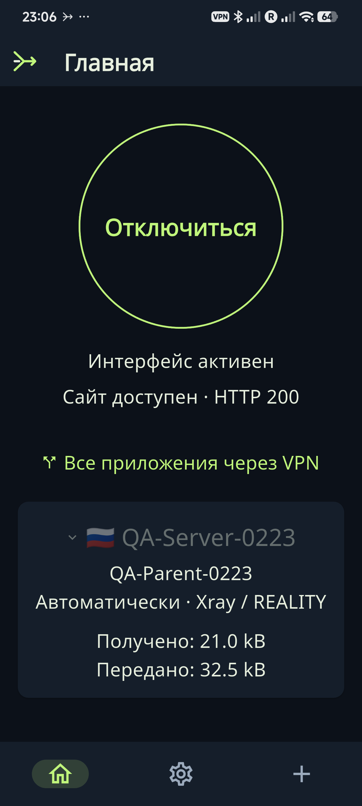
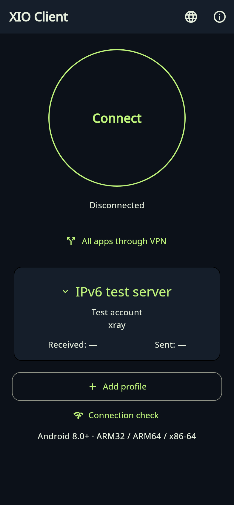
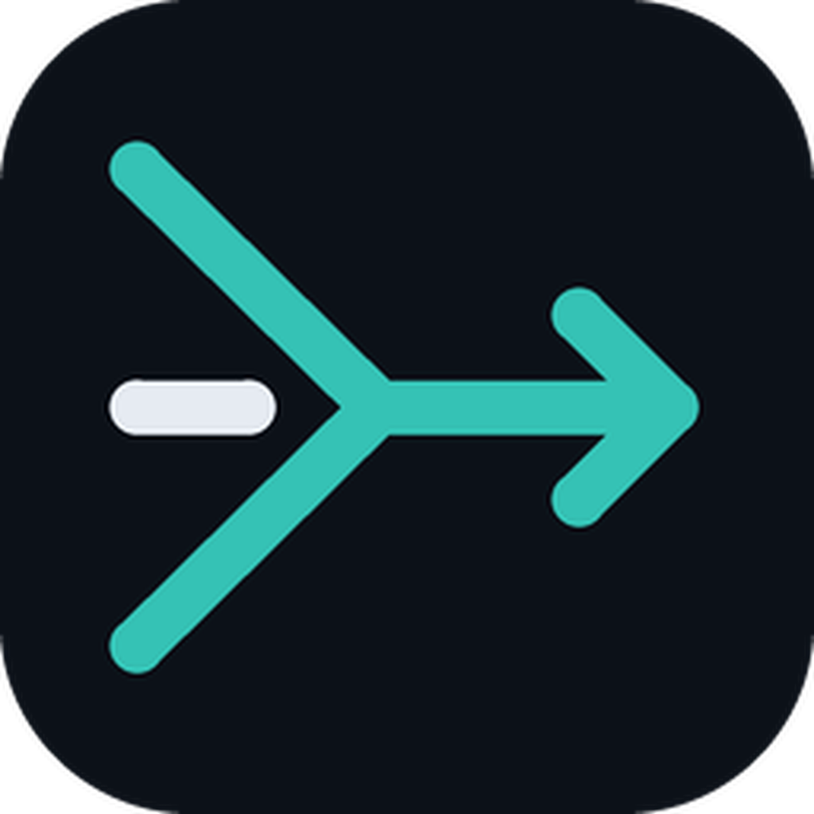
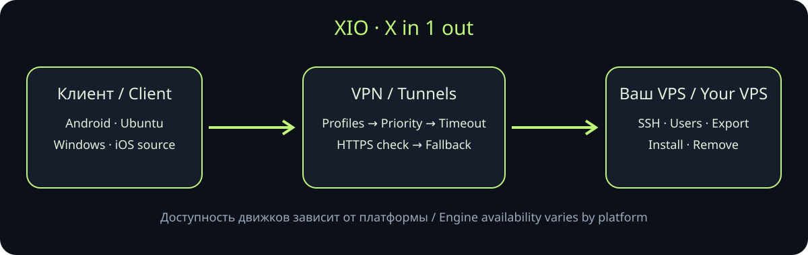
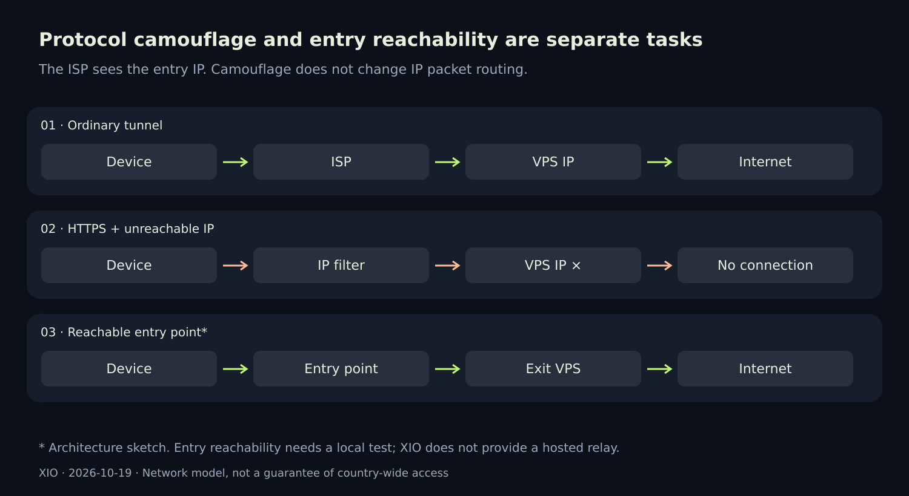

# XIO — X in 1 out

## XIO Client 0.22.4

Yellow-orange client theme and icons; full XIO keeps its green identity. Android APKs, Windows ZIP and Ubuntu DEB/tar.gz. iOS source preparation without an IPA. Full protocol interchangeability remains open: Android 5, Windows/Ubuntu 4, iOS 2 engines.

[Download / Скачать](https://github.com/rukazax/xio_vpn/releases/tag/v0.22.4) · [Matrix / Матрица](docs/compatibility/0.22.4.en.md)

 

## Previous release: XIO and XIO Client 0.22.3

Full XIO provisions and maintains servers. Lightweight XIO Client connects to existing servers and installs alongside the full app. Both use the same home-screen theme: connection, status, server, protocol and traffic. Russian and English are available in both applications.

The client imports profiles, switches connections and applies app or IPv4/IPv6 CIDR rules. Transports are Xray/REALITY, RIVET/H3, RIVET/S1, AmneziaWG and OpenVPN/Cloak. An ordinary profile cannot create other clients. An explicitly authorized account can create and revoke its own children within a server-enforced quota. Child profiles do not inherit the parent token.

Server SSH/root/admin keys are not passed to the client. Delegation uses a separate restricted HTTPS token and a pinned certificate. Physical tests found and corrected DNS, HTTPS service permissions, Android FileProvider and Xray split-routing verification defects.

**Prerelease 0.22.3+5012, server recipe 24.** Tested on a POCO X6 5G running Android 16 and the authorized IPv4 VPS. Public IPv6 is still unverified because that VPS has no IPv6 route. The test record states the remaining scope and build versions. Android 8.0+, ARM32/ARM64/x86-64, plus a universal client APK. Desktop releases are unchanged.

[Download both apps](https://github.com/rukazax/xio_vpn/releases/tag/v0.22.3) · [Client and subclients](client/README.en.md) · [Tests, screens and diagrams](docs/dualstack/0.22.3.en.md)

 

The first image is a physical-device screenshot. The second is a local render of real client widgets using test data. Client FLAG_SECURE remains enabled.

📱 [Physical Android tests: five protocols, the Cloak fix, and the results](docs/blog/2026-10-21-physical-android.en.md)

**English** · [Русский](README.ru.md)

Your VPN, your servers, one interface. Connect a VPS, import supported configurations, create users and share access. When an attempt times out, XIO tries the next available configuration for that user.

[Download](docs/en/downloads.md) · [Guide](docs/en/guide.md) · [Protocols](docs/en/protocols.md) · [Build](docs/en/build.md) · [FAQ](docs/en/faq.md)

## Features

- SSH installation and maintenance of your VPS, user management, revocation and export.
- Automatic detection of supported third-party configuration formats.
- Protocol priority, attempt timeout and HTTPS test; youtube.com is the default.
- Multi-protocol user bundles and delegated administration with active-user limits.
- Android split tunnelling, system theme, icon choices, quick-settings tile and 13 languages.
- VPN tethering on rooted Android; experimental Windows ICS integration with administrator rights.
- Signed client-update metadata and managed-server maintenance with rollback.

## Version 0.22 builds

| Platform | Availability | Client protocols |
|---|---|---|
| Android 8+ | ARM64, ARMv7, x86_64 APKs; ARM64 physically checked on one POCO X6 5G | Xray, RIVET/S1, RIVET/H3, AWG, Cloak |
| Ubuntu x64 | DEB and portable archive; system tests on Ubuntu 24.04 | Xray, RIVET/S1, RIVET/H3, AWG |
| Windows 10/11 x64 | Test ZIP; UI tested in Wine, native driver and ICS still need a Windows test | Xray, RIVET/S1, RIVET/H3, AWG |
| iPhone/iPad | Xcode source project, no signed IPA | RIVET/S1/H3 in source; Apple validation pending |

**Protocols is under Settings → Connection**. Help and licensing remain under About XIO. Standalone WireGuard, OpenVPN, IKEv2, Shadowsocks and Tailscale are removed; OpenVPN remains an internal Cloak dependency.

## What a VPN cannot promise 🔎

The ISP can observe the entry IP even with TLS. A strict allowlist requires reachable ingress; changing a website name alone cannot reach a blocked VPS. This build has not been field-tested on Russian operator networks. RIVET is experimental, without an independent audit or proven browser indistinguishability.

[Changes and reasoning](docs/blog/2026-10-19-restricted-networks.md#english) · [Video review and primary sources](docs/research/2026-10-19-video-protocols.en.md) · [Releases](https://github.com/rukazax/xio_vpn/releases)

Owned code: [GPL-3.0-only](LICENSE). Dependencies keep their licences: [0.22 notices](THIRD-PARTY-0.22.md). Copyright: Константин Александрович Ерёмин, er-ka@mail.ru. [Support XIO](https://x1o.org/pay).

The five-protocol matrix in both apps (20 HTTPS checks) ran on build 5011. Final build 5012 uses the unchanged native engine/AAR and adds secret-free tile lifecycle logs. Build5012 separately passed the tile primary connect/disconnect commands, independent VPN HTTPS and a client Xray control. This does not represent a rerun of the entire matrix on 5012.
