# XIO — X in, 1 out

Одна страница на двух языках · One page in two languages: [Русский](#русский) · [English](#english)

## Русский

XIO — это VPN-система с собственным сервером и двумя приложениями: **XIO Client** для подключения
к готовым серверам и **полный XIO** для развёртывания и обслуживания сервера. Один сервер держит
несколько транспортов одновременно, а клиент импортирует один переносимый профиль `xio://` и сам
выбирает, через что подключаться.

[Download](#что-скачать) · [Как это работает](#как-это-работает) · [Протоколы](#протоколы) · [Методика тестов](#как-мы-тестируем) · [English](README.md)

## Два приложения

| | **XIO Client** | **Полный XIO** |
|---|---|---|
| Для чего | подключаться к уже существующим серверам | ставить и обслуживать свой сервер |
| Оформление | жёлто-оранжевое | зелёное |
| Установка | отдельным пакетом рядом с полным приложением | отдельным пакетом рядом с клиентом |
| Права | нет SSH/root/admin; только scoped-токен на своих субклиентов, если выдан | SSH-провижининг VPS, выпуск/отзыв пользователей, квоты, пакетный экспорт |
| Хранилище | отдельное от полного приложения | своё |

Клиент устанавливается рядом с полным приложением и не получает серверных ключей.

## Полное приложение: свой сервер

Полный XIO — это администрирование сервера, а не подключение к чужому. Приложение по SSH проверяет
машину, ставит серверный пакет, выпускает и отзывает пользователей, считает трафик и обновляет
компоненты. Клиенту полное приложение для работы не нужно.

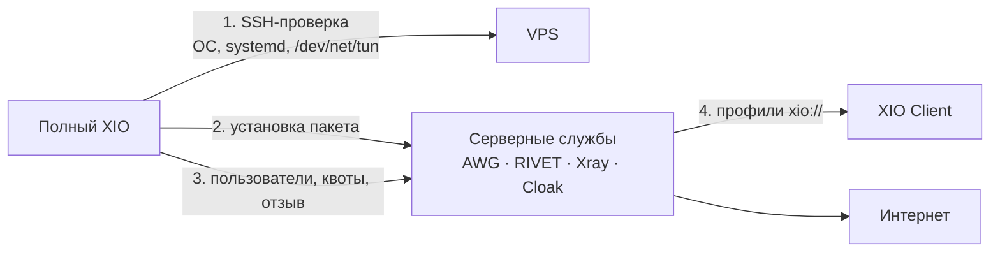

Что делает приложение:

- проверяет сервер до установки: ОС, x86_64, systemd, наличие `/dev/net/tun`, занятые порты;
- ставит серверный пакет из собственного бандла и поднимает службы (AmneziaWG, RIVET, Xray, Cloak);
- выдаёт пользователей и профили, ведёт квоты и отзыв доступа;
- показывает состояние служб, трафик по пользователям и журналы без секретов;
- обновляет сервер и откатывает изменения.

Скриншоты полного приложения (Windows, 26.10.2026):

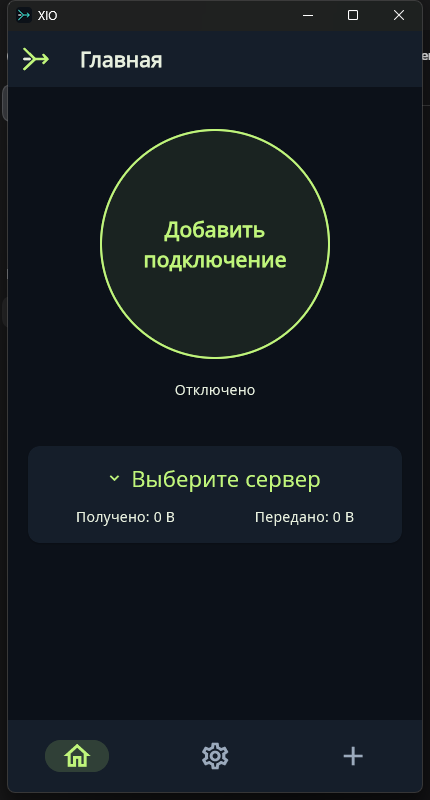 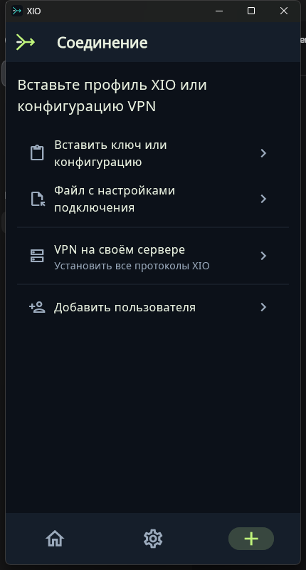 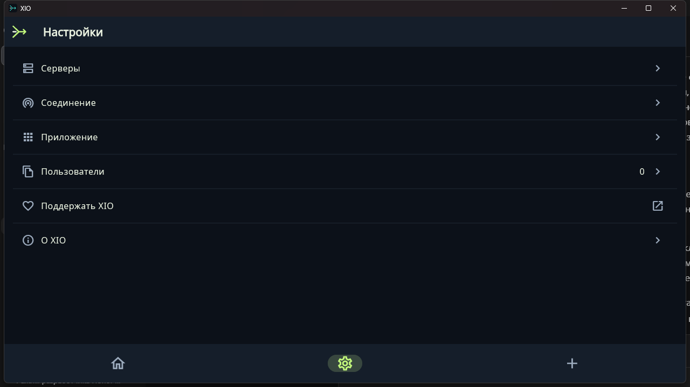

Окно приложения компактное (430×800), как на телефоне: тот же экран без растягивания по ширине.

## Как это работает

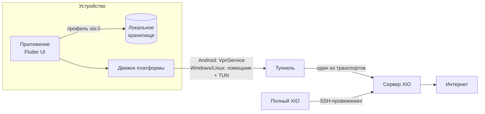

Что происходит по шагам:

1. **Импорт профиля.** Администратор выдаёт файл `xio://` — это base64-контейнер с пользователем,
   сервером и конфигурациями транспортов. Профиль хранится локально в зашифрованном виде
   (Keystore на Android, DPAPI на Windows, AES-GCM с правами файла на Linux).
2. **Выбор транспорта.** Из профиля видно, какие транспорты к этому серверу реально есть. Если
   нужного движка на платформе нет, клиент об этом говорит и не подменяет его другим.
3. **Подключение.** Клиент поднимает TUN, забирает адрес внутри туннеля и направляет трафик
   в выбранный транспорт. На Android используется системный `VpnService`, на Windows/Linux —
   отдельный помощник, который получает права и меняет маршруты только после согласия.
4. **Проверка.** После подъёма интерфейса клиент сам открывает выбранный HTTPS-сайт через туннель.
   Если проверка не проходит — соединение снимается. «Интерфейс активен» без проходящего трафика
   не считается успехом.
5. **Работа.** Сервер принимает трафик, выдаёт адрес в своей внутренней сети и NAT-ит в интернет.

## Протоколы

XIO не переизобретает всё: часть транспортов основана на проверенных реализациях, часть —
собственная разработка. Разные транспорты решают разные задачи: скорость, обход блокировок,
работу там, где UDP закрыт.

| Транспорт | Основа | Транспорт сети | Зачем | Android | Windows | Ubuntu | iOS |
|---|---|---|---|---|---|---|---|
| **AWG** | AmneziaWG (WireGuard + обфускация) | UDP | быстрый повседневный туннель | ✅ | ✅ | ✅ | — |
| **RIVET/H3** | собственная разработка | QUIC / HTTP/3 + TLS 1.3 | стабильный обход там, где режут подозрительный TLS | ✅ | ✅ | ✅ | ✅ |
| **RIVET/S1** | собственная разработка | TCP + TLS 1.3 | тот же туннель для сетей, где UDP закрыт | ✅ | ✅ | ✅ | ✅ |
| **Xray/REALITY** | Xray (VLESS + REALITY) | TCP, маскировка под чужой TLS-сайт | маскировка под настоящий сайт | ✅ | ⚠️ | ⚠️ | — |
| **OpenVPN/Cloak** | OpenVPN внутри Cloak | TCP + TLS-обфускация | «последний шанс» в жёстких сетях | ✅ | — | — | — |

✅ — движок есть и проверялся; ⚠️ — движок объявлен, но на паре «клиент + шлюз 0.23.0» не
подключается (см. ограничения); — — движка нет.

### Что такое RIVET

RIVET — собственная разработка XIO. Идея: дать клиенту два независимых «входа» на одном сервере,
чтобы блокировка одного не убивала доступ.

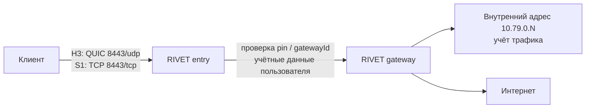

- Два транспорта (**H3** и **S1**) с одной и той же аутентификацией: клиент может переключаться,
  не меняя профиль.
- Сертификат шлюза закрепляется (`pin`), у каждого сервера свой `gatewayId` и внешний CA.
- Пользователь получает `secret` и `entryToken`; родительский токен в субклиента не передаётся.
- Внутренняя адресация — `10.79.0.N`, отдельный учёт трафика на пользователя.

## Что скачать

Единый принцип имён: `XIO-<Приложение>-<версия>-<ОС>-<архитектура>.<расширение>`, где приложение —
`armeabi-v7a`, `x86_64`, `universal`, `x64`.

### XIO Client — подключение к готовым серверам

| Система | Файл | Что это |
|---|---|---|
| Android 8+ · ARM64 | `XIO-Client-0.23.0-android-arm64-v8a.apk` | основной вариант для современных телефонов |
| Android 8+ · ARM32 | `XIO-Client-0.23.0-android-armeabi-v7a.apk` | старые 32-битные устройства |
| Android 8+ · x86-64 | `XIO-Client-0.23.0-android-x86_64.apk` | эмуляторы и x86-планшеты |
| Android 8+ · universal | `XIO-Client-0.23.0-android-universal.apk` | одна сборка для всех архитектур |
| Windows 11 x64 | `XIO-Client-0.23.0-windows-x64.zip` | ZIP: приложение, помощник, Wintun |
| iOS | — | IPA нет: нужны Mac, Xcode и подпись Apple |

Всё лежит в разделе [Releases](https://github.com/rukazax/xio_vpn/releases/tag/v0.23.0):
сборки 0.23.0, [контрольные суммы](https://github.com/rukazax/xio_vpn/releases/download/v0.23.0/SHA256SUMS-0.23.0.txt),
[протокол проверки](https://github.com/rukazax/xio_vpn/releases/download/v0.23.0/verification-0.23.0.json).

### Полный XIO — свой сервер

| Система | Файл | Что это |
|---|---|---|
| Android 8+ · ARM64 | `XIO-Full-0.23.0-android-arm64-v8a.apk` | полное приложение с администрированием |
| Android 8+ · ARM32 | `XIO-Full-0.23.0-android-armeabi-v7a.apk` | старые 32-битные устройства |
| Android 8+ · x86-64 | `XIO-Full-0.23.0-android-x86_64.apk` | эмуляторы |
| Android 8+ · universal | `XIO-Full-0.23.0-android-universal.apk` | одна сборка для всех архитектур |
| Windows 11 x64 | `XIO-Full-0.23.0-windows-x64.zip` | ZIP: приложение, помощник, Wintun |
| iOS | — | нет |

Серверная часть ставится из полного приложения по SSH на Debian 12/13, Ubuntu 22.04/24.04/26.04,
RHEL/Alma/Rocky 9/10 (x86_64, systemd, `/dev/net/tun`).

## Как подключить

1. Возьмите профиль `xio://` у администратора сервера.
2. Установите **XIO Client** (не полное приложение — оно для другого).
3. Откройте приложение → «Добавить профиль» → вставьте ключ или выберите файл.
4. Нажмите «Подключиться». Android один раз спросит разрешение на VPN; Windows — права
   администратора для помощника.
5. Убедитесь, что появилось «Сайт доступен · HTTP 200» и растёт трафик.

Android-экраны не публикуются: приложение ставит `FLAG_SECURE`, и система отдаёт чёрный снимок.
Это защита, а не ошибка.

## Как мы тестируем

Методика построена на одном принципе: **доказательством считается только наблюдаемый результат на
реальном оборудовании, а не успешная сборка.**

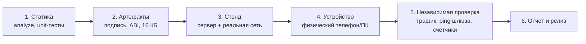

| Уровень | Что проверяется | Чем не является |
|---|---|---|
| Статика | `flutter analyze`, unit/виджет-тесты, Go-тесты, проверка паритета транспортов | не доказывает работу сети |
| Артефакты | подпись APK, `package`/`versionCode`, разрядность и 16 КБ-выравнивание нативного payload | не доказывает подключение |
| Стенд | сервер поднимается штатным бандлом, клиент подключается к нему по реальной сети | не доказывает поведение на телефоне |
| Устройство | установка на физический Android / запуск на Windows | не доказывает маршрут |
| Независимая проверка | HTTPS-проверка внутри туннеля, `ping` до шлюза туннеля, счётчики и `endpoint` на сервере | — |

Правила, которые мы держим:

- Отчёт «интерфейс активен» без проходящего трафика не считается успехом.
- Cross-build, Wine, эмулятор и unit-тесты не заменяют проверку на Windows, физическом Android и
  Ethernet.
- `FAIL`, `BLOCKED` и `NOT_EXECUTED` так и пишутся — не подменяются словом «работает».
- Каждый прогон хранит версию, коммит, устройство, команды и результат отдельно от предыдущих.

Подробнее: [методика и критерии](docs/compatibility/0.23.0.ru.md) ·
[отчёт последнего прогона](docs/blog/2026-10-26-windows-and-ipv6.ru.md).

## Скриншоты

Рендеры интерфейса клиента (тёмная и светлая тема):

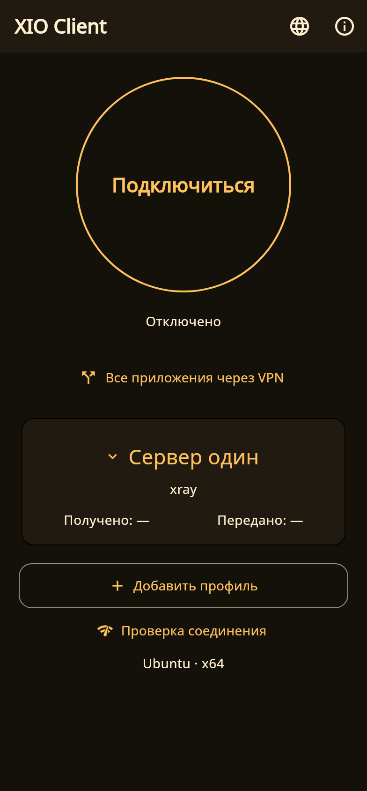 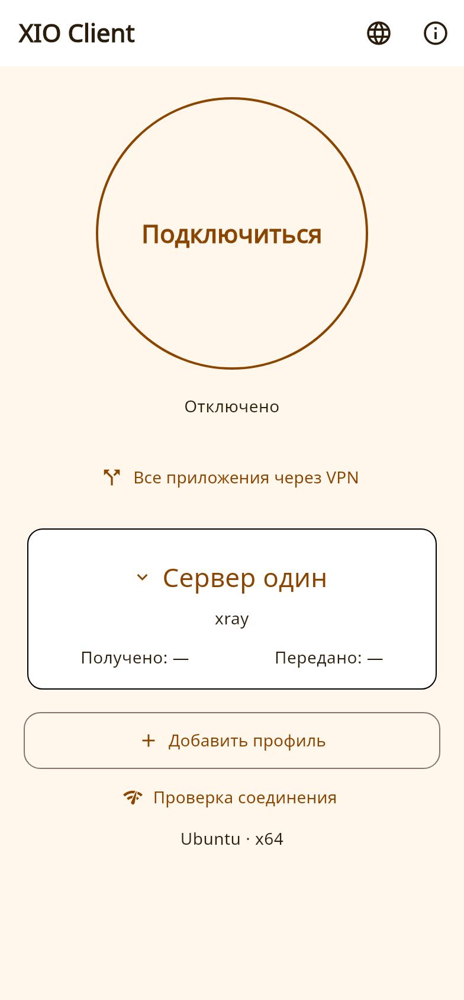

Windows-клиент, реальный запуск 26.10.2026:

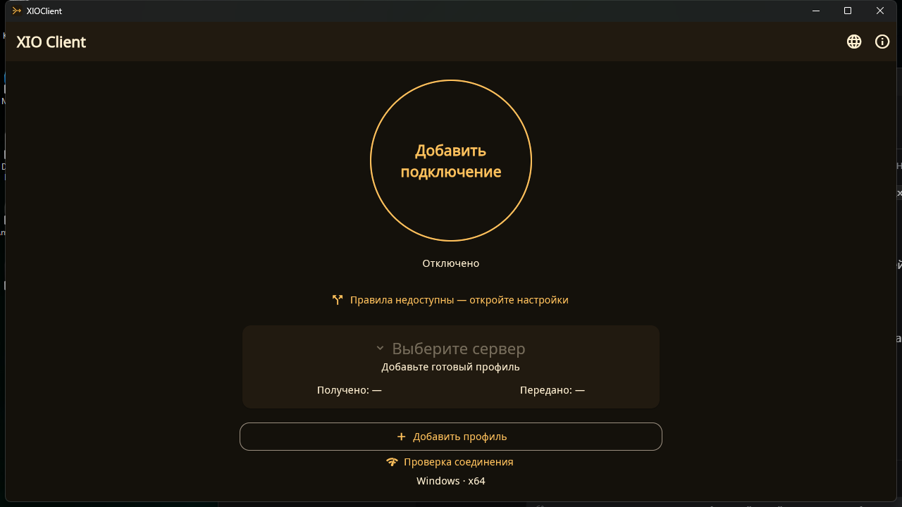

## Ограничения

- **Xray/REALITY не подключается** на паре «клиент 0.23.0 + шлюз Xray 26.7.28»: несовместима
  реализация REALITY в клиентском ядре. AWG и RIVET работают.
- **Публичный IPv6** не проверен. На стенде использовался локальный ULA-префикс, а выход IPv6 из
  туннеля сервер блокирует намеренно.
- **iOS** не собран: нет Mac/Xcode/iPhone, IPA отсутствует.
- **Полная протокольная взаимозаменяемость не достигнута**: Android — 5 транспортов,
  Windows/Ubuntu — 4, iOS — 2.
- **Одновременно с другим VPN** на одной машине XIO не работает: маршруты `/1` конфликтуют.
- Приложение для Windows не подписано сертификатом издателя — SmartScreen предупредит.

## Документация

- [Совместимость и состояние 0.23.0](docs/compatibility/0.23.0.ru.md)
- [Скачать](docs/ru/downloads.md) · [Сборка из исходников](docs/ru/build.md) · [FAQ](docs/ru/faq.md)
- [Как устроены протоколы](docs/protocols/README.md) · [RIVET](RIVET-IMPLEMENTATION-0.2.ru.md)
- [История изменений](CHANGELOG.md) · [Лицензия GPL-3.0-only](LICENSE)

Собственный код — GPL-3.0-only. Сторонние компоненты сохраняют свои лицензии:
[THIRD-PARTY-NOTICES.md](THIRD-PARTY-NOTICES.md).

---

## English

XIO is a VPN system with its own server and two applications: **XIO Client** connects to existing
servers, and **full XIO** deploys and maintains the server. One server serves several transports at
once; the client imports a single portable `xio://` profile and picks the transport itself.

[Download](#download) · [How it works](#how-it-works) · [Protocols](#protocols) · [How we test](#how-we-test) · [Русский](README.ru.md)

## Two applications

> **0.23.0 installs as a separate application.** The packages were renamed (`app.xio.client`, `app.xio.xio`), so Android will not update the previous build in place: export/import your profiles and remove the old version manually. Legacy `x1o://` profiles still import.

| | **XIO Client** | **Full XIO** |
|---|---|---|
| Purpose | connect to servers that already exist | install and maintain your own server |
| Styling | amber/orange | green |
| Installation | separate package next to the full app | separate package next to the client |
| Rights | no SSH/root/admin; only a scoped token for its own subclients when granted | SSH provisioning, user issue/revoke, quotas, batch export |
| Storage | separate from the full application | its own |

The client installs alongside the full application and never receives server keys.

## The full application: your own server

Full XIO administers a server; it is not for connecting to somebody else's. Over SSH it checks the
machine, installs the server package, issues and revokes users, accounts traffic and updates
components. The client does not need the full application to work.

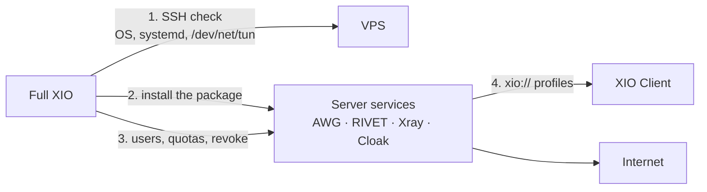

What it does:

- checks the server before installing: OS, x86_64, systemd, `/dev/net/tun`, busy ports;
- installs the server package from its own bundle and starts the services (AmneziaWG, RIVET, Xray,
  Cloak);
- issues users and profiles, enforces quotas and revokes access;
- shows service state, per-user traffic and secret-free logs;
- updates the server and rolls changes back.

Screenshots of the full application (Windows, 2026-10-26):

  

The window is compact (430×800), phone-sized: the same screen without stretching across the width.

## How it works

Step by step:

1. **Import.** The administrator issues an `xio://` file: a base64 container with the user, the
   server and per-transport configurations. It is stored encrypted locally (Keystore on Android,
   DPAPI on Windows, AES-GCM with file permissions on Linux).
2. **Transport choice.** The profile lists which transports really exist for that server. If the
   platform has no engine for one of them, the client says so instead of silently substituting another.
3. **Connect.** The client brings up a TUN interface, takes an address inside the tunnel and routes
   traffic through the chosen transport. Android uses the system `VpnService`; Windows and Linux use a
   separate helper that changes routes only after consent.
4. **Verify.** Once the interface is up, the client opens the selected HTTPS site through the tunnel.
   If the check fails, the connection is dropped. “Interface active” without passing traffic is not a
   success.
5. **Run.** The server accepts the traffic, assigns an internal address and NATs to the internet.

## Protocols

XIO does not reinvent everything: some transports build on proven implementations, one is our own.
Different transports solve different problems: speed, censorship resistance, and networks where UDP
is closed.

| Transport | Basis | Network transport | Purpose | Android | Windows | Ubuntu | iOS |
|---|---|---|---|---|---|---|---|
| **AWG** | AmneziaWG (WireGuard + obfuscation) | UDP | fast everyday tunnel | ✅ | ✅ | ✅ | — |
| **RIVET/H3** | in-house | QUIC / HTTP/3 + TLS 1.3 | resilient access where suspicious TLS is filtered | ✅ | ✅ | ✅ | ✅ |
| **RIVET/S1** | in-house | TCP + TLS 1.3 | the same tunnel for UDP-blocked networks | ✅ | ✅ | ✅ | ✅ |
| **Xray/REALITY** | Xray (VLESS + REALITY) | TCP, masquerades as a real TLS site | camouflage as a genuine site | ✅ | ⚠️ | ⚠️ | — |
| **OpenVPN/Cloak** | OpenVPN inside Cloak | TCP + TLS obfuscation | last resort in strict networks | ✅ | — | — | — |

✅ engine present and tested; ⚠️ declared but does not connect on the 0.23.0 client/gateway pair
(see limitations); — not available.

### What RIVET is

RIVET is our own development. The idea: give the client two independent “entrances” to the same
server, so blocking one does not kill access.

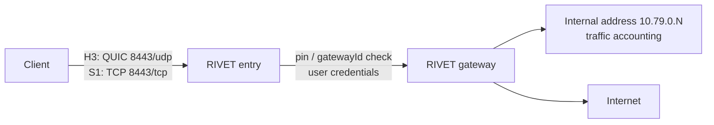

- Two transports (**H3** and **S1**) share one authentication, so the client can switch without
  changing the profile.
- The gateway certificate is pinned (`pin`); every server has its own `gatewayId` and outer CA.
- A user gets a `secret` and an `entryToken`; the parent token is never passed to a subclient.
- Internal addressing is `10.79.0.N` with per-user traffic accounting.

## Download

One naming rule: `XIO-<App>-<version>-<OS>-<arch>.<ext>`, where app is `Client` or `Full`, OS is
`x64`.

### XIO Client — connect to existing servers

| System | File | What it is |
|---|---|---|
| Android 8+ · ARM64 | `XIO-Client-0.23.0-android-arm64-v8a.apk` | the usual choice for modern phones |
| Android 8+ · ARM32 | `XIO-Client-0.23.0-android-armeabi-v7a.apk` | older 32-bit devices |
| Android 8+ · x86-64 | `XIO-Client-0.23.0-android-x86_64.apk` | emulators and x86 tablets |
| Android 8+ · universal | `XIO-Client-0.23.0-android-universal.apk` | one build for all architectures |
| Windows 11 x64 | `XIO-Client-0.23.0-windows-x64.zip` | ZIP: app, helper, Wintun |
| iOS | — | no IPA: needs a Mac, Xcode and Apple signing |

Everything lives in [Releases](https://github.com/rukazax/xio_vpn/releases/tag/v0.23.0): 0.23.0
builds, [checksums](https://github.com/rukazax/xio_vpn/releases/download/v0.23.0/SHA256SUMS-0.23.0.txt),
[verification report](https://github.com/rukazax/xio_vpn/releases/download/v0.23.0/verification-0.23.0.json).

### Full XIO — your own server

| System | File | What it is |
|---|---|---|
| Android 8+ · ARM64 | `XIO-Full-0.23.0-android-arm64-v8a.apk` | full application with administration |
| Android 8+ · ARM32 | `XIO-Full-0.23.0-android-armeabi-v7a.apk` | older 32-bit devices |
| Android 8+ · x86-64 | `XIO-Full-0.23.0-android-x86_64.apk` | emulators |
| Android 8+ · universal | `XIO-Full-0.23.0-android-universal.apk` | one build for all architectures |
| Windows 11 x64 | `XIO-Full-0.23.0-windows-x64.zip` | ZIP: app, helper, Wintun |
| iOS | — | none |

The server is installed from the full application over SSH on Debian 12/13, Ubuntu 22.04/24.04/26.04,
RHEL/Alma/Rocky 9/10 (x86_64, systemd, `/dev/net/tun`).

## How to connect

1. Get an `xio://` profile from the server administrator.
2. Install **XIO Client** (not the full application — that one is for running servers).
3. Open the app → “Add profile” → paste the key or pick the file.
4. Press “Connect”. Android asks for VPN permission once; Windows asks for administrator rights for
   the helper.
5. Make sure “Site reachable · HTTP 200” appears and traffic counters grow.

Android screens are not published: the app sets `FLAG_SECURE`, so the system returns a black image.
That is protection, not a bug.

## How we test

The methodology rests on one rule: **only an observed result on real hardware counts as evidence, not
a successful build.**

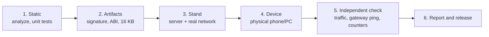

| Level | What is checked | What it is not |
|---|---|---|
| Static | `flutter analyze`, unit/widget tests, Go tests, transport parity gate | does not prove networking |
| Artifacts | APK signature, `package`/`versionCode`, ABI and 16 KB alignment of the native payload | does not prove a connection |
| Stand | the server is installed from the shipped bundle and a client connects over a real network | does not prove phone behaviour |
| Device | install on a physical Android device / run on Windows | does not prove the route |
| Independent check | HTTPS check inside the tunnel, `ping` to the tunnel gateway, server counters and `endpoint` | — |

Rules we keep:

- “Interface active” without passing traffic is not a success.
- Cross-builds, Wine, emulators and unit tests do not replace checks on Windows, physical Android or
  Ethernet.
- `FAIL`, `BLOCKED` and `NOT_EXECUTED` are written as such and never replaced with “works”.
- Every run stores version, commit, device, commands and results separately from previous runs.

More: [methodology and criteria](docs/compatibility/0.23.0.en.md) ·
[latest run report](docs/blog/2026-10-26-windows-and-ipv6.en.md).

## Screenshots

Client UI renders (dark and light):

 

Windows client, real run on 2026-10-26:

## Limitations

- **Xray/REALITY does not connect** on the 0.23.0 client with the Xray 26.7.28 gateway: the REALITY
  implementation in the client core is incompatible. AWG and RIVET work.
- **Public IPv6** is unverified. The stand used a local ULA prefix, and IPv6 egress from the tunnel is
  blocked by the server on purpose.
- **iOS** is not built: no Mac/Xcode/iPhone, no IPA.
- **Full protocol parity is not achieved**: Android has 5 transports, Windows/Ubuntu 4, iOS 2.
- **Alongside another VPN** XIO does not work: the `/1` routes conflict.
- The Windows application is not signed with a publisher certificate, so SmartScreen warns.

## Documentation

- [Compatibility and status 0.23.0](docs/compatibility/0.23.0.en.md)
- [Download](docs/en/downloads.md) · [Build from source](docs/en/build.md) · [FAQ](docs/en/faq.md)
- [Protocol documentation](docs/protocols/README.md) · [RIVET](RIVET-IMPLEMENTATION-0.2.ru.md)
- [Changelog](CHANGELOG.md) · [License GPL-3.0-only](LICENSE)

Original code is GPL-3.0-only. Third-party components keep their own licences:
[THIRD-PARTY-NOTICES.md](THIRD-PARTY-NOTICES.md).
