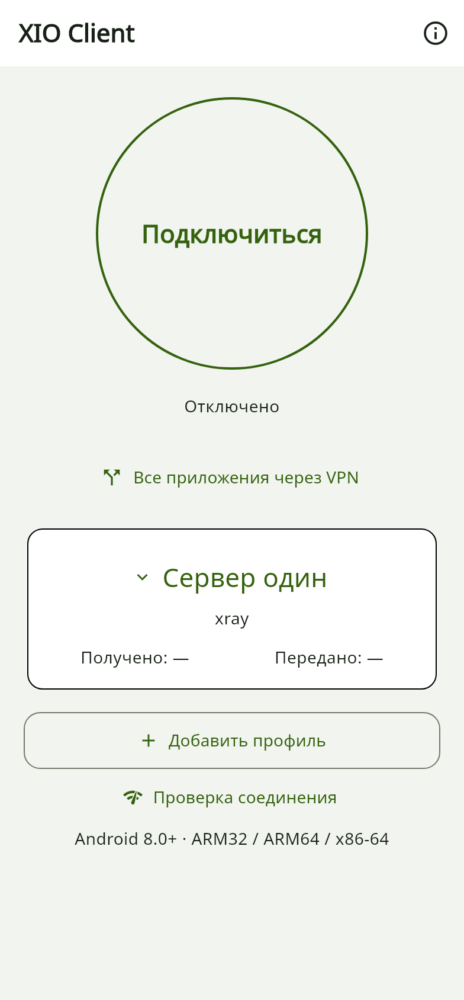
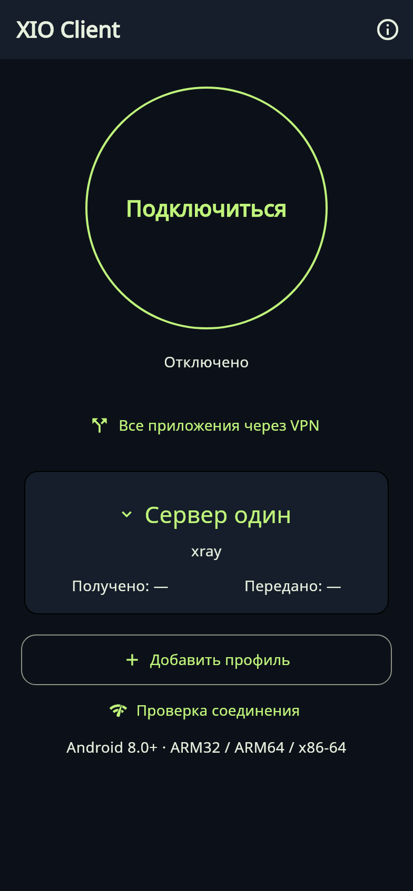

# XIO — X in 1 out

## 0.22.3 candidate: IPv4/IPv6 in both apps

Source and Android builds add IPv4/IPv6 endpoint selection, RIVET IPv6 payloads and server recipe 23. **Physical Android and public IPv6 checks are still pending; no stable release is claimed.** [Both app guides, results, previews and diagrams](docs/dualstack/0.22.3.en.md).

## XIO Client 0.22.2 — connect without administering the server

XIO Client is a separate lightweight Android app for existing VPN servers. Get a profile from the owner, import it, select a server and connect. Users do not need to provision a VPS or enter its SSH key. The client installs alongside the full XIO app.

The home screen shares the full app’s theme: a large connection button, status, server picker, protocol and traffic counters. It supports server switching and split tunnelling by application or IP network. Available transports: Xray, RIVET/S1, RIVET/H3, AmneziaWG and Cloak.

| App | Purpose |
|---|---|
| Full XIO | Owners provision and maintain servers, create accounts, set quotas and issue access. |
| XIO Client | Users connect to existing servers. Accounts explicitly granted the right can create and revoke their own subclients within a server-enforced quota. |

**Subclients.** The page appears after importing an account profile with scoped API access. Each operation checks live rights, revocation, ownership and remaining quota on the server. Ordinary VPN profiles grant no such right. A child gets only its own VPN credentials and cannot create further clients.

**Server keys stay with the owner.** Client-profile export rejects root/admin SSH keys. A random token instead permits only account status and creation/revocation of that account’s children. Android stores it encrypted; the server stores its hash. HTTPS pins the exact certificate. A lost creation response never triggers an automatic retry with a new operation ID.

[Download client and full app 0.22.2](https://github.com/rukazax/xio_vpn/releases/tag/v0.22.2) · [Setup and limits](client/README.en.md) · [Design and changes](docs/blog/2026-10-23-client-0.22.2.en.md)

 

*Local widget-test previews with synthetic profiles; these are not physical-device screenshots.*

Requires **Android 8.0+**. ARM32, ARM64, x86-64 and universal APKs are provided. Subclients require server recipe 21 and a newly issued account profile with a positive quota, using the full Android app 0.22.2. The owner explicitly confirms the separate HTTPS API on TCP 9444. Ordinary VPN connections do not need this API.

This is a **prerelease**. Local checks passed: analysis, 110 general Flutter tests (5 skipped), separately 10 client-mode and 26 server tests, APK signatures, packaged assets and native alignment. The new client and account API have not been tested on physical Android or a live VPS; earlier full-app 0.22.1 tests do not establish that result. The preliminary API needs installation/load validation and a production transport review before mass deployment. Desktop builds remain at 0.22.0.

📱 [Physical Android tests: five protocols, the Cloak fix, and the results](docs/blog/2026-10-21-physical-android.en.md)

**English** · [Русский](README.ru.md)

Your VPN, your servers, one interface. Connect a VPS, import supported configurations, create users and share access. When an attempt times out, XIO tries the next available configuration for that user.

[Download](docs/en/downloads.md) · [Guide](docs/en/guide.md) · [Protocols](docs/en/protocols.md) · [Build](docs/en/build.md) · [FAQ](docs/en/faq.md)

## Features

- SSH installation and maintenance of your VPS, user management, revocation and export.
- Automatic detection of supported third-party configuration formats.
- Protocol priority, attempt timeout and HTTPS test; youtube.com is the default.
- Multi-protocol user bundles and delegated administration with active-user limits.
- Android split tunnelling, system theme, icon choices, quick-settings tile and 13 languages.
- VPN tethering on rooted Android; experimental Windows ICS integration with administrator rights.
- Signed client-update metadata and managed-server maintenance with rollback.

## Version 0.22 builds

| Platform | Availability | Client protocols |
|---|---|---|
| Android 8+ | ARM64, ARMv7, x86_64 APKs; ARM64 physically checked on one POCO X6 5G | Xray, RIVET/S1, RIVET/H3, AWG, Cloak |
| Ubuntu x64 | DEB and portable archive; system tests on Ubuntu 24.04 | Xray, RIVET/S1, RIVET/H3, AWG |
| Windows 10/11 x64 | Test ZIP; UI tested in Wine, native driver and ICS still need a Windows test | Xray, RIVET/S1, RIVET/H3, AWG |
| iPhone/iPad | Xcode source project, no signed IPA | RIVET/S1/H3 in source; Apple validation pending |

**Protocols is under Settings → Connection**. Help and licensing remain under About XIO. Standalone WireGuard, OpenVPN, IKEv2, Shadowsocks and Tailscale are removed; OpenVPN remains an internal Cloak dependency.

## What a VPN cannot promise 🔎

The ISP can observe the entry IP even with TLS. A strict allowlist requires reachable ingress; changing a website name alone cannot reach a blocked VPS. This build has not been field-tested on Russian operator networks. RIVET is experimental, without an independent audit or proven browser indistinguishability.

[Changes and reasoning](docs/blog/2026-10-19-restricted-networks.md#english) · [Video review and primary sources](docs/research/2026-10-19-video-protocols.en.md) · [Releases](https://github.com/rukazax/xio_vpn/releases)

Owned code: [GPL-3.0-only](LICENSE). Dependencies keep their licences: [0.22 notices](THIRD-PARTY-0.22.md). Copyright: Константин Александрович Ерёмин, er-ka@mail.ru. [Support XIO](https://x1o.org/pay).
