<p align="center">
  <a href="https://github.com/rukazax/xio_vpn">
    
  </a>
</p>

<h1 align="center">XIO</h1>

<p align="center"><b>X in, 1 out.</b> Your VPN, your servers, one interface.</p>

<p align="center">Android &middot; Windows 11 &middot; Ubuntu &middot; Linux server &middot; five transports &middot; IPv4 + IPv6</p>

<p align="center">
  <a href="https://github.com/rukazax/xio_vpn/releases"></a>
  <a href="LICENSE"></a>
  <a href="#clients-by-platform"></a>
  <a href="#five-transports"></a>
  <a href="#ipv4-and-ipv6"></a>
  <a href="docs/compatibility/0.24.0.en.md"></a>
</p>

<p align="center">
  <a href="README.md">English</a> |
  <a href="README.ru.md">Русский</a>
</p>

XIO is a self-hosted VPN system in three parts. **XIO Client** connects to servers that already
exist. **Full XIO** deploys and maintains your own server over SSH. The **server payload** serves
five transports at once. One portable `xio://` profile carries every transport the server offers;
the client picks the one that works on the current network and switches without a new profile.

No subscription, no account on someone else's backend, no built-in server catalogue. You bring a
VPS, XIO brings the rest.

[What this is](#what-this-is) &middot; [Features](#features) &middot; [Transports](#five-transports) &middot;
[IPv4 and IPv6](#ipv4-and-ipv6) &middot; [Cascade](#cascade-two-servers-ipv4--ipv6) &middot; [Install a server](#install-a-server) &middot;
[Clients](#clients-by-platform) &middot; [Split tunnelling](#split-tunnelling) &middot; [Security](#security) &middot;
[FAQ](#faq) &middot; [Limitations](#limitations-what-is-not-verified) &middot; [Русский](README.ru.md)

---

## What this is

| Part | What it does | Runs on |
|---|---|---|
| **XIO Client** | Imports `xio://`, chooses a transport, brings up the tunnel, verifies traffic. No SSH, no server keys. | Android 8+, Windows 11 x64, Ubuntu 22.04+ |
| **Full XIO** | SSH preflight, install, update and removal of the server; users, quotas, revocation, traffic. | Android, Windows, Ubuntu |
| **Server payload** | AmneziaWG, RIVET, Xray, Cloak, OpenVPN, counters, firewall, dual-stack routing. | Linux x86_64 VPS with systemd and `/dev/net/tun` |

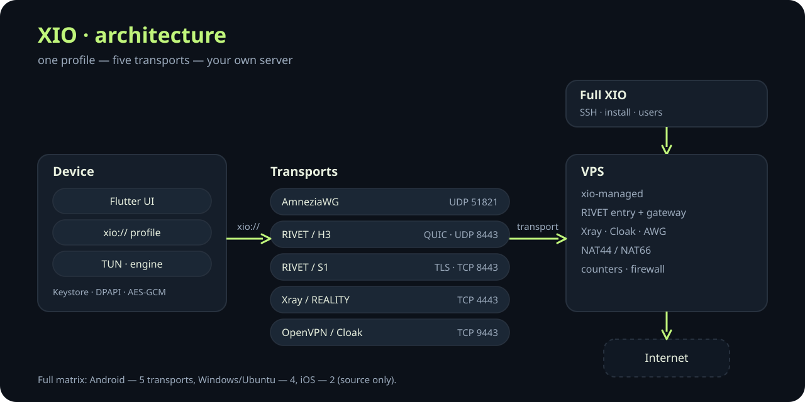

Five steps from a profile to traffic:

1. **Import.** The administrator issues an `xio://` file: a base64 container with the user, the
   server and per-transport configurations. It is stored encrypted: Android Keystore (excluded
   from backups), Windows DPAPI, Ubuntu AES-GCM with file permissions, iOS Keychain.
2. **Choose.** The profile lists the transports that really exist for that server. If the platform
   has no engine for one of them, the client says so instead of silently substituting another.
3. **Connect.** The client creates a TUN interface, takes an address inside the tunnel and routes
   traffic through the chosen transport. Android uses the system `VpnService`; Windows and Ubuntu
   use a separate privileged helper that changes routes only after consent.
4. **Verify.** The tunnel is confirmed by a fresh exchange, growing counters and a DNS lookup
   through the tunnel. The HTTPS site probe is optional and off by default.
5. **Run.** The server accepts the traffic, assigns an internal address and NATs it to the internet.

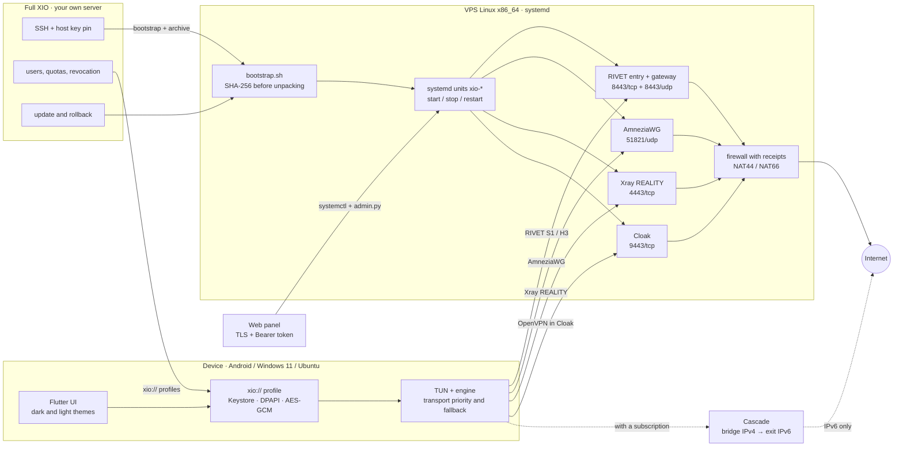

The diagram also exists as a standalone file: [docs/landing/architecture.mmd](docs/landing/architecture.mmd).

## Features

### XIO Client

- **Portable profile.** One `xio://` file for every transport of one server; import from a file or
  paste the key. Imports accept client material only: no listeners, API servers, executable
  commands, filesystem paths or direct/freedom outbounds.
- **Transport priority and fallback.** The selected profile goes first, then variants of the same
  endpoint with another protocol, then other profiles. A blocked protocol is replaced before the
  entry point changes, so the VPS address is not lost. The default first choice is Xray/REALITY, on
  iOS RIVET/S1; the order is configurable and unavailable engines are skipped.
- **Live link watchdog.** While you want the tunnel, the link is checked every 15 seconds. After two
  consecutive misses the client reconnects, retrying after 5 seconds (the first three attempts) and
  15 seconds afterwards until the server returns.
- **Honest verification.** "Interface active" alone is not a success: traffic counters and DNS
  through the tunnel must move. The site probe is an extra you can enable; with it off, the tunnel
  is confirmed by the handshake, counters and DNS.
- **Split tunnelling.** Include or exclude selected applications, and add IP/CIDR rules in either
  direction. Domain rules are not supported.
- **Subclients.** An explicitly granted account token can check quota and create or revoke only its
  own children through the server HTTPS API with a pinned certificate. A child export contains only
  that child's VPN keys and never the parent capability or SSH/root keys.
- **VPN sharing.** Android: requires root, IPv4 goes into the tunnel, DNS is redirected to
  `9.9.9.9`, IPv6 sharing is blocked. Windows: ICS-based, experimental and not verified on a live
  Windows host. Ubuntu and iOS: not available.
- **13 UI languages** with offline catalogues, dark and light themes.
- **Updates.** One check per week with a random offset; a release can be skipped. Metadata signature
  and package hash are verified before installation; Android installs through the system installer.
- **Privacy by default.** No advertising or analytics SDK, no automatic crash reporting, no
  built-in server catalogue, no endpoint geolocation. Android screens are protected with
  `FLAG_SECURE`.

### Full XIO

- **Preflight before touching the server:** OS family and version, x86_64, systemd, `/dev/net/tun`,
  busy VPN ports, subnet conflicts, existing VPN interfaces and `/etc/wireguard/xio0.conf`.
- **Install from its own bundle.** The bootstrap verifies the archive SHA-256 before unpacking; a
  truncated or substituted stream is refused instead of being unpacked as root.
- **Users and quotas.** Issue and revoke users, limit the number of active records for delegated
  admins, export profiles in batch, and keep child ownership scoped to the creator.
- **Traffic accounting.** Per-user monthly bytes and online state from server counters sampled
  every 30 seconds; RIVET, AWG and OpenVPN are counted separately.
- **Service state and secret-free logs.** Which units are active, which failed and what the server
  advertises — without keys or passwords in the output.
- **Update and rollback.** The server is updated only while the VPN is off, with saved SSH
  credentials and a matching host key; users and keys survive, and a failed update rolls back.
- **Removal that cleans up after itself.** Only XIO-owned units, rules and keys are removed; IP
  forwarding is restored and shared packages are kept.

#### Your own cascade servers 🛠️

The cascade used to be a demo only. The app now lets you configure your own pair: open the
**Cascade** screen, tap the **DNS** icon in the app bar and set the **Bridge** address (IPv4 or
domain, e.g. `81.177.142.37`) and the **Exit** address (IPv6 only, e.g. `2a0c:b641:1a0:800::2a2`).
Validation rejects schemes, ports, IPv6 in the bridge field, IPv4 in the exit field and values
like `999.1.1.1`.

The addresses are stored in the app profile, the route stations display them, and the dialog shows
the exact install command with your exit:

```bash
curl -fsSL https://raw.githubusercontent.com/rukazax/xio_vpn/main/deploy/cascade/terminal-install.sh \
  | bash -s -- --role bridge --exit-host 2a0c:b641:1a0:800::2a2
```

The "Copy command" button puts it on the clipboard. Subscription and server failover are still stubs.

## Server payload

- Five transports on one host, each with its own port and its own systemd unit.
- Managed firewall with receipts: every added rule is recorded and removed precisely; forwarding is
  scoped to the owned interfaces.
- Dual-stack: IPv4 and IPv6 listeners, NAT44 and NAT66, per-interface IPv6 subnets.
- systemd hardening: `LoadCredential` and `${CREDENTIALS_DIRECTORY}` instead of `%d` in unit files,
  `ProtectSystem=strict` where the kernel allows it, an explicit compatibility mode where it does not.
- Counters every 30 seconds; `status` returns a snapshot instead of running `wg` on every request.
- Restricted mode for IPv6-only VPS: no kernel WireGuard, no IPv4 default route, only the ports that
  can actually work.

More detail, examples and diagrams: [docs/features.md](docs/features.md).

## Five transports

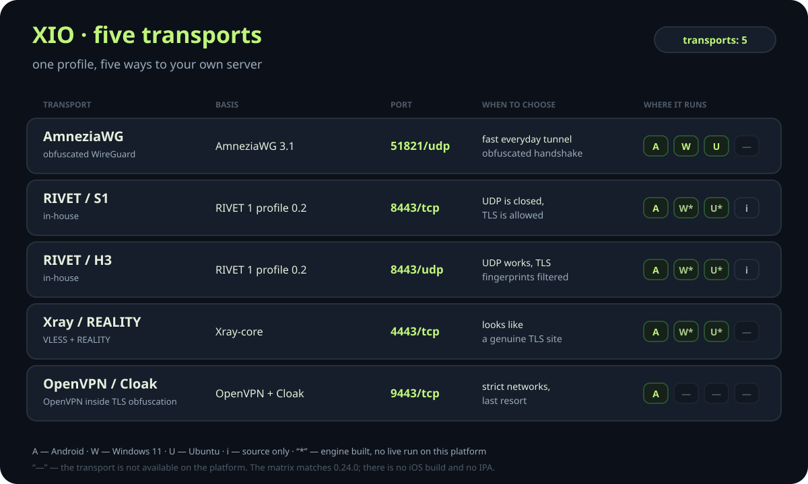

XIO does not reinvent cryptography: each transport builds on a proven implementation, and RIVET is
our own. The transports solve different problems: speed, camouflage, and networks where UDP is
closed.

| Transport | Basis | Outer transport | Port | Use when | Android | Windows | Ubuntu | iOS |
|---|---|---|---|---|---|---|---|---|
| **AmneziaWG** | AmneziaWG 3.1 (WireGuard + obfuscation) | UDP | 51821 | fast everyday tunnel, obfuscated handshake | yes | yes | yes | - |
| **RIVET / S1** | in-house | TCP + TLS 1.3 | 8443/tcp | UDP is blocked, TLS is allowed | yes | yes* | yes* | source |
| **RIVET / H3** | in-house | QUIC / HTTP/3 + TLS 1.3 | 8443/udp | UDP works, TLS fingerprint filtering | yes | yes* | yes* | source |
| **Xray / REALITY** | Xray VLESS + REALITY | TCP | 4443/tcp | camouflage as a genuine TLS site | yes | yes* | yes* | - |
| **OpenVPN / Cloak** | OpenVPN inside Cloak | TCP + TLS obfuscation | 9443/tcp | strict networks, last resort | yes | - | - | - |

`yes` — engine present and a native run on this platform was performed; `yes*` — engine built, no
native run on this platform; `source` — engine in source, no Apple build; `-` — not available.
Android has five transports, Windows and Ubuntu four, iOS two.

The order is arranged so the protocol changes before the entry point: selected profile → same
endpoint with another transport → other profiles.

### AmneziaWG

WireGuard with an obfuscated handshake: fixed message headers are replaced, junk packets are
inserted and handshake sizes are randomised (`Jc`, `Jmin`, `Jmax`, `S1`, `S2`, `H1`–`H4`). It is
still a UDP tunnel: blocking all UDP also blocks AWG. The server runs the userspace
`xio-amneziawg-go` for `xioawg0`; plain WireGuard (`xio0`) uses the kernel module and exists only in
non-restricted installs.

### RIVET

Our own development: two independent entrances to the same server, so blocking one does not kill
access.

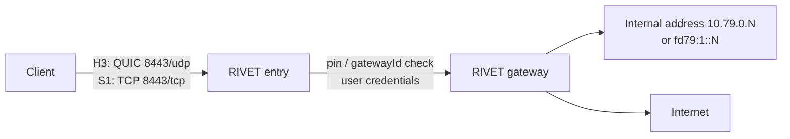

- Two transports (**H3** and **S1**) share one authentication, so the client switches without
  changing the profile.
- The gateway certificate is pinned (`pin`); every server has its own `gatewayId` and outer CA.
- A user gets a `secret` and an `entryToken`; the parent token is never passed to a subclient.
- Internal addressing is `10.79.0.N` with per-user traffic accounting, plus `fd79:1::/64` when the
  server advertises IPv6.

### Xray / REALITY

VLESS with REALITY: the server presents a real TLS site's parameters and the client verifies the
expected certificate/SNI pair. On the wire it looks like ordinary HTTPS. On the tested pair
"client 0.23.x + gateway Xray 26.7.28" REALITY does not connect; see
[Limitations](#limitations-what-is-not-verified).

### OpenVPN / Cloak

OpenVPN wrapped in Cloak's TLS obfuscation. It exists for networks where only TCP/443-like traffic
is allowed and is the client's last resort. Only Android declares the Cloak engine.

### Server-side transports

WireGuard, Shadowsocks and IKEv2 are installed on the server but not offered by the XIO client.
They exist for compatibility with other clients and for restricted deployments.

| Port | Protocol | Service | Notes |
|---|---|---|---|
| 8443/tcp + 8443/udp | TCP / QUIC | RIVET S1 and H3 | TLS 1.3, pinned gateway certificate |
| 4443/tcp | TCP | Xray / REALITY | VLESS, masquerades as a real site |
| 9443/tcp | TCP | Cloak | OpenVPN TCP behind TLS obfuscation |
| 1194/udp | UDP | OpenVPN UDP | direct, no Cloak |
| 1195/tcp | TCP | OpenVPN TCP | loopback only, exposed through Cloak |
| 51821/udp | UDP | AmneziaWG | obfuscated WireGuard |
| 51820/udp | UDP | WireGuard | non-restricted installs only |
| 8388/tcp + 8388/udp | TCP/UDP | Shadowsocks | server-side only |
| 500/udp, 4500/udp | UDP | IKEv2 / IPsec | server-side only |
| 9444/tcp | TCP | Account API | only when an account token is granted |

Deep dives: [protocol notes](docs/en/protocols.md) · [RIVET library](docs/protocols/README.md) ·
[RIVET implementation 0.2 (RU)](RIVET-IMPLEMENTATION-0.2.ru.md).

## IPv4 and IPv6

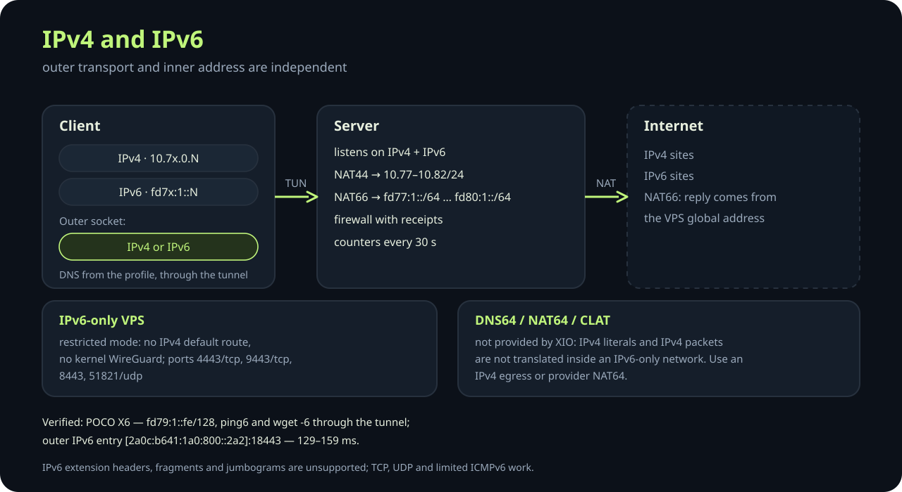

The outer transport and the inner address are independent:

- An endpoint may be an IPv4 address, an IPv6 address, or a domain with A and/or AAAA records.
- Xray and Cloak try both address families. RIVET tries them sequentially, because concurrent
  authorisation of one identity can replace a peer.
- RIVET/S1, RIVET/H3, AmneziaWG and OpenVPN carry IPv4 and IPv6 inside the tunnel. IPv6 addresses
  are issued only by a server that explicitly advertises support.
- Managed addressing, forwarding and NAT66 require real provider routing. Only owned changes are
  made, each with a receipt and a precise rollback.
- DNS comes from the profile and goes through the tunnel.
- **XIO does not provide DNS64, NAT64 or CLAT.** IPv4 literals and IPv4 packets are not translated
  inside an IPv6-only network; such a host needs an IPv4 egress or provider-side NAT64.
- IPv6 extension headers, fragments and jumbograms are not supported. TCP, UDP and limited ICMPv6 are.

| Transport | IPv4 subnet | IPv6 subnet |
|---|---|---|
| WireGuard (non-restricted) | `10.77.0.0/24` | `fd77:1::/64` |
| AmneziaWG | `10.78.0.0/24` | `fd78:1::/64` |
| RIVET | `10.79.0.0/24` | `fd79:1::/64` |
| OpenVPN UDP | `10.80.0.0/24` | `fd80:0::/64` |
| OpenVPN TCP | `10.81.0.0/24` | `fd80:1::/64` |
| IKEv2 / IPsec | `10.82.0.0/24` | - |

### IPv6-only VPS

`restrictedNetwork` mode is for a server that has no IPv4 default route:

- no kernel WireGuard and no `xio0`; AmneziaWG runs in userspace;
- only transports that can work are installed: AWG, RIVET, Xray, Cloak, OpenVPN TCP;
- the firewall opens `4443/tcp`, `9443/tcp`, `8443`, `51821/udp` — not the IPv4-only set;
- the preflight records `outboundByFamily: {ipv6: eth0}` and reports `ipv4DefaultRoute: false`
  instead of pretending the host is dual-stack.

Verified on a VPS with global IPv6 `2a0c:b641:1a0:800::2a2`: the client receives `fd79:1::fe/128`,
`ping6` and `wget -6` pass through the tunnel, and the answer comes from the VPS global address
(NAT66). The outer IPv6 entry `[2a0c:b641:1a0:800::2a2]:18443` connected in 129–159 ms.

## Cascade: two servers, IPv4 → IPv6

A paid feature (subscription stub for now): the device reaches **bridge** over IPv4, the bridge
keeps a protected **IPv6-only** tunnel to an **exit** server, and traffic leaves from an IPv6-only
network.

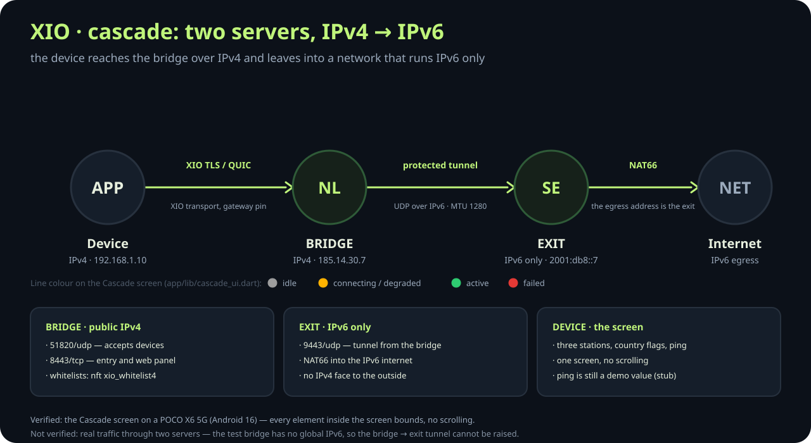

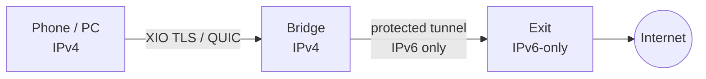

**What the app shows.** One screen, no scrolling, entirely inside the phone screen
(`app/lib/cascade_ui.dart`):

- three stations — device → bridge → exit — with country flags from the ISO code;
- state lines: grey idle, yellow connecting or degraded, green active, red failed;
- a status block — "Latency", "Egress IPv6", "Updated" — and a "Check cascade" button that
  really probes the bridge over SSH (up to 15 s) and reports whether the tunnel is alive, the
  measured response time, the real egress IPv6 and the failure reason;
- a "Paid feature. Subscription required" plate and an "Activate" button.

| Cascade screen with configured addresses | "Cascade servers" dialog |
|---|---|
| 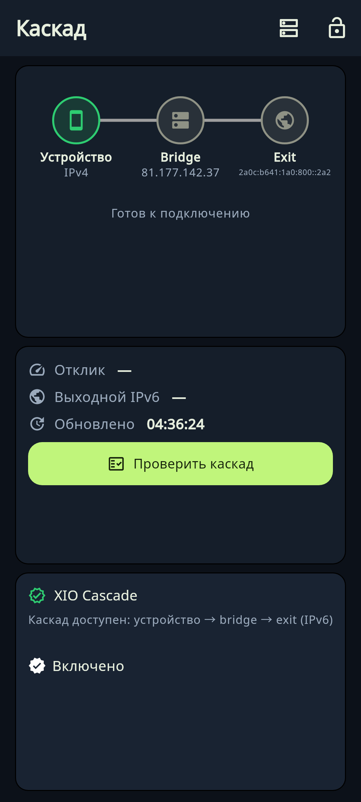 | 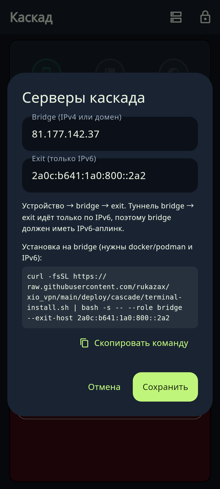 |

After "Check cascade" the same screen shows the result of the check: latency, the egress IPv6
and the time the server answered.

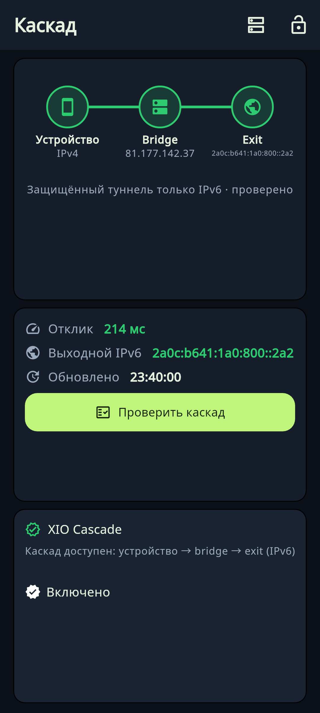

These are real renders of the screen produced by a widget test
([docs/screenshots/README.md](docs/screenshots/README.md), section 1), not mockups. The frame
shows the subscription plate in its active state even though the subscription itself is still a
stub (`CascadeFeatureGate.enabled == false`).

**One command on the server:**

```bash
curl -fsSL https://raw.githubusercontent.com/rukazax/xio_vpn/main/deploy/cascade/terminal-install.sh \
  | sudo bash -s -- --role bridge --exit-host <ipv6-exit>
```

The script downloads the installer over HTTPS, verifies sha256 **before** running it, requires root
and logs to `/var/log/xio-cascade-install.log` (mode 600). Roles: `bridge`, `exit`, `both`. From the
app the cascade is enabled by the "Enable cascade (subscription)" checkbox in the server setup form;
it passes `--enable-cascade` and the usual SSH flow takes over.

| What | Where |
|---|---|
| Installer (bridge/exit/both, container) | `deploy/cascade/` |
| Terminal install | `deploy/cascade/terminal-install.sh` |
| Health check | `deploy/cascade/cascade-healthcheck.sh` → `/var/lib/xio-cascade/health.json` |
| Whitelists on the bridge | `deploy/cascade/whitelist-update.sh`, weekly timer |
| Server web UI (TLS + token) | `server/webui/` |
| Full description and diagram | [docs/cascade/README.md](docs/cascade/README.md) |

> **What is not verified:** real traffic through two servers. The test bridge (81.177.142.37) has no
> global IPv6, so the bridge → exit tunnel (2a0c:b641:1a0:800::2a2) cannot physically be raised. The
> scripts were checked for bash syntax and branching logic, never on a live server pair. The
> subscription is a stub: `CascadeFeatureGate.enabled == false`.

## Install a server

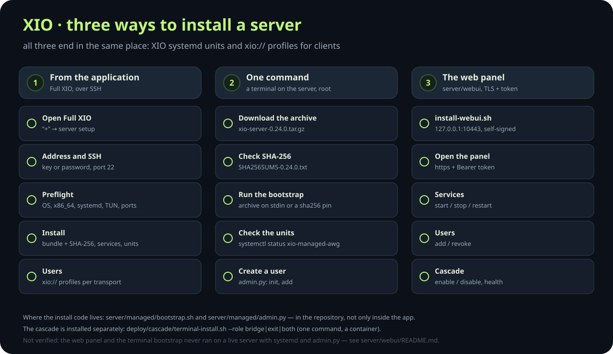

**A clean VPS is required:** x86_64, Debian 12/13, Ubuntu 22.04/24.04/26.04, or RHEL/Alma/Rocky
9/10, systemd, `/dev/net/tun`, no other VPN on the host.

### 1. From the app (recommended)

1. Open **Full XIO** → "+" → server setup.
2. Enter the address and SSH credentials (key or password).
3. The preflight checks OS, architecture, systemd, TUN, ports and subnets.
4. Install: the app uploads its own bundle, verifies the digest, installs the services and reports
   the unit state.
5. Create users and export their `xio://` profiles.

### 2. One command in a terminal

The bootstrap reads the archive from stdin. Take both names from the
[Releases](https://github.com/rukazax/xio_vpn/releases) page — a release candidate carries a `-rcN`
suffix in the tag while its asset keeps the plain version number, so they are separate variables:

```bash
TAG=0.24.1-rc13                  # tag on the release page, without the leading "v"
FILE=xio-server-0.24.1.tar.gz    # asset name on that release
curl -fsSLo xio-server.tar.gz \
  "https://github.com/rukazax/xio_vpn/releases/download/v${TAG}/${FILE}"
curl -fsSLo xio-bootstrap.sh \
  https://raw.githubusercontent.com/rukazax/xio_vpn/main/server/managed/bootstrap.sh
sudo XIO_EXPECTED_ARCHIVE_SHA256="<sha256 from SHA256SUMS>" \
  bash xio-bootstrap.sh < xio-server.tar.gz
```

If `v0.24.1` is already published, use it as `TAG` — the stable tag has no `-rc` suffix.

Without `XIO_EXPECTED_ARCHIVE_SHA256` the bootstrap still refuses a broken archive, but the digest
pin is what makes a substituted stream stop before it is unpacked as root. Take the hash from
`SHA256SUMS-<version>.txt` on the release page.

> **Server package versions matter.** 0.23.1 shipped a payload that failed the firewall step
> (`iptables: Can't use -i with POSTROUTING`) and broke `status` on IPv6-only hosts. 0.24.0 fixed
> that but its packager left `readiness.py` and `xio-ready.service` out of the tarball, so an
> install on a clean host ended with exit code 1 on the last step. Both are fixed in 0.24.1
> (`RECIPE` 26). For a new server take **0.24.1 or newer**.

### 3. The web panel

```bash
sudo ./install-webui.sh                 # https://127.0.0.1:10443
sudo ./install-webui.sh 0.0.0.0:10443   # all interfaces, behind a reverse proxy only
```

The script prints the URL with a token, the token itself and the certificate SHA-256 fingerprint.
Services, users and the cascade are managed from one page; the panel speaks TLS only, uses a
Bearer token plus a `SameSite=Strict` cookie and requires a CSRF header for POST. Details:
[server/webui/README.md](server/webui/README.md).

### What ends up on the server

| Path | Contents |
|---|---|
| `/usr/local/lib/xio-managed` | server code: `admin.py`, `stack.py`, `network_stack.py`, `dualstack.py`, binaries |
| `/etc/xio-managed/deployment.json` | deployment state: host, users, keys, counters, receipts — without per-client configs |
| `/etc/xio-rivet` | RIVET public state and installer receipt |
| `/usr/local/lib/xio-rivet` | RIVET binary and setup script |
| `/var/lib/xio-stack` | stack counters and runtime state |

Units: `xio-managed-awg`, `xio-managed-stats.timer`, `xio-rivet-entry`, `xio-rivet-gateway`,
`xio-stack`, `xio-cloak`, `xio-openvpn-udp`, `xio-openvpn-tcp`, `xio-ikev2`, `xio-client-api`,
`xio-ready`.

Administration is JSON on stdin:

```sh
printf '%s\n' '{"action":"status","serverId":"<id>"}' \
  | python3 /usr/local/lib/xio-managed/admin.py
```

| Action | What it does |
|---|---|
| `init` | first installation; `host` and `restrictedNetwork` are required |
| `inspect` | public server description and phase |
| `status` | services, counters, users, monthly traffic |
| `add` | create a user and return per-transport configs |
| `revoke` | revoke a user and its children |
| `remove` | remove only XIO-owned units, rules, keys and packages |
| `client-grant` | issue a scoped account token for subclients |

## Clients by platform

`XIO-<App>-<version>-<OS>-<arch>.<ext>`. `App` is `Client` or `Full`, `OS` is `android`, `windows`
or `ubuntu`, architecture is `arm64-v8a`, `armeabi-v7a`, `x86_64`, `universal`, `amd64` or `x64`.

Everything is on the [Releases](https://github.com/rukazax/xio_vpn/releases) page, including
`SHA256SUMS` files. Verify with `sha256sum -c SHA256SUMS-<version>.txt` or
`Get-FileHash <file> -Algorithm SHA256`.

### Android — Full or Client?

| | **XIO Full** (`app.xio.xio`) | **XIO Client** (`app.xio.client`) |
|---|---|---|
| Connect to an existing server | yes | yes |
| Own server over SSH | yes | no |
| Users, quotas, revocation | yes | no (subclients only, if granted) |
| VPN sharing | yes | no |
| Five transports | yes | yes |
| Package size | ~58 MB | ~57 MB |

Android 8+; ARM64 is the usual choice, ARM32 for old devices, x86_64 for emulators, `universal` if
you do not want to think about it. Open the APK, allow installation from this source, and the
update installs over the previous version keeping profiles.

On MIUI/HyperOS `adb install` may answer `INSTALL_FAILED_USER_RESTRICTED`. The working path:

```bash
APK=XIO-Full-<version>-android-arm64-v8a.apk
adb push "$APK" /data/local/tmp/xio.apk
adb shell pm install -r -g /data/local/tmp/xio.apk
```

Android 0.24.1 is `0.24.1+5018`, signed with `CN=x1o Development` (SHA-256 `e4e81b12…c9671`), so it
updates over 0.23.x/0.24.x without uninstalling. The newest APKs on the Releases page are 0.24.0 —
the 0.24.1 Android set is being prepared, and its notes are in
[docs/release-notes-0.24.1-mobile.md](docs/release-notes-0.24.1-mobile.md).

### Windows 11 x64

Fully unpack the ZIP and run `XIO.exe`. The helper `libexec\xio-tunnel.exe` starts elevated: it
needs that to create the network interface. Wintun is included with its licence. Four transports
(no Cloak). The build is not signed with a publisher certificate, so SmartScreen warns — that is
expected.

- Full XIO for Windows: in the 0.24.0 release.
- XIO Client for Windows: published in 0.23.1; 0.24.0 did not include it.

### Ubuntu 22.04+

```bash
sudo apt install ./XIO-*-ubuntu-amd64.deb
```

The package name drifted between releases (`XIO-Full-…-ubuntu-amd64.deb` in 0.24.0,
`XIO-…-ubuntu-amd64.deb` in 0.24.1), hence the wildcard — or unpack the `.tar.gz`.

The GUI runs as your user; the network helper asks for system authorisation through polkit.
`systemd-resolved` is required: without it the connect is rejected with
`systemd-resolved could not configure VPN DNS`. Four transports.

> The 0.24.0 packages are built, but the GUI was not re-verified live (in 0.23.0 the window never
> appeared: the process lived, the Impeller/EGL surface did not come up). The tunnel works through
> `libexec/xio-tunnel`.

### iOS

There is no IPA. The source supports RIVET/H3 and S1 and needs a Mac, Xcode, an Apple Developer team
and NetworkExtension entitlements. See [build from source](docs/en/build.md).

### Screenshots

<p>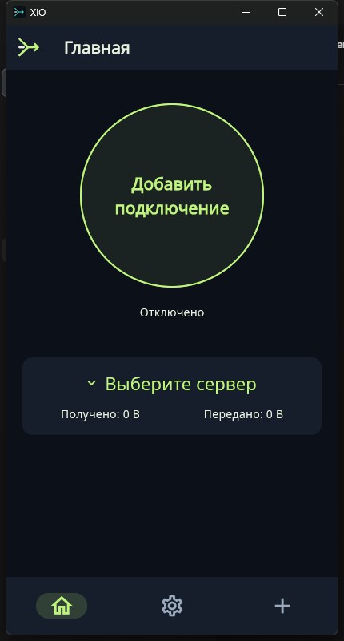 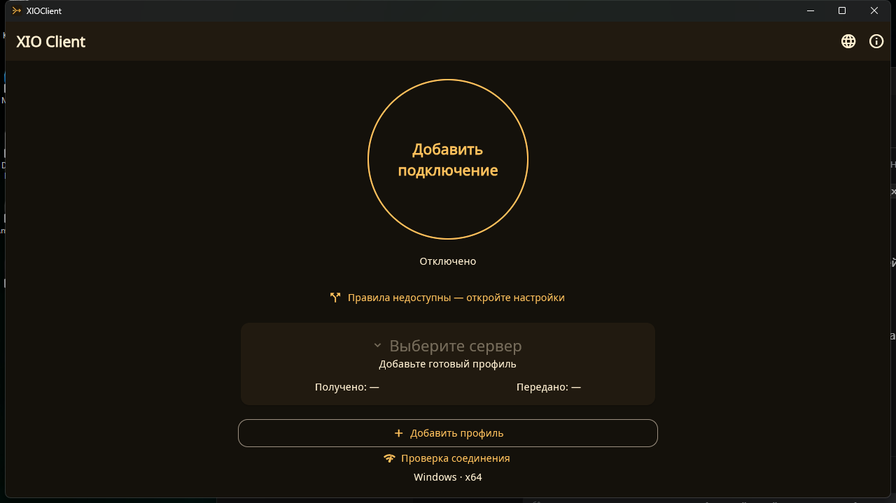 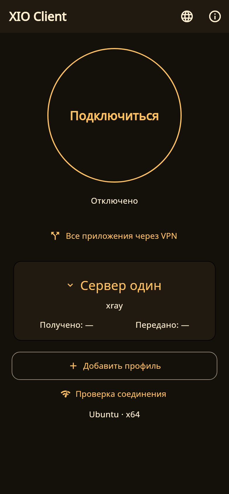</p>

Fresh Android frames produced by the golden render
(`app/test/screenshots/capture_screens_test.dart`, command in
[docs/screenshots/README.md](docs/screenshots/README.md)):

| Home, disconnected | Connection tab |
|---|---|
| 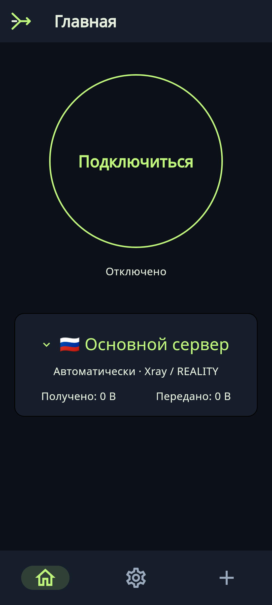 | 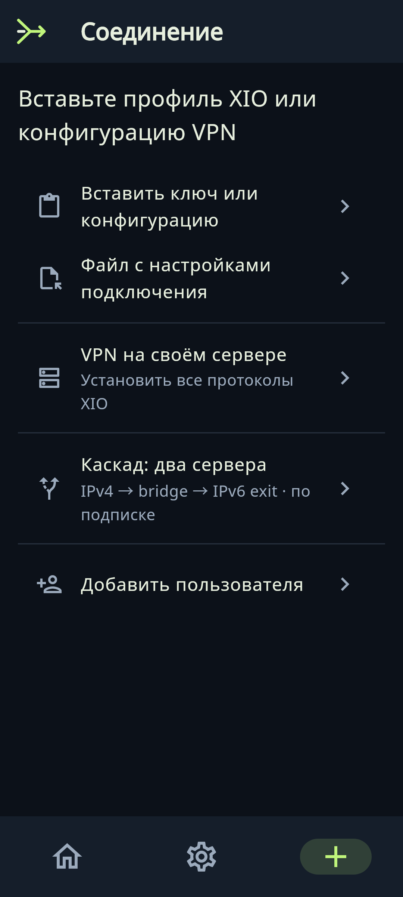 |

| "DNS resolver": presets and custom addresses | "Telegram proxy (MTProto)": steps and the saved link |
|---|---|
| 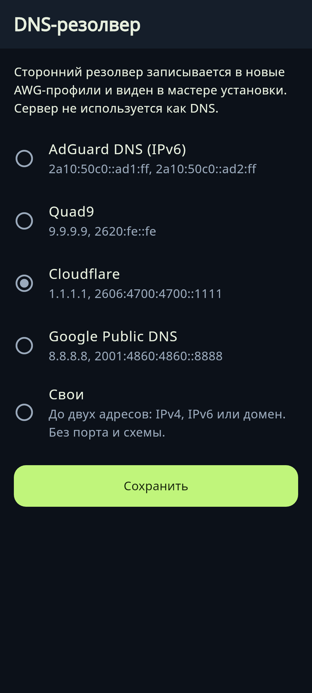 | 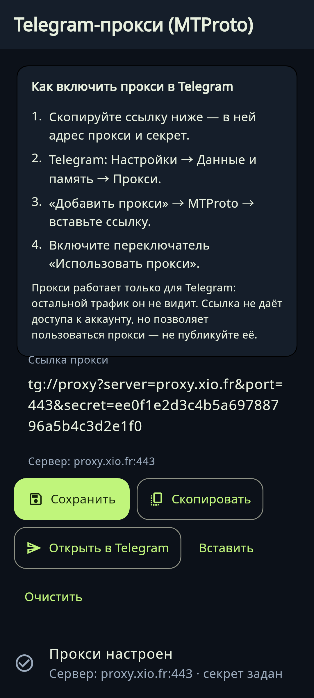 |

Android screens on the phone stay black in a system screenshot: the app sets `FLAG_SECURE`. That is
protection, not a bug — the Android images in the docs come from Flutter widget tests. The list of
frames we still need, with exact `adb` commands and a status table, is in
[docs/screenshots/README.md](docs/screenshots/README.md).

## Split tunnelling

Include or exclude selected applications, and add IP/CIDR rules in either direction. Domain rules
are not supported: routing by name needs its own resolver, and XIO does not have one yet.

Excluded traffic goes directly — unless Android lockdown forbids it, in which case the system rule
wins over the setting. In a cascade the rules live on the bridge (`xio_whitelist4` nft set), are
refreshed weekly and replaced atomically.

## Security

- **Profile secrets are encrypted at rest.** Android Keystore with backups disabled, Windows DPAPI,
  Ubuntu AES-GCM with a local key and file permissions, iOS Keychain.
- **The client never receives server keys.** SSH, root and admin credentials stay in the full
  application; subclients get only their own VPN keys.
- **SSH host keys are pinned.** A changed key stops maintenance until the owner confirms it.
- **The bootstrap verifies the archive digest** before unpacking; a substituted stream is refused.
- **Per-client configs are not written into `deployment.json`.** A replay returns
  `configsUnavailable` instead of handing out secrets twice.
- **Secrets are compared in constant time** in `rivet user add` and token checks.
- **Unit files use a credentials directory**, not `%d`, so secrets are not expanded into the command
  line.
- **Sandbox is explicit.** `ProtectSystem=strict` is used where a read-only bind mount works;
  otherwise XIO records `sandboxMode: compat` and drops only that directive, keeping `PrivateTmp`,
  `NoNewPrivileges` and capability bounding.
- **Imports are sanitised.** A profile cannot add listeners, API servers, commands, filesystem paths
  or direct/freedom outbounds.
- **No telemetry.** No advertising or analytics SDK, no automatic crash reporting, no server
  catalogue.

## How we test

The rule is simple: **only an observed result on real hardware counts as evidence, not a successful
build.**

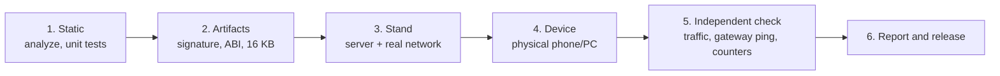

| Level | What is checked | What it is not |
|---|---|---|
| Static | `flutter analyze`, unit/widget tests, Go tests, transport parity gate | does not prove networking |
| Artifacts | APK signature, `package`/`versionCode`, ABI and 16 KB alignment | does not prove a connection |
| Stand | the server is installed from the shipped bundle and a client connects over a real network | does not prove phone behaviour |
| Device | install on a physical Android device / run on Windows | does not prove the route |
| Independent check | HTTPS inside the tunnel, `ping` to the tunnel gateway, server counters and `endpoint` | - |

`FAIL`, `BLOCKED` and `NOT_EXECUTED` are written as such and never replaced with "works". Details:
[compatibility 0.24.0](docs/compatibility/0.24.0.en.md) ·
[physical Android run](docs/verification/android-physical-2026-10-21.en.md).

## FAQ

**Is XIO a subscription VPN?** No. It is software you run on your own VPS. The only paid piece is
the cascade, and its subscription is still a stub.

**Do I need root?** Not for the VPN itself. Root is needed for VPN sharing on Android.

**Which transport will it pick?** Xray/REALITY first by default, then the alternatives of the same
server, then other profiles. You can reorder them; a blocked protocol is replaced before the entry
point changes.

**It says "tunnel active" but nothing loads.** Check counters and DNS on the connection screen —
they are the real proof. If they do not move, the server side is the usual suspect: NAT, firewall,
or DNS. "Interface active" without traffic is not a success by design.

**Can I run it next to another VPN?** No. The `/1` routes conflict; disable the other tunnel.

**Where do I get iOS?** Nowhere yet: there is source, not an IPA. It needs a Mac, Xcode and Apple
signing.

**The server install failed at the last step.** That is the known 0.24.0 packager defect
(`readiness.py` and `xio-ready.service` missing). Take 0.24.1 or newer.

**Does it guarantee bypassing blocks?** No. There are no field measurements with Russian carriers
and no independent audit of RIVET. Reaching the entry point and camouflaging the transport are two
different jobs.

## Limitations (what is not verified)

- **Xray/REALITY does not connect** on "client 0.23.x + Xray 26.7.28 gateway": the REALITY
  implementation in the client core is incompatible. AWG and RIVET work.
- **AWG on Android in this branch (`main`):** `tun.CreateUnmonitoredTUNFromFD` can hand the TUN
  descriptor to a Go finalizer, which later closes a number that already belongs to something else;
  an AWG activation that failed earlier can then kill an unrelated socket (`i/o timeout`,
  `accept4: bad file descriptor`). The fix — duplicating the descriptor first — is in the
  `release-0.24.0` branch (`c2b3338`), `main` does not have it yet.
- **Windows 0.24.0:** the helper is rebuilt with the WFP firewall fix (rules by user SID and App ID
  instead of `netsh`), analyze, tests and packaging pass. A live GUI connection on 0.24.0 was not
  re-run; the last live run was the 0.22.5 helper with the 0.23.0 application.
- **Ubuntu GUI:** 0.24.0 packages are built, the GUI was not re-verified live. The tunnel works
  through `libexec/xio-tunnel` and needs `systemd-resolved`.
- **A full tunnel on Linux cuts off the local network:** while the tunnel is up the machine stops
  answering SSH from the LAN, because all unmarked IPv4 goes into the tunnel.
- **Cascade:** no real traffic through two servers; the subscription and server pooling are stubs.
- **The web panel and the terminal bootstrap** never ran on a live server with systemd and
  `admin.py` — only `py_compile`, certificate generation and response codes were checked locally.
- **Windows ICS sharing** was not validated on a live host.
- **IPv6 must be routed by the provider.** XIO configures addressing, forwarding and NAT66 on its own
  interfaces, but cannot make an upstream announce or route a prefix. DNS64/NAT64 are not provided.
- **iOS** is not built: no Mac/Xcode/iPhone, no IPA.
- **Full protocol parity is not achieved:** Android 5 transports, Windows/Ubuntu 4, iOS 2.
- **Alongside another VPN** XIO does not work: the `/1` routes conflict.
- The Windows application is not signed with a publisher certificate, so SmartScreen warns.

## Documentation

- [Features in detail](docs/features.md) · [Возможности (RU)](docs/features.ru.md)
- [Compatibility and status 0.24.0](docs/compatibility/0.24.0.en.md)
- [Guide](docs/en/guide.md) · [Downloads](docs/en/downloads.md) · [FAQ](docs/en/faq.md) · [Build](docs/en/build.md)
- [Protocols](docs/en/protocols.md) · [RIVET library](docs/protocols/README.md) · [Dual-stack notes](docs/dualstack/0.22.3.en.md)
- [Cascade](docs/cascade/README.md) · [Web panel](server/webui/README.md) · [Client and subclients](client/README.en.md)
- [Release notes 0.24.0](docs/release-notes-0.24.0.md) · [0.24.1 mobile](docs/release-notes-0.24.1-mobile.md) · [Changelog](CHANGELOG.md)
- [Screenshots to take](docs/screenshots/README.md) · [Diagrams](docs/landing/architecture.mmd) · [Third-party notices](THIRD-PARTY-NOTICES.md)

## License

Original code is GPL-3.0-only. Third-party components keep their own licences:
[THIRD-PARTY-NOTICES.md](THIRD-PARTY-NOTICES.md). Security reports:
[SECURITY.md](SECURITY.md). Contributing: [CONTRIBUTING.md](CONTRIBUTING.md).
