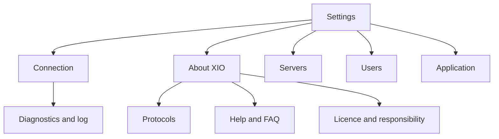
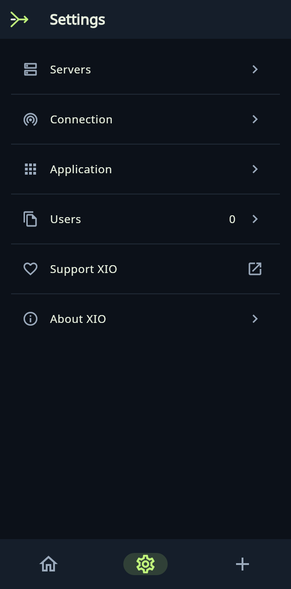
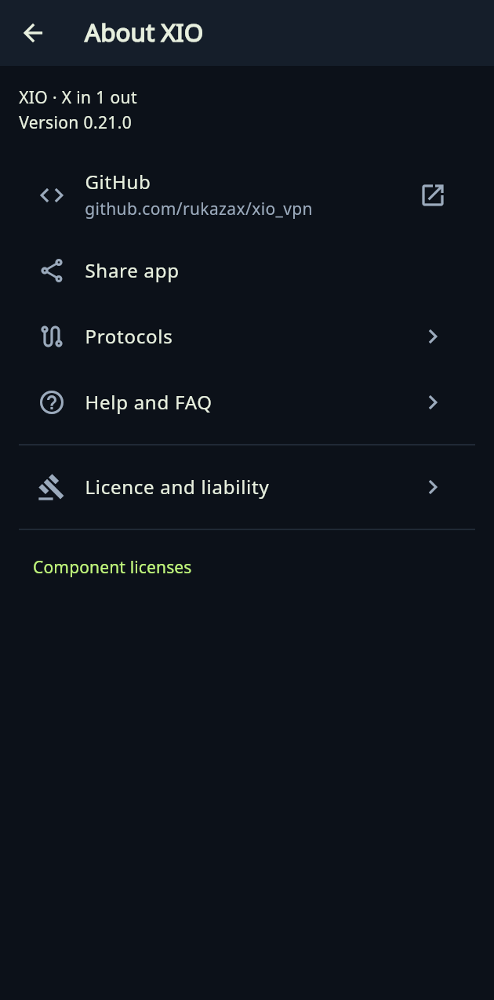

# XIO — X in 1 out

**English** · [Русский](README.ru.md)

Your VPN, your servers, one interface. Connect a VPS, import configurations, create users and share access. XIO selects a supported protocol automatically and tries the next one when a connection attempt fails.

[Download](docs/en/downloads.md) · [User guide](docs/en/guide.md) · [Protocols](docs/en/protocols.md) · [Build](docs/en/build.md) · [FAQ](docs/en/faq.md)

## Features

- Manage your VPS over SSH: installation, users, export and removal of XIO components.
- Import third-party configurations and detect the supported engine automatically.
- Set a preferred protocol, connection timeout and HTTPS test site. The default is youtube.com.
- Share a user profile containing several protocol configurations. Delegate administration with a limit on active users.
- Android split tunneling, system theme, launcher icon choices and 13 interface languages.
- On-device licence acknowledgement, help and connection diagnostics.

## Platforms

| Platform | Status | Protocols |
|---|---|---|
| Android 8+ | ARM64, ARMv7 and x86_64 APKs; the physical Honor phone has not been checked | 10 engines |
| Ubuntu x64 22.04+ | DEB and portable archive | 7 engines |
| Windows 10/11 x64 | Test ZIP; UI checked in Wine, native networking still needs testing | 7 engines |
| iPhone/iPad iOS 15+ | Xcode source project; no installable IPA | Two RIVET transports integrated in source, Apple testing pending |

See [engine availability and limits](docs/en/protocols.md). Our RIVET/H3 and RIVET/S1 transports are experimental. Independent auditing and traffic indistinguishability from ordinary HTTPS have not been established.

## Settings

About XIO contains Protocols, Help and FAQ, Licence and responsibility, and component licences. Diagnostics is under Connection. The main navigation stays compact.

## Source, licence and feedback

`app/` contains the shared UI and native adapters. `protocol/rivet/` contains tunnels, client engines and the desktop helper. `server/` handles VPS setup and management. `native/`, `vendor/` and `vendor-metadata/` contain bridges, dependencies and provenance. `tools/` and `tooling/` contain build and verification tools.

Original code: [GPL-3.0-only](LICENSE). Dependencies retain [their own licences](THIRD-PARTY-NOTICES.md). Copyright holder: Константин Александрович Ерёмин (Konstantin Eryomin), [er-ka@mail.ru](mailto:er-ka@mail.ru). The Russian spelling in COPYRIGHT is authoritative.

[Report a bug](https://github.com/rukazax/xio_vpn/issues/new/choose) · [Security](SECURITY.md) · [Contribute](CONTRIBUTING.md) · [Changelog](CHANGELOG.md).

Do not post SSH passwords, private keys or access profiles in issues. Administrative exports contain secrets.

### Interface

Screenshots from the shared Flutter UI test.

 

The complete source and dependency bundle is `XIO-0.21.0-source.zip` on the [release page](https://github.com/rukazax/xio_vpn/releases/tag/v0.21.0). The exact shipped Android runtime source is under `native-sources/android-runtime-0.18` inside that archive. [Component provenance](docs/native-source-provenance.md).

[RIVET articles: diagrams, wire formats and tests](docs/protocols/README.md) · [Development blog](docs/blog/2026-10-18-rivet.md).

[Project introduction and public discussion](publishing/public-launch/README.md).

[Application updates](docs/en/updates.md) · [0.21 blog](docs/blog/2026-10-19-updates.md).
