**← [Все проекты · All projects](https://github.com/rukazax?tab=repositories)**

<div align="center">
  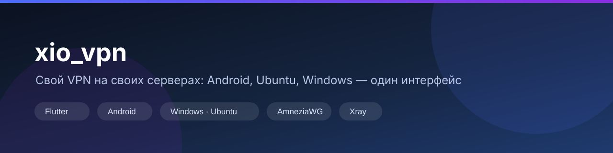
</div>

# XIO

**RU** · [English](#english)

[](https://github.com/rukazax)
[](#пять-транспортов)
[](#текущее-состояние-024135030-17-ноября-2026)
[](#клиенты-по-платформам)
[](#лицензия)

> **X in, 1 out.** Свой VPN на своих серверах: Android, Ubuntu, Windows и Linux-сервер, пять транспортов, IPv4 + IPv6 — и всё в одном интерфейсе. XIO Client подключается к уже существующим серверам, Full XIO сам разворачивает и обслуживает ваш сервер по SSH, серверный комплект раздаёт пять транспортов одновременно. Без подписки и чужого аккаунта: приносите свой VPS — XIO приносит остальное.

## 🧭 Навигация

| Раздел | О чём |
|---|---|
| [Текущее состояние](#текущее-состояние-024135030-17-ноября-2026) | Что проверено на живых серверах, цифры, честные ограничения |
| [Что это такое](#что-это-такое) | Три части системы и пять шагов от профиля до трафика |
| [Возможности](#возможности) | XIO Client, Full XIO, свои каскадные серверы |
| [Серверный комплект](#серверный-комплект) | Что живёт на VPS: транспорты, firewall, учёт трафика |
| [Пять транспортов](#пять-транспортов) | AmneziaWG, RIVET, Xray/REALITY, OpenVPN/Cloak и порты сервера |
| [IPv4 и IPv6](#ipv4-и-ipv6) | Dual-stack, подсети туннелей, VPS только с IPv6 |
| [Каскад](#каскад-два-сервера-ipv4--ipv6) | Два сервера: мост IPv4 → выход IPv6, замеры и скриншоты |
| [Установка сервера](#установка-сервера) | Три способа: приложение, одна команда, веб-панель |
| [Клиенты по платформам](#клиенты-по-платформам) | Android, Windows, Ubuntu, iOS и скриншоты |
| [Раздельное туннелирование](#раздельное-туннелирование) | Правила по приложениям и IP/CIDR |
| [Безопасность](#безопасность) | Секреты, пины, санитайзинг импорта, no telemetry |
| [Как мы проверяем](#как-мы-проверяем) | Шесть уровней доказательств |
| [FAQ](#faq-частые-вопросы) | Частые вопросы |
| [Ограничения](#ограничения-что-не-проверено) | Что честно не проверено |
| [Сборка из Git](#клонирование-и-сборка-из-git) · [Документация](#документация) | Клон и сборка · ссылки на доки |
| [Лицензия](#лицензия) | GPL-3.0-only и сторонние компоненты |

---

## Текущее состояние: 0.24.13+5030 (17 ноября 2026)

Каскад «телефон → российский VPS → зарубежный VPS» собран, развёрнут и проверен на живых серверах, и автоматический failover между маршрутами снова работает: когда первый кандидат не поднимается, приложение подключает следующий и публикует принятое решение. Клиент больше не предлагает OpenVPN/Cloak; серверный комплект и разделы ниже по-прежнему описывают полный набор 0.24.0–0.24.2, включая эти транспорты.

0.24.13 превращает каскад в одно действие: мастер ставит exit, затем bridge за один проход, авторизует ключ bridge на exit через уже открытое соединение и сохраняет адреса только после того, как bridge подтвердит туннель. Карточка каждого сервера показывает свой план, идущий шаг и строку, доказавшую предыдущий; при сбое называется шаг и сохраняется вывод упавшей команды плюс `journalctl -u xio-cascade-… -n 40`, снятый до закрытия соединения. 0.24.11–0.24.12 — подготовка под это: per-ABI APK с выключенными логированием и гео-IP телеметрией и каскад, который сам устанавливает нужные инструменты, а не предполагает их наличие.

| Проверка | Результат |
|---|---|
| Bridge | `81.177.142.37` (RU, Debian 12), `xio-cascade-bridge` активен |
| Exit | `103.102.135.124` (FR), `xio-cascade-exit` активен, NAT44/NAT66 |
| Туннель | SSH TUN `10.250.0.1 ⇄ 10.250.0.2`, ping 50.8 мс |
| Egress телефона | IPv4 `103.102.135.124`, IPv6 `2a0c:b641:1a0:800::2a2`; прямой xray выходит с адреса `81.177.142.37` |
| Тесты | `flutter test`: 1174 passed, 27 skipped, 0 failed |
| Анализ | `flutter analyze`: 0 ошибок |
| APK | `XIO-Full-0.24.13-android-arm64-v8a.apk` (52.4 МБ) и `…-armeabi-v7a.apk` (52.3 МБ), release v0.24.13 |

Команды и цифры: [CASCADE-ANDROID-RU-FR-20261117.md](docs/CASCADE-ANDROID-RU-FR-20261117.md) · [ANDROID-VALIDATION-20261117.md](docs/ANDROID-VALIDATION-20261117.md) · [скриншоты](docs/screenshots/README.md) · [CHANGELOG](CHANGELOG.md).

**Известные ограничения — не прячем:**

- каскад ставится одной кнопкой, но проход не возобновляется: при отказе SSH-соединения остаются открытыми для повтора, который начинается заново с первого шага упавшего сервера, и по-прежнему нужны готовые exit и bridge с root-доступом по SSH (`deploy/cascade/native/`);
- автоматический failover проверен на закрытом порту и остановленном сервисе AWG; когда мертвы все кандидаты, раунд всё равно заканчивается одной честной ошибкой;
- связка bridge–exit — это SSH TUN (TCP-over-TCP), а не WireGuard: рукопожатие WireGuard проходит, но транспортные пакеты теряются; BBR включён на bridge, но не на exit;
- мобильный профиль использует `9.9.9.9` как DNS, а не резолвер оператора;
- Yandex Browser на тестовом телефоне рисует пустую страницу при работающем туннеле; Chrome работает. Это поведение браузера, а не каскада;
- проверено в этом прогоне: импорт, подключение, каскад, IPv4/IPv6 egress и главный экран. Xray/RIVET, переключение Wi-Fi ↔ LTE и долгий soak после включения BBR не перепроверялись.
## Что это такое

| Часть | Что делает | Работает на |
|---|---|---|
| **XIO Client** | Импортирует `xio://`, выбирает транспорт, поднимает туннель, проверяет трафик. Без SSH и серверных ключей. | Android 8+, Windows 11 x64, Ubuntu 22.04+ |
| **Full XIO** | Preflight по SSH, установка, обновление и удаление сервера; пользователи, квоты, отзыв, трафик. | Android, Windows, Ubuntu |
| **Серверный комплект** | AmneziaWG, RIVET, Xray, Cloak, OpenVPN, счётчики, firewall, dual-stack маршрутизация. | Linux x86_64 VPS с systemd и `/dev/net/tun` |

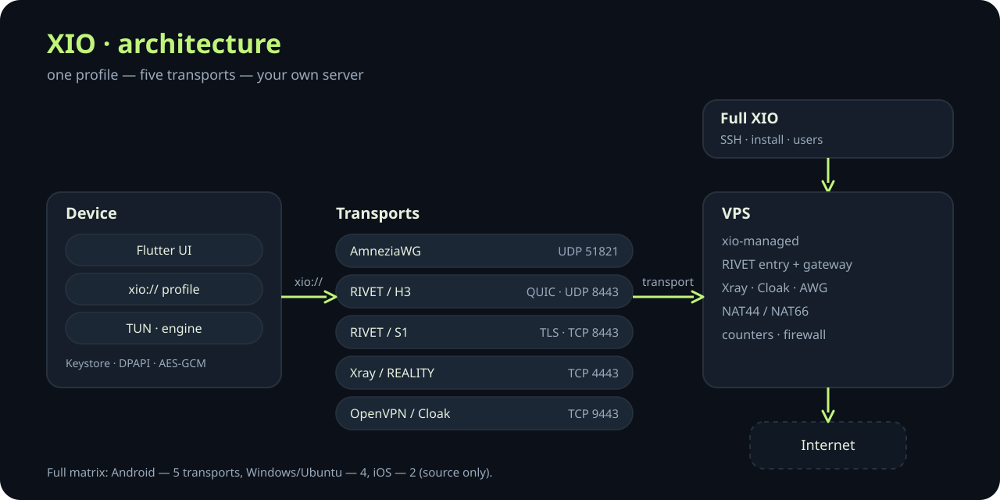

Пять шагов от профиля до трафика:

1. **Импорт.** Администратор выдаёт файл `xio://` — base64-контейнер с пользователем, сервером и конфигурацией по каждому транспорту. Хранится в зашифрованном виде: Android Keystore (исключён из бэкапов), Windows DPAPI, Ubuntu AES-GCM с правами на файл, iOS Keychain.
2. **Выбор.** Профиль перечисляет транспорты, которые реально существуют на этом сервере. Если на платформе нет движка для одного из них, клиент честно скажет об этом, а не молча подменит другим.
3. **Подключение.** Клиент создаёт TUN-интерфейс, берёт адрес внутри туннеля и направляет трафик через выбранный транспорт. Android использует системный `VpnService`; Windows и Ubuntu — отдельный привилегированный helper, который меняет маршруты только после согласия.
4. **Проверка.** Туннель подтверждается свежим обменом, растущими счётчиками и DNS-запросом через туннель. Проба HTTPS-сайта — опциональна и по умолчанию выключена.
5. **Работа.** Сервер принимает трафик, выдаёт внутренний адрес и выпускает его в интернет через NAT.

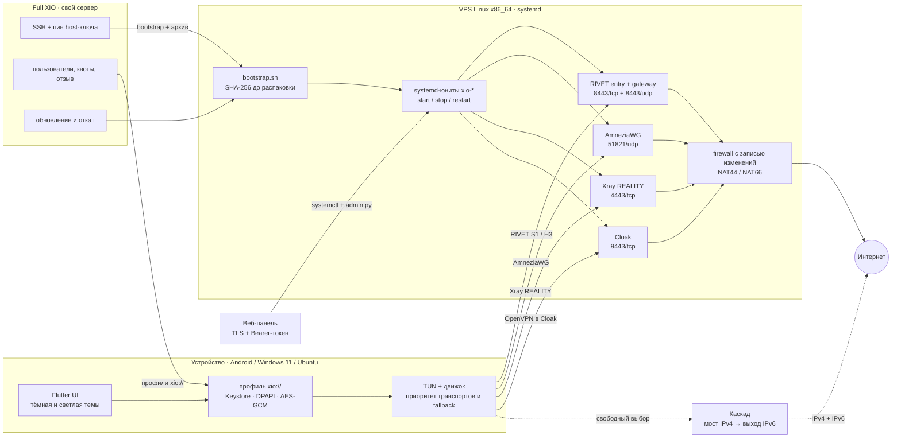

Та же схема лежит и отдельным файлом: [docs/landing/architecture.mmd](docs/landing/architecture.mmd).

## Возможности

### XIO Client

- **Переносимый профиль.** Один файл `xio://` на все транспорты одного сервера; импорт из файла или вставка ключа. Импорт принимает только клиентский материал: никаких слушателей, API-серверов, исполняемых команд, путей файловой системы или direct/freedom outbounds.
- **Приоритет транспортов и fallback.** Сначала выбранный профиль, затем варианты того же endpoint с другим протоколом, затем другие профили. Заблокированный протокол заменяется раньше, чем меняется точка входа, поэтому адрес VPS не теряется. Первый выбор по умолчанию — Xray/REALITY, на iOS — RIVET/S1; порядок настраивается, недоступные движки пропускаются.
- **Живой watchdog связи.** Пока нужен туннель, связь проверяется каждые 15 секунд. После двух пропусков подряд клиент переподключается: через 5 секунд (первые три попытки), затем через 15 секунд — пока сервер не вернётся.
- **Честная проверка.** «Интерфейс активен» — ещё не успех: счётчики трафика и DNS через туннель должны двигаться. Проба сайта — дополнение, которое можно включить; без неё туннель подтверждается рукопожатием, счётчиками и DNS.
- **Раздельное туннелирование.** Включение или исключение выбранных приложений и правила по IP/CIDR в обе стороны. Доменные правила не поддерживаются.
- **Субклиенты.** Явно выданный токен аккаунта может проверять квоту и создавать или отзывать только своих «детей» через HTTPS API сервера с пиннутым сертификатом. Экспорт «ребёнка» содержит только его VPN-ключи и никогда — родительскую capability или SSH/root-ключи.
- **Раздача VPN.** Android: нужен root, IPv4 уходит в туннель, DNS перенаправляется на `9.9.9.9`, раздача IPv6 заблокирована. Windows: на базе ICS, экспериментально и не проверено на живом Windows-хосте. Ubuntu и iOS: недоступно.
- **13 языков интерфейса** с офлайн-каталогами, тёмная и светлая темы.
- **Обновления.** Одна проверка в неделю со случайным сдвигом; релиз можно пропустить. Перед установкой проверяются подпись метаданных и хеш пакета; на Android установка идёт через системный установщик.
- **Приватность по умолчанию.** Никаких рекламных или аналитических SDK, автоматических отчётов о падениях, встроенного каталога серверов и геолокации endpoint-адресов. Экраны Android защищены `FLAG_SECURE`.

### Full XIO

- **Preflight до первого касания сервера:** семейство и версия ОС, x86_64, systemd, `/dev/net/tun`, занятые VPN-порты, конфликты подсетей, существующие VPN-интерфейсы и `/etc/wireguard/xio0.conf`.
- **Установка из собственного бандла.** Bootstrap сверяет SHA-256 архива до распаковки; обрезанный или подменённый поток отвергается, а не распаковывается под root.
- **Пользователи и квоты.** Выдача и отзыв пользователей, ограничение числа активных записей для делегированных админов, пакетный экспорт профилей, владение «детьми» закреплено за создавшим.
- **Учёт трафика.** Месячные байты по пользователям и онлайн-состояние из серверных счётчиков, опрашиваемых каждые 30 секунд; RIVET, AWG и OpenVPN считаются отдельно.
- **Состояние сервисов и логи без секретов.** Какие юниты активны, какие упали и что сервер анонсирует — без ключей и паролей в выводе.
- **Обновление и откат.** Сервер обновляется только при выключенном VPN, с сохранёнными SSH-креденшелами и совпавшим host-ключом; пользователи и ключи выживают, неудачное обновление откатывается.
- **Удаление, которое убирает за собой.** Снимаются только юниты, правила и ключи, принадлежащие XIO; IP forwarding восстанавливается, общие пакеты остаются.

#### Свои каскадные серверы 🛠️

Каскад раньше существовал только как демо. Теперь приложение позволяет настроить свою пару: откройте экран **Каскад**, нажмите иконку **DNS** в панели приложения и задайте адрес **Bridge** (IPv4 или домен, например `81.177.142.37`) и адрес **Exit** (только IPv6, например `2a0c:b641:1a0:800::2a2`). Валидация отвергает схемы, порты, IPv6 в поле bridge, IPv4 в поле exit и значения вроде `999.1.1.1`.

Адреса сохраняются в профиль приложения, станции маршрута показывают их, а диалог показывает точную команду установки с вашим exit:

```bash
curl -fsSL https://raw.githubusercontent.com/rukazax/xio_vpn/main/deploy/cascade/terminal-install.sh \
  | bash -s -- --role bridge --exit-host 2a0c:b641:1a0:800::2a2
```

Кнопка «Скопировать команду» кладёт её в буфер обмена. Подписка и failover серверов пока остаются заглушками.
## Серверный комплект

- Пять транспортов на одном хосте, у каждого свой порт и свой systemd-юнит.
- Управляемый firewall с записью изменений: каждое добавленное правило фиксируется и снимается точно; forwarding ограничен принадлежащими XIO интерфейсами.
- Dual-stack: IPv4- и IPv6-слушатели, NAT44 и NAT66, IPv6-подсети по интерфейсам.
- Харденинг systemd: `LoadCredential` и `${CREDENTIALS_DIRECTORY}` вместо `%d` в unit-файлах, `ProtectSystem=strict` там, где позволяет ядро, и явный режим совместимости там, где не позволяет.
- Счётчики каждые 30 секунд; `status` возвращает снимок состояния, а не гоняет `wg` на каждый запрос.
- Ограниченный режим для VPS только с IPv6: без kernel WireGuard, без IPv4 default route, только порты, которые реально могут работать.

Подробнее, с примерами и схемами: [docs/features.md](docs/features.md).

## Пять транспортов

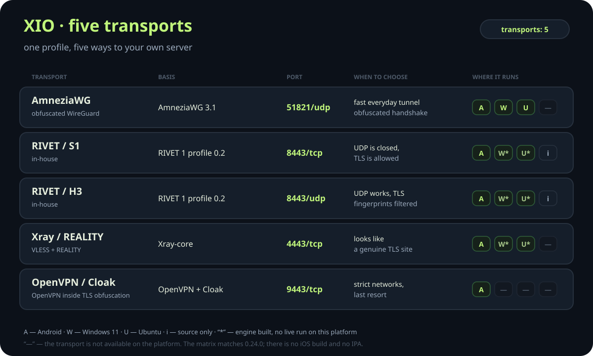

XIO не изобретает криптографию заново: каждый транспорт строится на проверенной реализации, и лишь RIVET — собственная разработка проекта. Транспорты решают разные задачи: скорость, маскировка и сети, где закрыт UDP.

| Транспорт | Основа | Внешний транспорт | Порт | Когда использовать | Android | Windows | Ubuntu | iOS |
|---|---|---|---|---|---|---|---|---|
| **AmneziaWG** | AmneziaWG 3.1 (WireGuard + обфускация) | UDP | 51821 | быстрый повседневный туннель, обфусцированный handshake | да | да | да | — |
| **RIVET / S1** | собственная разработка | TCP + TLS 1.3 | 8443/tcp | UDP заблокирован, TLS разрешён | да | да* | да* | source |
| **RIVET / H3** | собственная разработка | QUIC / HTTP/3 + TLS 1.3 | 8443/udp | UDP работает, но включена фильтрация по TLS-отпечатку | да | да* | да* | source |
| **Xray / REALITY** | Xray VLESS + REALITY | TCP | 4443/tcp | маскировка под настоящий TLS-сайт | да | да* | да* | — |
| **OpenVPN / Cloak** | OpenVPN внутри Cloak | TCP + TLS-обфускация | 9443/tcp | строгие сети, последний резерв | да | — | — | — |

`да` — движок есть, нативный запуск на этой платформе выполнен; `да*` — движок собран, нативного запуска на платформе не было; `source` — движок в исходниках, Apple-сборки нет; `—` — недоступно. У Android пять транспортов, у Windows и Ubuntu по четыре, у iOS два.

Порядок выстроен так, чтобы протокол менялся раньше точки входа: выбранный профиль → тот же endpoint с другим транспортом → другие профили.

### AmneziaWG

WireGuard с обфусцированным рукопожатием: фиксированные заголовки сообщений заменяются, вставляются мусорные пакеты, размеры handshake рандомизируются (`Jc`, `Jmin`, `Jmax`, `S1`, `S2`, `H1`–`H4`). Это по-прежнему UDP-туннель: блокировка всего UDP блокирует и AWG. На сервере работает userspace-процесс `xio-amneziawg-go` для `xioawg0`; обычный WireGuard (`xio0`) использует kernel-модуль и существует только в не-ограниченных установках.

### RIVET

Собственная разработка проекта: два независимых входа на один сервер, так что блокировка одного не убивает доступ.

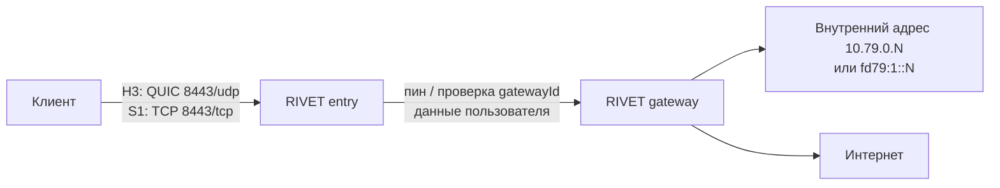

- Два транспорта (**H3** и **S1**) разделяют одну аутентификацию, поэтому клиент переключается без смены профиля.
- Сертификат gateway запиннен (`pin`); у каждого сервера свой `gatewayId` и внешняя CA.
- Пользователь получает `secret` и `entryToken`; родительский токен субклиенту не передаётся.
- Внутренняя адресация — `10.79.0.N` с per-user учётом трафика, плюс `fd79:1::/64`, когда сервер анонсирует IPv6.

### Xray / REALITY

VLESS с REALITY: сервер предъявляет параметры реального TLS-сайта, а клиент проверяет ожидаемую пару сертификат/SNI. На проводе это выглядит как обычный HTTPS. На протестированной паре «клиент 0.23.x + gateway Xray 26.7.28» REALITY не подключается; см. [Ограничения](#ограничения-что-не-проверено).

### OpenVPN / Cloak

OpenVPN, завёрнутый в TLS-обфускацию Cloak. Существует для сетей, где разрешён только похожий на TCP/443 трафик, и является последним резервом клиента. Движок Cloak заявляет только Android.

### Серверные транспорты

WireGuard, Shadowsocks и IKEv2 устанавливаются на сервер, но клиентом XIO не предлагаются. Они существуют для совместимости с другими клиентами и для ограниченных развёртываний.

| Порт | Протокол | Сервис | Примечание |
|---|---|---|---|
| 8443/tcp + 8443/udp | TCP / QUIC | RIVET S1 и H3 | TLS 1.3, запинненный сертификат gateway |
| 4443/tcp | TCP | Xray / REALITY | VLESS, маскируется под реальный сайт |
| 9443/tcp | TCP | Cloak | OpenVPN TCP за TLS-обфускацией |
| 1194/udp | UDP | OpenVPN UDP | напрямую, без Cloak |
| 1195/tcp | TCP | OpenVPN TCP | только loopback, наружу через Cloak |
| 51821/udp | UDP | AmneziaWG | обфусцированный WireGuard |
| 51820/udp | UDP | WireGuard | только не-ограниченные установки |
| 8388/tcp + 8388/udp | TCP/UDP | Shadowsocks | только на стороне сервера |
| 500/udp, 4500/udp | UDP | IKEv2 / IPsec | только на стороне сервера |
| 9444/tcp | TCP | Account API | только когда выдан токен аккаунта |

Подробно: [заметки о протоколах](docs/en/protocols.md) · [библиотека RIVET](docs/protocols/README.md) · [реализация RIVET 0.2 (RU)](RIVET-IMPLEMENTATION-0.2.ru.md).

## IPv4 и IPv6


Внешний транспорт и внутренний адрес независимы:

- Endpoint может быть IPv4-адресом, IPv6-адресом или доменом с записями A и/или AAAA.
- Xray и Cloak пробуют оба семейства адресов. RIVET пробует их последовательно, потому что параллельная авторизация одной личности может подменить peer.
- RIVET/S1, RIVET/H3, AmneziaWG и OpenVPN несут IPv4 и IPv6 внутри туннеля. IPv6-адреса выдаёт только сервер, который явно анонсирует поддержку.
- Управляемая адресация, forwarding и NAT66 требуют реальной маршрутизации от провайдера. Вносятся только принадлежащие XIO изменения, каждое — с записью и точным откатом.
- DNS берётся из профиля и идёт через туннель.
- **XIO не предоставляет DNS64, NAT64 или CLAT.** IPv4-литералы и IPv4-пакеты не транслируются внутри сети только с IPv6; такому хосту нужен IPv4-egress или NAT64 на стороне провайдера.
- IPv6 extension headers, фрагменты и jumbogram-пакеты не поддерживаются. TCP, UDP и ограниченный ICMPv6 — поддерживаются.

| Транспорт | IPv4-подсеть | IPv6-подсеть |
|---|---|---|
| WireGuard (не-ограниченный) | `10.77.0.0/24` | `fd77:1::/64` |
| AmneziaWG | `10.78.0.0/24` | `fd78:1::/64` |
| RIVET | `10.79.0.0/24` | `fd79:1::/64` |
| OpenVPN UDP | `10.80.0.0/24` | `fd80:0::/64` |
| OpenVPN TCP | `10.81.0.0/24` | `fd80:1::/64` |
| IKEv2 / IPsec | `10.82.0.0/24` | — |

### VPS только с IPv6

Режим `restrictedNetwork` — для сервера без IPv4 default route:

- без kernel WireGuard и без `xio0`; AmneziaWG работает в userspace;
- устанавливаются только транспорты, которые могут работать: AWG, RIVET, Xray, Cloak, OpenVPN TCP;
- firewall открывает `4443/tcp`, `9443/tcp`, `8443`, `51821/udp` — не IPv4-only набор;
- preflight записывает `outboundByFamily: {ipv6: eth0}` и честно сообщает `ipv4DefaultRoute: false`, вместо того чтобы изображать dual-stack.

Проверено на VPS с глобальным IPv6 `2a0c:b641:1a0:800::2a2`: клиент получает `fd79:1::fe/128`, `ping6` и `wget -6` проходят через туннель, ответ приходит с глобального адреса VPS (NAT66). Внешний IPv6-вход `[2a0c:b641:1a0:800::2a2]:18443` подключался за 129–159 мс.
## Каскад: два сервера, IPv4 → IPv6

Каскад бесплатен: ни подписки, ни аккаунта. Устройство попадает на **мост** через AmneziaWG (IPv4), мост держит **SSH TUN** до **выхода**, а выход обслуживает трафик в интернет по IPv4 и IPv6. Ровно эта схема была развёрнута и проверена 17 ноября 2026 на живой паре `81.177.142.37` (RU) → `103.102.135.124` (FR).


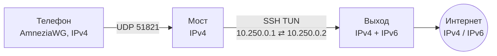

**Что приложение показывает в 0.24.8.** Карточка на главном экране и экран Каскада сообщают одно и то же состояние:

- три станции — 🇷🇺 устройство → 🇷🇺 мост → 🇫🇷 выход — с адресами и флагами стран;
- реальный egress: `103.102.135.124 FR` для IPv4 плюс глобальный IPv6 выхода;
- «Каскад активен» — только пока туннель реально поднят, а не просто потому, что адреса сохранены;
- «Проверить каскад»: с сохранённым SSH-сервером реально пингует мост; без него честно спрашивает `api.ipify.org` о фактическом egress и сохраняет адрес и страну. Никаких демо-таймеров и выдуманных задержек.

Реальные скриншоты с POCO X6, не мокапы:

| Главный экран с флагами каскада | IPv4 egress | IPv6 egress |
|---|---|---|
| 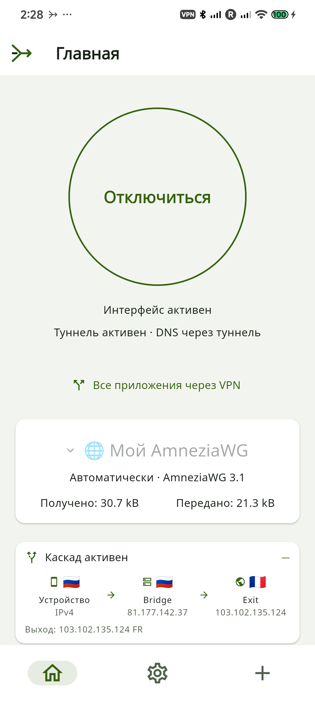 |  |  |

**Установка на живые серверы — `deploy/cascade/native/`.** Нативные скрипты и systemd-юниты, а не Docker-контейнер; они идемпотентны, и `systemctl restart` пересоздаёт правила без дублей.

1. **Выход** (`103.102.135.124`): положить `xio-cascade-exit-{up,down}.sh` в `/usr/local/sbin/` и `xio-cascade-exit.service` в `/etc/systemd/system/`, затем `systemctl enable --now xio-cascade-exit`. Юнит поднимает `tun0` `10.250.0.2/30` и `fd78:2::2/64`, forwarding и NAT44/NAT66.
2. **Мост** (`81.177.142.37`): установить его скрипты и юнит так же, записать `XIO_CASCADE_EXIT_HOST=103.102.135.124` в `/etc/xio-cascade/bridge.env`, затем `systemctl enable --now xio-cascade-bridge`. Юнит держит `ssh -N -w 0:0` до выхода и перезапускается при сбое.
3. **Доверие SSH** один раз: `PermitTunnel yes` на выходе; ключ моста `/root/.ssh/xio_cascade` добавлен в `authorized_keys` выхода.

Замерено на этой паре: `ping 10.250.0.1` с выхода — 50.8 мс; 20 МиБ через `tun0` — 2.309 с (**69.3 Мбит/с**) при BBR на мосту, `tcp_mtu_probing=1` и буферах 16 МиБ; без BBR та же пара падала до 1.5 Мбит/с при ≈8 % потерь. Команды и цифры: [docs/CASCADE-ANDROID-RU-FR-20261117.md](docs/CASCADE-ANDROID-RU-FR-20261117.md).

| Что | Где |
|---|---|
| Проверенные нативные скрипты и юниты | `deploy/cascade/native/` |
| Контейнерный установщик мост/выход/оба (ранний путь) | `deploy/cascade/`, `deploy/cascade/terminal-install.sh` |
| Health check | `deploy/cascade/cascade-healthcheck.sh` → `/var/lib/xio-cascade/health.json` |
| Whitelists на мосту | `deploy/cascade/whitelist-update.sh`, недельный таймер |
| Серверный веб-UI (TLS + токен) | `server/webui/` |
| Полное описание и схема | [docs/cascade/README.md](docs/cascade/README.md) |

**Свои каскадные серверы.** На экране Каскада иконка **DNS** открывает диалог:

| Поле | Что вводить | Валидация |
|---|---|---|
| **Мост** | IPv4 или домен, например `81.177.142.37` | отвергает схемы, порты, IPv6 и «999.1.1.1» |
| **Выход** | IPv6-литерал, например `2a0c:b641:1a0:800::2a2` (скобки допустимы) | отвергает IPv4, DNS-имена и мусор |

Адреса сохраняются в профиль, станции их показывают, диалог предлагает готовую команду установки. В проверенной паре выход задан IPv4-адресом в `bridge.env`, потому что SSH TUN ходит по IPv4; диалог принимает IPv4-адрес, IPv6-литерал или имя хоста, так что IPv4-значение — это выбор, а не обходной путь.

**Честные ограничения каскада:**

- нет одной кнопки, которая ставит каскад на оба сервера; мост и выход — отдельные шаги, хотя оба набора скриптов лежат в репозитории;
- обновление или переустановка APK ломает сохранённую нативную запись (receipt): чистая установка, импорт профиля и подключение работают, но после переустановки приложение может сообщить «saved plan could not be reconciled»;
- SSH TUN — это TCP-over-TCP: выживает на BBR, BBR включён на мосту, но не на выходе (ядро без `tcp_bbr`); путь один, без запасного;
- WireGuard между серверами не завёлся для данных: рукопожатие проходит, но транспортные пакеты теряются — поэтому и выбран SSH TUN;
- мобильный профиль использует `9.9.9.9` как DNS, и запросы идут через каскад;
- Yandex Browser на тестовом телефоне рисует пустую страницу при работающем туннеле; Chrome работает. Это поведение браузера, а не каскада.

## Установка сервера

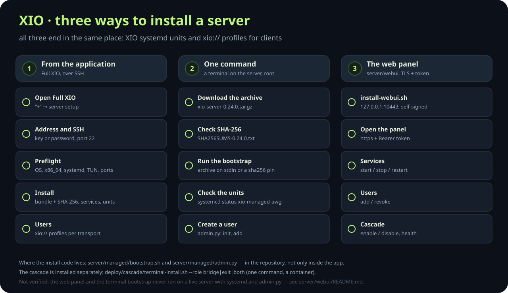

**Нужен чистый VPS:** x86_64, Debian 12/13, Ubuntu 22.04/24.04/26.04 или RHEL/Alma/Rocky 9/10, systemd, `/dev/net/tun`, без других VPN на хосте.

### 1. Из приложения (рекомендуется)

1. Откройте **Full XIO** → «+» → настройка сервера.
2. Введите адрес и SSH-креденшелы (ключ или пароль).
3. Preflight проверяет ОС, архитектуру, systemd, TUN, порты и подсети.
4. Установка: приложение загружает свой бандл, сверяет дайджест, ставит сервисы и сообщает состояние юнитов.
5. Создайте пользователей и экспортируйте их профили `xio://`.

### 2. Одна команда в терминале

Bootstrap читает архив из stdin. Оба имени берите со страницы [Releases](https://github.com/rukazax/xio_vpn/releases) — у release-кандидата в теге стоит суффикс `-rcN`, а asset носит чистый номер версии, так что это две отдельные переменные:

```bash
TAG=0.24.1-rc13                  # тег со страницы релиза, без ведущей «v»
FILE=xio-server-0.24.1.tar.gz    # имя asset на этом релизе
curl -fsSLo xio-server.tar.gz \
  "https://github.com/rukazax/xio_vpn/releases/download/v${TAG}/${FILE}"
curl -fsSLo xio-bootstrap.sh \
  https://raw.githubusercontent.com/rukazax/xio_vpn/main/server/managed/bootstrap.sh
sudo XIO_EXPECTED_ARCHIVE_SHA256="<sha256 из SHA256SUMS>" \
  bash xio-bootstrap.sh < xio-server.tar.gz
```

Если `v0.24.1` уже опубликован, берите его как `TAG` — у стабильного тега нет суффикса `-rc`.

Без `XIO_EXPECTED_ARCHIVE_SHA256` bootstrap всё равно отвергнет битый архив, но именно пин дайджеста останавливает подменённый поток до того, как он будет распакован под root. Хеш берите из `SHA256SUMS-<версия>.txt` на странице релиза.

> **Версии серверного пакета важны.** 0.23.1 привёз комплект, который падал на шаге firewall (`iptables: Can't use -i with POSTROUTING`) и ломал `status` на IPv6-only хостах. 0.24.0 это починил, но его упаковщик забыл положить в tarball `readiness.py` и `xio-ready.service`, и установка на чистом хосте заканчивалась exit code 1 на последнем шаге. Оба дефекта исправлены в 0.24.1 (`RECIPE` 26). Для нового сервера берите **0.24.1 или новее**.

### 3. Веб-панель

```bash
sudo ./install-webui.sh                 # https://127.0.0.1:10443
sudo ./install-webui.sh 0.0.0.0:10443   # все интерфейсы, только за reverse proxy
```

Скрипт печатает URL с токеном, сам токен и SHA-256-отпечаток сертификата. Сервисы, пользователи и каскад управляются с одной страницы; панель говорит только по TLS, использует Bearer-токен плюс cookie `SameSite=Strict` и требует CSRF-заголовок для POST. Подробности: [server/webui/README.md](server/webui/README.md).

### Что остаётся на сервере

| Путь | Содержимое |
|---|---|
| `/usr/local/lib/xio-managed` | серверный код: `admin.py`, `stack.py`, `network_stack.py`, `dualstack.py`, бинарники |
| `/etc/xio-managed/deployment.json` | состояние развёртывания: хост, пользователи, ключи, счётчики, записи изменений — без per-client конфигов |
| `/etc/xio-rivet` | публичное состояние RIVET и запись установщика |
| `/usr/local/lib/xio-rivet` | бинарник RIVET и скрипт настройки |
| `/var/lib/xio-stack` | счётчики стека и runtime-состояние |

Юниты: `xio-managed-awg`, `xio-managed-stats.timer`, `xio-rivet-entry`, `xio-rivet-gateway`, `xio-stack`, `xio-cloak`, `xio-openvpn-udp`, `xio-openvpn-tcp`, `xio-ikev2`, `xio-client-api`, `xio-ready`.

Администрирование — JSON на stdin:

```sh
printf '%s\n' '{"action":"status","serverId":"<id>"}' \
  | python3 /usr/local/lib/xio-managed/admin.py
```

| Действие | Что делает |
|---|---|
| `init` | первая установка; обязательны `host` и `restrictedNetwork` |
| `inspect` | публичное описание сервера и фаза |
| `status` | сервисы, счётчики, пользователи, месячный трафик |
| `add` | создаёт пользователя и возвращает конфиги по транспортам |
| `revoke` | отзывает пользователя и его «детей» |
| `remove` | снимает только юниты, правила, ключи и пакеты, принадлежащие XIO |
| `client-grant` | выдаёт скоупированный токен аккаунта для субклиентов |
## Клиенты по платформам

`XIO-<App>-<version>-<OS>-<arch>.<ext>`. `App` — это `Client` или `Full`, `OS` — `android`, `windows` или `ubuntu`, архитектура — `arm64-v8a`, `armeabi-v7a`, `x86_64`, `universal`, `amd64` или `x64`.

Всё лежит на странице [Releases](https://github.com/rukazax/xio_vpn/releases), включая файлы `SHA256SUMS`. Проверяйте через `sha256sum -c SHA256SUMS-<версия>.txt` или `Get-FileHash <file> -Algorithm SHA256`.

### Android — Full или Client?

| | **XIO Full** (`app.xio.xio`) | **XIO Client** (`app.xio.client`) |
|---|---|---|
| Подключение к существующему серверу | да | да |
| Свой сервер по SSH | да | нет |
| Пользователи, квоты, отзыв | да | нет (только субклиенты, если выдано) |
| Раздача VPN | да | нет |
| Пять транспортов | да | да |
| Размер пакета | ~58 МБ | ~57 МБ |

Android 8+; ARM64 — обычный выбор, ARM32 для старых устройств, x86_64 для эмуляторов, `universal`, если не хочется думать. Откройте APK, разрешите установку из этого источника — и обновление встанет поверх прежней версии, сохранив профили.

На MIUI/HyperOS `adb install` может ответить `INSTALL_FAILED_USER_RESTRICTED`. Рабочий путь:

```bash
APK=XIO-Full-<version>-android-arm64-v8a.apk
adb push "$APK" /data/local/tmp/xio.apk
adb shell pm install -r -g /data/local/tmp/xio.apk
```

Android 0.24.1 — это `0.24.1+5018`, подписанный тем же сертификатом (SHA-256 `e4e81b12…c9671`; алиас исторической подписи сохранён в keystore), поэтому он обновляется поверх 0.23.x/0.24.x без удаления. Самые свежие APK на странице Releases — 0.24.0; набор 0.24.1 для Android готовится, его заметки — в [docs/release-notes-0.24.1-mobile.md](docs/release-notes-0.24.1-mobile.md).

### Windows 11 x64

Распакуйте ZIP полностью и запустите `XIO.exe`. Helper `libexec\xio-tunnel.exe` стартует с повышением прав: это нужно для создания сетевого интерфейса. Wintun идёт в комплекте со своей лицензией. Четыре транспорта (без Cloak). Сборка не подписана сертификатом издателя, поэтому SmartScreen предупреждает — это ожидаемо.

- Full XIO для Windows: в релизе 0.24.0.
- XIO Client для Windows: опубликован в 0.23.1; в 0.24.0 его не было.

### Ubuntu 22.04+

```bash
sudo apt install ./XIO-*-ubuntu-amd64.deb
```

Имя пакета гуляло между релизами (`XIO-Full-…-ubuntu-amd64.deb` в 0.24.0, `XIO-…-ubuntu-amd64.deb` в 0.24.1), отсюда wildcard — либо распакуйте `.tar.gz`.

GUI работает от вашего пользователя; сетевой helper запрашивает системную авторизацию через polkit. `systemd-resolved` обязателен: без него подключение отвергается с `systemd-resolved could not configure VPN DNS`. Четыре транспорта.

> Пакеты 0.24.0 собраны, но GUI не был перепроверен вживую (в 0.23.0 окно так и не появилось: процесс жил, а Impeller/EGL surface не поднялся). Туннель работает через `libexec/xio-tunnel`.

### iOS

IPA нет. Исходники поддерживают RIVET/H3 и S1 и требуют Mac, Xcode, Apple Developer team и entitlements NetworkExtension. См. [сборку из исходников](docs/en/build.md).

### Скриншоты

<p> 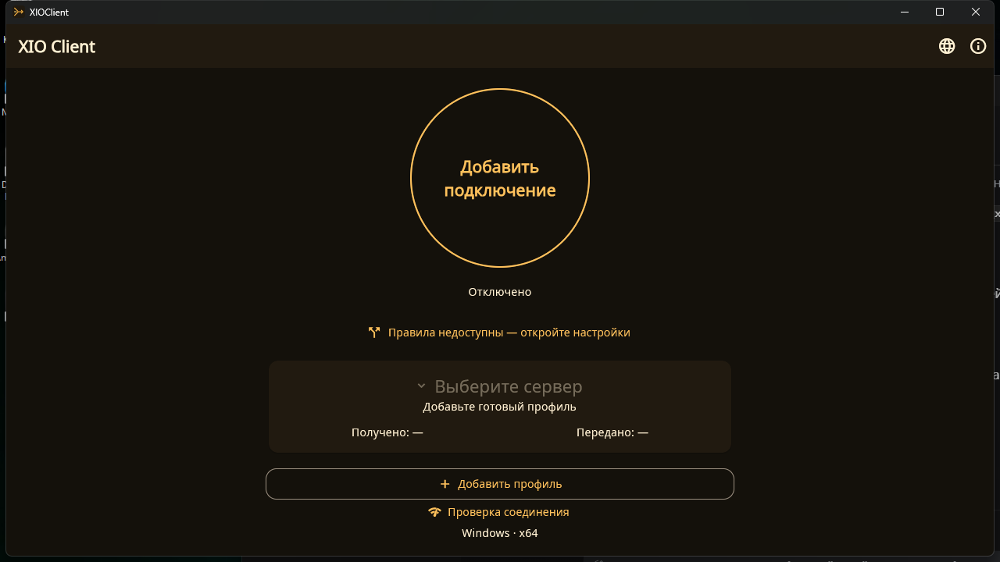 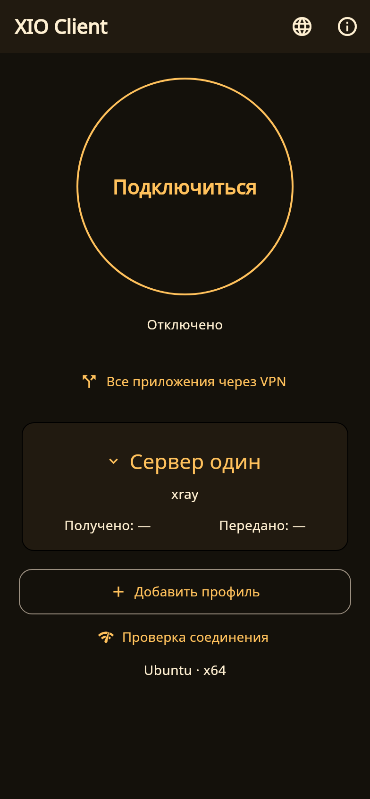</p>

Свежие кадры Android, снятые golden-рендером (`app/test/screenshots/capture_screens_test.dart`, команда в [docs/screenshots/README.md](docs/screenshots/README.md)):

| Главный, отключено | Вкладка «Настройки подключения» |
|---|---|
|  | 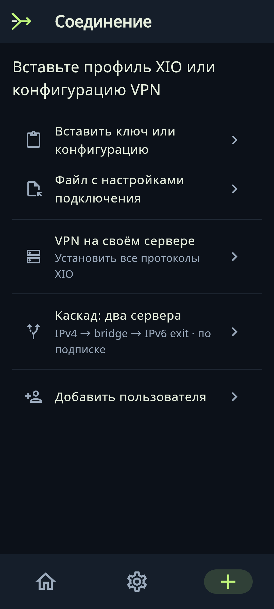 |

| «DNS-резолвер»: пресеты и свои адреса | «Telegram-прокси (MTProto)»: шаги и сохранённая ссылка |
|---|---|
| 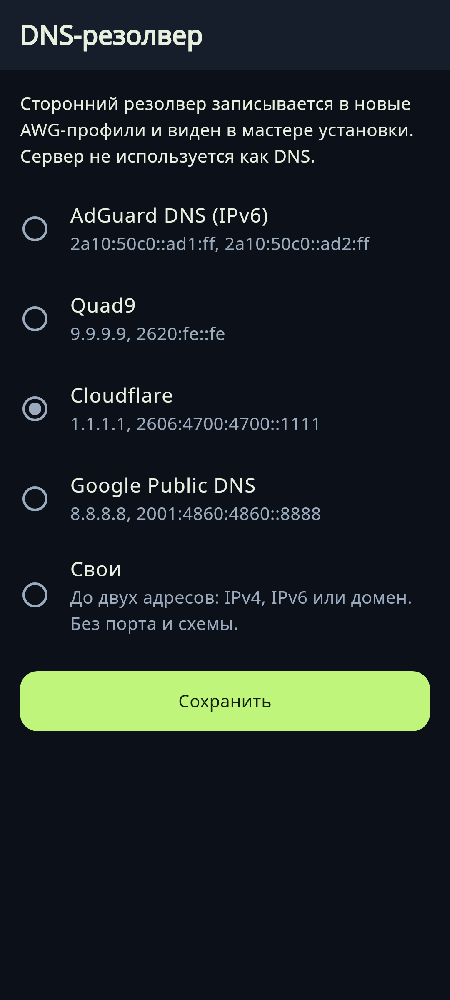 |  |

| «Маршрутизация»: режимы IP/сайтов и поле доменов |
|---|
|  |

Экраны Android на телефоне остаются чёрными в системном скриншоте: приложение ставит `FLAG_SECURE`. Это защита, а не баг — картинки Android в доках сняты с Flutter widget-тестов. Список ещё нужных кадров, с точными `adb`-командами и таблицей статусов, — в [docs/screenshots/README.md](docs/screenshots/README.md).

## Раздельное туннелирование

Включение или исключение выбранных приложений и правила по IP/CIDR в обе стороны. Доменные правила не поддерживаются: маршрутизация по имени требует собственного резолвера, а его у XIO пока нет.

Исключённый трафик идёт напрямую — если только Android lockdown не запрещает; тогда системное правило побеждает настройку. В каскаде правила живут на мосту (nft-множество `xio_whitelist4`), обновляются еженедельно и заменяются атомарно.

## Безопасность

- **Секреты профиля зашифрованы на диске.** Android Keystore с отключёнными бэкапами, Windows DPAPI, Ubuntu AES-GCM с локальным ключом и правами на файл, iOS Keychain.
- **Клиент никогда не получает серверных ключей.** SSH, root и админские креденшелы остаются в полном приложении; субклиенты получают только свои VPN-ключи.
- **SSH host-ключи запиннены.** Изменившийся ключ останавливает обслуживание, пока владелец не подтвердит его.
- **Bootstrap сверяет дайджест архива** до распаковки; подменённый поток отвергается.
- **Per-client конфиги не пишутся в `deployment.json`.** Повторный запрос возвращает `configsUnavailable`, а не выдаёт секреты дважды.
- **Секреты сравниваются за константное время** в `rivet user add` и проверках токенов.
- **Unit-файлы используют каталог креденшелов**, а не `%d`, чтобы секреты не разрастались в командную строку.
- **Песочница явная.** `ProtectSystem=strict` используется там, где работает read-only bind mount; иначе XIO записывает `sandboxMode: compat` и снимает только эту директиву, сохраняя `PrivateTmp`, `NoNewPrivileges` и ограничение capabilities.
- **Импорты санитизируются.** Профиль не может добавить слушателей, API-серверы, команды, пути файловой системы или direct/freedom outbounds.
- **Никакой телеметрии.** Ни рекламных или аналитических SDK, ни автоматических отчётов о падениях, ни каталога серверов.

## Как мы проверяем

Правило простое: **доказательством считается только наблюдаемый результат на реальном железе, а не успешная сборка.**

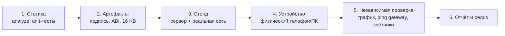

| Уровень | Что проверяется | Чем это не является |
|---|---|---|
| Статика | `flutter analyze`, unit/widget-тесты, Go-тесты, гейт паритета транспортов | не доказывает сеть |
| Артефакты | подпись APK, `package`/`versionCode`, ABI и выравнивание 16 KB | не доказывает подключение |
| Стенд | сервер ставится из поставляемого бандла, клиент подключается по реальной сети | не доказывает поведение телефона |
| Устройство | установка на физическое Android-устройство / запуск на Windows | не доказывает маршрут |
| Независимая проверка | HTTPS внутри туннеля, `ping` до gateway туннеля, серверные счётчики и `endpoint` | — |

`FAIL`, `BLOCKED` и `NOT_EXECUTED` так и записываются и никогда не подменяются на «работает». Подробности: [совместимость 0.24.0](docs/compatibility/0.24.0.en.md) · [физический прогон на Android](docs/verification/android-physical-2026-10-21.en.md).
## FAQ (частые вопросы)

**XIO — это подписочный VPN?** Нет. Это софт, который вы запускаете на своём VPS. Каскад тоже бесплатен: ни подписки, ни биллинга, ни стороннего аккаунта.

**Нужен ли root?** Не для самого VPN. Root нужен для раздачи VPN на Android.

**Какой транспорт выберется?** По умолчанию первым идёт Xray/REALITY, затем альтернативы того же сервера, затем другие профили. Порядок можно менять; заблокированный протокол заменяется раньше, чем меняется точка входа.

**Пишет «туннель активен», но ничего не грузится.** Проверьте счётчики и DNS на экране подключения — вот настоящее доказательство. Если они не двигаются, обычно виновата серверная сторона: NAT, firewall или DNS. «Интерфейс активен» без трафика — не успех по замыслу.

**Можно ли рядом с другим VPN?** Нет. Маршруты `/1` конфликтуют; выключите другой туннель.

**Где взять iOS?** Пока нигде: есть исходники, нет IPA. Нужны Mac, Xcode и Apple-подпись.

**Установка сервера упала на последнем шаге.** Это известный дефект упаковщика 0.24.0 (в пакете нет `readiness.py` и `xio-ready.service`). Берите 0.24.1 или новее.

**Гарантирует ли обход блокировок?** Нет. Нет полевых замеров с российскими операторами и нет независимого аудита RIVET. Дойти до точки входа и замаскировать транспорт — две разные задачи.

## Ограничения (что не проверено)

- **Xray/REALITY не подключается** на паре «клиент 0.23.x + gateway Xray 26.7.28»: реализация REALITY в клиентском ядре несовместима. AWG и RIVET работают.
- **AWG на Android в этой ветке (`main`):** `tun.CreateUnmonitoredTUNFromFD` может отдать TUN-дескриптор Go-финализатору, который позже закроет номер, уже принадлежащий чему-то другому; неудачная активация AWG может тогда убить посторонний сокет (`i/o timeout`, `accept4: bad file descriptor`). Фикс — сначала дублировать дескриптор — лежит в ветке `release-0.24.0` (`c2b3338`), в `main` его ещё нет.
- **Windows 0.24.0:** helper пересобран с WFP-фиксом firewall (правила по user SID и App ID вместо `netsh`), analyze, тесты и упаковка проходят. Живое GUI-подключение на 0.24.0 не перезапускалось; последний живой прогон — helper 0.22.5 с приложением 0.23.0.
- **Ubuntu GUI:** пакеты 0.24.0 собраны, GUI вживую не перепроверялся. Туннель работает через `libexec/xio-tunnel` и требует `systemd-resolved`.
- **Полный туннель на Linux отрезает локальную сеть:** пока туннель поднят, машина перестаёт отвечать на SSH из LAN, потому что весь непомеченный IPv4 уходит в туннель.
- **Каскад:** проверен на живой паре `81.177.142.37` → `103.102.135.124` (SSH TUN, IPv4 + IPv6 egress, 69.3 Мбит/с с BBR). Ограничения: нет установки в одну кнопку на оба сервера, TCP-over-TCP без запасного пути, нативная запись (receipt) ломается при переустановке APK; подробности в разделе [Каскад](#каскад-два-сервера-ipv4--ipv6).
- **Веб-панель** развёрнута и отвечает на живом сервере (`https://79e.ru/xio/`, health 1.1.0); терминальный bootstrap в этом прогоне не перезапускался.
- **Windows ICS-раздача** не валидировалась на живом хосте.
- **IPv6 должен маршрутизироваться провайдером.** XIO настраивает адресацию, forwarding и NAT66 на своих интерфейсах, но не может заставить upstream анонсировать или маршрутизировать префикс. DNS64/NAT64 не предоставляются.
- **iOS** не собран: нет Mac/Xcode/iPhone, нет IPA.
- **Полного паритета протоколов нет:** Android — 5 транспортов, Windows/Ubuntu — 4, iOS — 2.
- **Рядом с другим VPN** XIO не работает: маршруты `/1` конфликтуют.
- Приложение Windows не подписано сертификатом издателя, поэтому SmartScreen предупреждает.

## Клонирование и сборка из Git

Достаточно обычного клона. Модифицированные исходники AWG — отслеживаемые файлы, не сабмодули и не Git LFS: `vendor/amneziawg-go` (upstream `amnezia-vpn/amneziawg-go` v3.1.20260814 плюс XIO activation API, описанный в `vendor/amneziawg-go/XIO-CHANGES.md`) и `vendor/amneziawg` (Android-мост с предсобранными `jniLibs`). `protocol/rivet/go.mod` подменяет модуль на `../../vendor/amneziawg-go`, поэтому `go build ./...` работает сразу после клона.

```sh
git clone --recurse-submodules https://github.com/rukazax/xio_vpn.git
cd xio_vpn
cd app && flutter pub get && flutter analyze   # app/pubspec.yaml
cd ../protocol/rivet && go build ./...         # Go 1.27.x
```

`--recurse-submodules` безвреден и задел на будущее, но здесь ничего не делает: `.gitmodules` нет, и `git submodule update --init --recursive` тоже no-op. Вне дерева остаются только артефакты сборки: `tools/build-rivet.py` создаёт `vendor-server/*` и AAR, а `python3 tools/package-server.py --check` сверяет их с `vendor-metadata/rivet-build.json`.

## Документация

- [Возможности подробно](docs/features.md) · [Возможности (RU)](docs/features.ru.md)
- [Совместимость и статус 0.24.0](docs/compatibility/0.24.0.en.md)
- [Руководство](docs/en/guide.md) · [Загрузки](docs/en/downloads.md) · [FAQ](docs/en/faq.md) · [Сборка](docs/en/build.md)
- [Протоколы](docs/en/protocols.md) · [Библиотека RIVET](docs/protocols/README.md) · [Заметки о dual-stack](docs/dualstack/0.22.3.en.md)
- [Каскад](docs/cascade/README.md) · [Веб-панель](server/webui/README.md) · [Клиент и субклиенты](client/README.en.md)
- [Release notes 0.24.0](docs/release-notes-0.24.0.md) · [0.24.1 mobile](docs/release-notes-0.24.1-mobile.md) · [Changelog](CHANGELOG.md)
- [Какие скриншоты снять](docs/screenshots/README.md) · [Схемы](docs/landing/architecture.mmd) · [Сторонние компоненты](THIRD-PARTY-NOTICES.md)

## Лицензия

Оригинальный код — GPL-3.0-only. Сторонние компоненты сохраняют свои лицензии: [THIRD-PARTY-NOTICES.md](THIRD-PARTY-NOTICES.md). Отчёты о безопасности: [SECURITY.md](SECURITY.md). Contributing: [CONTRIBUTING.md](CONTRIBUTING.md).

---

## English

**EN** · [Русский — выше](#xio)

XIO is a self-hosted VPN system in three parts. **XIO Client** connects to servers that already exist. **Full XIO** deploys and maintains your own server over SSH. The **server payload** serves five transports at once. One portable `xio://` profile carries every transport the server offers; the client picks the one that works on the current network and switches without a new profile.

No subscription, no account on someone else's backend, no built-in server catalogue. You bring a VPS, XIO brings the rest.

[What this is](#what-this-is) · [Features](#features) · [Transports](#five-transports) · [IPv4 and IPv6](#ipv4-and-ipv6) · [Cascade](#cascade-two-servers-ipv4--ipv6) · [Install a server](#install-a-server) · [Clients](#clients-by-platform) · [Split tunnelling](#split-tunnelling) · [Security](#security) · [FAQ](#faq) · [Limitations](#limitations-what-is-not-verified)
### Current state: 0.24.13+5030 (17 Nov 2026)

The phone → Russian VPS → foreign VPS cascade is built, deployed and verified on live servers, and automatic failover between routes works again: when the first candidate does not come up the app connects the next one and publishes the accepted choice. The client no longer offers OpenVPN/Cloak; the server payload and the sections below still describe the full 0.24.0–0.24.2 set, including those transports.

0.24.13 turns the cascade into one action: the wizard installs the exit and then the bridge in a single pass, authorises the bridge key on the exit through the connection that is already open, and stores the addresses only after the bridge confirms the tunnel. Each server card shows its own plan, the step that is running and the line that proved the previous one; a failure names the step and keeps the output of the command that failed plus `journalctl -u xio-cascade-… -n 40`, captured before the connection closes. 0.24.11–0.24.12 are the groundwork behind it: per-ABI APKs with logging and geo-IP telemetry off, and a cascade that installs the tools it needs instead of assuming them.

| Check | Result |
|---|---|
| Bridge | `81.177.142.37` (RU, Debian 12), `xio-cascade-bridge` active |
| Exit | `103.102.135.124` (FR), `xio-cascade-exit` active, NAT44/NAT66 |
| Tunnel | SSH TUN `10.250.0.1 ⇄ 10.250.0.2`, ping 50.8 ms |
| Phone egress | IPv4 `103.102.135.124`, IPv6 `2a0c:b641:1a0:800::2a2`; direct xray exits `81.177.142.37` |
| Tests | `flutter test`: 1174 passed, 27 skipped, 0 failed |
| Analyse | `flutter analyze`: 0 errors |
| APK | `XIO-Full-0.24.13-android-arm64-v8a.apk` (52.4 MB) and `…-armeabi-v7a.apk` (52.3 MB), release v0.24.13 |

Commands and numbers: [CASCADE-ANDROID-RU-FR-20261117.md](docs/CASCADE-ANDROID-RU-FR-20261117.md) · [ANDROID-VALIDATION-20261117.md](docs/ANDROID-VALIDATION-20261117.md) · [screenshots](docs/screenshots/README.md) · [CHANGELOG](CHANGELOG.md).

**Known limits, not hidden:**

- the cascade is installed by one button, but the pass is not resumable: a refusal leaves the SSH connections open for a retry that starts again from the first step of the failed server, and it still needs a ready exit and bridge with root SSH (`deploy/cascade/native/`);
- automatic failover is verified against a closed port and against a stopped AWG service; when every candidate is dead the round still ends with one honest error;
- the bridge–exit link is an SSH TUN (TCP-over-TCP), not WireGuard: the WireGuard handshake succeeds but transport packets are lost; BBR is enabled on the bridge, not on the exit;
- the mobile profile uses `9.9.9.9` for DNS, not the carrier resolver;
- Yandex Browser on the test phone renders a blank page while the tunnel works; Chrome works. This is browser behaviour, not the cascade;
- verified in this run: import, connection, cascade, IPv4/IPv6 egress and the main screen. Xray/RIVET, Wi-Fi ↔ LTE switching and a long soak after BBR were not re-checked.

### What this is

| Part | What it does | Runs on |
|---|---|---|
| **XIO Client** | Imports `xio://`, chooses a transport, brings up the tunnel, verifies traffic. No SSH, no server keys. | Android 8+, Windows 11 x64, Ubuntu 22.04+ |
| **Full XIO** | SSH preflight, install, update and removal of the server; users, quotas, revocation, traffic. | Android, Windows, Ubuntu |
| **Server payload** | AmneziaWG, RIVET, Xray, Cloak, OpenVPN, counters, firewall, dual-stack routing. | Linux x86_64 VPS with systemd and `/dev/net/tun` |


Five steps from a profile to traffic:

1. **Import.** The administrator issues an `xio://` file: a base64 container with the user, the server and per-transport configurations. It is stored encrypted: Android Keystore (excluded from backups), Windows DPAPI, Ubuntu AES-GCM with file permissions, iOS Keychain.
2. **Choose.** The profile lists the transports that really exist for that server. If the platform has no engine for one of them, the client says so instead of silently substituting another.
3. **Connect.** The client creates a TUN interface, takes an address inside the tunnel and routes traffic through the chosen transport. Android uses the system `VpnService`; Windows and Ubuntu use a separate privileged helper that changes routes only after consent.
4. **Verify.** The tunnel is confirmed by a fresh exchange, growing counters and a DNS lookup through the tunnel. The HTTPS site probe is optional and off by default.
5. **Run.** The server accepts the traffic, assigns an internal address and NATs it to the internet.

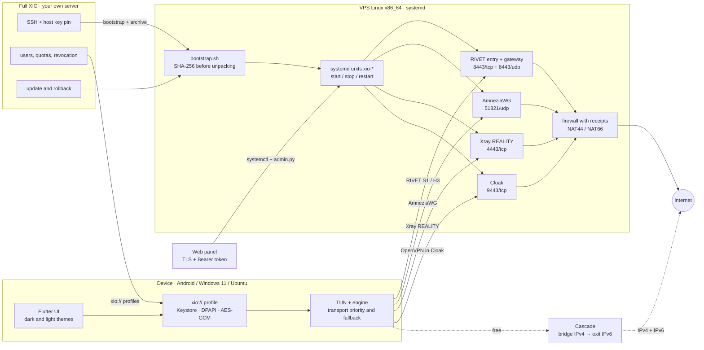

The diagram also exists as a standalone file: [docs/landing/architecture.mmd](docs/landing/architecture.mmd).

### Features

#### XIO Client

- **Portable profile.** One `xio://` file for every transport of one server; import from a file or paste the key. Imports accept client material only: no listeners, API servers, executable commands, filesystem paths or direct/freedom outbounds.
- **Transport priority and fallback.** The selected profile goes first, then variants of the same endpoint with another protocol, then other profiles. A blocked protocol is replaced before the entry point changes, so the VPS address is not lost. The default first choice is Xray/REALITY, on iOS RIVET/S1; the order is configurable and unavailable engines are skipped.
- **Live link watchdog.** While you want the tunnel, the link is checked every 15 seconds. After two consecutive misses the client reconnects, retrying after 5 seconds (the first three attempts) and 15 seconds afterwards until the server returns.
- **Honest verification.** "Interface active" alone is not a success: traffic counters and DNS through the tunnel must move. The site probe is an extra you can enable; with it off, the tunnel is confirmed by the handshake, counters and DNS.
- **Split tunnelling.** Include or exclude selected applications, and add IP/CIDR rules in either direction. Domain rules are not supported.
- **Subclients.** An explicitly granted account token can check quota and create or revoke only its own children through the server HTTPS API with a pinned certificate. A child export contains only that child's VPN keys and never the parent capability or SSH/root keys.
- **VPN sharing.** Android: requires root, IPv4 goes into the tunnel, DNS is redirected to `9.9.9.9`, IPv6 sharing is blocked. Windows: ICS-based, experimental and not verified on a live Windows host. Ubuntu and iOS: not available.
- **13 UI languages** with offline catalogues, dark and light themes.
- **Updates.** One check per week with a random offset; a release can be skipped. Metadata signature and package hash are verified before installation; Android installs through the system installer.
- **Privacy by default.** No advertising or analytics SDK, no automatic crash reporting, no built-in server catalogue, no endpoint geolocation. Android screens are protected with `FLAG_SECURE`.

#### Full XIO

- **Preflight before touching the server:** OS family and version, x86_64, systemd, `/dev/net/tun`, busy VPN ports, subnet conflicts, existing VPN interfaces and `/etc/wireguard/xio0.conf`.
- **Install from its own bundle.** The bootstrap verifies the archive SHA-256 before unpacking; a truncated or substituted stream is refused instead of being unpacked as root.
- **Users and quotas.** Issue and revoke users, limit the number of active records for delegated admins, export profiles in batch, and keep child ownership scoped to the creator.
- **Traffic accounting.** Per-user monthly bytes and online state from server counters sampled every 30 seconds; RIVET, AWG and OpenVPN are counted separately.
- **Service state and secret-free logs.** Which units are active, which failed and what the server advertises — without keys or passwords in the output.
- **Update and rollback.** The server is updated only while the VPN is off, with saved SSH credentials and a matching host key; users and keys survive, and a failed update rolls back.
- **Removal that cleans up after itself.** Only XIO-owned units, rules and keys are removed; IP forwarding is restored and shared packages are kept.

##### Your own cascade servers 🛠️

The cascade used to be a demo only. The app now lets you configure your own pair: open the **Cascade** screen, tap the **DNS** icon in the app bar and set the **Bridge** address (IPv4 or domain, e.g. `81.177.142.37`) and the **Exit** address (IPv6 only, e.g. `2a0c:b641:1a0:800::2a2`). Validation rejects schemes, ports, IPv6 in the bridge field, IPv4 in the exit field and values like `999.1.1.1`.

The addresses are stored in the app profile, the route stations display them, and the dialog shows the exact install command with your exit:

```bash
curl -fsSL https://raw.githubusercontent.com/rukazax/xio_vpn/main/deploy/cascade/terminal-install.sh \
  | bash -s -- --role bridge --exit-host 2a0c:b641:1a0:800::2a2
```

The "Copy command" button puts it on the clipboard. Subscription and server failover are still stubs.
### Server payload

- Five transports on one host, each with its own port and its own systemd unit.
- Managed firewall with receipts: every added rule is recorded and removed precisely; forwarding is scoped to the owned interfaces.
- Dual-stack: IPv4 and IPv6 listeners, NAT44 and NAT66, per-interface IPv6 subnets.
- systemd hardening: `LoadCredential` and `${CREDENTIALS_DIRECTORY}` instead of `%d` in unit files, `ProtectSystem=strict` where the kernel allows it, an explicit compatibility mode where it does not.
- Counters every 30 seconds; `status` returns a snapshot instead of running `wg` on every request.
- Restricted mode for IPv6-only VPS: no kernel WireGuard, no IPv4 default route, only the ports that can actually work.

More detail, examples and diagrams: [docs/features.md](docs/features.md).

### Five transports


XIO does not reinvent cryptography: each transport builds on a proven implementation, and RIVET is our own. The transports solve different problems: speed, camouflage, and networks where UDP is closed.

| Transport | Basis | Outer transport | Port | Use when | Android | Windows | Ubuntu | iOS |
|---|---|---|---|---|---|---|---|---|
| **AmneziaWG** | AmneziaWG 3.1 (WireGuard + obfuscation) | UDP | 51821 | fast everyday tunnel, obfuscated handshake | yes | yes | yes | - |
| **RIVET / S1** | in-house | TCP + TLS 1.3 | 8443/tcp | UDP is blocked, TLS is allowed | yes | yes* | yes* | source |
| **RIVET / H3** | in-house | QUIC / HTTP/3 + TLS 1.3 | 8443/udp | UDP works, TLS fingerprint filtering | yes | yes* | yes* | source |
| **Xray / REALITY** | Xray VLESS + REALITY | TCP | 4443/tcp | camouflage as a genuine TLS site | yes | yes* | yes* | - |
| **OpenVPN / Cloak** | OpenVPN inside Cloak | TCP + TLS obfuscation | 9443/tcp | strict networks, last resort | yes | - | - | - |

`yes` — engine present and a native run on this platform was performed; `yes*` — engine built, no native run on this platform; `source` — engine in source, no Apple build; `-` — not available. Android has five transports, Windows and Ubuntu four, iOS two.

The order is arranged so the protocol changes before the entry point: selected profile → same endpoint with another transport → other profiles.

#### AmneziaWG

WireGuard with an obfuscated handshake: fixed message headers are replaced, junk packets are inserted and handshake sizes are randomised (`Jc`, `Jmin`, `Jmax`, `S1`, `S2`, `H1`–`H4`). It is still a UDP tunnel: blocking all UDP also blocks AWG. The server runs the userspace `xio-amneziawg-go` for `xioawg0`; plain WireGuard (`xio0`) uses the kernel module and exists only in non-restricted installs.

#### RIVET

Our own development: two independent entrances to the same server, so blocking one does not kill access.

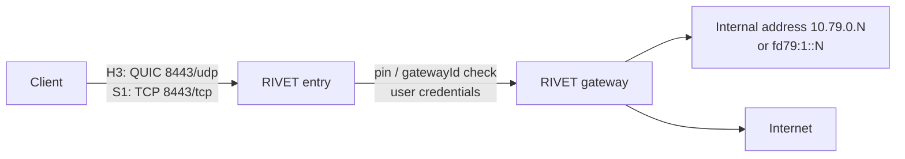

- Two transports (**H3** and **S1**) share one authentication, so the client switches without changing the profile.
- The gateway certificate is pinned (`pin`); every server has its own `gatewayId` and outer CA.
- A user gets a `secret` and an `entryToken`; the parent token is never passed to a subclient.
- Internal addressing is `10.79.0.N` with per-user traffic accounting, plus `fd79:1::/64` when the server advertises IPv6.

#### Xray / REALITY

VLESS with REALITY: the server presents a real TLS site's parameters and the client verifies the expected certificate/SNI pair. On the wire it looks like ordinary HTTPS. On the tested pair "client 0.23.x + gateway Xray 26.7.28" REALITY does not connect; see [Limitations](#limitations-what-is-not-verified).

#### OpenVPN / Cloak

OpenVPN wrapped in Cloak's TLS obfuscation. It exists for networks where only TCP/443-like traffic is allowed and is the client's last resort. Only Android declares the Cloak engine.

#### Server-side transports

WireGuard, Shadowsocks and IKEv2 are installed on the server but not offered by the XIO client. They exist for compatibility with other clients and for restricted deployments.

| Port | Protocol | Service | Notes |
|---|---|---|---|
| 8443/tcp + 8443/udp | TCP / QUIC | RIVET S1 and H3 | TLS 1.3, pinned gateway certificate |
| 4443/tcp | TCP | Xray / REALITY | VLESS, masquerades as a real site |
| 9443/tcp | TCP | Cloak | OpenVPN TCP behind TLS obfuscation |
| 1194/udp | UDP | OpenVPN UDP | direct, no Cloak |
| 1195/tcp | TCP | OpenVPN TCP | loopback only, exposed through Cloak |
| 51821/udp | UDP | AmneziaWG | obfuscated WireGuard |
| 51820/udp | UDP | WireGuard | non-restricted installs only |
| 8388/tcp + 8388/udp | TCP/UDP | Shadowsocks | server-side only |
| 500/udp, 4500/udp | UDP | IKEv2 / IPsec | server-side only |
| 9444/tcp | TCP | Account API | only when an account token is granted |

Deep dives: [protocol notes](docs/en/protocols.md) · [RIVET library](docs/protocols/README.md) · [RIVET implementation 0.2 (RU)](RIVET-IMPLEMENTATION-0.2.ru.md).

### IPv4 and IPv6


The outer transport and the inner address are independent:

- An endpoint may be an IPv4 address, an IPv6 address, or a domain with A and/or AAAA records.
- Xray and Cloak try both address families. RIVET tries them sequentially, because concurrent authorisation of one identity can replace a peer.
- RIVET/S1, RIVET/H3, AmneziaWG and OpenVPN carry IPv4 and IPv6 inside the tunnel. IPv6 addresses are issued only by a server that explicitly advertises support.
- Managed addressing, forwarding and NAT66 require real provider routing. Only owned changes are made, each with a receipt and a precise rollback.
- DNS comes from the profile and goes through the tunnel.
- **XIO does not provide DNS64, NAT64 or CLAT.** IPv4 literals and IPv4 packets are not translated inside an IPv6-only network; such a host needs an IPv4 egress or provider-side NAT64.
- IPv6 extension headers, fragments and jumbograms are not supported. TCP, UDP and limited ICMPv6 are.

| Transport | IPv4 subnet | IPv6 subnet |
|---|---|---|
| WireGuard (non-restricted) | `10.77.0.0/24` | `fd77:1::/64` |
| AmneziaWG | `10.78.0.0/24` | `fd78:1::/64` |
| RIVET | `10.79.0.0/24` | `fd79:1::/64` |
| OpenVPN UDP | `10.80.0.0/24` | `fd80:0::/64` |
| OpenVPN TCP | `10.81.0.0/24` | `fd80:1::/64` |
| IKEv2 / IPsec | `10.82.0.0/24` | - |

#### IPv6-only VPS

`restrictedNetwork` mode is for a server that has no IPv4 default route:

- no kernel WireGuard and no `xio0`; AmneziaWG runs in userspace;
- only transports that can work are installed: AWG, RIVET, Xray, Cloak, OpenVPN TCP;
- the firewall opens `4443/tcp`, `9443/tcp`, `8443`, `51821/udp` — not the IPv4-only set;
- the preflight records `outboundByFamily: {ipv6: eth0}` and reports `ipv4DefaultRoute: false` instead of pretending the host is dual-stack.

Verified on a VPS with global IPv6 `2a0c:b641:1a0:800::2a2`: the client receives `fd79:1::fe/128`, `ping6` and `wget -6` pass through the tunnel, and the answer comes from the VPS global address (NAT66). The outer IPv6 entry `[2a0c:b641:1a0:800::2a2]:18443` connected in 129–159 ms.

### Cascade: two servers, IPv4 → IPv6

The cascade is free: no subscription, no account. The device reaches **bridge** over AmneziaWG (IPv4), the bridge keeps an **SSH TUN** to **exit**, and the exit serves traffic to the internet over IPv4 and IPv6. This exact scheme was deployed and verified on 17 Nov 2026 on the live pair `81.177.142.37` (RU) → `103.102.135.124` (FR).


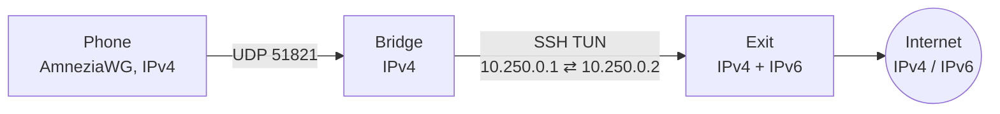

**What the app shows in 0.24.8.** The main-screen card and the Cascade screen report the same state:

- three stations — 🇷🇺 device → 🇷🇺 bridge → 🇫🇷 exit — with addresses and country flags;
- the real egress: `103.102.135.124 FR` for IPv4 plus the exit's global IPv6;
- "Cascade active" only while the tunnel is actually up, not just because addresses are saved;
- "Check cascade": with a saved SSH server it really probes the bridge; without one it honestly asks `api.ipify.org` for the actual egress and stores the address and country. No demo timers, no fake latency.

Real POCO X6 captures, not mockups:

| Main screen with cascade flags | IPv4 egress | IPv6 egress |
|---|---|---|
|  |  |  |

**Installing on live servers — `deploy/cascade/native/`.** Native scripts and systemd units, not a Docker container; they are idempotent, and `systemctl restart` recreates the rules without duplicating them.

1. **Exit** (`103.102.135.124`): put `xio-cascade-exit-{up,down}.sh` into `/usr/local/sbin/` and `xio-cascade-exit.service` into `/etc/systemd/system/`, then `systemctl enable --now xio-cascade-exit`. The unit brings up `tun0` `10.250.0.2/30` and `fd78:2::2/64`, forwarding and NAT44/NAT66.
2. **Bridge** (`81.177.142.37`): install its scripts and unit the same way, write `XIO_CASCADE_EXIT_HOST=103.102.135.124` to `/etc/xio-cascade/bridge.env`, then `systemctl enable --now xio-cascade-bridge`. The unit keeps `ssh -N -w 0:0` to the exit and restarts on failure.
3. **SSH trust** once: `PermitTunnel yes` on the exit; the bridge key `/root/.ssh/xio_cascade` added to the exit's `authorized_keys`.

Measured on that pair: `ping 10.250.0.1` from the exit — 50.8 ms; 20 MiB through `tun0` — 2.309 s (**69.3 Mbit/s**) with BBR on the bridge, `tcp_mtu_probing=1` and 16 MiB buffers; without BBR the same pair collapsed to 1.5 Mbit/s at ≈8 % loss. Commands and numbers: [docs/CASCADE-ANDROID-RU-FR-20261117.md](docs/CASCADE-ANDROID-RU-FR-20261117.md).

| What | Where |
|---|---|
| Verified native scripts and units | `deploy/cascade/native/` |
| Container installer for bridge/exit/both (earlier path) | `deploy/cascade/`, `deploy/cascade/terminal-install.sh` |
| Health check | `deploy/cascade/cascade-healthcheck.sh` → `/var/lib/xio-cascade/health.json` |
| Whitelists on the bridge | `deploy/cascade/whitelist-update.sh`, weekly timer |
| Server web UI (TLS + token) | `server/webui/` |
| Full description and diagram | [docs/cascade/README.md](docs/cascade/README.md) |

**Your own cascade servers.** On the Cascade screen the **DNS** icon opens a dialog:

| Field | What to enter | Validation |
|---|---|---|
| **Bridge** | IPv4 or domain, e.g. `81.177.142.37` | rejects schemes, ports, IPv6 and "999.1.1.1" |
| **Exit** | IPv6 literal, e.g. `2a0c:b641:1a0:800::2a2` (brackets allowed) | rejects IPv4, DNS names and garbage |

The addresses are stored in the profile, the stations show them, and the dialog offers a ready install command. In the verified pair the exit is set by IPv4 in `bridge.env` because the SSH TUN runs over IPv4; the dialog accepts an IPv4 address, an IPv6 literal or a host name, so the IPv4 value is a choice and not a workaround.

**Honest cascade limits:**

- there is no single button that installs the cascade on both servers; the bridge and the exit are separate steps, although both script sets are in the repository;
- updating or reinstalling the APK breaks the saved native receipt: a clean install, profile import and connection work, but after a reinstall the app may report "saved plan could not be reconciled";
- the SSH TUN is TCP-over-TCP: it survives on BBR, and BBR is enabled on the bridge but not on the exit (kernel without `tcp_bbr`); one path, no backup;
- WireGuard between the servers did not come up for data: the handshake succeeds but transport packets are lost, which is why the SSH TUN was chosen;
- the mobile profile uses `9.9.9.9` for DNS and the queries go through the cascade;
- Yandex Browser on the test phone renders a blank page while the tunnel works; Chrome works. This is browser behaviour, not the cascade.
### Install a server


**A clean VPS is required:** x86_64, Debian 12/13, Ubuntu 22.04/24.04/26.04, or RHEL/Alma/Rocky 9/10, systemd, `/dev/net/tun`, no other VPN on the host.

#### 1. From the app (recommended)

1. Open **Full XIO** → "+" → server setup.
2. Enter the address and SSH credentials (key or password).
3. The preflight checks OS, architecture, systemd, TUN, ports and subnets.
4. Install: the app uploads its own bundle, verifies the digest, installs the services and reports the unit state.
5. Create users and export their `xio://` profiles.

#### 2. One command in a terminal

The bootstrap reads the archive from stdin. Take both names from the [Releases](https://github.com/rukazax/xio_vpn/releases) page — a release candidate carries a `-rcN` suffix in the tag while its asset keeps the plain version number, so they are separate variables:

```bash
TAG=0.24.1-rc13                  # tag on the release page, without the leading "v"
FILE=xio-server-0.24.1.tar.gz    # asset name on that release
curl -fsSLo xio-server.tar.gz \
  "https://github.com/rukazax/xio_vpn/releases/download/v${TAG}/${FILE}"
curl -fsSLo xio-bootstrap.sh \
  https://raw.githubusercontent.com/rukazax/xio_vpn/main/server/managed/bootstrap.sh
sudo XIO_EXPECTED_ARCHIVE_SHA256="<sha256 from SHA256SUMS>" \
  bash xio-bootstrap.sh < xio-server.tar.gz
```

If `v0.24.1` is already published, use it as `TAG` — the stable tag has no `-rc` suffix.

Without `XIO_EXPECTED_ARCHIVE_SHA256` the bootstrap still refuses a broken archive, but the digest pin is what makes a substituted stream stop before it is unpacked as root. Take the hash from `SHA256SUMS-<version>.txt` on the release page.

> **Server package versions matter.** 0.23.1 shipped a payload that failed the firewall step (`iptables: Can't use -i with POSTROUTING`) and broke `status` on IPv6-only hosts. 0.24.0 fixed that but its packager left `readiness.py` and `xio-ready.service` out of the tarball, so an install on a clean host ended with exit code 1 on the last step. Both are fixed in 0.24.1 (`RECIPE` 26). For a new server take **0.24.1 or newer**.

#### 3. The web panel

```bash
sudo ./install-webui.sh                 # https://127.0.0.1:10443
sudo ./install-webui.sh 0.0.0.0:10443   # all interfaces, behind a reverse proxy only
```

The script prints the URL with a token, the token itself and the certificate SHA-256 fingerprint. Services, users and the cascade are managed from one page; the panel speaks TLS only, uses a Bearer token plus a `SameSite=Strict` cookie and requires a CSRF header for POST. Details: [server/webui/README.md](server/webui/README.md).

#### What ends up on the server

| Path | Contents |
|---|---|
| `/usr/local/lib/xio-managed` | server code: `admin.py`, `stack.py`, `network_stack.py`, `dualstack.py`, binaries |
| `/etc/xio-managed/deployment.json` | deployment state: host, users, keys, counters, receipts — without per-client configs |
| `/etc/xio-rivet` | RIVET public state and installer receipt |
| `/usr/local/lib/xio-rivet` | RIVET binary and setup script |
| `/var/lib/xio-stack` | stack counters and runtime state |

Units: `xio-managed-awg`, `xio-managed-stats.timer`, `xio-rivet-entry`, `xio-rivet-gateway`, `xio-stack`, `xio-cloak`, `xio-openvpn-udp`, `xio-openvpn-tcp`, `xio-ikev2`, `xio-client-api`, `xio-ready`.

Administration is JSON on stdin:

```sh
printf '%s\n' '{"action":"status","serverId":"<id>"}' \
  | python3 /usr/local/lib/xio-managed/admin.py
```

| Action | What it does |
|---|---|
| `init` | first installation; `host` and `restrictedNetwork` are required |
| `inspect` | public server description and phase |
| `status` | services, counters, users, monthly traffic |
| `add` | create a user and return per-transport configs |
| `revoke` | revoke a user and its children |
| `remove` | remove only XIO-owned units, rules, keys and packages |
| `client-grant` | issue a scoped account token for subclients |

### Clients by platform

`XIO-<App>-<version>-<OS>-<arch>.<ext>`. `App` is `Client` or `Full`, `OS` is `android`, `windows` or `ubuntu`, architecture is `arm64-v8a`, `armeabi-v7a`, `x86_64`, `universal`, `amd64` or `x64`.

Everything is on the [Releases](https://github.com/rukazax/xio_vpn/releases) page, including `SHA256SUMS` files. Verify with `sha256sum -c SHA256SUMS-<version>.txt` or `Get-FileHash <file> -Algorithm SHA256`.

#### Android — Full or Client?

| | **XIO Full** (`app.xio.xio`) | **XIO Client** (`app.xio.client`) |
|---|---|---|
| Connect to an existing server | yes | yes |
| Own server over SSH | yes | no |
| Users, quotas, revocation | yes | no (subclients only, if granted) |
| VPN sharing | yes | no |
| Five transports | yes | yes |
| Package size | ~58 MB | ~57 MB |

Android 8+; ARM64 is the usual choice, ARM32 for old devices, x86_64 for emulators, `universal` if you do not want to think about it. Open the APK, allow installation from this source, and the update installs over the previous version keeping profiles.

On MIUI/HyperOS `adb install` may answer `INSTALL_FAILED_USER_RESTRICTED`. The working path:

```bash
APK=XIO-Full-<version>-android-arm64-v8a.apk
adb push "$APK" /data/local/tmp/xio.apk
adb shell pm install -r -g /data/local/tmp/xio.apk
```

Android 0.24.1 is `0.24.1+5018`, signed with the same certificate (SHA-256 `e4e81b12…c9671`; the alias of the historical signature is kept in the keystore), so it updates over 0.23.x/0.24.x without uninstalling. The newest APKs on the Releases page are 0.24.0 — the 0.24.1 Android set is being prepared, and its notes are in [docs/release-notes-0.24.1-mobile.md](docs/release-notes-0.24.1-mobile.md).

#### Windows 11 x64

Fully unpack the ZIP and run `XIO.exe`. The helper `libexec\xio-tunnel.exe` starts elevated: it needs that to create the network interface. Wintun is included with its licence. Four transports (no Cloak). The build is not signed with a publisher certificate, so SmartScreen warns — that is expected.

- Full XIO for Windows: in the 0.24.0 release.
- XIO Client for Windows: published in 0.23.1; 0.24.0 did not include it.

#### Ubuntu 22.04+

```bash
sudo apt install ./XIO-*-ubuntu-amd64.deb
```

The package name drifted between releases (`XIO-Full-…-ubuntu-amd64.deb` in 0.24.0, `XIO-…-ubuntu-amd64.deb` in 0.24.1), hence the wildcard — or unpack the `.tar.gz`.

The GUI runs as your user; the network helper asks for system authorisation through polkit. `systemd-resolved` is required: without it the connect is rejected with `systemd-resolved could not configure VPN DNS`. Four transports.

> The 0.24.0 packages are built, but the GUI was not re-verified live (in 0.23.0 the window never appeared: the process lived, the Impeller/EGL surface did not come up). The tunnel works through `libexec/xio-tunnel`.

#### iOS

There is no IPA. The source supports RIVET/H3 and S1 and needs a Mac, Xcode, an Apple Developer team and NetworkExtension entitlements. See [build from source](docs/en/build.md).

#### Screenshots

<p>  </p>

Fresh Android frames produced by the golden render (`app/test/screenshots/capture_screens_test.dart`, command in [docs/screenshots/README.md](docs/screenshots/README.md)):

| Home, disconnected | "Connection settings" tab |
|---|---|
|  |  |

| "DNS resolver": presets and custom addresses | "Telegram proxy (MTProto)": steps and the saved link |
|---|---|
|  |  |

| "Routing": IP/site modes and the domains field |
|---|
|  |

Android screens on the phone stay black in a system screenshot: the app sets `FLAG_SECURE`. That is protection, not a bug — the Android images in the docs come from Flutter widget tests. The list of frames we still need, with exact `adb` commands and a status table, is in [docs/screenshots/README.md](docs/screenshots/README.md).

### Split tunnelling

Include or exclude selected applications, and add IP/CIDR rules in either direction. Domain rules are not supported: routing by name needs its own resolver, and XIO does not have one yet.

Excluded traffic goes directly — unless Android lockdown forbids it, in which case the system rule wins over the setting. In a cascade the rules live on the bridge (`xio_whitelist4` nft set), are refreshed weekly and replaced atomically.

### Security

- **Profile secrets are encrypted at rest.** Android Keystore with backups disabled, Windows DPAPI, Ubuntu AES-GCM with a local key and file permissions, iOS Keychain.
- **The client never receives server keys.** SSH, root and admin credentials stay in the full application; subclients get only their own VPN keys.
- **SSH host keys are pinned.** A changed key stops maintenance until the owner confirms it.
- **The bootstrap verifies the archive digest** before unpacking; a substituted stream is refused.
- **Per-client configs are not written into `deployment.json`.** A replay returns `configsUnavailable` instead of handing out secrets twice.
- **Secrets are compared in constant time** in `rivet user add` and token checks.
- **Unit files use a credentials directory**, not `%d`, so secrets are not expanded into the command line.
- **Sandbox is explicit.** `ProtectSystem=strict` is used where a read-only bind mount works; otherwise XIO records `sandboxMode: compat` and drops only that directive, keeping `PrivateTmp`, `NoNewPrivileges` and capability bounding.
- **Imports are sanitised.** A profile cannot add listeners, API servers, commands, filesystem paths or direct/freedom outbounds.
- **No telemetry.** No advertising or analytics SDK, no automatic crash reporting, no server catalogue.
### How we test

The rule is simple: **only an observed result on real hardware counts as evidence, not a successful build.**

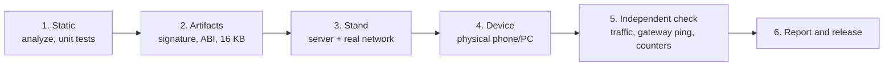

| Level | What is checked | What it is not |
|---|---|---|
| Static | `flutter analyze`, unit/widget tests, Go tests, transport parity gate | does not prove networking |
| Artifacts | APK signature, `package`/`versionCode`, ABI and 16 KB alignment | does not prove a connection |
| Stand | the server is installed from the shipped bundle and a client connects over a real network | does not prove phone behaviour |
| Device | install on a physical Android device / run on Windows | does not prove the route |
| Independent check | HTTPS inside the tunnel, `ping` to the tunnel gateway, server counters and `endpoint` | - |

`FAIL`, `BLOCKED` and `NOT_EXECUTED` are written as such and never replaced with "works". Details: [compatibility 0.24.0](docs/compatibility/0.24.0.en.md) · [physical Android run](docs/verification/android-physical-2026-10-21.en.md).

### FAQ

**Is XIO a subscription VPN?** No. It is software you run on your own VPS. The cascade is free too: no subscription, no billing, no third-party account.

**Do I need root?** Not for the VPN itself. Root is needed for VPN sharing on Android.

**Which transport will it pick?** Xray/REALITY first by default, then the alternatives of the same server, then other profiles. You can reorder them; a blocked protocol is replaced before the entry point changes.

**It says "tunnel active" but nothing loads.** Check counters and DNS on the connection screen — they are the real proof. If they do not move, the server side is the usual suspect: NAT, firewall, or DNS. "Interface active" without traffic is not a success by design.

**Can I run it next to another VPN?** No. The `/1` routes conflict; disable the other tunnel.

**Where do I get iOS?** Nowhere yet: there is source, not an IPA. It needs a Mac, Xcode and Apple signing.

**The server install failed at the last step.** That is the known 0.24.0 packager defect (`readiness.py` and `xio-ready.service` missing). Take 0.24.1 or newer.

**Does it guarantee bypassing blocks?** No. There are no field measurements with Russian carriers and no independent audit of RIVET. Reaching the entry point and camouflaging the transport are two different jobs.

### Limitations (what is not verified)

- **Xray/REALITY does not connect** on "client 0.23.x + Xray 26.7.28 gateway": the REALITY implementation in the client core is incompatible. AWG and RIVET work.
- **AWG on Android in this branch (`main`):** `tun.CreateUnmonitoredTUNFromFD` can hand the TUN descriptor to a Go finalizer, which later closes a number that already belongs to something else; an AWG activation that failed earlier can then kill an unrelated socket (`i/o timeout`, `accept4: bad file descriptor`). The fix — duplicating the descriptor first — is in the `release-0.24.0` branch (`c2b3338`), `main` does not have it yet.
- **Windows 0.24.0:** the helper is rebuilt with the WFP firewall fix (rules by user SID and App ID instead of `netsh`), analyze, tests and packaging pass. A live GUI connection on 0.24.0 was not re-run; the last live run was the 0.22.5 helper with the 0.23.0 application.
- **Ubuntu GUI:** 0.24.0 packages are built, the GUI was not re-verified live. The tunnel works through `libexec/xio-tunnel` and needs `systemd-resolved`.
- **A full tunnel on Linux cuts off the local network:** while the tunnel is up the machine stops answering SSH from the LAN, because all unmarked IPv4 goes into the tunnel.
- **Cascade:** verified on the live pair `81.177.142.37` → `103.102.135.124` (SSH TUN, IPv4 + IPv6 egress, 69.3 Mbit/s with BBR). Limits: no one-button install on both servers, TCP-over-TCP without a backup path, the native receipt breaks when the APK is reinstalled; see the [Cascade section](#cascade-two-servers-ipv4--ipv6) for details.
- **The web panel** is deployed and answers on a live server (`https://79e.ru/xio/`, health 1.1.0); the terminal bootstrap was not re-run in this pass.
- **Windows ICS sharing** was not validated on a live host.
- **IPv6 must be routed by the provider.** XIO configures addressing, forwarding and NAT66 on its own interfaces, but cannot make an upstream announce or route a prefix. DNS64/NAT64 are not provided.
- **iOS** is not built: no Mac/Xcode/iPhone, no IPA.
- **Full protocol parity is not achieved:** Android 5 transports, Windows/Ubuntu 4, iOS 2.
- **Alongside another VPN** XIO does not work: the `/1` routes conflict.
- The Windows application is not signed with a publisher certificate, so SmartScreen warns.

### Clone and build from Git

A plain clone is enough. The modified AWG sources are tracked files, not submodules and not Git LFS: `vendor/amneziawg-go` (upstream `amnezia-vpn/amneziawg-go` v3.1.20260814 plus the XIO activation API documented in `vendor/amneziawg-go/XIO-CHANGES.md`) and `vendor/amneziawg` (Android bridge with the prebuilt `jniLibs`). `protocol/rivet/go.mod` replaces the module with `../../vendor/amneziawg-go`, so `go build ./...` works straight after cloning.

```sh
git clone --recurse-submodules https://github.com/rukazax/xio_vpn.git
cd xio_vpn
cd app && flutter pub get && flutter analyze   # app/pubspec.yaml
cd ../protocol/rivet && go build ./...         # Go 1.27.x
```

`--recurse-submodules` is harmless and future-proof, but does nothing here: there is no `.gitmodules`, and `git submodule update --init --recursive` is a no-op as well. Only build artifacts stay out of the tree: `tools/build-rivet.py` produces `vendor-server/*` and the AAR, and `python3 tools/package-server.py --check` verifies them against `vendor-metadata/rivet-build.json`.

### Documentation

- [Features in detail](docs/features.md) · [Возможности (RU)](docs/features.ru.md)
- [Compatibility and status 0.24.0](docs/compatibility/0.24.0.en.md)
- [Guide](docs/en/guide.md) · [Downloads](docs/en/downloads.md) · [FAQ](docs/en/faq.md) · [Build](docs/en/build.md)
- [Protocols](docs/en/protocols.md) · [RIVET library](docs/protocols/README.md) · [Dual-stack notes](docs/dualstack/0.22.3.en.md)
- [Cascade](docs/cascade/README.md) · [Web panel](server/webui/README.md) · [Client and subclients](client/README.en.md)
- [Release notes 0.24.0](docs/release-notes-0.24.0.md) · [0.24.1 mobile](docs/release-notes-0.24.1-mobile.md) · [Changelog](CHANGELOG.md)
- [Screenshots to take](docs/screenshots/README.md) · [Diagrams](docs/landing/architecture.mmd) · [Third-party notices](THIRD-PARTY-NOTICES.md)

### License

Original code is GPL-3.0-only. Third-party components keep their own licences: [THIRD-PARTY-NOTICES.md](THIRD-PARTY-NOTICES.md). Security reports: [SECURITY.md](SECURITY.md). Contributing: [CONTRIBUTING.md](CONTRIBUTING.md).

---

#vpn #self-hosted #android #flutter #linux #windows #amneziawg #xray #rivet #quic #tls #networking
