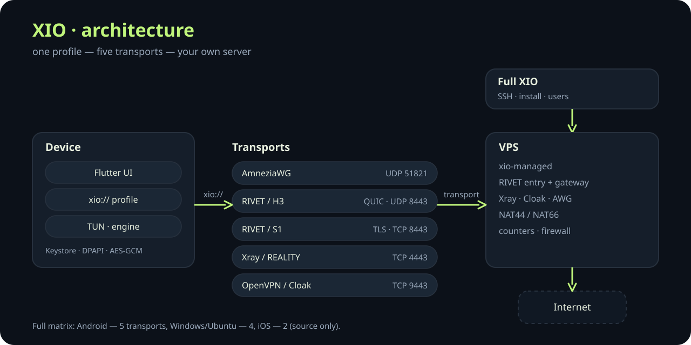
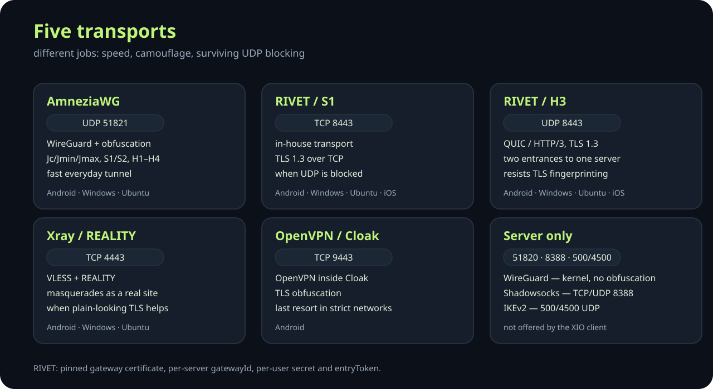
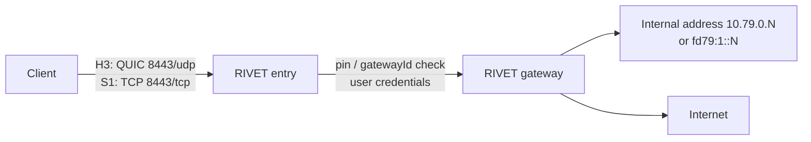
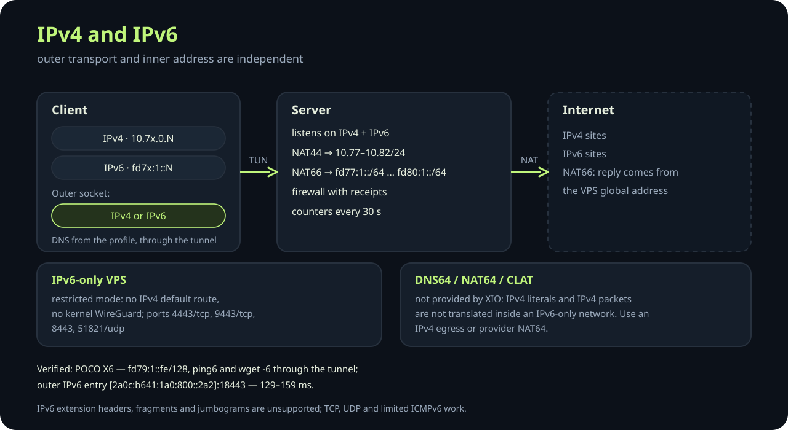
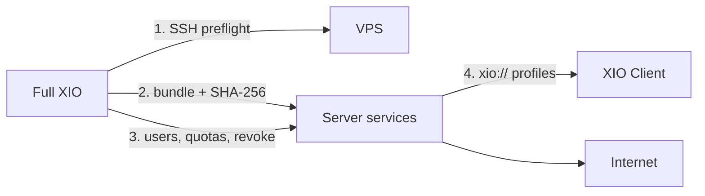
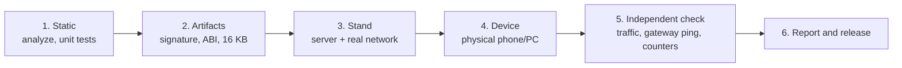

<p align="center">
  <a href="https://github.com/rukazax/xio_vpn">
    
  </a>
</p>

<h1 align="center">XIO</h1>

<p align="center"><b>X in, 1 out.</b> Your VPN, your servers, one interface.</p>

<p align="center">Android &middot; Windows &middot; Ubuntu &middot; iOS (source) &middot; IPv4 + IPv6</p>

<p align="center">
  <a href="https://github.com/rukazax/xio_vpn/releases/tag/v0.24.0"></a>
  <a href="LICENSE"></a>
  <a href="https://github.com/rukazax/xio_vpn/releases/tag/v0.24.0"></a>
  <a href="#protocols"></a>
  <a href="#ipv4-and-ipv6"></a>
  <a href="docs/compatibility/0.24.0.en.md"></a>
</p>

<p align="center">
  <a href="README.md">English</a> |
  <a href="README.ru.md">Русский</a>
</p>

XIO is a self-hosted VPN system in three parts: **XIO Client** connects to servers that already exist,
**Full XIO** deploys and maintains your own server over SSH, and the **server payload** serves five
transports at once. One portable `xio://` profile carries every transport the server offers; the
client picks the one that works on the current network and switches without a new profile.

[Overview](#overview) &middot; [Features](#features) &middot; [Screenshots](#screenshots) &middot; [Protocols](#protocols) &middot;
[IPv4 and IPv6](#ipv4-and-ipv6) &middot; [Install](#install) &middot; [Quick start](#quick-start) &middot;
[Server](#server-management) &middot; [Security](#security-model) &middot; [Limitations](#limitations) &middot;
[Русский](README.ru.md)

## Overview

| Part | What it does | Runs on |
|---|---|---|
| **XIO Client** | Imports `xio://`, chooses a transport, brings up the tunnel, verifies traffic. No SSH, no server keys. | Android 8+, Windows 11 x64; Ubuntu 22.04+ through the full application; iOS from source |
| **Full XIO** | SSH preflight, install, update and removal of the server; users, quotas, revocation, traffic. | Android, Windows, Ubuntu |
| **Server payload** | AmneziaWG, RIVET, Xray, Cloak, OpenVPN, counters, firewall, dual-stack routing. | Linux x86_64 VPS with systemd and `/dev/net/tun` |



Five steps from a profile to traffic:

1. **Import.** The administrator issues an `xio://` file: a base64 container with the user, the server
   and per-transport configurations. It is stored encrypted: Android Keystore (excluded from backups),
   Windows DPAPI, Ubuntu AES-GCM with file permissions, iOS Keychain.
2. **Choose.** The profile lists the transports that really exist for that server. If the platform has
   no engine for one of them, the client says so instead of silently substituting another.
3. **Connect.** The client creates a TUN interface, takes an address inside the tunnel and routes
   traffic through the chosen transport. Android uses the system `VpnService`; Windows and Ubuntu use a
   separate privileged helper that changes routes only after consent.
4. **Verify.** The tunnel is confirmed by a fresh exchange, growing counters and a DNS lookup through
   the tunnel. The HTTPS site probe is optional and off by default.
5. **Run.** The server accepts the traffic, assigns an internal address and NATs it to the internet.

## Features

### XIO Client

- **Portable profile.** One `xio://` file for every transport of one server; import from a file or
  paste the key. Imports accept client material only: no listeners, API servers, executable commands,
  filesystem paths or direct/freedom outbounds.
- **Transport priority and fallback.** The selected profile goes first, then variants of the same
  endpoint with another protocol, then other profiles. A blocked protocol is replaced before the entry
  point changes, so the VPS address is not lost. The default first choice is Xray/REALITY, on iOS
  RIVET/S1; the order is configurable and unavailable engines are skipped.
- **Live link watchdog.** While you want the tunnel, the link is checked every 15 seconds. After two
  consecutive misses the client reconnects, retrying after 5 seconds (the first three attempts) and
  15 seconds afterwards until the server returns.
- **Honest verification.** "Interface active" alone is not a success: traffic counters and DNS through
  the tunnel must move. The site probe is an extra you can enable; with it off, the tunnel is confirmed
  by the handshake, counters and DNS.
- **Split tunnelling.** Include or exclude selected applications, and add IP/CIDR rules in either
  direction. Domain rules are not supported. Excluded traffic goes directly unless Android lockdown
  blocks it.
- **Subclients.** An explicitly granted account token can check quota and create or revoke only its own
  children through the server HTTPS API with a pinned certificate. A child export contains only that
  child's VPN keys and never the parent capability or SSH/root keys.
- **VPN sharing.** Android: requires root, IPv4 goes into the tunnel, DNS is redirected to `9.9.9.9`,
  IPv6 sharing is blocked. Windows: ICS-based, experimental and not verified on a live Windows host.
  Ubuntu and iOS: not available.
- **13 UI languages** with offline catalogues, dark and light themes.
- **Updates.** One check per week with a random offset; a release can be skipped. Metadata signature and
  package hash are verified before installation; Android installs through the system installer.
- **Privacy by default.** No advertising or analytics SDK, no automatic crash reporting, no built-in
  server catalogue, no endpoint geolocation. Android screens are protected with `FLAG_SECURE`.

### Full XIO

- **Preflight before touching the server:** OS family and version, x86_64, systemd, `/dev/net/tun`,
  busy VPN ports, subnet conflicts, existing VPN interfaces and `/etc/wireguard/xio0.conf`.
- **Install from its own bundle.** The bootstrap verifies the archive SHA-256 before unpacking; a
  truncated or substituted stream is refused instead of being unpacked as root.
- **Users and quotas.** Issue and revoke users, limit the number of active records for delegated
  admins, export profiles in batch, and keep child ownership scoped to the creator.
- **Traffic accounting.** Per-user monthly bytes and online state from server counters sampled every
  30 seconds; RIVET, AWG and OpenVPN are counted separately.
- **Service state and secret-free logs.** Which units are active, which failed and what the server
  advertises — without keys or passwords in the output.
- **Update and rollback.** The server is updated only while the VPN is off, with saved SSH credentials
  and a matching host key; users and keys survive, and a failed update rolls back.
- **Removal that cleans up after itself.** Only XIO-owned units, rules and keys are removed; IP
  forwarding is restored and shared packages are kept.

### Server payload

- Five transports on one host, each with its own port and its own systemd unit.
- Managed firewall with receipts: every added rule is recorded and removed precisely; forwarding is
  scoped to the owned interfaces.
- Dual-stack: IPv4 and IPv6 listeners, NAT44 and NAT66, per-interface IPv6 subnets.
- systemd hardening: `LoadCredential` and `${CREDENTIALS_DIRECTORY}` instead of `%d` in unit files,
  `ProtectSystem=strict` where the kernel allows it, an explicit compatibility mode where it does not.
- Counters every 30 seconds; `status` returns a snapshot instead of running `wg` on every request.
- Restricted mode for IPv6-only VPS: no kernel WireGuard, no IPv4 default route, only the ports that
  can actually work.

## Screenshots

XIO Client, dark and light themes:

<p> </p>

Full XIO and XIO Client for Windows (2026-10-26):

<p>  </p>

Android screens are not published: the app sets `FLAG_SECURE`, so the system returns a black image. That
is protection, not a bug.

## Protocols



XIO does not reinvent cryptography: each transport builds on a proven implementation, and RIVET is our
own. The transports solve different problems: speed, camouflage, and networks where UDP is closed.

| Transport | Basis | Outer transport | Port | Use when | Android | Windows | Ubuntu | iOS |
|---|---|---|---|---|---|---|---|---|
| **AmneziaWG** | AmneziaWG 3.1 (WireGuard + obfuscation) | UDP | 51821 | fast everyday tunnel, obfuscated handshake | yes | yes | yes | - |
| **RIVET / S1** | in-house | TCP + TLS 1.3 | 8443/tcp | UDP is blocked, TLS is allowed | yes | yes* | yes* | source |
| **RIVET / H3** | in-house | QUIC / HTTP/3 + TLS 1.3 | 8443/udp | UDP works, TLS fingerprint filtering | yes | yes* | yes* | source |
| **Xray / REALITY** | Xray VLESS + REALITY | TCP | 4443/tcp | camouflage as a genuine TLS site | yes | yes* | yes* | - |
| **OpenVPN / Cloak** | OpenVPN inside Cloak | TCP + TLS obfuscation | 9443/tcp | strict networks, last resort | yes | - | - | - |

`yes` — engine present and a native run on this platform was performed; `yes*` — engine built, no
native run on this platform; `source` — engine in source, no Apple build; `-` — not available.
Android has five transports, Windows and Ubuntu four, iOS two.

### AmneziaWG

AmneziaWG is WireGuard with an obfuscated handshake: the fixed message headers are replaced, junk
packets are inserted and the handshake sizes are randomised (`Jc`, `Jmin`, `Jmax`, `S1`, `S2`,
`H1`–`H4`). It stays a UDP tunnel: blocking all UDP also blocks AWG. The server runs the userspace
`xio-amneziawg-go` for the `xioawg0` interface; plain WireGuard (`xio0`) uses the kernel module and
exists only in non-restricted installs.

### RIVET

RIVET is our own development: two independent entrances to the same server, so blocking one does not
kill access.



- Two transports (**H3** and **S1**) share one authentication, so the client switches without changing
  the profile.
- The gateway certificate is pinned (`pin`); every server has its own `gatewayId` and outer CA.
- A user gets a `secret` and an `entryToken`; the parent token is never passed to a subclient.
- Internal addressing is `10.79.0.N` with per-user traffic accounting, plus `fd79:1::/64` when the
  server advertises IPv6.

### Xray / REALITY

VLESS with REALITY: the server presents a real TLS site's parameters, and the client verifies the
expected certificate/SNI pair. It looks like ordinary HTTPS on the wire. On the tested pair "client
0.23.x + gateway Xray 26.7.28" REALITY does not connect; see [Limitations](#limitations).

### OpenVPN / Cloak

OpenVPN wrapped in Cloak's TLS obfuscation. It exists for networks where only TCP/443-like traffic is
allowed and is the client's last resort. Only Android declares the Cloak engine.

### Server-side transports

WireGuard, Shadowsocks and IKEv2 are installed on the server but not offered by the XIO client. They
exist for compatibility with other clients and for restricted deployments; they are not part of the
five-transport client matrix.

| Port | Protocol | Service | Notes |
|---|---|---|---|
| 8443/tcp + 8443/udp | TCP / QUIC | RIVET S1 and H3 | TLS 1.3, pinned gateway certificate |
| 4443/tcp | TCP | Xray / REALITY | VLESS, masquerades as a real site |
| 9443/tcp | TCP | Cloak | OpenVPN TCP behind TLS obfuscation |
| 1194/udp | UDP | OpenVPN UDP | direct, no Cloak |
| 1195/tcp | TCP | OpenVPN TCP | loopback only, exposed through Cloak |
| 51821/udp | UDP | AmneziaWG | obfuscated WireGuard |
| 51820/udp | UDP | WireGuard | non-restricted installs only |
| 8388/tcp + 8388/udp | TCP/UDP | Shadowsocks | server-side only |
| 500/udp, 4500/udp | UDP | IKEv2 / IPsec | server-side only |
| 9444/tcp | TCP | Account API | only when an account token is granted |

## IPv4 and IPv6



The outer transport and the inner address are independent:

- An endpoint may be an IPv4 address, an IPv6 address, or a domain with A and/or AAAA records.
- Xray and Cloak try both address families. RIVET tries them sequentially, because concurrent
  authorisation of one identity can replace a peer.
- RIVET/S1, RIVET/H3, AmneziaWG and OpenVPN carry IPv4 and IPv6 inside the tunnel. IPv6 addresses are
  issued only by a server that explicitly advertises support.
- Managed addressing, forwarding and NAT66 require real provider routing. Only owned changes are made,
  each with a receipt and a precise rollback.
- DNS comes from the profile and goes through the tunnel.
- **XIO does not provide DNS64, NAT64 or CLAT.** IPv4 literals and IPv4 packets are not translated
  inside an IPv6-only network; such a host needs an IPv4 egress or provider-side NAT64.
- IPv6 extension headers, fragments and jumbograms are not supported. TCP, UDP and limited ICMPv6 are.

| Transport | IPv4 subnet | IPv6 subnet |
|---|---|---|
| WireGuard (non-restricted) | `10.77.0.0/24` | `fd77:1::/64` |
| AmneziaWG | `10.78.0.0/24` | `fd78:1::/64` |
| RIVET | `10.79.0.0/24` | `fd79:1::/64` |
| OpenVPN UDP | `10.80.0.0/24` | `fd80:0::/64` |
| OpenVPN TCP | `10.81.0.0/24` | `fd80:1::/64` |
| IKEv2 / IPsec | `10.82.0.0/24` | - |

### IPv6-only VPS

`restrictedNetwork` mode is for a server that has no IPv4 default route:

- no kernel WireGuard and no `xio0`; AmneziaWG runs in userspace;
- only transports that can work are installed: AWG, RIVET, Xray, Cloak, OpenVPN TCP;
- the firewall opens `4443/tcp`, `9443/tcp`, `8443`, `51821/udp` — not the IPv4-only set;
- the preflight records `outboundByFamily: {ipv6: eth0}` and reports `ipv4DefaultRoute: false` instead
  of pretending the host is dual-stack.

Verified on a VPS with global IPv6 `2a0c:b641:1a0:800::2a2`: the client receives `fd79:1::fe/128`,
`ping6` and `wget -6` pass through the tunnel, and the answer comes from the VPS global address
(NAT66). The outer IPv6 entry `[2a0c:b641:1a0:800::2a2]:18443` connected in 129–159 ms.

## Install

> **0.24.0 is the current release.** Install over 0.23.1: package names did not change, so Android updates
> the app and keeps profiles and settings. Read [Limitations](#limitations) before installing.

One naming rule: `XIO-<App>-<version>-<OS>-<arch>.<ext>`. `App` is `Client` or `Full`, `OS` is
`android`, `windows` or `ubuntu`, architecture is `arm64-v8a`, `armeabi-v7a`, `x86_64`, `universal`,
`amd64` or `x64`.

### XIO Client — connect to existing servers

| System | File | What it is |
|---|---|---|
| Android 8+ · ARM64 | [XIO-Client-0.24.0-android-arm64-v8a.apk](https://github.com/rukazax/xio_vpn/releases/download/v0.24.0/XIO-Client-0.24.0-android-arm64-v8a.apk) | the usual choice for modern phones |
| Android 8+ · ARM32 | [XIO-Client-0.24.0-android-armeabi-v7a.apk](https://github.com/rukazax/xio_vpn/releases/download/v0.24.0/XIO-Client-0.24.0-android-armeabi-v7a.apk) | older 32-bit devices |
| Android 8+ · x86-64 | [XIO-Client-0.24.0-android-x86_64.apk](https://github.com/rukazax/xio_vpn/releases/download/v0.24.0/XIO-Client-0.24.0-android-x86_64.apk) | emulators and x86 tablets |
| Android 8+ · universal | [XIO-Client-0.24.0-android-universal.apk](https://github.com/rukazax/xio_vpn/releases/download/v0.24.0/XIO-Client-0.24.0-android-universal.apk) | one build for all architectures |
| iOS | - | no IPA: needs a Mac, Xcode and Apple signing |

### Full XIO — your own server

| System | File | What it is |
|---|---|---|
| Android 8+ · ARM64 | [XIO-Full-0.24.0-android-arm64-v8a.apk](https://github.com/rukazax/xio_vpn/releases/download/v0.24.0/XIO-Full-0.24.0-android-arm64-v8a.apk) | full application with administration |
| Android 8+ · ARM32 | [XIO-Full-0.24.0-android-armeabi-v7a.apk](https://github.com/rukazax/xio_vpn/releases/download/v0.24.0/XIO-Full-0.24.0-android-armeabi-v7a.apk) | older 32-bit devices |
| Android 8+ · x86-64 | [XIO-Full-0.24.0-android-x86_64.apk](https://github.com/rukazax/xio_vpn/releases/download/v0.24.0/XIO-Full-0.24.0-android-x86_64.apk) | emulators |
| Android 8+ · universal | [XIO-Full-0.24.0-android-universal.apk](https://github.com/rukazax/xio_vpn/releases/download/v0.24.0/XIO-Full-0.24.0-android-universal.apk) | one build for all architectures |
| Ubuntu 22.04+ x64 | [XIO-Full-0.24.0-ubuntu-amd64.deb](https://github.com/rukazax/xio_vpn/releases/download/v0.24.0/XIO-Full-0.24.0-ubuntu-amd64.deb) | 49.0 MiB, installs with `apt` |
| Ubuntu 22.04+ x64 | [XIO-Full-0.24.0-ubuntu-x64.tar.gz](https://github.com/rukazax/xio_vpn/releases/download/v0.24.0/XIO-Full-0.24.0-ubuntu-x64.tar.gz) | 57.9 MiB, portable archive |
| Server package | [xio-server-0.24.0.tar.gz](https://github.com/rukazax/xio_vpn/releases/download/v0.24.0/xio-server-0.24.0.tar.gz) | 21.3 MiB, server payload for a Linux host |
| Windows 11 x64 | [XIO-Full-0.24.0-windows-x64.zip](https://github.com/rukazax/xio_vpn/releases/download/v0.24.0/XIO-Full-0.24.0-windows-x64.zip) | ZIP: app, helper, Wintun |

> **The 0.23.1 server payload defect is fixed here.** The payload published with 0.23.1 failed during
> install on the firewall step (`iptables: Can't use -i with POSTROUTING`) and, on IPv6-only hosts, its
> `status` and statistics timer failed with `Command failed: wg`. 0.24.0 ships the fixed payload,
> verified by a live install on Debian 13. Client-only use of RIVET and AWG was never affected.

Everything lives in [Releases](https://github.com/rukazax/xio_vpn/releases/tag/v0.24.0): builds,
[SHA256SUMS](https://github.com/rukazax/xio_vpn/releases/download/v0.24.0/SHA256SUMS-0.24.0.txt),
[verification report](https://github.com/rukazax/xio_vpn/releases/download/v0.24.0/verification-0.24.0.json).
Verify with `sha256sum -c SHA256SUMS-0.24.0.txt` or
`Get-FileHash <file> -Algorithm SHA256`.

### Android

Open the APK; Android 8+ asks for permission to install from this source. The update installs over the
previous version and keeps profiles. The VPN permission is requested separately on the first connect.

### Windows

Fully unpack the ZIP and run `XIO.exe`. The helper `libexec\xio-tunnel.exe` starts elevated: it needs
that to create the network interface. The build is not signed with a publisher certificate, so
SmartScreen warns. Wintun is included with its licence.

### Ubuntu

```sh
```

or unpack the `.tar.gz`. The GUI runs as your user; the network helper asks for system authorisation
through polkit. `systemd-resolved` is required: without it the connect is rejected with
`systemd-resolved could not configure VPN DNS`.

### iOS

There is no IPA. The source supports RIVET/H3 and S1 and needs a Mac, Xcode, an Apple Developer team
and NetworkExtension entitlements. See [Build from source](#build-from-source).

## Quick start

### Connect to an existing server

1. Get an `xio://` profile from the server administrator.
2. Install **XIO Client**, not the full application: the full one is for running servers.
3. Open the app → "Add profile" → paste the key or pick the file.
4. Press "Connect". Android asks for VPN permission once; Windows asks for administrator rights for
   the helper.
5. Make sure the counters grow and DNS resolves through the tunnel. "Tunnel active" without traffic is
   not a success. The optional site probe is in Settings.

### Deploy your own server

1. Prepare a clean VPS: x86_64, Debian 12/13, Ubuntu 22.04/24.04/26.04, or RHEL/Alma/Rocky 9/10,
   systemd, `/dev/net/tun`, no other VPN.
2. Open **Full XIO** → "+" → server setup, enter the address and SSH credentials.
3. The preflight checks the OS, architecture, systemd, TUN, ports and subnets.
4. Install. The application uploads its bundle, verifies the digest, installs the services and reports
   the unit state.
5. Create users and export their `xio://` profiles.
6. Connect from the client and verify traffic.



### Users, quotas and revocation

"Settings → Users" or "+ → User" creates an access record. One user profile contains all supported
protocols of that user. "Share" transfers the access secret, so send it only to the recipient.
"Revoke" disables access on the server and releases the quota slot. An admin flag allows creating
users within the limit of simultaneously active records; revocation frees a slot. The card shows the
role, online state, monthly traffic and available actions.

### Update and remove

- **Client:** Settings → App. One check per week, a release can be skipped; the package hash and
  metadata signature are verified before installation.
- **Server:** the server is updated while the VPN is off, with saved SSH credentials and a matching
  host key. Users and keys survive; a failed update rolls back.
- **Removal:** "Remove" deletes only the client record; "Clean up" removes the XIO-owned components on
  the VPS, revokes all users of that server and keeps shared system packages.

## Server management

Where things live:

| Path | Contents |
|---|---|
| `/usr/local/lib/xio-managed` | server code: `admin.py`, `stack.py`, `network_stack.py`, `dualstack.py`, binaries |
| `/etc/xio-managed/deployment.json` | deployment state: host, users, keys, counters, receipts — without per-client configs |
| `/etc/xio-rivet` | RIVET public state and installer receipt |
| `/usr/local/lib/xio-rivet` | RIVET binary and setup script |
| `/var/lib/xio-stack` | stack counters and runtime state |

The administration interface is JSON on stdin:

```sh
printf '%s\n' '{"action":"status","serverId":"<id>"}' \
  | python3 /usr/local/lib/xio-managed/admin.py
```

| Action | What it does |
|---|---|
| `init` | first installation; `host` and `restrictedNetwork` are required |
| `inspect` | public server description and phase |
| `status` | services, counters, users, monthly traffic |
| `add` | create a user and return per-transport configs |
| `revoke` | revoke a user and its children |
| `remove` | remove only XIO-owned units, rules, keys and packages |
| `client-grant` | issue a scoped account token for subclients |

All actions except `init` require `serverId`; a mismatch returns `Server identity changed; reopen
setup`. Delegated admins connect through SSH with a restricted command
(`admin.py --delegate <id>`) and cannot run anything else.

| Unit | Role |
|---|---|
| `xio-managed-awg` | AmneziaWG userspace interface `xioawg0` |
| `xio-managed-stats.timer` | counters every 30 seconds |
| `xio-rivet-entry` / `xio-rivet-gateway` | RIVET H3/S1 entry and gateway |
| `xio-stack` | Xray gateway and stack state |
| `xio-cloak` | Cloak TLS obfuscation |
| `xio-openvpn-udp` / `xio-openvpn-tcp` | OpenVPN transports |
| `xio-ikev2` | IKEv2/IPsec, non-restricted installs |
| `xio-client-api` | scoped account API on 9444, only when granted |

## Security model

- **Profile secrets are encrypted at rest.** Android Keystore with backups disabled, Windows DPAPI,
  Ubuntu AES-GCM with a local key and file permissions, iOS Keychain.
- **The client never receives server keys.** SSH, root and admin credentials stay in the full
  application; subclients get only their own VPN keys.
- **SSH host keys are pinned.** A changed key stops maintenance until the owner confirms it.
- **The bootstrap verifies the archive digest** before unpacking; a substituted stream is refused.
- **Per-client configs are not written into `deployment.json`.** A replay returns
  `configsUnavailable` instead of handing out secrets twice.
- **Secrets are compared in constant time** in `rivet user add` and token checks.
- **Unit files use a credentials directory**, not `%d`, so secrets are not expanded into the command
  line.
- **Sandbox is explicit.** `ProtectSystem=strict` is used where a read-only bind mount works; otherwise
  XIO records `sandboxMode: compat` and drops only that directive, keeping `PrivateTmp`,
  `NoNewPrivileges` and capability bounding.
- **Imports are sanitised.** A profile cannot add listeners, API servers, commands, filesystem paths
  or direct/freedom outbounds.
- **No telemetry.** No advertising or analytics SDK, no automatic crash reporting, no server catalogue.

## How we test

The rule is simple: **only an observed result on real hardware counts as evidence, not a successful
build.**



| Level | What is checked | What it is not |
|---|---|---|
| Static | `flutter analyze`, unit/widget tests, Go tests, transport parity gate | does not prove networking |
| Artifacts | APK signature, `package`/`versionCode`, ABI and 16 KB alignment of the native payload | does not prove a connection |
| Stand | the server is installed from the shipped bundle and a client connects over a real network | does not prove phone behaviour |
| Device | install on a physical Android device / run on Windows | does not prove the route |
| Independent check | HTTPS inside the tunnel, `ping` to the tunnel gateway, server counters and `endpoint` | - |

`FAIL`, `BLOCKED` and `NOT_EXECUTED` are written as such and never replaced with "works". Every run
stores version, commit, device, commands and results separately from previous runs. Details:
[compatibility 0.24.0](docs/compatibility/0.24.0.en.md).

## Limitations

- **0.24.0 server payload fails during install** on the `POSTROUTING` firewall rule and, on IPv6-only
  hosts, in the stats timer (`Command failed: wg`). Fixed in `19d55dc`, next build. See
  [Install](#install).
- **Xray/REALITY does not connect** on the 0.23.x client with the Xray 26.7.28 gateway: the REALITY
  implementation in the client core is incompatible. AWG and RIVET work.
- **Windows 0.24.0:** the helper is rebuilt with the WFP firewall fix (rules by user SID and App ID
  instead of `netsh`), and analyze, tests and packaging pass. A live GUI connection on 0.24.0 was not
  re-run; the last live run was the 0.22.5 helper with the 0.23.0 application.
- **The site probe is optional** since 0.24.0 and off by default. If you enable it, the probe site must
  be reachable through the tunnel.
- **Ubuntu GUI:** 0.23.0 did not create a window (the process lived, the Impeller/EGL surface never
  came up). 0.24.0 packages are built, but the GUI was not re-verified live. The tunnel works through
  `libexec/xio-tunnel` and needs `systemd-resolved`.
- **A full tunnel on Linux cuts off the local network:** while the tunnel is up the machine stops
  answering SSH from the LAN, because all unmarked IPv4 goes into the tunnel.
- **IPv6 must be routed by the provider.** XIO configures addressing, forwarding and NAT66 on its own
  interfaces, but cannot make an upstream announce or route a prefix. DNS64/NAT64 are not provided.
- **iOS** is not built: no Mac/Xcode/iPhone, no IPA.
- **Full protocol parity is not achieved:** Android has 5 transports, Windows/Ubuntu 4, iOS 2.
- **Alongside another VPN** XIO does not work: the `/1` routes conflict.
- The Windows application is not signed with a publisher certificate, so SmartScreen warns.

## Build from source

Current toolchain: Flutter 3.47.7, Dart 3.13.5, Go 1.27.2/1.27.3 for the native engines and Python 3.12;
Android also needs JDK 17, SDK 36, NDK 30.0.16248370 and CMake/Ninja.

```sh
cd app
flutter pub get
flutter analyze
flutter test
```

Native engines: `tools/restore-go-sources.py`, `tools/build-rivet.py`, `tools/build-amneziawg.py`,
`tools/build-openvpn.py`, then `python3 tools/package-server.py`. Desktop: `tools/build-windows.ps1`,
`tools/build-linux.sh`. iOS: `tooling/cross-platform/build-ios.sh` on a Mac with signing configured.

Full instructions: [Build from source](docs/en/build.md) &middot; [source provenance](legal/SOURCE-BUILD.ru.md).

## Documentation

- [Compatibility and status 0.24.0](docs/compatibility/0.24.0.en.md)
- [Download details](docs/en/downloads.md) &middot; [Build](docs/en/build.md) &middot; [FAQ](docs/en/faq.md) &middot; [Guide](docs/en/guide.md)
- [Protocols](docs/en/protocols.md) &middot; [Dual-stack notes](docs/dualstack/0.22.3.en.md) &middot; [RIVET implementation](RIVET-IMPLEMENTATION-0.2.ru.md)
- [Release notes 0.24.0](docs/release-notes-0.24.0.md) &middot; [Changelog](CHANGELOG.md)
- [Client and subclients](client/README.en.md) &middot; [Third-party notices](THIRD-PARTY-NOTICES.md)

## License

Original code is GPL-3.0-only. Third-party components keep their own licences:
[THIRD-PARTY-NOTICES.md](THIRD-PARTY-NOTICES.md).
