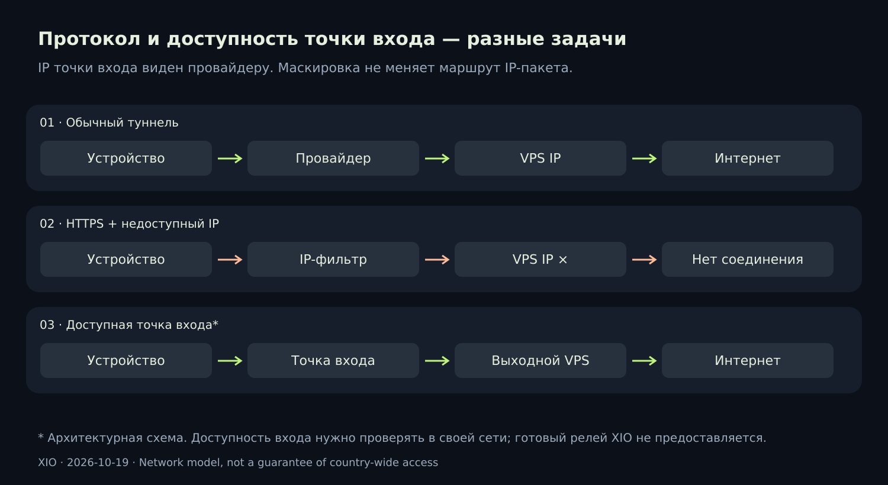

# XIO — X in 1 out

> **Android-патч 0.22.1:** исправлена активация новых пользователей Cloak, серверный пакет обновлён до ревизии 20. [Скачать и посмотреть изменения](https://github.com/rukazax/xio_vpn/releases/tag/v0.22.1) · [Отчёт о проверке на телефоне](docs/verification/android-physical-2026-10-21.ru.md). Версия сборок для ПК — 0.22.0.

📱 [Натурные тесты Android: пять протоколов, ошибка Cloak и результаты](docs/blog/2026-10-21-physical-android.ru.md)

[English](README.md) · **Русский**

Свой VPN, свои серверы, один интерфейс. Подключайте VPS, импортируйте готовые конфигурации, создавайте пользователей и делитесь доступом. Если протокол не подключился за заданное время, XIO пробует следующий доступный профиль пользователя.

[Скачать](docs/ru/downloads.md) · [Инструкция](docs/ru/guide.md) · [Протоколы](docs/ru/protocols.md) · [Сборка](docs/ru/build.md) · [FAQ](docs/ru/faq.md)

## Что умеет

- Установка и обслуживание собственного VPS по SSH, пользователи, отзыв доступа и экспорт.
- Автоматическое распознавание поддерживаемых сторонних конфигураций.
- Приоритет протокола, тайм-аут и HTTPS-проверка; по умолчанию youtube.com.
- Пользовательские пакеты с несколькими протоколами и ограниченное делегирование администрирования.
- Android: раздельное туннелирование, системная тема, иконки, плитка быстрых настроек и 13 языков.
- VPN при раздаче: Android с root; экспериментальная интеграция Windows ICS с правами администратора.
- Подписанные сведения об обновлении клиента и обслуживание управляемой серверной части с откатом.

## Сборки 0.22

| Платформа | Доступность | Клиентские протоколы |
|---|---|---|
| Android 8+ | ARM64, ARMv7, x86_64 APK; ARM64 проверена на одном POCO X6 5G | Xray, RIVET/S1, RIVET/H3, AWG, Cloak |
| Ubuntu x64 | DEB и переносимый архив; системный стенд Ubuntu 24.04 | Xray, RIVET/S1, RIVET/H3, AWG |
| Windows 10/11 x64 | Тестовый ZIP; интерфейс в Wine, драйвер и ICS требуют проверки на Windows | Xray, RIVET/S1, RIVET/H3, AWG |
| iPhone/iPad | Исходный проект Xcode, подписанной IPA нет | RIVET/S1/H3 в исходниках, Apple-проверка впереди |

Раздел **«Протоколы» находится в «Настройки → Соединение»**. Справка и лицензия — в «О XIO». Старые отдельные WireGuard, OpenVPN, IKEv2, Shadowsocks и Tailscale удалены; OpenVPN остаётся внутренней зависимостью Cloak.

## Что VPN не обещает 🔎

Провайдер видит IP точки входа даже при TLS. Строгий белый список требует доступного входа; одна подмена имени сайта не делает заблокированный VPS доступным. Нет подтверждённых испытаний этой сборки в сетях российских операторов. RIVET экспериментален, независимого аудита и доказанной неотличимости от браузера нет.

[Что изменилось и почему](docs/blog/2026-10-19-restricted-networks.md) · [Разбор видео и первичные источники](docs/research/2026-10-19-video-protocols.ru.md) · [Релизы](https://github.com/rukazax/xio_vpn/releases)

Собственный код: [GPL-3.0-only](LICENSE). Компоненты сохраняют свои лицензии: [уведомления 0.22](THIRD-PARTY-0.22.md). Правообладатель: Ерёмин Константин Александрович, er-ka@mail.ru. [Поддержать XIO](https://x1o.org/pay).
