<p align="center">
  <a href="https://github.com/rukazax/xio_vpn">
    
  </a>
</p>

<h1 align="center">XIO</h1>

<p align="center"><b>X in, 1 out.</b> Свой VPN, свои серверы, один интерфейс.</p>

<p align="center">Android &middot; Windows 11 &middot; Ubuntu &middot; сервер Linux &middot; пять транспортов &middot; IPv4 + IPv6</p>

<p align="center">
  <a href="https://github.com/rukazax/xio_vpn/releases"></a>
  <a href="LICENSE"></a>
  <a href="#клиенты-по-платформам"></a>
  <a href="#пять-транспортов"></a>
  <a href="#ipv4-и-ipv6"></a>
  <a href="docs/compatibility/0.24.0.ru.md"></a>
</p>

<p align="center">
  <a href="README.md">English</a> |
  <a href="README.ru.md">Русский</a>
</p>

XIO — VPN-система для своего сервера из трёх частей. **XIO Client** подключается к серверам,
которые уже есть. **Полная XIO** разворачивает и обслуживает свой сервер по SSH. **Серверный
пакет** держит пять транспортов сразу. Один переносимый профиль `xio://` содержит все
транспорты сервера; клиент выбирает тот, который работает в текущей сети, и переключается без
нового профиля.

Ни подписки, ни аккаунта на чужом бэкенде, ни встроенного каталога серверов. Вы даёте VPS,
XIO делает остальное.

[Что это](#что-это) &middot; [Возможности](#возможности) &middot; [Транспорты](#пять-транспортов) &middot;
[IPv4 и IPv6](#ipv4-и-ipv6) &middot; [Каскад](#каскад-два-сервера-ipv4--ipv6) &middot; [Установка сервера](#установка-сервера) &middot;
[Клиенты](#клиенты-по-платформам) &middot; [Раздельное туннелирование](#раздельное-туннелирование) &middot;
[Безопасность](#безопасность) &middot; [FAQ](#faq) &middot; [Ограничения](#ограничения-что-не-проверено) &middot; [English](README.md)

---

## Что это

| Часть | Что делает | Где работает |
|---|---|---|
| **XIO Client** | Импортирует `xio://`, выбирает транспорт, поднимает туннель и проверяет трафик. Без SSH и серверных ключей. | Android 8+, Windows 11 x64, Ubuntu 22.04+ |
| **Полная XIO** | SSH-предпроверка, установка, обновление и удаление сервера; пользователи, квоты, отзыв, трафик. | Android, Windows, Ubuntu |
| **Серверный пакет** | AmneziaWG, RIVET, Xray, Cloak, OpenVPN, счётчики, firewall, dual-stack маршрутизация. | Linux VPS x86_64 с systemd и `/dev/net/tun` |

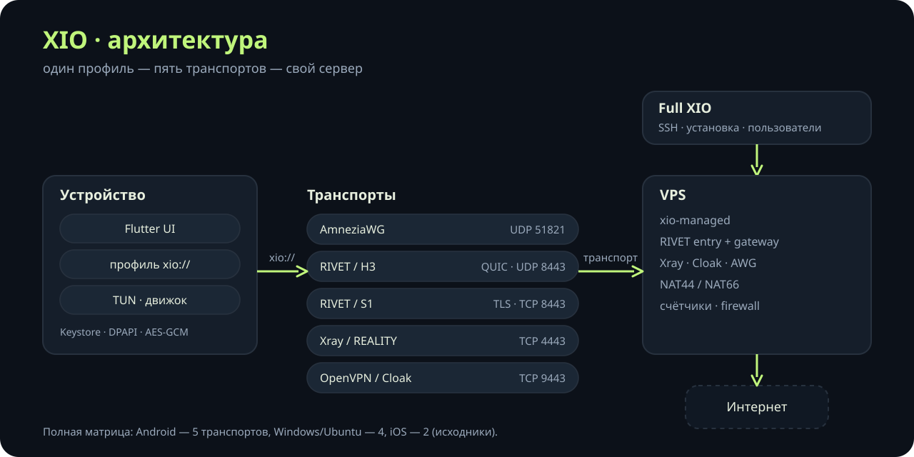

Пять шагов от профиля до трафика:

1. **Импорт.** Администратор выдаёт файл `xio://`: base64-контейнер с пользователем, сервером и
   конфигурациями по транспортам. Он хранится зашифрованным: Android Keystore (без резервных
   копий), Windows DPAPI, Ubuntu AES-GCM с правами файла, iOS Keychain.
2. **Выбор.** В профиле перечислены только те транспорты, которые реально есть у этого сервера.
   Если на платформе нет движка, клиент говорит об этом, а не подставляет другой молча.
3. **Подключение.** Клиент создаёт TUN-интерфейс, берёт адрес внутри туннеля и направляет трафик
   через выбранный транспорт. На Android это системный `VpnService`; на Windows и Ubuntu —
   отдельный привилегированный помощник, который меняет маршруты только после согласия.
4. **Проверка.** Туннель подтверждается свежим обменом, растущими счётчиками и DNS-запросом через
   туннель. Опрос HTTPS-сайта необязателен и по умолчанию выключен.
5. **Работа.** Сервер принимает трафик, выдаёт внутренний адрес и делает NAT в интернет.

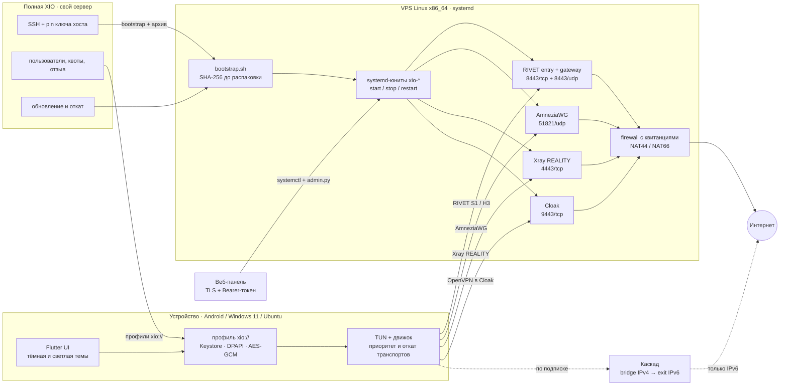

Та же схема отдельным файлом: [docs/landing/architecture.mmd](docs/landing/architecture.mmd).

## Возможности

### XIO Client

- **Переносимый профиль.** Один файл `xio://` на все транспорты одного сервера; импорт из файла
  или вставкой ключа. Импорт принимает только клиентский материал: ни слушателей, ни
  API-серверов, ни исполняемых команд, ни путей файловой системы, ни outbound-ов
  `direct`/`freedom`.
- **Приоритет и откат транспортов.** Сначала выбранный профиль, затем варианты того же endpoint
  с другим протоколом, затем остальные профили. Заблокированный протокол меняется раньше, чем
  точка входа, поэтому адрес VPS не теряется. По умолчанию первым идёт Xray/REALITY, на iOS —
  RIVET/S1; порядок настраивается, недоступные движки пропускаются.
- **Живой контроль связи.** Пока туннель нужен, линия проверяется каждые 15 секунд. После двух
  промахов подряд клиент переподключается: первые три попытки через 5 секунд, дальше через 15,
  пока сервер не вернётся.
- **Честная проверка.** «Интерфейс активен» само по себе не успех: счётчики трафика и DNS через
  туннель должны двигаться. Опрос сайта — дополнительная опция; без него туннель подтверждается
  рукопожатием, счётчиками и DNS.
- **Раздельное туннелирование.** Включение и исключение выбранных приложений, плюс правила
  IP/CIDR в обе стороны. Доменных правил нет.
- **Субклиенты.** Отдельно выданный токен аккаунта проверяет квоту и создаёт или отзывает только
  своих субклиентов через HTTPS API сервера с закреплённым сертификатом. Экспорт субклиента
  содержит только его VPN-ключи и никогда — права родителя или SSH/root-ключи.
- **Раздача VPN.** Android: нужен root, IPv4 идёт в туннель, DNS перенаправляется на `9.9.9.9`,
  раздача IPv6 блокируется. Windows: через ICS, экспериментально, на живом хосте не проверялось.
  Ubuntu и iOS: недоступно.
- **13 языков интерфейса** с офлайн-каталогами, тёмная и светлая темы.
- **Обновления.** Одна проверка в неделю со случайным сдвигом; релиз можно пропустить. Подпись
  метаданных и хеш пакета проверяются до установки; Android ставит через системный установщик.
- **Приватность по умолчанию.** Нет рекламного или аналитического SDK, нет автоматических отчётов
  о падениях, нет встроенного каталога серверов и геолокации точки входа. Экраны Android закрыты
  `FLAG_SECURE`.

### Полная XIO

- **Предпроверка до касания сервера:** семейство и версия ОС, x86_64, systemd, `/dev/net/tun`,
  занятые VPN-порты, конфликты подсетей, существующие VPN-интерфейсы и
  `/etc/wireguard/xio0.conf`.
- **Установка из собственного пакета.** Bootstrap проверяет SHA-256 архива до распаковки;
  обрезанный или подменённый поток отклоняется, а не распаковывается от root.
- **Пользователи и квоты.** Выдача и отзыв, лимит одновременно действующих записей для
  делегированных администраторов, пакетный экспорт профилей, владение субклиентами в рамках
  создателя.
- **Учёт трафика.** Месячные байты и состояние online по счётчикам сервера раз в 30 секунд;
  RIVET, AWG и OpenVPN считаются отдельно.
- **Состояние служб и логи без секретов.** Какие юниты активны, какие упали и что сервер
  объявляет — без ключей и паролей в выводе.
- **Обновление и откат.** Сервер обновляется только при выключенном VPN, с сохранёнными
  SSH-данными и совпавшим ключом хоста; пользователи и ключи сохраняются, неудачное обновление
  откатывается.
- **Удаление, которое убирает за собой.** Снимаются только юниты, правила и ключи, принадлежащие
  XIO; IP forwarding восстанавливается, общие пакеты остаются.

### Серверный пакет

- Пять транспортов на одном хосте, у каждого свой порт и свой systemd-юнит.
- Управляемый firewall с квитанциями: каждое добавленное правило записывается и снимается точно;
  forwarding ограничен своими интерфейсами.
- Dual-stack: слушатели IPv4 и IPv6, NAT44 и NAT66, отдельные IPv6-подсети на интерфейс.
- Усиление systemd: `LoadCredential` и `${CREDENTIALS_DIRECTORY}` вместо `%d` в юнитах,
  `ProtectSystem=strict` там, где ядро это позволяет, и явный режим совместимости там, где нет.
- Счётчики раз в 30 секунд; `status` отдаёт снимок, а не запускает `wg` на каждый запрос.
- Restricted-режим для VPS только с IPv6: без kernel WireGuard, без IPv4 default route, только те
  порты, которые реально могут работать.

Подробнее, с примерами и схемами: [docs/features.ru.md](docs/features.ru.md).

## Пять транспортов

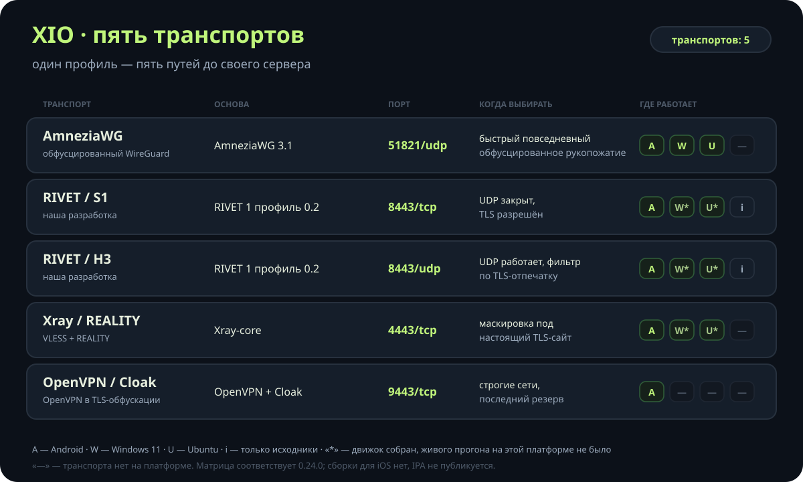

XIO не изобретает криптографию: каждый транспорт опирается на проверенную реализацию, а RIVET —
наш собственный. Транспорты решают разные задачи: скорость, маскировка и сети, где UDP закрыт.

| Транспорт | Основа | Внешний транспорт | Порт | Когда использовать | Android | Windows | Ubuntu | iOS |
|---|---|---|---|---|---|---|---|---|
| **AmneziaWG** | AmneziaWG 3.1 (WireGuard + обфускация) | UDP | 51821 | быстрый повседневный туннель, обфусцированное рукопожатие | да | да | да | - |
| **RIVET / S1** | собственный | TCP + TLS 1.3 | 8443/tcp | UDP закрыт, TLS разрешён | да | да* | да* | исходники |
| **RIVET / H3** | собственный | QUIC / HTTP/3 + TLS 1.3 | 8443/udp | UDP работает, фильтрация по TLS-отпечатку | да | да* | да* | исходники |
| **Xray / REALITY** | Xray VLESS + REALITY | TCP | 4443/tcp | маскировка под настоящий TLS-сайт | да | да* | да* | - |
| **OpenVPN / Cloak** | OpenVPN внутри Cloak | TCP + TLS-обфускация | 9443/tcp | строгие сети, последний резерв | да | - | - | - |

`да` — движок есть и на этой платформе был живой прогон; `да*` — движок собран, живого прогона на
этой платформе не было; `исходники` — движок в исходниках, сборки Apple нет; `-` — недоступно.
На Android пять транспортов, на Windows и Ubuntu четыре, на iOS два.

Порядок устроен так, чтобы менялся протокол, а не точка входа: выбранный профиль → тот же
endpoint с другим транспортом → остальные профили.

### AmneziaWG

WireGuard с обфусцированным рукопожатием: фиксированные заголовки сообщений заменяются,
вставляются мусорные пакеты, размеры рукопожатия рандомизируются (`Jc`, `Jmin`, `Jmax`, `S1`,
`S2`, `H1`–`H4`). Это по-прежнему UDP-туннель: полная блокировка UDP блокирует и AWG. Сервер
поднимает userspace-`xio-amneziawg-go` для `xioawg0`; обычный WireGuard (`xio0`) использует
модуль ядра и существует только в не-restricted установке.

### RIVET

Наша разработка: два независимых входа к одному серверу, чтобы блокировка одного не убивала
доступ.

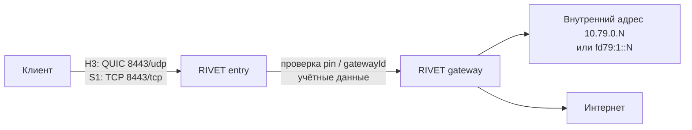

- Два транспорта (**H3** и **S1**) делят одну аутентификацию, поэтому клиент переключается без
  смены профиля.
- Сертификат шлюза закреплён (`pin`); у каждого сервера свой `gatewayId` и внешний CA.
- Пользователь получает `secret` и `entryToken`; родительский токен никогда не передаётся
  субклиенту.
- Внутренняя адресация — `10.79.0.N` с учётом трафика по пользователям, плюс `fd79:1::/64`, когда
  сервер объявляет IPv6.

### Xray / REALITY

VLESS с REALITY: сервер предъявляет параметры настоящего TLS-сайта, клиент проверяет ожидаемую
пару сертификат/SNI. В сети это выглядит как обычный HTTPS. На проверенной паре «клиент 0.23.x +
шлюз Xray 26.7.28» REALITY не подключается; см. [Ограничения](#ограничения-что-не-проверено).

### OpenVPN / Cloak

OpenVPN, обёрнутый в TLS-обфускацию Cloak. Нужен в сетях, где разрешён только трафик вида
TCP/443, и является последним резервом клиента. Движок Cloak объявлен только на Android.

### Серверные транспорты

WireGuard, Shadowsocks и IKEv2 устанавливаются на сервер, но клиент XIO их не предлагает. Они
нужны для совместимости с другими клиентами и для restricted-развёртываний.

| Порт | Протокол | Служба | Примечание |
|---|---|---|---|
| 8443/tcp + 8443/udp | TCP / QUIC | RIVET S1 и H3 | TLS 1.3, закреплённый сертификат шлюза |
| 4443/tcp | TCP | Xray / REALITY | VLESS, маскировка под настоящий сайт |
| 9443/tcp | TCP | Cloak | OpenVPN TCP за TLS-обфускацией |
| 1194/udp | UDP | OpenVPN UDP | напрямую, без Cloak |
| 1195/tcp | TCP | OpenVPN TCP | только loopback, наружу через Cloak |
| 51821/udp | UDP | AmneziaWG | обфусцированный WireGuard |
| 51820/udp | UDP | WireGuard | только в обычной, не restricted установке |
| 8388/tcp + 8388/udp | TCP/UDP | Shadowsocks | только на сервере |
| 500/udp, 4500/udp | UDP | IKEv2 / IPsec | только на сервере |
| 9444/tcp | TCP | API аккаунта | только при выданном токене |

Глубже: [протоколы](docs/ru/protocols.md) · [библиотека RIVET](docs/protocols/README.md) ·
[реализация RIVET 0.2](RIVET-IMPLEMENTATION-0.2.ru.md).

## IPv4 и IPv6

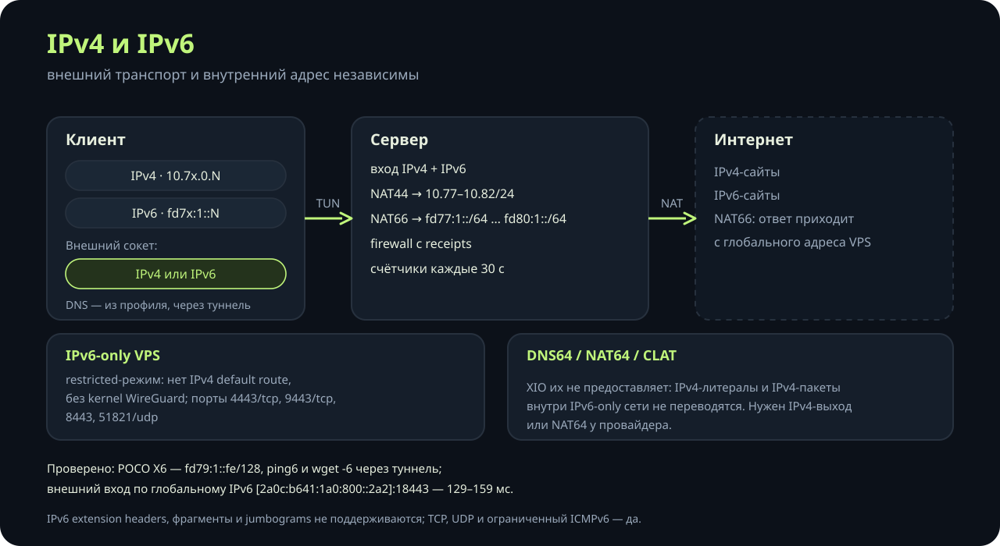

Внешний транспорт и внутренний адрес независимы:

- Точка входа может быть IPv4-адресом, IPv6-адресом или доменом с записями A и/или AAAA.
- Xray и Cloak пробуют оба семейства адресов. RIVET идёт по ним последовательно, потому что
  одновременная авторизация одной идентичности может заменить peer.
- RIVET/S1, RIVET/H3, AmneziaWG и OpenVPN несут IPv4 и IPv6 внутри туннеля. IPv6-адреса выдаются
  только сервером, который явно объявляет поддержку.
- Управляемая адресация, forwarding и NAT66 требуют реальной маршрутизации у провайдера. Делаются
  только свои изменения, каждое — с квитанцией и точным откатом.
- DNS берётся из профиля и идёт через туннель.
- **XIO не предоставляет DNS64, NAT64 и CLAT.** IPv4-литералы и IPv4-пакеты не переводятся внутри
  IPv6-only сети; такому хосту нужен IPv4-выход или NAT64 на стороне провайдера.
- IPv6 extension headers, фрагменты и jumbograms не поддерживаются. TCP, UDP и ограниченный
  ICMPv6 — да.

| Транспорт | Подсеть IPv4 | Подсеть IPv6 |
|---|---|---|
| WireGuard (не restricted) | `10.77.0.0/24` | `fd77:1::/64` |
| AmneziaWG | `10.78.0.0/24` | `fd78:1::/64` |
| RIVET | `10.79.0.0/24` | `fd79:1::/64` |
| OpenVPN UDP | `10.80.0.0/24` | `fd80:0::/64` |
| OpenVPN TCP | `10.81.0.0/24` | `fd80:1::/64` |
| IKEv2 / IPsec | `10.82.0.0/24` | - |

### VPS только с IPv6

Режим `restrictedNetwork` — для сервера без IPv4 default route:

- нет kernel WireGuard и интерфейса `xio0`; AmneziaWG работает в userspace;
- ставятся только транспорты, которые могут работать: AWG, RIVET, Xray, Cloak, OpenVPN TCP;
- firewall открывает `4443/tcp`, `9443/tcp`, `8443`, `51821/udp`, а не набор с IPv4;
- предпроверка записывает `outboundByFamily: {ipv6: eth0}` и честно сообщает
  `ipv4DefaultRoute: false`, а не делает вид, что хост dual-stack.

Проверено на VPS с глобальным IPv6 `2a0c:b641:1a0:800::2a2`: клиент получает `fd79:1::fe/128`,
`ping6` и `wget -6` проходят через туннель, ответ приходит с глобального адреса VPS (NAT66).
Внешний вход по IPv6 `[2a0c:b641:1a0:800::2a2]:18443` подключался за 129–159 мс.

## Каскад: два сервера, IPv4 → IPv6

Платная функция (заглушка подписки): устройство приходит по IPv4 в **bridge**, тот держит
защищённый туннель **только по IPv6** до сервера **exit**, и трафик выходит из сети, где работает
один IPv6.

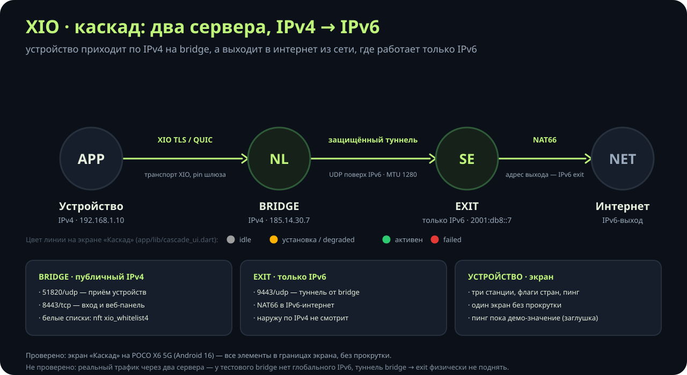

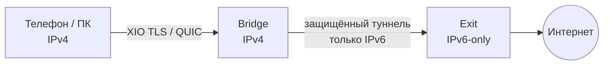

**Что видно в приложении.** Один экран без прокрутки, целиком в экран телефона
(`app/lib/cascade_ui.dart`):

- три станции — устройство → bridge → exit — с флагами стран из ISO-кода;
- линии состояния: серый — ожидание, жёлтый — установка или degraded, зелёный — активен,
  красный — failed;
- пинг, время обновления, кнопка «Переподключить»;
- плашка «Платная функция. Требуется подписка» и кнопка «Активировать».

**Одной командой на сервере:**

```bash
curl -fsSL https://raw.githubusercontent.com/rukazax/xio_vpn/main/deploy/cascade/terminal-install.sh \
  | sudo bash -s -- --role bridge --exit-host <ipv6-exit>
```

Скрипт скачивает установщик по HTTPS, проверяет sha256 **до** запуска, требует root и пишет лог в
`/var/log/xio-cascade-install.log` (права 600). Роли: `bridge`, `exit`, `both`. Из приложения
каскад включается галочкой «Включить каскад (по подписке)» в форме установки сервера — она
передаёт `--enable-cascade`, дальше идёт обычная схема SSH.

| Что | Где |
|---|---|
| Установщик (bridge/exit/both, контейнер) | `deploy/cascade/` |
| Установка из терминала | `deploy/cascade/terminal-install.sh` |
| Проверка туннелей | `deploy/cascade/cascade-healthcheck.sh` → `/var/lib/xio-cascade/health.json` |
| Белые списки на bridge | `deploy/cascade/whitelist-update.sh`, еженедельный таймер |
| Веб-интерфейс сервера (TLS + токен) | `server/webui/` |
| Полное описание и схема | [docs/cascade/README.md](docs/cascade/README.md) |

> **Что не проверено:** реальный трафик через два сервера. У тестового bridge (81.177.142.37) нет
> глобального IPv6, поэтому туннель bridge → exit (2a0c:b641:1a0:800::2a2) физически не поднять.
> Скрипты проверены на синтаксис bash и логику ветвлений, но не на живой паре серверов. Подписка —
> заглушка: `CascadeFeatureGate.enabled == false`.

### Свои серверы для каскада 🛠️

Раньше каскад был только демонстрацией. Теперь в приложении есть настройка своих серверов:
на экране «Каскад» нажмите иконку **DNS** в шапке и укажите:

| Поле | Что вводить | Проверка |
|---|---|---|
| **Bridge** | IPv4 или домен, например `81.177.142.37` | отвергаются схемы, порты, IPv6 и «999.1.1.1» |
| **Exit** | только IPv6, например `2a0c:b641:1a0:800::2a2` (скобки можно) | отвергается IPv4 и мусор |

Адреса сохраняются в профиле приложения, станции маршрута показывают именно их, а в диалоге
сразу появляется готовая команда установки с вашим exit:

```bash
curl -fsSL https://raw.githubusercontent.com/rukazax/xio_vpn/main/deploy/cascade/terminal-install.sh \
  | bash -s -- --role bridge --exit-host 2a0c:b641:1a0:800::2a2
```

Кнопка «Скопировать команду» кладёт её в буфер. Подписка и автоперебор серверов пока заглушки.

## Установка сервера

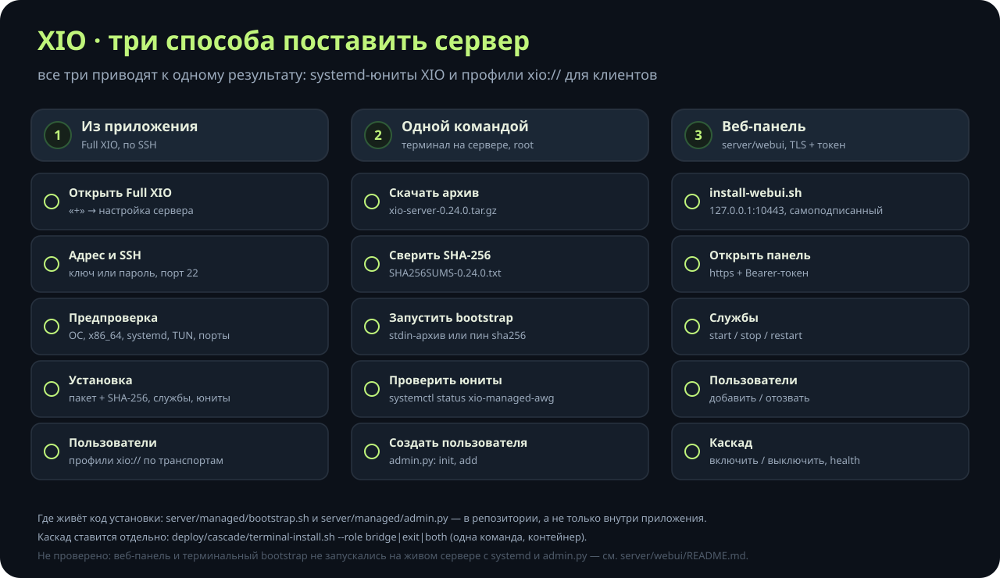

**Нужен чистый VPS:** x86_64, Debian 12/13, Ubuntu 22.04/24.04/26.04 или RHEL/Alma/Rocky 9/10,
systemd, `/dev/net/tun`, без другого VPN на хосте.

### 1. Из приложения (рекомендуется)

1. Откройте **полную XIO** → «+» → настройка сервера.
2. Введите адрес и SSH-данные (ключ или пароль).
3. Предпроверка смотрит ОС, архитектуру, systemd, TUN, порты и подсети.
4. Установка: приложение загружает свой пакет, проверяет дайджест, ставит службы и показывает
   состояние юнитов.
5. Создайте пользователей и выгрузите их профили `xio://`.

### 2. Одной командой в терминале

Bootstrap читает архив из stdin. Оба имени берутся со страницы
[Releases](https://github.com/rukazax/xio_vpn/releases): у релиза-кандидата тег несёт суффикс
`-rcN`, а файл-ассет — чистый номер версии, поэтому это две разные переменные:

```bash
TAG=0.24.1-rc13                  # тег на странице релиза, без ведущей "v"
FILE=xio-server-0.24.1.tar.gz    # имя ассета на этом релизе
curl -fsSLo xio-server.tar.gz \
  "https://github.com/rukazax/xio_vpn/releases/download/v${TAG}/${FILE}"
curl -fsSLo xio-bootstrap.sh \
  https://raw.githubusercontent.com/rukazax/xio_vpn/main/server/managed/bootstrap.sh
sudo XIO_EXPECTED_ARCHIVE_SHA256="<sha256 из SHA256SUMS>" \
  bash xio-bootstrap.sh < xio-server.tar.gz
```

Если `v0.24.1` уже опубликован — подставляйте его в `TAG`: у стабильного тега нет `-rc`.

Без `XIO_EXPECTED_ARCHIVE_SHA256` bootstrap тоже откажется от битого архива, но именно пин
дайджеста останавливает подменённый поток **до** распаковки от root. Хеш берётся из
`SHA256SUMS-<версия>.txt` на странице релиза.

> **Версия серверного пакета важна.** В 0.23.1 пакет падал на шаге firewall
> (`iptables: Can't use -i with POSTROUTING`) и ломал `status` на хостах только с IPv6. В 0.24.0
> это исправили, но упаковщик не включил в архив `readiness.py` и `xio-ready.service`, поэтому
> установка на чистом хосте завершалась кодом 1 на последнем шаге. И то и другое исправлено в
> 0.24.1 (`RECIPE` 26). Для нового сервера берите **0.24.1 или новее**.

### 3. Веб-панель

```bash
sudo ./install-webui.sh                 # https://127.0.0.1:10443
sudo ./install-webui.sh 0.0.0.0:10443   # все интерфейсы, только за обратным прокси
```

Скрипт печатает URL с токеном, сам токен и SHA-256 отпечаток сертификата. Службы, пользователи и
каскад управляются с одной страницы; панель умеет только TLS, использует Bearer-токен плюс cookie
`SameSite=Strict` и требует CSRF-заголовок для POST. Подробности:
[server/webui/README.md](server/webui/README.md).

### Что появляется на сервере

| Путь | Содержимое |
|---|---|
| `/usr/local/lib/xio-managed` | серверный код: `admin.py`, `stack.py`, `network_stack.py`, `dualstack.py`, бинарники |
| `/etc/xio-managed/deployment.json` | состояние развёртывания: хост, пользователи, ключи, счётчики, квитанции — без клиентских конфигураций |
| `/etc/xio-rivet` | публичное состояние RIVET и квитанция установки |
| `/usr/local/lib/xio-rivet` | бинарник RIVET и скрипт установки |
| `/var/lib/xio-stack` | счётчики и состояние стека |

Юниты: `xio-managed-awg`, `xio-managed-stats.timer`, `xio-rivet-entry`, `xio-rivet-gateway`,
`xio-stack`, `xio-cloak`, `xio-openvpn-udp`, `xio-openvpn-tcp`, `xio-ikev2`, `xio-client-api`,
`xio-ready`.

Административный интерфейс — JSON на stdin:

```sh
printf '%s\n' '{"action":"status","serverId":"<id>"}' \
  | python3 /usr/local/lib/xio-managed/admin.py
```

| Действие | Что делает |
|---|---|
| `init` | первая установка; нужны `host` и `restrictedNetwork` |
| `inspect` | публичное описание сервера и фаза |
| `status` | службы, счётчики, пользователи, трафик за месяц |
| `add` | создать пользователя и вернуть конфигурации по транспортам |
| `revoke` | отозвать пользователя и его субклиентов |
| `remove` | снять только свои юниты, правила, ключи и пакеты |
| `client-grant` | выдать ограниченный токен аккаунта для субклиентов |

## Клиенты по платформам

`XIO-<App>-<версия>-<ОС>-<архитектура>.<формат>`. `App` — `Client` или `Full`, `ОС` — `android`,
`windows` или `ubuntu`, архитектура — `arm64-v8a`, `armeabi-v7a`, `x86_64`, `universal`, `amd64`
или `x64`.

Всё лежит на странице [Releases](https://github.com/rukazax/xio_vpn/releases), включая файлы
`SHA256SUMS`. Проверка: `sha256sum -c SHA256SUMS-<версия>.txt` или
`Get-FileHash <file> -Algorithm SHA256`.

### Android — Full или Client?

| | **XIO Full** (`app.xio.xio`) | **XIO Client** (`app.xio.client`) |
|---|---|---|
| Подключение к готовому серверу | да | да |
| Свой сервер по SSH | да | нет |
| Пользователи, квоты, отзыв | да | нет (только субклиенты, если выданы) |
| Раздача VPN | да | нет |
| Пять транспортов | да | да |
| Размер пакета | ~58 МБ | ~57 МБ |

Android 8+; ARM64 — обычный выбор, ARM32 для старых устройств, x86_64 для эмуляторов,
`universal` — если не хочется думать. Откройте APK, разрешите установку из этого источника;
обновление ставится поверх предыдущей версии и сохраняет профили.

На MIUI/HyperOS `adb install` может ответить `INSTALL_FAILED_USER_RESTRICTED`. Рабочий путь:

```bash
APK=XIO-Full-<версия>-android-arm64-v8a.apk
adb push "$APK" /data/local/tmp/xio.apk
adb shell pm install -r -g /data/local/tmp/xio.apk
```

Android 0.24.1 — это `0.24.1+5018`, подпись `CN=x1o Development` (SHA-256 `e4e81b12…c9671`),
поэтому обновление ставится поверх 0.23.x/0.24.x без удаления. Самые свежие APK на странице
Releases — 0.24.0; набор 0.24.1 для Android готовится, его заметки —
[docs/release-notes-0.24.1-mobile.md](docs/release-notes-0.24.1-mobile.md).

### Windows 11 x64

Полностью распакуйте ZIP и запустите `XIO.exe`. Помощник `libexec\xio-tunnel.exe` запускается с
повышенными правами: они нужны, чтобы создать сетевой интерфейс. Wintun входит в комплект вместе
с лицензией. Четыре транспорта (Cloak нет). Сборка не подписана сертификатом издателя, поэтому
SmartScreen предупреждает — это ожидаемо.

- Full XIO для Windows: входит в релиз 0.24.0.
- XIO Client для Windows: опубликован в 0.23.1, в 0.24.0 его не было.

### Ubuntu 22.04+

```bash
sudo apt install ./XIO-*-ubuntu-amd64.deb
```

Имя пакета менялось между выпусками (`XIO-Full-…-ubuntu-amd64.deb` в 0.24.0,
`XIO-…-ubuntu-amd64.deb` в 0.24.1), отсюда звёздочка. Либо распакуйте `.tar.gz`.

Интерфейс работает от вашего пользователя; сетевой помощник запрашивает
системное разрешение через polkit. Нужен `systemd-resolved`: без него подключение отклоняется с
`systemd-resolved could not configure VPN DNS`. Четыре транспорта.

> Пакеты 0.24.0 собраны, но GUI живьём не перепроверялся (в 0.23.0 окно не создавалось: процесс
> жил, поверхность Impeller/EGL не поднималась). Туннель работает через `libexec/xio-tunnel`.

### iOS

IPA нет. Исходники поддерживают RIVET/H3 и S1, нужны Mac, Xcode, команда Apple Developer и
entitlements NetworkExtension. См. [сборка из исходников](docs/ru/build.md).

### Скриншоты

<p>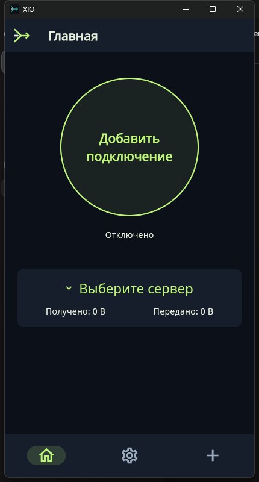 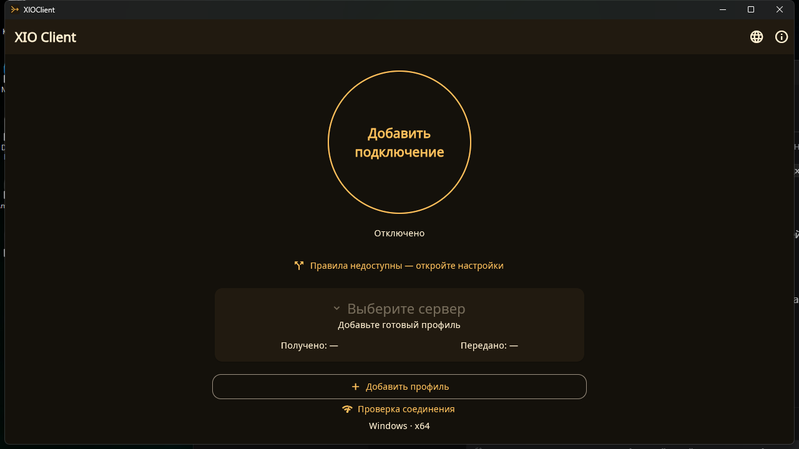 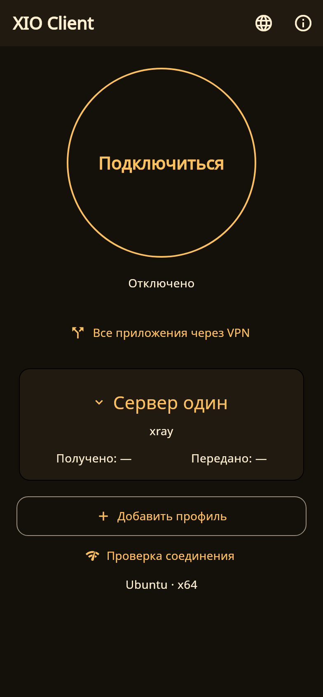</p>

Экраны Android остаются чёрными на системном скриншоте: приложение ставит `FLAG_SECURE`. Это
защита, а не ошибка — Android-кадры в документации получены из widget-тестов Flutter. Список
кадров, которые ещё нужны, с точными командами `adb` и таблицей статусов —
[docs/screenshots/README.md](docs/screenshots/README.md).

## Раздельное туннелирование

Включение и исключение выбранных приложений, плюс правила IP/CIDR в обе стороны. Доменных правил
нет: маршрутизация по именам требует своего резолвера, а его в XIO пока нет.

Исключённый трафик идёт напрямую — если системная блокировка Android его не запрещает; в режиме
lockdown системное правило сильнее настройки. В каскаде правила живут на bridge (nft-набор
`xio_whitelist4`), обновляются еженедельно и заменяются атомарно.

## Безопасность

- **Секреты профиля шифруются на диске.** Android Keystore с отключёнными резервными копиями,
  Windows DPAPI, Ubuntu AES-GCM с локальным ключом и правами файла, iOS Keychain.
- **Клиент не получает серверные ключи.** SSH, root и admin остаются в полном приложении;
  субклиенты получают только свои VPN-ключи.
- **SSH-ключи хоста закреплены.** Изменившийся ключ останавливает обслуживание до подтверждения
  владельцем.
- **Bootstrap проверяет дайджест архива** до распаковки; подменённый поток отклоняется.
- **Клиентские конфигурации не пишутся в `deployment.json`.** Повторный запрос возвращает
  `configsUnavailable`, а не выдаёт секреты второй раз.
- **Секреты сравниваются за постоянное время** в `rivet user add` и проверках токенов.
- **Юниты используют каталог credentials**, а не `%d`, поэтому секреты не попадают в командную
  строку.
- **Песочница явная.** `ProtectSystem=strict` применяется там, где работает read-only bind mount;
  иначе XIO записывает `sandboxMode: compat` и снимает только эту директиву, сохраняя `PrivateTmp`,
  `NoNewPrivileges` и ограничение capabilities.
- **Импорт очищается.** Профиль не может добавить слушателей, API-серверы, команды, пути файловой
  системы или outbound-ы `direct`/`freedom`.
- **Телеметрии нет.** Ни рекламного, ни аналитического SDK, ни автоматических отчётов о падениях,
  ни каталога серверов.

## Как мы проверяем

Правило простое: **доказательство — только наблюдаемый результат на реальном железе, а не
успешная сборка.**

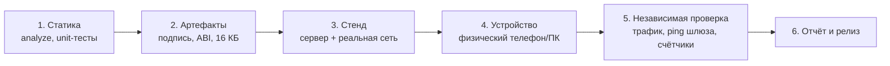

| Уровень | Что проверяется | Чем не является |
|---|---|---|
| Статика | `flutter analyze`, unit/widget-тесты, Go-тесты, гейт паритета транспортов | не доказывает сеть |
| Артефакты | подпись APK, `package`/`versionCode`, ABI и выравнивание 16 КБ | не доказывает подключение |
| Стенд | сервер ставится из поставляемого пакета, клиент подключается по реальной сети | не доказывает поведение телефона |
| Устройство | установка на физический Android / запуск на Windows | не доказывает маршрут |
| Независимая проверка | HTTPS внутри туннеля, `ping` до шлюза туннеля, счётчики сервера и `endpoint` | - |

`FAIL`, `BLOCKED` и `NOT_EXECUTED` пишутся как есть и никогда не заменяются на «работает».
Подробности: [совместимость 0.24.0](docs/compatibility/0.24.0.ru.md) ·
[физический прогон Android](docs/verification/android-physical-2026-10-21.ru.md).

## FAQ

**XIO — это подписка на VPN?** Нет. Это программа, которую вы ставите на свой VPS.
Единственная платная часть — каскад, и его подписка пока заглушка.

**Нужен root?** Для самого VPN — нет. Root нужен для раздачи VPN на Android.

**Какой транспорт он выберет?** По умолчанию первым Xray/REALITY, затем альтернативы того же
сервера, затем другие профили. Порядок можно менять; заблокированный протокол меняется раньше,
чем точка входа.

**Пишет «туннель активен», но ничего не открывается.** Смотрите счётчики и DNS на экране
подключения — это и есть доказательство. Если они не двигаются, ищите причину на сервере: NAT,
firewall или DNS. «Интерфейс активен» без трафика по замыслу не считается успехом.

**Можно ли держать его рядом с другим VPN?** Нет. Маршруты `/1` конфликтуют, второй туннель надо
выключить.

**Где взять iOS?** Пока нигде: есть исходники, а не IPA. Нужны Mac, Xcode и подпись Apple.

**Установка сервера упала на последнем шаге.** Это известный дефект упаковки 0.24.0 (не хватало
`readiness.py` и `xio-ready.service`). Берите 0.24.1 или новее.

**Обход блокировок гарантирован?** Нет. Полевых измерений у операторов РФ и независимого аудита
RIVET нет. Доступность входа и маскировка транспорта — разные задачи.

## Ограничения (что не проверено)

- **Xray/REALITY не подключается** на паре «клиент 0.23.x + шлюз Xray 26.7.28»: реализация
  REALITY в ядре клиента несовместима. AWG и RIVET работают.
- **AWG на Android в этой ветке (`main`):** `tun.CreateUnmonitoredTUNFromFD` может отдать
  TUN-дескриптор финализатору Go, а тот позже закрывает номер, который уже принадлежит другому
  объекту; неудачная активация AWG способна убить чужой сокет (`i/o timeout`,
  `accept4: bad file descriptor`). Исправление — предварительное дублирование дескриптора — есть
  в ветке `release-0.24.0` (`c2b3338`), в `main` его пока нет.
- **Windows 0.24.0:** помощник пересобран с исправлением firewall через WFP (правила по SID
  пользователя и App ID вместо `netsh`), analyze, тесты и упаковка проходят. Живое подключение
  через GUI на 0.24.0 не перепроверялось; последний живой прогон — помощник 0.22.5 с приложением
  0.23.0.
- **GUI Ubuntu:** пакеты 0.24.0 собраны, GUI живьём не перепроверялся. Туннель работает через
  `libexec/xio-tunnel` и требует `systemd-resolved`.
- **Полный туннель на Linux отрезает локальную сеть:** пока туннель поднят, машина не отвечает по
  SSH из LAN, потому что весь немаркированный IPv4 уходит в туннель.
- **Каскад:** реального трафика через два сервера не было; подписка и перебор серверов — заглушки.
- **Веб-панель и терминальный bootstrap** не запускались на живом сервере с systemd и `admin.py`
  — проверены `py_compile`, генерация сертификата и коды ответов локально.
- **Раздача на Windows (ICS)** не проверялась на живом хосте.
- **IPv6 должен маршрутизироваться провайдером.** XIO настраивает адресацию, forwarding и NAT66 на
  своих интерфейсах, но не может заставить провайдера объявить или направить префикс.
  DNS64/NAT64 не предоставляются.
- **iOS** не собирался: нет Mac/Xcode/iPhone и IPA.
- **Полного паритета протоколов нет:** на Android 5 транспортов, на Windows/Ubuntu 4, на iOS 2.
- **Рядом с другим VPN** XIO не работает: конфликтуют маршруты `/1`.
- Приложение Windows не подписано сертификатом издателя, поэтому SmartScreen предупреждает.

## Документация

- [Возможности подробно](docs/features.ru.md) · [Features (EN)](docs/features.md)
- [Совместимость и статус 0.24.0](docs/compatibility/0.24.0.ru.md)
- [Инструкция](docs/ru/guide.md) · [Загрузки](docs/ru/downloads.md) · [FAQ](docs/ru/faq.md) · [Сборка](docs/ru/build.md)
- [Протоколы](docs/ru/protocols.md) · [Библиотека RIVET](docs/protocols/README.md) · [Dual-stack](docs/dualstack/0.22.3.ru.md)
- [Каскад](docs/cascade/README.md) · [Веб-панель](server/webui/README.md) · [Клиент и субклиенты](client/README.ru.md)
- [Заметки 0.24.0](docs/release-notes-0.24.0.md) · [0.24.1 мобильный](docs/release-notes-0.24.1-mobile.md) · [Changelog](CHANGELOG.md)
- [Какие скриншоты нужны](docs/screenshots/README.md) · [Схемы](docs/landing/architecture.mmd) · [Сторонние компоненты](THIRD-PARTY-NOTICES.md)

## Лицензия

Оригинальный код — GPL-3.0-only. Сторонние компоненты сохраняют свои лицензии:
[THIRD-PARTY-NOTICES.md](THIRD-PARTY-NOTICES.md). Уязвимости: [SECURITY.md](SECURITY.md).
Участие: [CONTRIBUTING.md](CONTRIBUTING.md).
