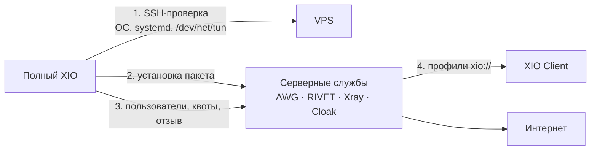
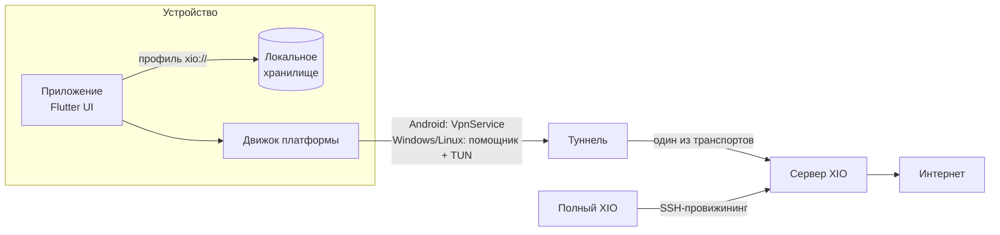
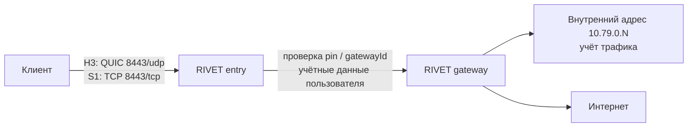
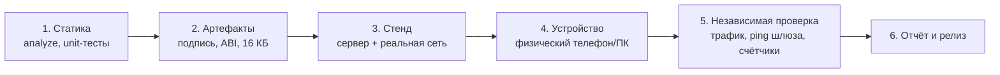

# XIO — X in, 1 out

XIO — это VPN-система с собственным сервером и двумя приложениями: **XIO Client** для подключения
к готовым серверам и **полный XIO** для развёртывания и обслуживания сервера. Один сервер держит
несколько транспортов одновременно, а клиент импортирует один переносимый профиль `xio://` и сам
выбирает, через что подключаться.

[Download](#что-скачать) · [Как это работает](#как-это-работает) · [Протоколы](#протоколы) · [Методика тестов](#как-мы-тестируем) · [English](README.md)

## Два приложения

| | **XIO Client** | **Полный XIO** |
|---|---|---|
| Для чего | подключаться к уже существующим серверам | ставить и обслуживать свой сервер |
| Оформление | жёлто-оранжевое | зелёное |
| Установка | отдельным пакетом рядом с полным приложением | отдельным пакетом рядом с клиентом |
| Права | нет SSH/root/admin; только scoped-токен на своих субклиентов, если выдан | SSH-провижининг VPS, выпуск/отзыв пользователей, квоты, пакетный экспорт |
| Хранилище | отдельное от полного приложения | своё |

Клиент устанавливается рядом с полным приложением и не получает серверных ключей.

## Полное приложение: свой сервер

Полный XIO — это администрирование сервера, а не подключение к чужому. Приложение по SSH проверяет
машину, ставит серверный пакет, выпускает и отзывает пользователей, считает трафик и обновляет
компоненты. Клиенту полное приложение для работы не нужно.

Что делает приложение:

- проверяет сервер до установки: ОС, x86_64, systemd, наличие `/dev/net/tun`, занятые порты;
- ставит серверный пакет из собственного бандла и поднимает службы (AmneziaWG, RIVET, Xray, Cloak);
- выдаёт пользователей и профили, ведёт квоты и отзыв доступа;
- показывает состояние служб, трафик по пользователям и журналы без секретов;
- обновляет сервер и откатывает изменения.

Скриншоты полного приложения (Windows, 26.10.2026):

Окно приложения компактное (430×800), как на телефоне: тот же экран без растягивания по ширине.

## Как это работает

Что происходит по шагам:

1. **Импорт профиля.** Администратор выдаёт файл `xio://` — это base64-контейнер с пользователем,
   сервером и конфигурациями транспортов. Профиль хранится локально в зашифрованном виде
   (Keystore на Android, DPAPI на Windows, AES-GCM с правами файла на Linux).
2. **Выбор транспорта.** Из профиля видно, какие транспорты к этому серверу реально есть. Если
   нужного движка на платформе нет, клиент об этом говорит и не подменяет его другим.
3. **Подключение.** Клиент поднимает TUN, забирает адрес внутри туннеля и направляет трафик
   в выбранный транспорт. На Android используется системный `VpnService`, на Windows/Linux —
   отдельный помощник, который получает права и меняет маршруты только после согласия.
4. **Проверка.** После подъёма интерфейса клиент сам открывает выбранный HTTPS-сайт через туннель.
   Если проверка не проходит — соединение снимается. «Интерфейс активен» без проходящего трафика
   не считается успехом.
5. **Работа.** Сервер принимает трафик, выдаёт адрес в своей внутренней сети и NAT-ит в интернет.

## Протоколы

XIO не переизобретает всё: часть транспортов основана на проверенных реализациях, часть —
собственная разработка. Разные транспорты решают разные задачи: скорость, обход блокировок,
работу там, где UDP закрыт.

| Транспорт | Основа | Транспорт сети | Зачем | Android | Windows | Ubuntu | iOS |
|---|---|---|---|---|---|---|---|
| **AWG** | AmneziaWG (WireGuard + обфускация) | UDP | быстрый повседневный туннель | ✅ | ✅ | ✅ | — |
| **RIVET/H3** | собственная разработка | QUIC / HTTP/3 + TLS 1.3 | стабильный обход там, где режут подозрительный TLS | ✅ | ✅ | ✅ | ✅ |
| **RIVET/S1** | собственная разработка | TCP + TLS 1.3 | тот же туннель для сетей, где UDP закрыт | ✅ | ✅ | ✅ | ✅ |
| **Xray/REALITY** | Xray (VLESS + REALITY) | TCP, маскировка под чужой TLS-сайт | маскировка под настоящий сайт | ✅ | ⚠️ | ⚠️ | — |
| **OpenVPN/Cloak** | OpenVPN внутри Cloak | TCP + TLS-обфускация | «последний шанс» в жёстких сетях | ✅ | — | — | — |

✅ — движок есть и проверялся; ⚠️ — движок объявлен, но на паре «клиент + шлюз 0.22.5» не
подключается (см. ограничения); — — движка нет.

### Что такое RIVET

RIVET — собственная разработка XIO. Идея: дать клиенту два независимых «входа» на одном сервере,
чтобы блокировка одного не убивала доступ.

- Два транспорта (**H3** и **S1**) с одной и той же аутентификацией: клиент может переключаться,
  не меняя профиль.
- Сертификат шлюза закрепляется (`pin`), у каждого сервера свой `gatewayId` и внешний CA.
- Пользователь получает `secret` и `entryToken`; родительский токен в субклиента не передаётся.
- Внутренняя адресация — `10.79.0.N`, отдельный учёт трафика на пользователя.

## Что скачать

Единый принцип имён: `XIO-<Приложение>-<версия>-<ОС>-<архитектура>.<расширение>`, где приложение —
`Client` или `Full`, ОС — `android`, `windows`, `ubuntu`, `ios`, архитектура — `arm64-v8a`,
`armeabi-v7a`, `x86_64`, `universal`, `x64`.

### XIO Client — подключение к готовым серверам

| Система | Файл | Что это |
|---|---|---|
| Android 8+ · ARM64 | `XIO-Client-0.22.5-android-arm64-v8a.apk` | основной вариант для современных телефонов |
| Android 8+ · ARM32 | `XIO-Client-0.22.5-android-armeabi-v7a.apk` | старые 32-битные устройства |
| Android 8+ · x86-64 | `XIO-Client-0.22.5-android-x86_64.apk` | эмуляторы и x86-планшеты |
| Android 8+ · universal | `XIO-Client-0.22.5-android-universal.apk` | одна сборка для всех архитектур |
| Windows 11 x64 | `XIO-Client-0.22.5-windows-x64.zip` | ZIP: приложение, помощник, Wintun |
| Ubuntu 22.04+ x64 | `XIO-Client-0.22.4-ubuntu-amd64.deb` | DEB из 0.22.4 (в 0.22.5 не пересобиралась) |
| Ubuntu 22.04+ x64 | `XIO-Client-0.22.4-ubuntu-x64.tar.gz` | tar.gz из 0.22.4 |
| iOS | — | IPA нет: нужны Mac, Xcode и подпись Apple |

Всё лежит в разделе [Releases](https://github.com/rukazax/xio_vpn/releases/tag/v0.22.5):
сборки 0.22.5, [контрольные суммы](https://github.com/rukazax/xio_vpn/releases/download/v0.22.5/SHA256SUMS-0.22.5.txt),
[протокол проверки](https://github.com/rukazax/xio_vpn/releases/download/v0.22.5/verification-0.22.5.json).

### Полный XIO — свой сервер

| Система | Файл | Что это |
|---|---|---|
| Android 8+ · ARM64 | `XIO-Full-0.22.5-android-arm64-v8a.apk` | полное приложение с администрированием |
| Android 8+ · ARM32 | `XIO-Full-0.22.5-android-armeabi-v7a.apk` | старые 32-битные устройства |
| Android 8+ · x86-64 | `XIO-Full-0.22.5-android-x86_64.apk` | эмуляторы |
| Android 8+ · universal | `XIO-Full-0.22.5-android-universal.apk` | одна сборка для всех архитектур |
| Windows 11 x64 | `XIO-Full-0.22.5-windows-x64.zip` | ZIP: приложение, помощник, Wintun |
| Ubuntu 22.04+ x64 | `XIO-0.22.0-ubuntu-amd64.deb` | сборка 0.22.0 |
| iOS | — | нет |

Серверная часть ставится из полного приложения по SSH на Debian 12/13, Ubuntu 22.04/24.04/26.04,
RHEL/Alma/Rocky 9/10 (x86_64, systemd, `/dev/net/tun`).

## Как подключить

1. Возьмите профиль `xio://` у администратора сервера.
2. Установите **XIO Client** (не полное приложение — оно для другого).
3. Откройте приложение → «Добавить профиль» → вставьте ключ или выберите файл.
4. Нажмите «Подключиться». Android один раз спросит разрешение на VPN; Windows — права
   администратора для помощника.
5. Убедитесь, что появилось «Сайт доступен · HTTP 200» и растёт трафик.

Android-экраны не публикуются: приложение ставит `FLAG_SECURE`, и система отдаёт чёрный снимок.
Это защита, а не ошибка.

## Как мы тестируем

Методика построена на одном принципе: **доказательством считается только наблюдаемый результат на
реальном оборудовании, а не успешная сборка.**

| Уровень | Что проверяется | Чем не является |
|---|---|---|
| Статика | `flutter analyze`, unit/виджет-тесты, Go-тесты, проверка паритета транспортов | не доказывает работу сети |
| Артефакты | подпись APK, `package`/`versionCode`, разрядность и 16 КБ-выравнивание нативного payload | не доказывает подключение |
| Стенд | сервер поднимается штатным бандлом, клиент подключается к нему по реальной сети | не доказывает поведение на телефоне |
| Устройство | установка на физический Android / запуск на Windows | не доказывает маршрут |
| Независимая проверка | HTTPS-проверка внутри туннеля, `ping` до шлюза туннеля, счётчики и `endpoint` на сервере | — |

Правила, которые мы держим:

- Отчёт «интерфейс активен» без проходящего трафика не считается успехом.
- Cross-build, Wine, эмулятор и unit-тесты не заменяют проверку на Windows, физическом Android и
  Ethernet.
- `FAIL`, `BLOCKED` и `NOT_EXECUTED` так и пишутся — не подменяются словом «работает».
- Каждый прогон хранит версию, коммит, устройство, команды и результат отдельно от предыдущих.

Подробнее: [методика и критерии](docs/compatibility/0.22.5.ru.md) ·
[отчёт последнего прогона](docs/blog/2026-10-26-windows-and-ipv6.ru.md).

## Скриншоты

Рендеры интерфейса клиента (тёмная и светлая тема):

 

Windows-клиент, реальный запуск 26.10.2026:

## Ограничения

- **Xray/REALITY не подключается** на паре «клиент 0.22.5 + шлюз Xray 26.7.28»: несовместима
  реализация REALITY в клиентском ядре. AWG и RIVET работают.
- **Публичный IPv6** не проверен. На стенде использовался локальный ULA-префикс, а выход IPv6 из
  туннеля сервер блокирует намеренно.
- **iOS** не собран: нет Mac/Xcode/iPhone, IPA отсутствует.
- **Полная протокольная взаимозаменяемость не достигнута**: Android — 5 транспортов,
  Windows/Ubuntu — 4, iOS — 2.
- **Одновременно с другим VPN** на одной машине XIO не работает: маршруты `/1` конфликтуют.
- Приложение для Windows не подписано сертификатом издателя — SmartScreen предупредит.

## Документация

- [Совместимость и состояние 0.22.5](docs/compatibility/0.22.5.ru.md)
- [Скачать](docs/ru/downloads.md) · [Сборка из исходников](docs/ru/build.md) · [FAQ](docs/ru/faq.md)
- [Как устроены протоколы](docs/protocols/README.md) · [RIVET](RIVET-IMPLEMENTATION-0.2.ru.md)
- [История изменений](CHANGELOG.md) · [Лицензия GPL-3.0-only](LICENSE)

Собственный код — GPL-3.0-only. Сторонние компоненты сохраняют свои лицензии:
[THIRD-PARTY-NOTICES.md](THIRD-PARTY-NOTICES.md).
