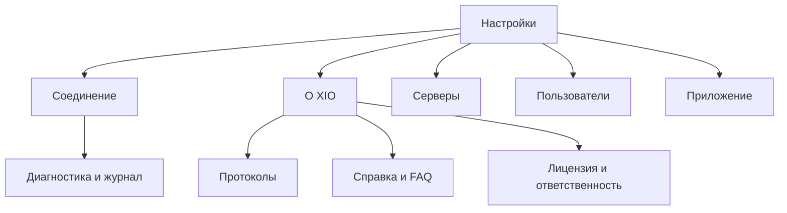
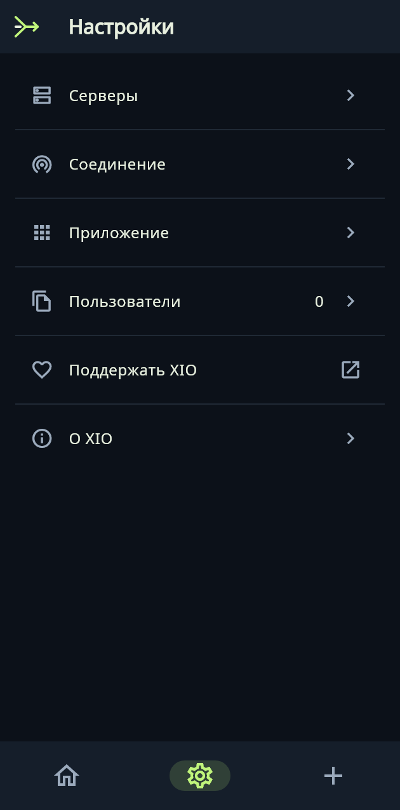
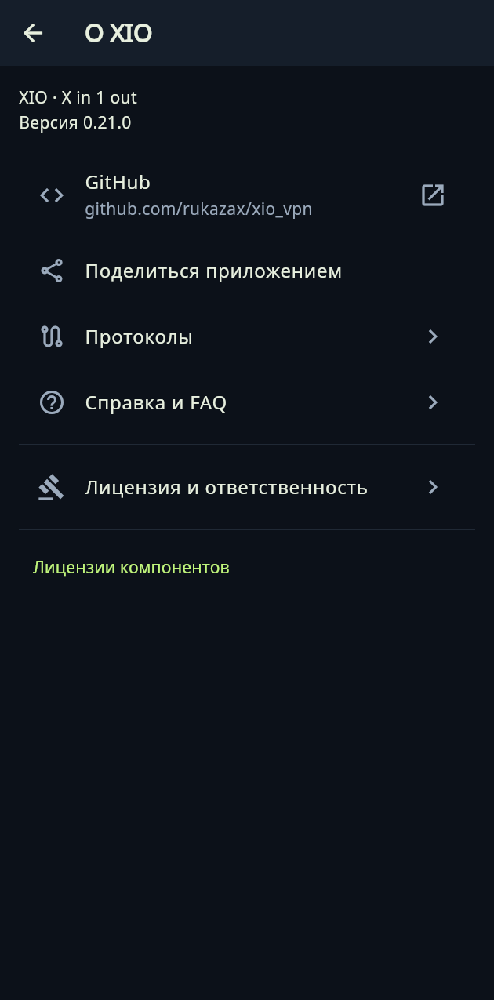

# XIO — X in 1 out

[English](README.md) · **Русский**

Свой VPN, свои серверы, один интерфейс. Подключайте VPS, импортируйте конфигурации, создавайте пользователей и делитесь доступом. Приложение выбирает поддерживаемый протокол автоматически и переходит к следующему, если попытка подключения не удалась.

[Скачать](docs/ru/downloads.md) · [Инструкция](docs/ru/guide.md) · [Протоколы](docs/ru/protocols.md) · [Сборка](docs/ru/build.md) · [FAQ](docs/ru/faq.md)

## Что работает

- Управление своим VPS через SSH: установка, пользователи, экспорт и очистка компонентов XIO.
- Импорт сторонних конфигураций с автоматическим определением поддерживаемого движка.
- Приоритет протокола, тайм-аут попытки и проверочный HTTPS-сайт. По умолчанию — youtube.com.
- Профиль пользователя с настройками нескольких протоколов. Делегирование администратора с лимитом действующих пользователей.
- Раздельное туннелирование на Android, системная тема, выбор иконки и 13 языков.
- Запись ознакомления с лицензией на устройстве, справка и диагностика соединения.

## Платформы

| Платформа | Состояние | Протоколы |
|---|---|---|
| Android 8+ | APK ARM64, ARMv7, x86_64; телефон Honor отдельно не проверен | 10 движков |
| Ubuntu x64 22.04+ | DEB и архив | 7 движков |
| Windows 10/11 x64 | ZIP для испытаний; интерфейс проверен в Wine, нативная сеть требует проверки | 7 движков |
| iPhone/iPad iOS 15+ | Исходный Xcode-проект; готового IPA нет | Интеграция двух RIVET-транспортов требует испытаний Apple |

[Точный состав и ограничения](docs/ru/protocols.md). Самостоятельно разработанные RIVET/H3 и RIVET/S1 экспериментальные. Независимый аудит и неотличимость трафика от обычного HTTPS не подтверждены.

## Настройки

«О XIO» содержит «Протоколы», «Справка и FAQ», «Лицензия и ответственность» и лицензии компонентов. «Диагностика» находится в «Соединение». Основное меню остаётся компактным.

## Код, лицензия и обратная связь

`app/` — общий интерфейс и нативные адаптеры. `protocol/rivet/` — туннели, клиентские движки и настольный помощник. `server/` — установка и управление VPS. `native/`, `vendor/`, `vendor-metadata/` — мосты, зависимости и их происхождение. `tools/` и `tooling/` — сборка и проверки.

Собственный код — [GPL-3.0-only](LICENSE). Сторонние компоненты сохраняют [свои лицензии](THIRD-PARTY-NOTICES.md). Правообладатель: Ерёмин Константин Александрович, [er-ka@mail.ru](mailto:er-ka@mail.ru).

[Сообщить об ошибке](https://github.com/rukazax/xio_vpn/issues/new/choose) · [Безопасность](SECURITY.md) · [Участие в разработке](CONTRIBUTING.md) · [История изменений](CHANGELOG.md).

Не публикуйте SSH-пароли, приватные ключи и профили доступа в issues. Административный экспорт содержит секреты.

### Интерфейс

Снимки из проверки общего Flutter-интерфейса.

 

Полный комплект исходников и зависимостей находится в `XIO-0.20.0-source.zip` на [странице релиза](https://github.com/rukazax/xio_vpn/releases/tag/v0.20.0). Точные исходники встроенного Android runtime находятся в `native-sources/android-runtime-0.18` внутри архива. [Происхождение компонентов](docs/native-source-provenance.md).

[Статьи о RIVET: схемы, форматы и испытания](docs/protocols/README.md) · [Блог разработки](docs/blog/2026-10-18-rivet.md).
