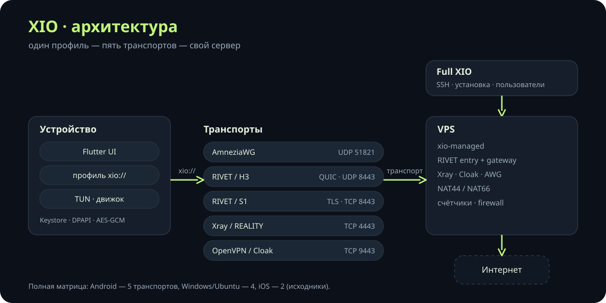
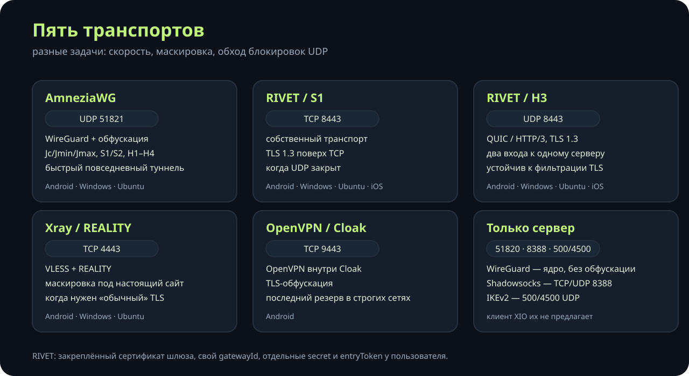
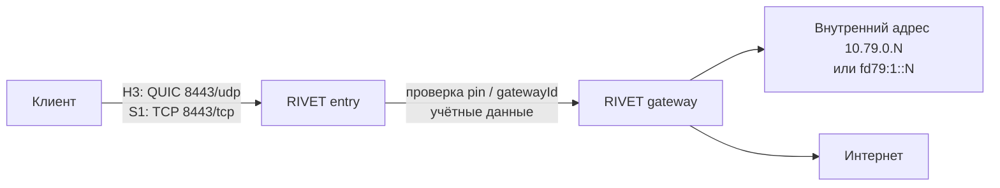
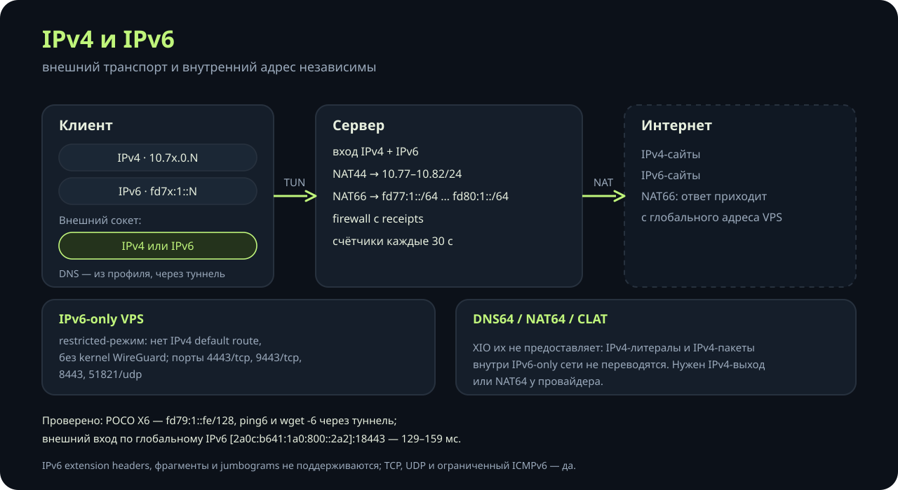
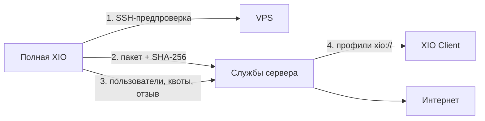
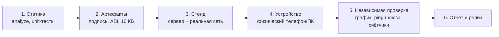

<p align="center">
  <a href="https://github.com/rukazax/xio_vpn">
    
  </a>
</p>

<h1 align="center">XIO</h1>

<p align="center"><b>X in, 1 out.</b> Свой VPN, свои серверы, один интерфейс.</p>

<p align="center">Android &middot; Windows &middot; Ubuntu &middot; iOS (исходники) &middot; IPv4 + IPv6</p>

<p align="center">
  <a href="https://github.com/rukazax/xio_vpn/releases/tag/v0.23.1"></a>
  <a href="LICENSE"></a>
  <a href="https://github.com/rukazax/xio_vpn/releases/tag/v0.23.1"></a>
  <a href="#протоколы"></a>
  <a href="#ipv4-и-ipv6"></a>
  <a href="docs/compatibility/0.23.1.ru.md"></a>
</p>

<p align="center">
  <a href="README.md">English</a> |
  <a href="README.ru.md">Русский</a>
</p>

XIO — это VPN-система для своего сервера из трёх частей: **XIO Client** подключается к уже существующим
серверам, **полная XIO** разворачивает и обслуживает свой сервер по SSH, а **серверный пакет** держит
пять транспортов сразу. Один переносимый профиль `xio://` содержит все транспорты сервера; клиент
выбирает тот, который работает в текущей сети, и переключается без нового профиля.

[Обзор](#обзор) &middot; [Возможности](#возможности) &middot; [Скриншоты](#скриншоты) &middot; [Протоколы](#протоколы) &middot;
[IPv4 и IPv6](#ipv4-и-ipv6) &middot; [Установка](#установка) &middot; [Быстрый старт](#быстрый-старт) &middot;
[Сервер](#управление-сервером) &middot; [Безопасность](#модель-безопасности) &middot; [Ограничения](#ограничения) &middot;
[English](README.md)

## Обзор

| Часть | Что делает | Где работает |
|---|---|---|
| **XIO Client** | Импортирует `xio://`, выбирает транспорт, поднимает туннель и проверяет трафик. Без SSH и серверных ключей. | Android 8+, Windows 11 x64; Ubuntu 22.04+ через полное приложение; iOS из исходников |
| **Полная XIO** | SSH-предпроверка, установка, обновление и удаление сервера; пользователи, квоты, отзыв, трафик. | Android, Windows, Ubuntu |
| **Серверный пакет** | AmneziaWG, RIVET, Xray, Cloak, OpenVPN, счётчики, firewall, dual-stack маршрутизация. | Linux VPS x86_64 с systemd и `/dev/net/tun` |



Пять шагов от профиля до трафика:

1. **Импорт.** Администратор выдаёт файл `xio://`: base64-контейнер с пользователем, сервером и
   конфигурациями по транспортам. Он хранится зашифрованным: Android Keystore (без резервных копий),
   Windows DPAPI, Ubuntu AES-GCM с правами файла, iOS Keychain.
2. **Выбор.** В профиле перечислены только те транспорты, которые реально есть у этого сервера. Если
   на платформе нет движка, клиент говорит об этом, а не подставляет другой молча.
3. **Подключение.** Клиент создаёт TUN-интерфейс, берёт адрес внутри туннеля и направляет трафик через
   выбранный транспорт. На Android это системный `VpnService`; на Windows и Ubuntu — отдельный
   привилегированный помощник, который меняет маршруты только после согласия.
4. **Проверка.** Туннель подтверждается свежим обменом, растущими счётчиками и DNS-запросом через
   туннель. Опрос HTTPS-сайта необязателен и по умолчанию выключен.
5. **Работа.** Сервер принимает трафик, выдаёт внутренний адрес и делает NAT в интернет.

## Возможности

### XIO Client

- **Переносимый профиль.** Один файл `xio://` на все транспорты одного сервера; импорт из файла или
  вставкой ключа. Импорт принимает только клиентский материал: ни слушателей, ни API-серверов, ни
  исполняемых команд, ни путей файловой системы, ни outbound-ов `direct`/`freedom`.
- **Приоритет и откат транспортов.** Сначала выбранный профиль, затем варианты того же endpoint с
  другим протоколом, затем остальные профили. Заблокированный протокол меняется раньше, чем точка
  входа, поэтому адрес VPS не теряется. По умолчанию первым идёт Xray/REALITY, на iOS — RIVET/S1;
  порядок настраивается, недоступные движки пропускаются.
- **Живой контроль связи.** Пока туннель нужен, линия проверяется каждые 15 секунд. После двух
  промахов подряд клиент переподключается: первые три попытки через 5 секунд, дальше через 15, пока
  сервер не вернётся.
- **Честная проверка.** «Интерфейс активен» само по себе не успех: счётчики трафика и DNS через
  туннель должны двигаться. Опрос сайта — дополнительная опция; без него туннель подтверждается
  рукопожатием, счётчиками и DNS.
- **Раздельное туннелирование.** Включение и исключение выбранных приложений, плюс правила IP/CIDR в
  обе стороны. Доменных правил нет. Исключённый трафик идёт напрямую, если системная блокировка
  Android его не запрещает.
- **Субклиенты.** Отдельно выданный токен аккаунта проверяет квоту и создаёт или отзывает только своих
  субклиентов через HTTPS API сервера с закреплённым сертификатом. Экспорт субклиента содержит только
  его VPN-ключи и никогда — права родителя или SSH/root-ключи.
- **Раздача VPN.** Android: нужен root, IPv4 идёт в туннель, DNS перенаправляется на `9.9.9.9`,
  раздача IPv6 блокируется. Windows: через ICS, экспериментально, на живом хосте не проверялось.
  Ubuntu и iOS: недоступно.
- **13 языков интерфейса** с офлайн-каталогами, тёмная и светлая темы.
- **Обновления.** Одна проверка в неделю со случайным сдвигом; релиз можно пропустить. Подпись
  метаданных и хеш пакета проверяются до установки; Android ставит через системный установщик.
- **Приватность по умолчанию.** Нет рекламного или аналитического SDK, нет автоматических отчётов о
  падениях, нет встроенного каталога серверов и геолокации точки входа. Экраны Android закрыты
  `FLAG_SECURE`.

### Полная XIO

- **Предпроверка до касания сервера:** семейство и версия ОС, x86_64, systemd, `/dev/net/tun`, занятые
  VPN-порты, конфликты подсетей, существующие VPN-интерфейсы и `/etc/wireguard/xio0.conf`.
- **Установка из собственного пакета.** Bootstrap проверяет SHA-256 архива до распаковки; обрезанный
  или подменённый поток отклоняется, а не распаковывается от root.
- **Пользователи и квоты.** Выдача и отзыв, лимит одновременно действующих записей для делегированных
  администраторов, пакетный экспорт профилей, владение субклиентами в рамках создателя.
- **Учёт трафика.** Месячные байты и состояние online по счётчикам сервера раз в 30 секунд; RIVET, AWG
  и OpenVPN считаются отдельно.
- **Состояние служб и логи без секретов.** Какие юниты активны, какие упали и что сервер объявляет —
  без ключей и паролей в выводе.
- **Обновление и откат.** Сервер обновляется только при выключенном VPN, с сохранёнными SSH-данными и
  совпавшим ключом хоста; пользователи и ключи сохраняются, неудачное обновление откатывается.
- **Удаление, которое убирает за собой.** Снимаются только юниты, правила и ключи, принадлежащие XIO;
  IP forwarding восстанавливается, общие пакеты остаются.

### Серверный пакет

- Пять транспортов на одном хосте, у каждого свой порт и свой systemd-юнит.
- Управляемый firewall с квитанциями: каждое добавленное правило записывается и снимается точно;
  forwarding ограничен своими интерфейсами.
- Dual-stack: слушатели IPv4 и IPv6, NAT44 и NAT66, отдельные IPv6-подсети на интерфейс.
- Усиление systemd: `LoadCredential` и `${CREDENTIALS_DIRECTORY}` вместо `%d` в юнитах,
  `ProtectSystem=strict` там, где ядро это позволяет, и явный режим совместимости там, где нет.
- Счётчики раз в 30 секунд; `status` отдаёт снимок, а не запускает `wg` на каждый запрос.
- Restricted-режим для VPS только с IPv6: без kernel WireGuard, без IPv4 default route, только те
  порты, которые реально могут работать.

## Скриншоты

XIO Client, тёмная и светлая темы:

<p> </p>

Полная XIO и XIO Client для Windows (26.10.2026):

<p>  </p>

Экраны Android не публикуются: приложение ставит `FLAG_SECURE`, поэтому система отдаёт чёрное изображение.
Это защита, а не ошибка.

## Протоколы



XIO не изобретает криптографию: каждый транспорт опирается на проверенную реализацию, а RIVET — наш
собственный. Транспорты решают разные задачи: скорость, маскировка и сети, где UDP закрыт.

| Транспорт | Основа | Внешний транспорт | Порт | Когда использовать | Android | Windows | Ubuntu | iOS |
|---|---|---|---|---|---|---|---|---|
| **AmneziaWG** | AmneziaWG 3.1 (WireGuard + обфускация) | UDP | 51821 | быстрый повседневный туннель, обфусцированное рукопожатие | да | да | да | - |
| **RIVET / S1** | собственный | TCP + TLS 1.3 | 8443/tcp | UDP закрыт, TLS разрешён | да | да* | да* | исходники |
| **RIVET / H3** | собственный | QUIC / HTTP/3 + TLS 1.3 | 8443/udp | UDP работает, фильтрация по TLS-отпечатку | да | да* | да* | исходники |
| **Xray / REALITY** | Xray VLESS + REALITY | TCP | 4443/tcp | маскировка под настоящий TLS-сайт | да | да* | да* | - |
| **OpenVPN / Cloak** | OpenVPN внутри Cloak | TCP + TLS-обфускация | 9443/tcp | строгие сети, последний резерв | да | - | - | - |

`да` — движок есть и на этой платформе был живой прогон; `да*` — движок собран, живого прогона на
этой платформе не было; `исходники` — движок в исходниках, сборки Apple нет; `-` — недоступно.
На Android пять транспортов, на Windows и Ubuntu четыре, на iOS два.

### AmneziaWG

AmneziaWG — это WireGuard с обфусцированным рукопожатием: фиксированные заголовки сообщений заменяются,
вставляются мусорные пакеты, размеры рукопожатия рандомизируются (`Jc`, `Jmin`, `Jmax`, `S1`, `S2`,
`H1`–`H4`). Это по-прежнему UDP-туннель: полная блокировка UDP блокирует и AWG. Сервер поднимает
userspace-`xio-amneziawg-go` для интерфейса `xioawg0`; обычный WireGuard (`xio0`) использует модуль
ядра и существует только в не-restricted установке.

### RIVET

RIVET — наша разработка: два независимых входа к одному серверу, чтобы блокировка одного не убивала
доступ.



- Два транспорта (**H3** и **S1**) делят одну аутентификацию, поэтому клиент переключается без смены
  профиля.
- Сертификат шлюза закреплён (`pin`); у каждого сервера свой `gatewayId` и внешний CA.
- Пользователь получает `secret` и `entryToken`; родительский токен никогда не передаётся субклиенту.
- Внутренняя адресация — `10.79.0.N` с учётом трафика по пользователям, плюс `fd79:1::/64`, когда
  сервер объявляет IPv6.

### Xray / REALITY

VLESS с REALITY: сервер предъявляет параметры настоящего TLS-сайта, клиент проверяет ожидаемую пару
сертификат/SNI. В сети это выглядит как обычный HTTPS. На проверенной паре «клиент 0.23.x + шлюз Xray
26.7.28» REALITY не подключается; см. [Ограничения](#ограничения).

### OpenVPN / Cloak

OpenVPN, обёрнутый в TLS-обфускацию Cloak. Нужен в сетях, где разрешён только трафик вида TCP/443, и
является последним резервом клиента. Движок Cloak объявлен только на Android.

### Серверные транспорты

WireGuard, Shadowsocks и IKEv2 устанавливаются на сервер, но клиент XIO их не предлагает. Они нужны для
совместимости с другими клиентами и для restricted-развёртываний и не входят в клиентскую матрицу из
пяти транспортов.

| Порт | Протокол | Служба | Примечание |
|---|---|---|---|
| 8443/tcp + 8443/udp | TCP / QUIC | RIVET S1 и H3 | TLS 1.3, закреплённый сертификат шлюза |
| 4443/tcp | TCP | Xray / REALITY | VLESS, маскировка под настоящий сайт |
| 9443/tcp | TCP | Cloak | OpenVPN TCP за TLS-обфускацией |
| 1194/udp | UDP | OpenVPN UDP | напрямую, без Cloak |
| 1195/tcp | TCP | OpenVPN TCP | только loopback, наружу через Cloak |
| 51821/udp | UDP | AmneziaWG | обфусцированный WireGuard |
| 51820/udp | UDP | WireGuard | только в обычной, не restricted установке |
| 8388/tcp + 8388/udp | TCP/UDP | Shadowsocks | только на сервере |
| 500/udp, 4500/udp | UDP | IKEv2 / IPsec | только на сервере |
| 9444/tcp | TCP | API аккаунта | только при выданном токене |

## IPv4 и IPv6



Внешний транспорт и внутренний адрес независимы:

- Точка входа может быть IPv4-адресом, IPv6-адресом или доменом с записями A и/или AAAA.
- Xray и Cloak пробуют оба семейства адресов. RIVET идёт по ним последовательно, потому что
  одновременная авторизация одной идентичности может заменить peer.
- RIVET/S1, RIVET/H3, AmneziaWG и OpenVPN несут IPv4 и IPv6 внутри туннеля. IPv6-адреса выдаются
  только сервером, который явно объявляет поддержку.
- Управляемая адресация, forwarding и NAT66 требуют реальной маршрутизации у провайдера. Делаются
  только свои изменения, каждое — с квитанцией и точным откатом.
- DNS берётся из профиля и идёт через туннель.
- **XIO не предоставляет DNS64, NAT64 и CLAT.** IPv4-литералы и IPv4-пакеты не переводятся внутри
  IPv6-only сети; такому хосту нужен IPv4-выход или NAT64 на стороне провайдера.
- IPv6 extension headers, фрагменты и jumbograms не поддерживаются. TCP, UDP и ограниченный ICMPv6 — да.

| Транспорт | Подсеть IPv4 | Подсеть IPv6 |
|---|---|---|
| WireGuard (не restricted) | `10.77.0.0/24` | `fd77:1::/64` |
| AmneziaWG | `10.78.0.0/24` | `fd78:1::/64` |
| RIVET | `10.79.0.0/24` | `fd79:1::/64` |
| OpenVPN UDP | `10.80.0.0/24` | `fd80:0::/64` |
| OpenVPN TCP | `10.81.0.0/24` | `fd80:1::/64` |
| IKEv2 / IPsec | `10.82.0.0/24` | - |

### VPS только с IPv6

Режим `restrictedNetwork` — для сервера без IPv4 default route:

- нет kernel WireGuard и интерфейса `xio0`; AmneziaWG работает в userspace;
- ставятся только транспорты, которые могут работать: AWG, RIVET, Xray, Cloak, OpenVPN TCP;
- firewall открывает `4443/tcp`, `9443/tcp`, `8443`, `51821/udp`, а не набор с IPv4;
- предпроверка записывает `outboundByFamily: {ipv6: eth0}` и честно сообщает
  `ipv4DefaultRoute: false`, а не делает вид, что хост dual-stack.

Проверено на VPS с глобальным IPv6 `2a0c:b641:1a0:800::2a2`: клиент получает `fd79:1::fe/128`,
`ping6` и `wget -6` проходят через туннель, ответ приходит с глобального адреса VPS (NAT66). Внешний
вход по IPv6 `[2a0c:b641:1a0:800::2a2]:18443` подключался за 129–159 мс.

## Установка

> **0.23.1 — предрелиз.** Ставится поверх 0.23.0: имена пакетов не менялись, поэтому Android обновляет
> приложение и сохраняет профили и настройки. Перед установкой прочитайте
> [Ограничения](#ограничения).

Правило имён: `XIO-<App>-<version>-<OS>-<arch>.<ext>`. `App` — `Client` или `Full`, `OS` — `android`,
`windows` или `ubuntu`, архитектура — `arm64-v8a`, `armeabi-v7a`, `x86_64`, `universal`, `amd64` или
`x64`.

### XIO Client — подключение к готовым серверам

| Система | Файл | Что это |
|---|---|---|
| Android 8+ · ARM64 | [XIO-Client-0.23.1-android-arm64-v8a.apk](https://github.com/rukazax/xio_vpn/releases/download/v0.23.1/XIO-Client-0.23.1-android-arm64-v8a.apk) | обычный выбор для современных телефонов |
| Android 8+ · ARM32 | [XIO-Client-0.23.1-android-armeabi-v7a.apk](https://github.com/rukazax/xio_vpn/releases/download/v0.23.1/XIO-Client-0.23.1-android-armeabi-v7a.apk) | старые 32-битные устройства |
| Android 8+ · x86-64 | [XIO-Client-0.23.1-android-x86_64.apk](https://github.com/rukazax/xio_vpn/releases/download/v0.23.1/XIO-Client-0.23.1-android-x86_64.apk) | эмуляторы и x86-планшеты |
| Android 8+ · universal | [XIO-Client-0.23.1-android-universal.apk](https://github.com/rukazax/xio_vpn/releases/download/v0.23.1/XIO-Client-0.23.1-android-universal.apk) | одна сборка на все архитектуры |
| Windows 11 x64 | [XIO-Client-0.23.1-windows-x64.zip](https://github.com/rukazax/xio_vpn/releases/download/v0.23.1/XIO-Client-0.23.1-windows-x64.zip) | ZIP: приложение, помощник, Wintun |
| iOS | - | IPA нет: нужны Mac, Xcode и подпись Apple |

### Полная XIO — свой сервер

| Система | Файл | Что это |
|---|---|---|
| Android 8+ · ARM64 | [XIO-Full-0.23.1-android-arm64-v8a.apk](https://github.com/rukazax/xio_vpn/releases/download/v0.23.1/XIO-Full-0.23.1-android-arm64-v8a.apk) | полное приложение с администрированием |
| Android 8+ · ARM32 | [XIO-Full-0.23.1-android-armeabi-v7a.apk](https://github.com/rukazax/xio_vpn/releases/download/v0.23.1/XIO-Full-0.23.1-android-armeabi-v7a.apk) | старые 32-битные устройства |
| Android 8+ · x86-64 | [XIO-Full-0.23.1-android-x86_64.apk](https://github.com/rukazax/xio_vpn/releases/download/v0.23.1/XIO-Full-0.23.1-android-x86_64.apk) | эмуляторы |
| Ubuntu 22.04+ x64 | [XIO-Full-0.23.1-ubuntu-amd64.deb](https://github.com/rukazax/xio_vpn/releases/download/v0.23.1/XIO-Full-0.23.1-ubuntu-amd64.deb) | 49,1 МиБ, ставится через `apt` |
| Ubuntu 22.04+ x64 | [XIO-Full-0.23.1-ubuntu-x64.tar.gz](https://github.com/rukazax/xio_vpn/releases/download/v0.23.1/XIO-Full-0.23.1-ubuntu-x64.tar.gz) | 57,9 МиБ, переносимый архив |
| Серверный пакет | [xio-server-0.23.1.tar.gz](https://github.com/rukazax/xio_vpn/releases/download/v0.23.1/xio-server-0.23.1.tar.gz) | 21,3 МиБ, серверная часть для Linux |
| Windows 11 x64 | [XIO-Full-0.23.1-windows-x64.zip](https://github.com/rukazax/xio_vpn/releases/download/v0.23.1/XIO-Full-0.23.1-windows-x64.zip) | ZIP: приложение, помощник, Wintun |

> **Известный дефект 0.23.1.** Серверный пакет, опубликованный в 0.23.1, падает на шаге firewall:
> `iptables: Can't use -i with POSTROUTING`, затем `Network stack operation failed: iptables`. На
> сервере только с IPv6 дополнительно падают таймер статистики и `status` с `Command failed: wg`,
> потому что интерфейса `xio0` нет. Оба дефекта исправлены коммитом `19d55dc`; в 0.23.1
> исправление не входит. На работу клиента с RIVET и AWG это не влияет.

Всё лежит в [Releases](https://github.com/rukazax/xio_vpn/releases/tag/v0.23.1): сборки,
[SHA256SUMS](https://github.com/rukazax/xio_vpn/releases/download/v0.23.1/SHA256SUMS-0.23.1.txt),
[отчёт проверки](https://github.com/rukazax/xio_vpn/releases/download/v0.23.1/verification-0.23.1.json).
Проверка: `sha256sum -c SHA256SUMS-0.23.1.txt` или `Get-FileHash <file> -Algorithm SHA256`.

### Android

Откройте APK; Android 8+ спросит разрешение на установку из этого источника. Обновление ставится поверх
предыдущей версии и сохраняет профили. Разрешение VPN запрашивается отдельно при первом подключении.

### Windows

Полностью распакуйте ZIP и запустите `XIO.exe`. Помощник `libexec\xio-tunnel.exe` запускается с
повышенными правами: они нужны, чтобы создать сетевой интерфейс. Сборка не подписана сертификатом
издателя, поэтому SmartScreen предупреждает. Wintun входит в комплект вместе с лицензией.

### Ubuntu

```sh
sudo apt install ./XIO-Full-0.23.1-ubuntu-amd64.deb
```

или распакуйте `.tar.gz`. Интерфейс работает от вашего пользователя; сетевой помощник запрашивает
системное разрешение через polkit. Нужен `systemd-resolved`: без него подключение отклоняется с
`systemd-resolved could not configure VPN DNS`.

### iOS

IPA нет. Исходники поддерживают RIVET/H3 и S1 и требуют Mac, Xcode, команду Apple Developer и
entitlements NetworkExtension. См. [Сборка из исходников](#сборка-из-исходников).

## Быстрый старт

### Подключение к готовому серверу

1. Получите профиль `xio://` у администратора сервера.
2. Установите **XIO Client**, а не полное приложение: полное — для обслуживания серверов.
3. Откройте приложение → «Добавить профиль» → вставьте ключ или выберите файл.
4. Нажмите «Подключить». Android один раз спросит разрешение VPN; Windows — права администратора для
   помощника.
5. Убедитесь, что счётчики растут и DNS отвечает через туннель. «Туннель активен» без трафика — не
   успех. Необязательный опрос сайта — в настройках.

### Развёртывание своего сервера

1. Подготовьте чистый VPS: x86_64, Debian 12/13, Ubuntu 22.04/24.04/26.04 или RHEL/Alma/Rocky 9/10,
   systemd, `/dev/net/tun`, без другого VPN.
2. Откройте **полную XIO** → «+» → настройка сервера, введите адрес и SSH-данные.
3. Предпроверка смотрит ОС, архитектуру, systemd, TUN, порты и подсети.
4. Установка. Приложение загружает свой пакет, проверяет дайджест, ставит службы и показывает
   состояние юнитов.
5. Создайте пользователей и выгрузите их профили `xio://`.
6. Подключитесь клиентом и проверьте трафик.



### Пользователи, квоты и отзыв

«Настройки → Пользователи» или «+ → Пользователь» создаёт запись доступа. Один профиль пользователя
содержит все поддерживаемые протоколы этого пользователя. «Поделиться» передаёт секрет доступа,
поэтому отправляйте его только получателю. «Отозвать» отключает доступ на сервере и освобождает место в
квоте. Флаг admin разрешает создавать пользователей в пределах лимита одновременно действующих записей;
отзыв освобождает место. Карточка показывает роль, состояние online, трафик за месяц и доступные
действия.

### Обновление и удаление

- **Клиент:** «Настройки → Приложение». Одна проверка в неделю, релиз можно пропустить; хеш пакета и
  подпись метаданных проверяются до установки.
- **Сервер:** обновляется при выключенном VPN, с сохранёнными SSH-данными и совпавшим ключом хоста.
  Пользователи и ключи сохраняются; неудачное обновление откатывается.
- **Удаление:** «Удалить» убирает только запись клиента; «Очистить» снимает компоненты XIO на VPS,
  отзывает всех пользователей этого сервера и сохраняет общие системные пакеты.

## Управление сервером

Что где лежит:

| Путь | Содержимое |
|---|---|
| `/usr/local/lib/xio-managed` | серверный код: `admin.py`, `stack.py`, `network_stack.py`, `dualstack.py`, бинарники |
| `/etc/xio-managed/deployment.json` | состояние развёртывания: хост, пользователи, ключи, счётчики, квитанции — без клиентских конфигураций |
| `/etc/xio-rivet` | публичное состояние RIVET и квитанция установки |
| `/usr/local/lib/xio-rivet` | бинарник RIVET и скрипт установки |
| `/var/lib/xio-stack` | счётчики и состояние стека |

Административный интерфейс — JSON на stdin:

```sh
printf '%s\n' '{"action":"status","serverId":"<id>"}' \
  | python3 /usr/local/lib/xio-managed/admin.py
```

| Действие | Что делает |
|---|---|
| `init` | первая установка; нужны `host` и `restrictedNetwork` |
| `inspect` | публичное описание сервера и фаза |
| `status` | службы, счётчики, пользователи, трафик за месяц |
| `add` | создать пользователя и вернуть конфигурации по транспортам |
| `revoke` | отозвать пользователя и его субклиентов |
| `remove` | снять только свои юниты, правила, ключи и пакеты |
| `client-grant` | выдать ограниченный токен аккаунта для субклиентов |

Всем действиям, кроме `init`, нужен `serverId`; при несовпадении возвращается
`Server identity changed; reopen setup`. Делегированные администраторы подключаются по SSH с
ограниченной командой (`admin.py --delegate <id>`) и не могут запускать ничего другого.

| Юнит | Роль |
|---|---|
| `xio-managed-awg` | userspace-интерфейс AmneziaWG `xioawg0` |
| `xio-managed-stats.timer` | счётчики каждые 30 секунд |
| `xio-rivet-entry` / `xio-rivet-gateway` | вход и шлюз RIVET H3/S1 |
| `xio-stack` | шлюз Xray и состояние стека |
| `xio-cloak` | TLS-обфускация Cloak |
| `xio-openvpn-udp` / `xio-openvpn-tcp` | транспорты OpenVPN |
| `xio-ikev2` | IKEv2/IPsec, обычная установка |
| `xio-client-api` | ограниченный API аккаунта на 9444, только при выдаче |

## Модель безопасности

- **Секреты профиля шифруются на диске.** Android Keystore с отключёнными резервными копиями, Windows
  DPAPI, Ubuntu AES-GCM с локальным ключом и правами файла, iOS Keychain.
- **Клиент не получает серверные ключи.** SSH, root и admin остаются в полном приложении; субклиенты
  получают только свои VPN-ключи.
- **SSH-ключи хоста закреплены.** Изменившийся ключ останавливает обслуживание до подтверждения
  владельцем.
- **Bootstrap проверяет дайджест архива** до распаковки; подменённый поток отклоняется.
- **Клиентские конфигурации не пишутся в `deployment.json`.** Повторный запрос возвращает
  `configsUnavailable`, а не выдаёт секреты второй раз.
- **Секреты сравниваются за постоянное время** в `rivet user add` и проверках токенов.
- **Юниты используют каталог credentials**, а не `%d`, поэтому секреты не попадают в командную строку.
- **Песочница явная.** `ProtectSystem=strict` применяется там, где работает read-only bind mount; иначе
  XIO записывает `sandboxMode: compat` и снимает только эту директиву, сохраняя `PrivateTmp`,
  `NoNewPrivileges` и ограничение capabilities.
- **Импорт очищается.** Профиль не может добавить слушателей, API-серверы, команды, пути файловой
  системы или outbound-ы `direct`/`freedom`.
- **Телеметрии нет.** Ни рекламного, ни аналитического SDK, ни автоматических отчётов о падениях, ни
  каталога серверов.

## Как мы проверяем

Правило простое: **доказательство — только наблюдаемый результат на реальном железе, а не успешная
сборка.**



| Уровень | Что проверяется | Чем не является |
|---|---|---|
| Статика | `flutter analyze`, unit/widget-тесты, Go-тесты, гейт паритета транспортов | не доказывает сеть |
| Артефакты | подпись APK, `package`/`versionCode`, ABI и выравнивание 16 КБ нативного payload | не доказывает подключение |
| Стенд | сервер ставится из поставляемого пакета, клиент подключается по реальной сети | не доказывает поведение телефона |
| Устройство | установка на физический Android / запуск на Windows | не доказывает маршрут |
| Независимая проверка | HTTPS внутри туннеля, `ping` до шлюза туннеля, счётчики сервера и `endpoint` | - |

`FAIL`, `BLOCKED` и `NOT_EXECUTED` пишутся как есть и никогда не заменяются на «работает». Каждый
прогон хранит версию, коммит, устройство, команды и результаты отдельно от предыдущих. Подробности:
[совместимость 0.23.1](docs/compatibility/0.23.1.ru.md).

## Ограничения

- **Серверный пакет 0.23.1 падает при установке** на правиле firewall `POSTROUTING`, а на хостах только
  с IPv6 — ещё и в таймере статистики (`Command failed: wg`). Исправлено в `19d55dc`, войдёт в
  следующую сборку. См. [Установка](#установка).
- **Xray/REALITY не подключается** на клиенте 0.23.x со шлюзом Xray 26.7.28: реализация REALITY в ядре
  клиента несовместима. AWG и RIVET работают.
- **Windows 0.23.1:** помощник пересобран с исправлением firewall через WFP (правила по SID
  пользователя и App ID вместо `netsh`), analyze, тесты и упаковка проходят. Живое подключение через GUI
  на 0.23.1 не перепроверялось; последний живой прогон — помощник 0.22.5 с приложением 0.23.0.
- **Опрос сайта необязателен** с 0.23.1 и по умолчанию выключен. Если включить, сайт-пробник должен
  быть доступен через туннель.
- **GUI Ubuntu:** в 0.23.0 окно не создавалось (процесс жил, поверхность Impeller/EGL не поднималась).
  Пакеты 0.23.1 собраны, но GUI живьём не перепроверялся. Туннель работает через
  `libexec/xio-tunnel` и требует `systemd-resolved`.
- **Полный туннель на Linux отрезает локальную сеть:** пока туннель поднят, машина не отвечает по SSH
  из LAN, потому что весь немаркированный IPv4 уходит в туннель.
- **IPv6 должен маршрутизироваться провайдером.** XIO настраивает адресацию, forwarding и NAT66 на
  своих интерфейсах, но не может заставить провайдера объявить или направить префикс. DNS64/NAT64 не
  предоставляются.
- **iOS** не собирался: нет Mac/Xcode/iPhone и IPA.
- **Полного паритета протоколов нет:** на Android 5 транспортов, на Windows/Ubuntu 4, на iOS 2.
- **Рядом с другим VPN** XIO не работает: конфликтуют маршруты `/1`.
- Приложение Windows не подписано сертификатом издателя, поэтому SmartScreen предупреждает.

## Сборка из исходников

Текущий тулчейн: Flutter 3.47.7, Dart 3.13.5, Go 1.27.2/1.27.3 для нативных движков и Python 3.12; для
Android ещё нужны JDK 17, SDK 36, NDK 30.0.16248370 и CMake/Ninja.

```sh
cd app
flutter pub get
flutter analyze
flutter test
```

Нативные движки: `tools/restore-go-sources.py`, `tools/build-rivet.py`, `tools/build-amneziawg.py`,
`tools/build-openvpn.py`, затем `python3 tools/package-server.py`. Desktop: `tools/build-windows.ps1`,
`tools/build-linux.sh`. iOS: `tooling/cross-platform/build-ios.sh` на Mac с настроенной подписью.

Полные инструкции: [Сборка из исходников](docs/ru/build.md) &middot; [происхождение исходников](legal/SOURCE-BUILD.ru.md).

## Документация

- [Совместимость и статус 0.23.1](docs/compatibility/0.23.1.ru.md)
- [Подробности загрузки](docs/ru/downloads.md) &middot; [Сборка](docs/ru/build.md) &middot; [FAQ](docs/ru/faq.md) &middot; [Инструкция](docs/ru/guide.md)
- [Протоколы](docs/ru/protocols.md) &middot; [Dual-stack](docs/dualstack/0.22.3.ru.md) &middot; [Реализация RIVET](RIVET-IMPLEMENTATION-0.2.ru.md)
- [Заметки о выпуске 0.23.1](docs/release-notes-0.23.1.md) &middot; [Changelog](CHANGELOG.md)
- [Клиент и субклиенты](client/README.ru.md) &middot; [Сторонние компоненты](THIRD-PARTY-NOTICES.md)

## Лицензия

Оригинальный код — GPL-3.0-only. Сторонние компоненты сохраняют свои лицензии:
[THIRD-PARTY-NOTICES.md](THIRD-PARTY-NOTICES.md).
