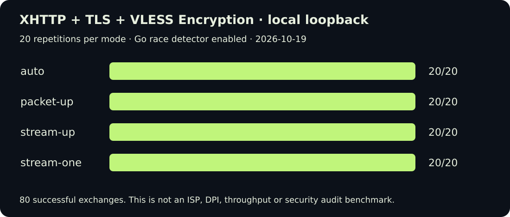
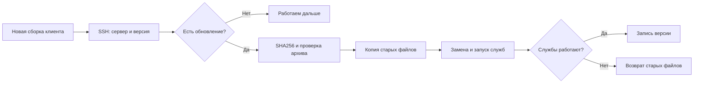

# XIO 0.22: белые списки, XHTTP и обновление сервера

[English below](#english) · 19.10.2026 · [Скачать релиз / Download](https://github.com/rukazax/xio_vpn/releases/tag/v0.22.0)

Мы разобрали замечания к предыдущему релизу и проверили идеи из [видео AlumPC](https://youtu.be/ZuMZRs8ofh4). Главное изменение подхода: отдельно проверяем транспорт и отдельно — возможность добраться до точки входа. Кнопки «обойти любой белый список» в приложении нет: такая надпись не сделала бы недоступный сервер доступным.

## Что видит провайдер 🔎

VPN — тоже туннель. Шифрование защищает содержимое канала, но провайдер видит IP его точки входа, порт, объёмы и время передачи. При обычном незашифрованном SNI видно и имя из TLS ClientHello. Имитировать часть HTTPS-обмена можно; изменить этим адрес назначения IP-пакета нельзя. Разные способы распознавания и ограничения соединений описаны в [RFC 9505](https://www.rfc-editor.org/rfc/rfc9505.html).

Фраза «провайдер видит Mail.ru, хотя данные идут с YouTube» описывает только часть возможной схемы. Имя в SNI само по себе не перенаправляет запрос через Mail.ru. Для реального посредника нужны поддерживаемая маршрутизация, нужный сервис и доступная точка входа. При проверке IP вместе с SNI подставленного имени недостаточно.

REALITY не означает кражу закрытого ключа чужого сертификата. Это отдельный механизм проверки клиента и поведения при обращении постороннего наблюдателя. Его возможности нужно оценивать по [документации проекта](https://github.com/XTLS/REALITY), а не по обещанию скрыть IP VPS.

## Какие ограничения приходится различать

| Что ограничено | Что имеет смысл проверять | Чего это не гарантирует |
|---|---|---|
| Узнаваемый VPN-транспорт | TLS, REALITY, Cloak, изменение транспортного профиля | Доступ к заблокированному IP |
| UDP или QUIC | TCP/TLS, затем проверка выбранного сайта | Прохождение TCP к любому серверу |
| Имя или сочетание IP + SNI | Собственный правильно настроенный вход, доступный в этой сети | Работу произвольного чужого SNI |
| IP, подсеть или ASN | Другую доступную точку входа, а при необходимости — отдельный выход | Доступность адреса из опубликованного списка во всех сетях |
| Почти весь внешний трафик | Подтверждённую доступность входа и его исходящего маршрута | Универсальное программное решение при полном отключении связи |

Это направления проверки, а не определение причины по одному тайм-ауту. Сбой DNS, сертификата, сервера, маршрута, запрет UDP и фильтр IP могут выглядеть похоже. Ответ одного сайта тоже не доказывает работу всего трафика, особенно при раздельном туннелировании.

Российские полевые обсуждения описывают разные условия у операторов и переходы между режимами фильтрации. Это полезные наблюдения, но не измерения нашей сборки и не официальный единый список: [обсуждение net4people](https://github.com/net4people/bbs/issues/516), [проект наблюдений за доступностью](https://github.com/hxehex/russia-mobile-internet-whitelist). Мы не встраиваем непроверенный список адресов как обещание доступа и не выполняем массовое сканирование чужих сетей.

## Что изменено в приложениях

В приложении остаются Xray, RIVET/S1, Cloak, AmneziaWG и RIVET/H3. На новых настройках Android и ПК сначала проверяется Xray; в iOS с доступными ему движками — RIVET/S1. Сохранённый доступный приоритет учитывается. RIVET/H3 полезен, пока сеть пропускает UDP.

Обычные WireGuard, OpenVPN, IKEv2, Shadowsocks и Tailscale полностью удалены из поддерживаемых клиентских подключений. Их отдельные профили больше не подключаются, смешанные пакеты сохраняют поддерживаемые конфигурации. OpenVPN остаётся внутренней зависимостью Cloak, чей TCP-вход привязан к loopback. Инструменты WG нужны инфраструктуре AWG. Новый сервер устанавливает только актуальный набор; миграция старого сервера отключает принадлежащие XIO устаревшие службы и открытый Shadowsocks-вход, сохраняя пользователей и ключи. Исторические исходные архивы не означают включение старых движков в новый клиент.

«Протоколы» перенесены в «Настройки → Соединение». Там же появился переключатель «VPN при раздаче». Android требует root; без него выводится «Необходим root». Для Windows используется ICS с правами администратора. Маршрутизация Linux проверена в отдельной VM: передача через интерфейс туннеля, блокировка после отключения, восстановление и удаление собственных правил. Работа аппаратного ускорения Android и реального Windows ICS не проверена; функция раздачи экспериментальная. Пошаговый порядок и ограничения — в [инструкции](../ru/guide.md).

План соединения теперь общий для интерфейса и фоновой плитки Android. Если протокол не прошёл проверку за заданное время, проверяется следующий из того же пользовательского профиля. При исчерпании вариантов приложение предлагает проверить точку входа и прямо объясняет предел смены протокола на одном IP. Автоматический переход к чужому серверу или к другому пользователю не добавлен.

## XHTTP: сначала проверка, затем интеграция ✅

Импорт XHTTP уже существовал. В 0.22 добавлена проверенная совместимость с форматом **VLESS Encryption** закреплённого Xray: `mlkem768x25519plus` с поддерживаемыми параметрами и ключами. Криптографию выполняет Xray, а не новый самодельный шифр XIO. Внешние TLS или REALITY обязательны. Конфигурации с отключением проверки сертификата, локальными файлами, скрытой переадресацией сокетов и отдельным `downloadSettings` не принимаются: текущий защитный сетевой адаптер разрешает только заявленную точку входа.

В тестах связки XHTTP + TLS + VLESS Encryption обнаружились две гонки в закреплённой зависимости: публикация HTTP-ответа читателю и обращение к буферу после передачи владения. Синхронизация первого участка перенесена по образцу текущей реализации XTLS; во втором длина сохраняется до передачи буфера. Патч и его происхождение опубликованы в [patches/xray](../../patches/xray/README.md). Лицензия изменённых файлов — MPL-2.0; криптографические алгоритмы не менялись.

Каждый из режимов `auto`, `packet-up`, `stream-up`, `stream-one` выполнил 20 обменов с включённым детектором гонок. В тесте использованы проверяемый TLS-сертификат и ключ ML-KEM-768 для VLESS Encryption. Это 80 локальных обменов, **не тест невидимости для DPI, не измерение скорости и не испытание в мобильной сети РФ**. Параметры xMUX передаются штатному движку; отдельный CDN и поддержку POST/дуплекса у него нужно проверять отдельно.

Мы изучили Hysteria 2, TUIC, Mieru, AnyTLS и NaïveProxy, но не добавили их названия как готовые движки. У каждого есть условия применения. Дополнительный QUIC-транспорт не помогает при полном запрете UDP. Chromium уменьшает расхождения сетевого стека, но не убирает IP и статистику соединения. Перенос чужих механизмов без сборки, профилей, учёта трафика и испытаний только увеличил бы список неисправностей. Подробности и источники — в [разборе видео и проектов](../research/2026-10-19-video-protocols.ru.md).

## Обновление клиента и сервера

После установки новой версии приложение владельца при запуске сравнивает рецепт и хеш серверного пакета с управляемым VPS. Для этого используются уже сохранённый SSH-доступ и сохранённая идентичность сервера. Пакет передаётся из установленного приложения: сервер не загружает случайный скрипт из сети.

Серверный рецепт этой сборки — **19**. Обновление сохраняет пользователей, ключи и сертификаты. Явная миграция убирает Shadowsocks-вход, обычных WG-пиров и отключает устаревшие службы XIO. Общие системные пакеты не удаляются. ОС не обновляется. При ошибке восстанавливаются старые runtime, конфигурации и состояния служб.

При активном VPN на этом устройстве операция откладывается, чтобы не оборвать собственный SSH-канал. После отключения откройте управление сервером или перезапустите приложение. Недоступный VPS будет повторно проверен при следующем запуске; в диагностическом журнале остаётся результат. Делегированный администратор и гостевой профиль не могут обновлять серверные исполняемые файлы. На других устройствах во время перезапуска серверных служб возможен короткий разрыв соединения.

В отдельной Ubuntu VM проверены переход с пакета 0.21, намеренно неисправный входящий бинарный файл и возврат к старому runtime. Затем выполнено успешное обновление, проверены сохранение пользователя и серверных ключей, повторный запуск без изменений и работа служб. Если откат не может завершиться, файлы восстановления сохраняются для владельца. Это не обещание восстановления после отключения питания или неисправности диска.

## Платформы и пределы проверки

| Платформа | Что входит в поставку | Граница проверки |
|---|---|---|
| Android 8+ | APK для ARM64, ARMv7, x86_64; AAB для Play | Эмулятор и проверки пакетов; физический Honor отдельно |
| Ubuntu x86_64 | DEB и переносимый архив, обновлённый VPN-helper | Локальные тесты и отдельная VM |
| Windows x64 | Архив с обновлённым helper | AOT и проверки в Wine; нативные драйвер/UAC отдельно |
| iOS | Обновлённые исходники клиента и общая логика | Нет сборки Xcode, подписанного IPA и проверки на iPhone |

Результаты и команды проверки находятся в [отчёте 0.22](../../verification/VERIFICATION-0.22.md). Не заявляем гарантированный обход белых списков, неразличимость с браузером или прохождение независимого криптоаудита.

---

# XIO 0.22: allowlists, XHTTP and managed-server updates

We reviewed the release feedback and the [AlumPC video](https://youtu.be/ZuMZRs8ofh4). Transport camouflage and entry-point reachability are separate problems. A different TLS handshake cannot make an unreachable IP reachable.

## What the ISP can observe

A VPN is a tunnel. The ISP can observe its entry IP, port, traffic volume and timing, and often unencrypted TLS SNI. An SNI value alone does not route a connection through the named website. An actual intermediary needs supported routing and a reachable entry point. See the technical taxonomy in [RFC 9505](https://www.rfc-editor.org/rfc/rfc9505.html).

REALITY does not mean stealing another site's private certificate key. It has its own client authentication and handling of unauthenticated connections; see [the project documentation](https://github.com/XTLS/REALITY). Its transport properties do not erase the destination IP.

| Restriction | Useful test or option | Limitation |
|---|---|---|
| Recognisable VPN transport | TLS/REALITY/Cloak and transport changes | Cannot unlock a blocked IP |
| UDP/QUIC blocked | A TCP/TLS route | TCP destination still has to be reachable |
| SNI or IP + SNI filtering | A correctly configured, reachable entry | An arbitrary borrowed hostname is insufficient |
| IP/subnet/ASN blocked | Another reachable entry, possibly a separate exit | Community lists are not universal guarantees |
| Severe shutdown | Test entry and onward reachability | Software cannot restore a fully disconnected link |

A timeout alone does not identify the cause. DNS failure, an invalid certificate, a server fault and an IP filter can look similar. A successful website probe also does not prove the path taken by every application under split routing. Russian [field discussions](https://github.com/net4people/bbs/issues/516) and [community reachability observations](https://github.com/hxehex/russia-mobile-internet-whitelist) are useful leads, not measurements of this XIO release. We do not ship an unverified list as guaranteed access or mass-scan third-party networks.

## Application changes

The supported client set is Xray, RIVET/S1, Cloak, AmneziaWG and RIVET/H3. Android/desktop defaults prefer Xray; iOS prefers its available RIVET/S1. A supported saved priority is respected. H3 needs reachable UDP.

Plain WireGuard, OpenVPN, IKEv2, Shadowsocks and Tailscale client engines are removed. Retired standalone profiles cannot connect; mixed bundles retain supported configurations. OpenVPN remains an internal Cloak dependency with a loopback TCP listener. Shared WG tooling serves AWG. New installations use the supported set; an explicit server migration disables owned legacy services and removes the bare Shadowsocks listener while retaining users and keys. Historical source archives do not mean those engines are linked into new clients.

Protocols moved to Settings → Connection, alongside VPN for tethering. Android requires root and displays “Root required” when unavailable. Windows uses administrator-authorised ICS. Linux forwarding rules were checked in an isolated VM for tunnel forwarding, disconnect blocking, recovery and cleanup. Android vendor offload and native Windows ICS remain unverified; tethering is experimental. Follow the [guide](../en/guide.md) and verify from a tethered device.

The UI and Android background tile now use one shared connection-plan implementation. Failed attempts move to the next candidate within the selected user's profile and the configured deadline. Exhausting the plan gives an entry-reachability explanation instead of implying that another protocol can unlock the same blocked IP. No silent switch to someone else's server or a different user was introduced.

## XHTTP interoperability and fixes ✅

XHTTP import already existed. This release adds checked import of the pinned engine's **VLESS Encryption** format, `mlkem768x25519plus`, with supported parameters and key lengths. Upstream Xray performs the cryptography. Outer TLS or REALITY remains required. Insecure certificate bypasses, local files, hidden socket redirection and separate `downloadSettings` are rejected: the current protected adapter only permits the declared entry endpoint.

Race-enabled local tests exposed two issues in the pinned Xray dependency: response-reader publication and accessing an upload buffer after transferring its ownership. We backported the current XTLS synchronization approach for the first and cached the buffer length before transfer for the second. The reproducible patch and provenance are in [patches/xray](../../patches/xray/README.md). Modified upstream files remain MPL-2.0. No cryptographic primitive was changed.

All four modes—`auto`, `packet-up`, `stream-up`, `stream-one`—completed 20 local exchanges each with TLS verification, VLESS Encryption using an ML-KEM-768 encapsulation key and the Go race detector. These 80 exchanges are **not a Russian ISP test, DPI indistinguishability test, throughput benchmark or independent cryptographic audit**. xMUX options reach the normal engine; CDN POST/duplex support needs a separate deployment test.

Hysteria 2, TUIC, Mieru, AnyTLS and NaïveProxy were reviewed, not added as untested engine labels. Another QUIC implementation does not solve a blanket UDP block. Chromium reduces stack differences but leaves entry IP and connection statistics observable. Read the [video/project review](../research/2026-10-19-video-protocols.en.md) for integration decisions and primary sources.

## Updating an existing managed server

On launch, the owner app compares the server recipe/hash over saved, identity-checked SSH access. The package comes from the installed application and is checked with SHA256. It replaces owned runtime files, restarts the relevant services, verifies their state and records the new version only after success. Failure restores previous files; a failed recovery retains backup files for the owner.

This release uses server **recipe 19**. Users, keys and certificates remain intact. The explicit migration removes bare Shadowsocks ingress and plain WG peers, and disables retired XIO-owned services. Shared OS packages stay. No OS package upgrade runs. Failure restores previous runtimes, configurations and service states.

An active VPN on this device defers the operation. Disconnect, then reopen server management or restart the app. Unreachable servers are retried on the next launch; the diagnostics log records the outcome. Delegated administrators and guest profiles cannot replace server executables. Other connected devices may see a brief interruption when server services restart.

An isolated Ubuntu VM exercised an actual 0.21 deployment, rollback after an intentionally broken incoming executable, successful upgrade, unchanged users/keys, idempotent repeat and active services. This does not establish recovery from power loss or disk failure.

## Delivery and test boundaries

Android: ARM64/ARMv7/x86_64 APKs and Play AAB; emulator/package checks, no new physical Honor proof. Ubuntu: DEB/portable package, local tests and an isolated VM. Windows: updated helper and Windows AOT, Wine checks; native driver/UAC validation remains separate. iOS: updated shared client and source project; no Xcode build, signed IPA or iPhone test on this Linux host.

See [0.22 verification](../../verification/VERIFICATION-0.22.md). We do not claim universal allowlist circumvention, browser indistinguishability or an independent security audit.
