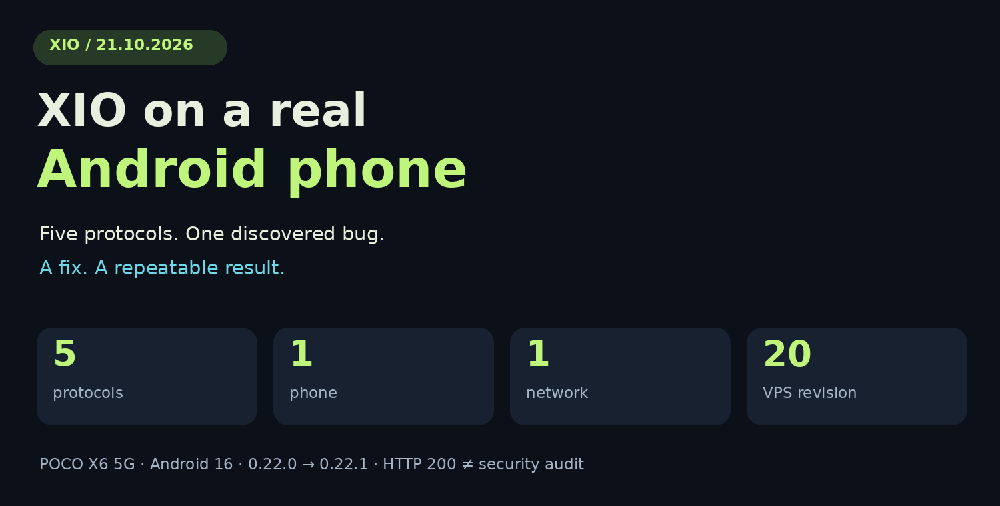
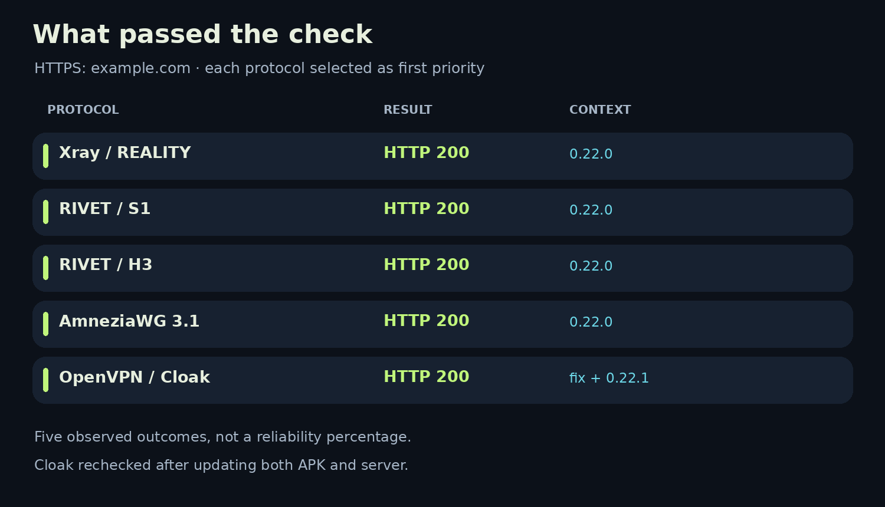
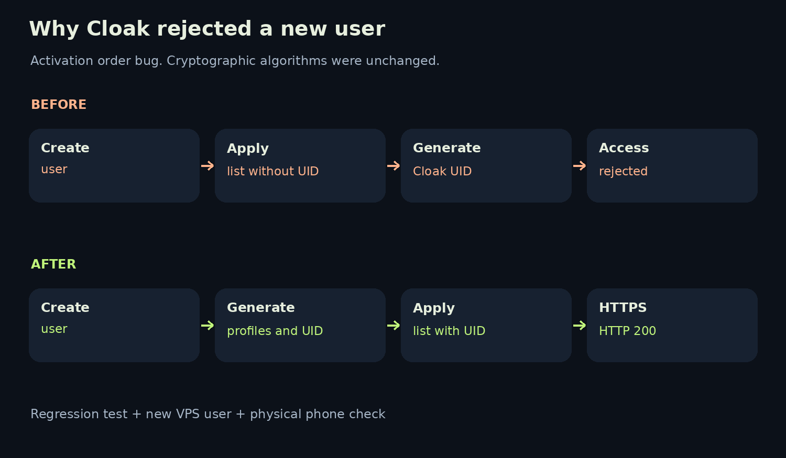

# XIO on a real Android phone: five protocols, one discovered bug, and release 0.22.1

[Русский](2026-10-21-physical-android.ru.md) · October 21, 2026 · Project engineering self-test

**We tested XIO on a physical POCO X6 5G running Android 16. All five protocols in this test series reached an HTTPS control site. Along the way, we found and fixed a Cloak user-creation bug, released Android patch 0.22.1, and verified an automatic VPS update.** ✅

Here is what we checked, why the first attempts failed, and what changed after the fix. The results cover one phone, one network, and one test VPS. There are no throughput charts: throughput was not measured in this session.

[Application repository](https://github.com/rukazax/xio_vpn) · [Download APKs](https://github.com/rukazax/xio_vpn/releases/tag/v0.22.1) · [Technical verification report](../verification/android-physical-2026-10-21.en.md)

## What XIO does

XIO is an open client for your own VPN server. It installs and maintains managed server components over SSH, creates users, stores their profiles, and tries the next available route when a connection attempt fails its check. The name means **X in 1 out**.

This Android series supports Xray/REALITY, RIVET/S1, RIVET/H3, AmneziaWG 3.1, and OpenVPN/Cloak. Xray, AmneziaWG, OpenVPN, and Cloak are third-party projects with their own authors and licenses. RIVET/S1 and RIVET/H3 are experimental XIO transports. See the [protocol documentation](../protocols/README.md) and [third-party notices](../../THIRD-PARTY-0.22.md) for details and attribution.

## Device and test method

| Parameter | Conditions in this series |
|---|---|
| Phone | Physical POCO X6 5G |
| System | Android 16 / API 36, ARM64 |
| System font scale | 145%; unchanged during testing |
| Client | Started with 0.22.0; finished with 0.22.1, build 5005 |
| Server | One test VPS; managed package migrated from revision 19 to 20 |
| Connectivity site | Initially youtube.com; temporarily changed to example.com |
| Connection pass criterion | Fresh activation of the selected protocol, an HTTPS response of 200, and bidirectional traffic counters |

We installed the published APK and checked its launcher and first-run flow. The owner personally accepted the license and VPN disclosure on the phone. We then added the VPS and created a user through the app. User creation reused the saved SSH access without another password prompt.

Each protocol was selected as first priority in turn. We checked the actual active route after connecting: otherwise, a successful fallback could hide a failure of the intended protocol. A running server service or an active interface alone did not count as a completed connection test.

## Why YouTube initially confused the result

XIO uses youtube.com as its default connectivity site. Early attempts brought up the interface and changed traffic counters, but the site check failed. The client then moved through the other protocols.

We checked the destination directly from the VPS. YouTube also failed to return an HTTP response there, while example.com returned HTTP 200. We temporarily changed the control address in settings and repeated the connections.

This separated destination reachability from tunnel operation. The cause of YouTube's failure was not established in this series. That observation alone cannot identify a protocol-specific block.

> For diagnosis, use an HTTPS site reachable from your VPS. A check of one destination answers a specific question; it does not establish reachability of the whole internet.

## Protocol results

| Protocol | Observed result | Part of the series |
|---|---|---|
| Xray / REALITY | HTTP 200; incoming and outgoing traffic | Client 0.22.0 |
| RIVET / S1 | HTTP 200; incoming and outgoing traffic | Client 0.22.0 |
| RIVET / H3 | HTTP 200; incoming and outgoing traffic | Client 0.22.0 |
| AmneziaWG 3.1 | HTTP 200; incoming and outgoing traffic | Client 0.22.0 |
| OpenVPN / Cloak | HTTP 200 after correcting user activation | Initially with the corrected server configuration; then repeated on the final 0.22.1 APK and server revision 20 |

This matrix records five observed connection outcomes, not a reliability percentage. The first four protocols did not undergo another separate series on the final 0.22.1 APK; the patch did not change native tunnel engines.

## The Cloak bug: a profile without activated access

Cloak initially reported `TRANSPORT_ERROR`. The client tried the next route and eventually connected through Xray. Fallback worked, but we recorded the Cloak failure separately.

Server inspection exposed a concrete mismatch: the new user already had a Cloak UID, but that UID was absent from the service configuration. For the first test user, the authorized UID list was still empty.

The configuration was being applied before all user profiles had been generated. Cloak UID creation happened after the service had already started with the previous access list.

The fix moves configuration application to the end of profile generation. We verified it in three steps:

1. Added a regression test requiring the user's UID to be present at the first gateway activation.
2. Created another temporary user on the real VPS and confirmed immediate authorization. We revoked that temporary access afterwards.
3. Repeated the Cloak connection from the phone and received HTTP 200. We repeated that result again after installing the final 0.22.1 APK and migrating the server package to revision 20.

All **19 server tests** passed. Another **14 selected Flutter tests** covering profiles, server actions, and update security passed. The fix did not change cryptographic algorithms.

## Checks around the connection

| Scenario | Observed result |
|---|---|
| Launcher and startup | APK installed, a launcher entry was available, and XIO opened |
| 145% font scale | Inspected screens remained readable; navigation stayed visible |
| VPS administration | Added a server and created a user with saved SSH access |
| Background operation | The VPN foreground service stayed active after leaving the app |
| Quick Settings tile | Disconnected and reconnected without opening XIO's window |
| Automatic fallback | An unsuccessful Cloak attempt was followed by successful Xray, before the fix |
| VPN tethering | Displayed the root requirement; tethered traffic routing was not tested |
| APK update | 0.22.1 installed over the earlier version, preserving profiles and first-run acknowledgments |
| VPS update | The app automatically migrated revision 19 to 20; the installed server package SHA-256 matched the APK's embedded package |

We finished with VPN disconnected and explicitly released the phone through the shared device coordinator. Release was acknowledged. Secrets, access profiles, and raw logs are excluded from this publication. The article's illustrations are diagrams, not device screenshots.

## What ships in 0.22.1

The [Android release](https://github.com/rukazax/xio_vpn/releases/tag/v0.22.1) includes ARM64, ARMv7, and x86_64 APKs, a signed update manifest, and checksums. All three APKs passed signature, launcher, and native-library consistency checks. **Only the ARM64 build was tested on a physical phone.**

All five release files were available without authentication. Their sizes and SHA-256 digests matched local artifacts. We also downloaded the ARM64 APK through its public URL and checked its digest. [Machine-readable publication evidence](../verification/release-0.22.1-public.json) identifies source commit `60aabec88ede2e258f7d44f02d6058504dcbed90`.

This is an Android patch. Windows and Ubuntu binaries remain at 0.22.0; the release does not add a signed installable iOS IPA. Server maintenance requires the owner's saved SSH access and takes place with VPN disconnected.

## What still needs testing

The next device matrix should cover more phones and Android versions, Wi-Fi/mobile-network changes, long sessions, and recovery after sleep. Separate work is needed for packet captures checking DNS/IPv6 behavior, tethering on a rooted device, power consumption, throughput, and resource usage.

Tests across different operator networks and an independent security audit remain separate milestones. RIVET remains experimental. HTTP 200 on one network does not establish browser indistinguishability or resistance to every blocking method.

## Try it and share a reproducible result

Start with the [XIO repository](https://github.com/rukazax/xio_vpn), [guide](../en/guide.md), and [APK release](https://github.com/rukazax/xio_vpn/releases/tag/v0.22.1). A useful report includes the phone model, Android version, XIO version, selected protocol, attempt timeout, and HTTPS control site. Do not send passwords, private keys, or complete access profiles.

For reproducible bugs, [open an issue](https://github.com/rukazax/xio_vpn/issues/new/choose). Reports from real devices help expand the test matrix. 🔎

---

Prepared by the project with AI assistance and checked against retained test evidence. This is the developer's account of its own project. [Source](https://github.com/rukazax/xio_vpn/tree/v0.22.1) · [License](../../LICENSE) · [Technical report](../verification/android-physical-2026-10-21.en.md). The diagrams and their [generator](../../tools/editorial/render_physical_article.py) are available in the repository.
