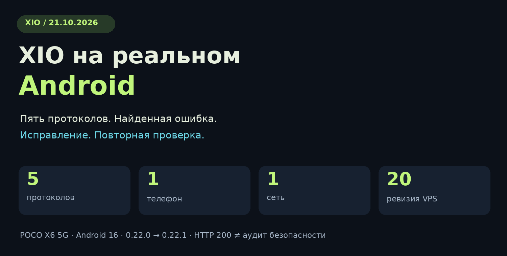
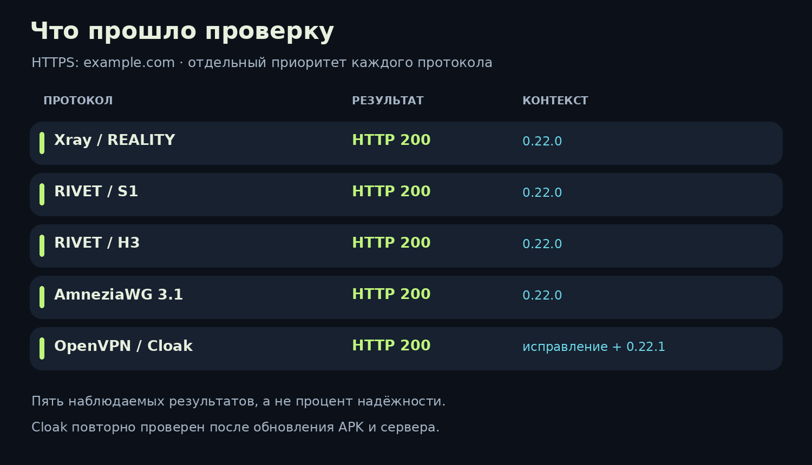
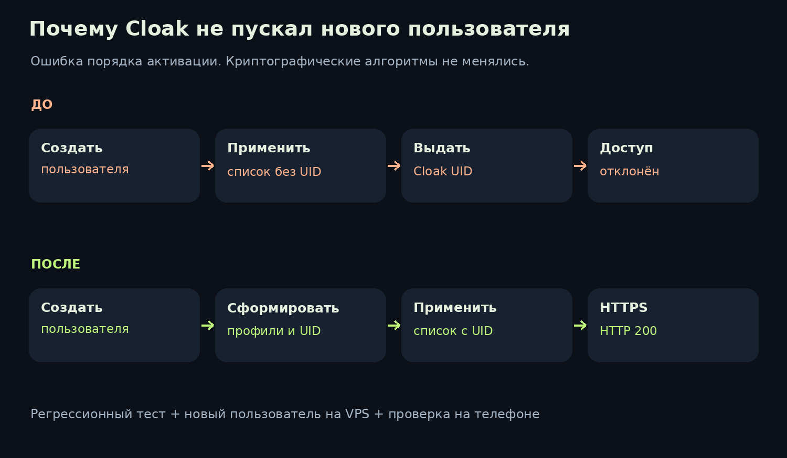

# XIO на реальном Android: пять протоколов, одна найденная ошибка и релиз 0.22.1

[English](2026-10-21-physical-android.en.md) · 21 октября 2026 · Инженерная самопроверка проекта

**Проверили XIO на физическом POCO X6 5G с Android 16. Все пять протоколов в этой серии смогли открыть контрольный HTTPS-сайт. По дороге нашли и исправили ошибку создания пользователей Cloak, выпустили Android-патч 0.22.1 и проверили автоматическое обновление VPS.** ✅

В этой статье показываем, что именно проверяли, почему первые попытки не проходили и что изменилось после исправления. Результаты относятся к одному телефону, одной сети и одному тестовому VPS. Графиков скорости здесь нет: пропускную способность в этой сессии не измеряли.

[Страница приложения](https://github.com/rukazax/xio_vpn) · [Скачать APK](https://github.com/rukazax/xio_vpn/releases/tag/v0.22.1) · [Краткий технический отчёт](../verification/android-physical-2026-10-21.ru.md)

## Что представляет собой XIO

XIO — открытый клиент для работы со своим VPN-сервером. Он устанавливает и обслуживает серверную часть через SSH, создаёт пользователей, хранит их профили и переключает доступные маршруты, если очередная попытка подключения не проходит проверку. Название означает **X in 1 out**.

В Android-клиенте этой серии доступны Xray/REALITY, RIVET/S1, RIVET/H3, AmneziaWG 3.1 и OpenVPN/Cloak. Xray, AmneziaWG, OpenVPN и Cloak — сторонние проекты со своими авторами и лицензиями. RIVET/S1 и RIVET/H3 — экспериментальные транспорты XIO. Их устройство описано в [документации протоколов](../protocols/README.md), а происхождение зависимостей — в [уведомлениях о лицензиях](../../THIRD-PARTY-0.22.md).

## На чём и как проверяли

| Параметр | Условия этой серии |
|---|---|
| Телефон | Физический POCO X6 5G |
| Система | Android 16 / API 36, ARM64 |
| Масштаб системного шрифта | 145%; во время проверки не менялся |
| Приложение | Начало серии — 0.22.0; завершение — 0.22.1, build 5005 |
| Сервер | Один тестовый VPS; пакет обновлён с ревизии 19 до 20 |
| Проверочный сайт | В начале youtube.com, затем временно example.com |
| Критерий успешного подключения | Свежая активация выбранного протокола, HTTPS-ответ 200 и двусторонние счётчики трафика |

Сначала установили опубликованный APK, проверили значок запуска и первый запуск. Лицензию и уведомление о работе VPN владелец подтвердил лично на телефоне. Затем через приложение добавили VPS и создали пользователя. Повторно вводить SSH-пароль при создании пользователя не потребовалось.

Каждый протокол по очереди выставляли приоритетным. После подключения смотрели фактически выбранный маршрут: иначе успешный резерв мог бы скрыть неудачу первого протокола. Работающая служба на VPS или надпись об активном интерфейсе сами по себе не считались завершённой проверкой.

## Почему YouTube сначала запутал картину

По умолчанию XIO проверяет соединение через youtube.com. В первых попытках приложение поднимало интерфейс, счётчики менялись, но проверка сайта не проходила. После этого начинался перебор других протоколов.

Проверили сайт непосредственно с VPS. Прямой запрос к YouTube тоже не получил HTTP-ответ, а example.com ответил HTTP 200. Поэтому временно сменили контрольный адрес в настройках и повторили подключения.

Это позволило разделить доступность сайта с выходного сервера и работоспособность туннеля. Причину недоступности YouTube в этой серии не установили. По одному такому наблюдению нельзя сделать вывод о блокировке конкретного протокола.

> Для диагностики используйте HTTPS-сайт, который доступен с вашего VPS. Проверка конкретного сайта отвечает на конкретный вопрос; она не подтверждает доступность всего интернета.

## Результаты по протоколам

| Протокол | Что наблюдали | В какой части серии |
|---|---|---|
| Xray / REALITY | HTTP 200, приём и передача данных | Клиент 0.22.0 |
| RIVET / S1 | HTTP 200, приём и передача данных | Клиент 0.22.0 |
| RIVET / H3 | HTTP 200, приём и передача данных | Клиент 0.22.0 |
| AmneziaWG 3.1 | HTTP 200, приём и передача данных | Клиент 0.22.0 |
| OpenVPN / Cloak | HTTP 200 после исправления активации пользователя | Сначала с исправленной конфигурацией сервера, затем повторно на итоговом APK 0.22.1 и серверной ревизии 20 |

Матрица описывает наблюдаемые результаты этой серии. Это пять проверенных вариантов подключения, а не статистика надёжности. Первые четыре протокола не проходили отдельную повторную серию на итоговом APK 0.22.1; нативные движки в патче не менялись.

## Ошибка Cloak: профиль уже есть, а доступа ещё нет

Cloak сначала выдавал `TRANSPORT_ERROR`. Приложение переходило к следующему маршруту и в итоге подключалось через Xray. Резервирование сработало, но ошибку Cloak мы зафиксировали отдельно.

Проверка сервера показала конкретное несоответствие: у созданного пользователя уже был Cloak UID, а в конфигурации службы его не было. Для первого тестового пользователя список разрешённых UID оставался пустым.

Причина оказалась в порядке операций. Конфигурация применялась раньше, чем завершалось формирование всех профилей. Создание Cloak UID происходило уже после запуска службы с предыдущим списком доступа.

Исправление перенесло применение конфигурации в конец формирования профилей. Для проверки сделали три шага:

1. Добавили регрессионный тест: при первой активации служба уже должна получить UID нового пользователя.
2. Создали дополнительного временного пользователя на VPS и проверили, что он сразу попал в разрешённый список. После проверки его доступ отозвали.
3. Повторили подключение Cloak с телефона. Получили HTTP 200, затем повторили этот результат после установки итогового APK 0.22.1 и обновления серверного пакета до ревизии 20.

Все **19 серверных тестов** прошли. Дополнительно прошли **14 выбранных тестов Flutter** по профилям, действиям с сервером и безопасности обновлений. Криптографические алгоритмы в этом исправлении не менялись.

## Что проверили вокруг соединения

| Сценарий | Наблюдаемый результат |
|---|---|
| Значок приложения и запуск | APK установился, значок запуска доступен, приложение открылось |
| Шрифт 145% | Проверенные экраны оставались читаемыми, навигация отображалась |
| Управление VPS | Сервер добавлен через приложение; пользователь создан с сохранённым SSH-доступом |
| Работа в фоне | После сворачивания приложения VPN-служба оставалась активной foreground service |
| Плитка быстрых настроек | VPN отключался и повторно подключался без открытия окна XIO |
| Автоматический резерв | Неуспешный Cloak сменился успешным Xray; это проверялось до исправления |
| Раздача VPN | Интерфейс показал требование root; прохождение раздаваемого трафика не проверялось |
| Обновление APK | 0.22.1 установился поверх предыдущей версии, профили и подтверждения первого запуска сохранились |
| Обновление VPS | Приложение автоматически сменило ревизию 19 на 20; SHA-256 установленного серверного пакета совпал со встроенным в APK |

Тест завершили с отключённым VPN. Телефон освободили через общего координатора, освобождение было явно подтверждено. Секреты, пользовательские профили и необработанные журналы в публикацию не включены. Иллюстрации в статье — схемы, а не снимки экрана телефона.

## Что получили пользователи в 0.22.1

В [Android-релизе](https://github.com/rukazax/xio_vpn/releases/tag/v0.22.1) размещены APK для ARM64, ARMv7 и x86_64, подписанное описание обновления и контрольные суммы. Для всех трёх APK проверены подпись, значок запуска и соответствие нативных библиотек. На физическом телефоне проверена **только ARM64-сборка**.

Все пять файлов релиза были доступны без авторизации. Их размеры и SHA-256 совпали с локальными файлами. ARM64 APK дополнительно скачали по публичной ссылке и сверили его контрольную сумму. [Машиночитаемое подтверждение публикации](../verification/release-0.22.1-public.json) связано с исходным коммитом `60aabec88ede2e258f7d44f02d6058504dcbed90`.

Это Android-патч. Сборки для Windows и Ubuntu остаются версии 0.22.0; устанавливаемого подписанного IPA для iOS этот релиз не добавляет. Обновление серверной части требует сохранённого SSH-доступа владельца и выполняется при отключённом VPN.

## Какие проверки ещё нужны

Следующая матрица должна включать другие телефоны и версии Android, смену Wi-Fi и мобильной сети, длительные сессии и восстановление после сна. Отдельно нужны захват пакетов для проверки DNS/IPv6, тест раздачи на устройстве с root, измерения энергопотребления, скорости и нагрузки.

Испытания на сетях разных операторов и независимый аудит безопасности остаются отдельными этапами. RIVET сохраняет экспериментальный статус. Результат HTTP 200 в одной сети не доказывает неотличимость от браузерного трафика и устойчивость к любым блокировкам.

## Попробовать и прислать результат

Начните со [страницы XIO](https://github.com/rukazax/xio_vpn), [инструкции](../ru/guide.md) и [релиза с APK](https://github.com/rukazax/xio_vpn/releases/tag/v0.22.1). Для сравнимого отчёта укажите модель телефона, Android, версию XIO, выбранный протокол, время попытки и проверочный HTTPS-сайт. Пароли, ключи и полные профили присылать не нужно.

Нашли воспроизводимую ошибку — [создайте issue](https://github.com/rukazax/xio_vpn/issues/new/choose). Обсуждение результатов помогает расширять матрицу реальных устройств. 🔎

---

Материал подготовлен командой проекта с помощью ИИ и проверен по сохранённым результатам испытаний. Это рассказ разработчика о собственном проекте. [Исходники](https://github.com/rukazax/xio_vpn/tree/v0.22.1) · [Лицензия](../../LICENSE) · [Технический отчёт](../verification/android-physical-2026-10-21.ru.md) · [Обсудить результаты](https://github.com/rukazax/xio_vpn/discussions/2). Схемы и их [генератор](../../tools/editorial/render_physical_article.py) доступны в репозитории.
