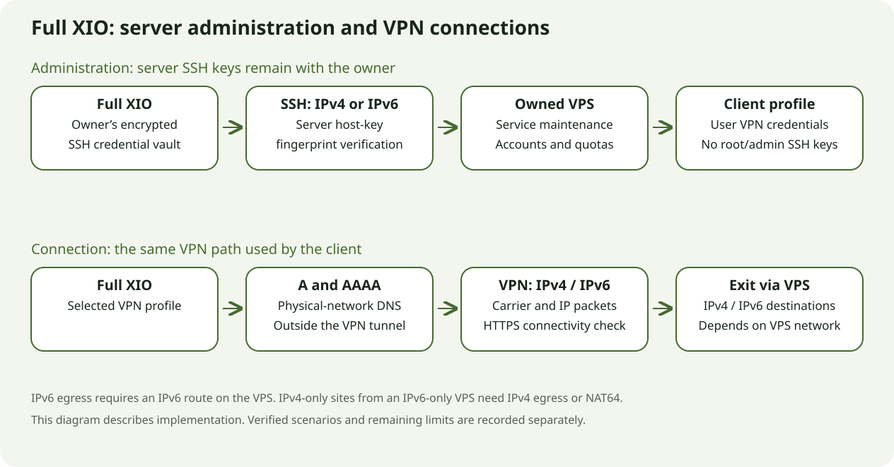
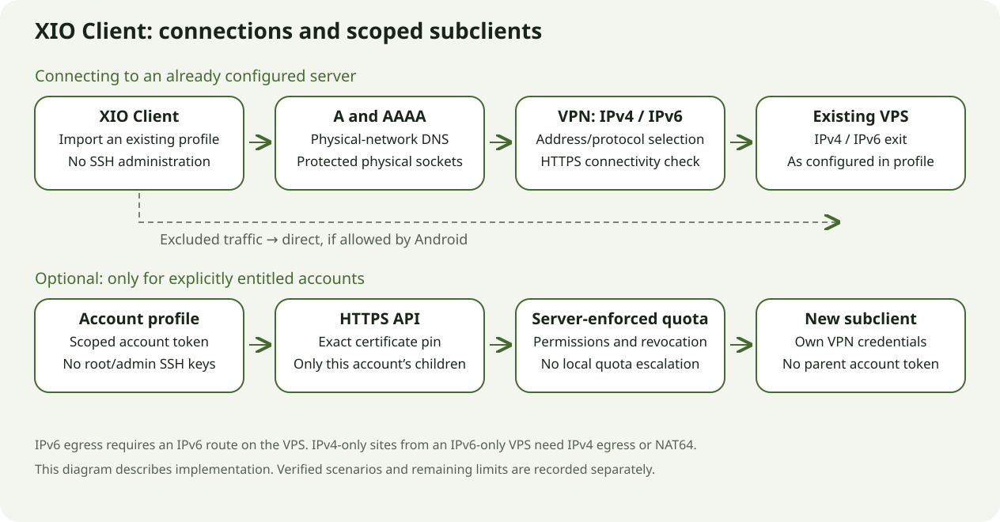

# XIO / XIO Client 0.22.3 — Android and IPv4/IPv6

**0.22.3+5012, server recipe 24. Prerelease.** Physical IPv4 checks cover a POCO X6 5G running Android 16/ARM64 and the authorized VPS. Public IPv6 remains unverified because that VPS has no IPv6 route. Code support is not presented as proof of a working public IPv6 path.

## Two applications

| Application | Purpose |
|---|---|
| Full XIO | Provision and maintain a VPS, manage users and quotas, issue profiles, and connect to VPN. |
| XIO Client | Connect to existing servers, switch profiles, and select app/IP routing. Only an explicitly authorized account can create and revoke its own children within the server quota. |

The client installs alongside full XIO. Its home screen shares the same theme: large connection button, status, server picker, protocol and traffic counters. Both apps support Russian and English. Android 8.0/API 26 or newer; ARM32, ARM64 and x86-64. A universal client APK is included. One ARM64 device was physically tested; other architectures were checked as signed builds. Desktop releases are unchanged.

## Network behaviour

Supported transports are Xray/REALITY, RIVET/H3, RIVET/S1, AmneziaWG and OpenVPN/Cloak. Endpoints may use IPv4, IPv6 or domains with A/AAAA records. VPN sockets are protected from their own tunnel; entry-point DNS uses the physical Android network. Xray and Cloak try both address families. RIVET tries them sequentially because concurrent authorization of one identity can replace a peer. TLS/REALITY and server identity checks remain enabled.

RIVET/S1 and H3 carry IPv4 and IPv6. IPv6 addresses are issued only by a server explicitly advertising support. Managed addressing, forwarding and NAT66 require real provider routing; owned changes have receipts and precise removal. IPv6 extension headers, fragments and jumbograms remain unsupported. TCP, UDP and limited ICMPv6 are supported. IPv6-only servers still need IPv4 egress or NAT64/DNS64 for IPv4-only sites.

Routing modes cover all apps, selected apps through/bypassing VPN, and selected IP/CIDR destinations through/bypassing VPN. DNS comes from the profile; destination inclusion must account for a reachable DNS server. Excluded traffic goes directly when Android lockdown permits it. Switching connections can leave a gap without VPN. Always-on and blocking connections without VPN are separate Android settings.

Xray checks the configured HTTPS site through its encrypted session before exposing the TUN. Fresh protected traffic is therefore verified even when app or destination rules exclude the visible check. The separate visible site check follows routing policy and cannot prove every application's route.

## Subclients and keys

The full-app owner confirms a separate HTTPS API on TCP 9444 and issues an account-scoped token. The client pins the API certificate. Each operation checks role, quota, revocation and child ownership on the server. Ordinary VPN profiles grant no delegation rights. Child exports contain only that child's VPN keys, without the parent token or further delegation rights.

Server SSH/root/admin keys are not passed to the client. Actual exports from the signed application were inspected in memory by a separate QA receiver through Android FileProvider. Only safe verification results were retained. VPN keys and account tokens remain sensitive. Keystore/AES-GCM and disabled backups remain in place. Client FLAG_SECURE was not disabled.

[Account setup and client build instructions](../../client/README.en.md).

## Fixes found during physical tests

- AmneziaWG no longer advertises IPv6 DNS for a VPS without declared IPv6 support. IPv4 DNS passed the repeated test.
- Strict installer umask no longer prevents the unprivileged account HTTPS service from reading its public code. Root-managed state remains inaccessible to that identity.
- Android 16 profile/update sharing uses distinct non-exported FileProvider components. Ordinary, account and child exports passed with temporary read permission. This follows the [Android FileProvider pattern](https://developer.android.com/reference/androidx/core/content/FileProvider).
- Xray's own HTTPS session check no longer depends on app/CIDR selection. Certificate, hostname and fresh-traffic checks remain enabled.

## Verification

[Detailed versioned and dated physical test record](../../verification/0.22.3-physical-android.json). Historical failures remain distinct from successful retests. One phone does not establish compatibility with every Android release.

| Layer | Result |
|---|---|
| Local suites | Flutter: 113 passed/6 skipped; separately client mode: 13 passed; server: 31 passed. Suites overlap. Analysis clean. |
| Native runtime | Go `-race` passed, including session-bound HTTPS, untrusted-certificate rejection, HTTP redirect rejection and deadline handling. Exact source fingerprints match the AAR. |
| Local IPv6 | Real S1/H3 packets, addressing, forwarding, NAT66, idempotency and owned-rule cleanup passed in isolated networks. This is not public IPv6 connectivity. |
| Android/VPS | Five transports in both apps, DNS/HTTPS and observed exit address; routing, quota, export and revocation cases identify their build in the record. |
| APK | Signatures, versions, content, ABIs and ZIP/ELF 16-KB alignment verified. Full XIO contains the exact recipe 24 archive. |
| Limits | One physical Android 16 device and one VPS. Two independent servers, public IPv6, rooted sharing, destructive server removal, load and battery life were not tested. |

## Diagrams and screens

 

Left: a real full-app screenshot on the POCO using a temporary QA profile. Right: actual client widgets rendered locally with a synthetic profile. These are different forms of evidence. Client screen protection was retained. Light and Russian previews are available in the images directory.

The five-protocol matrix in both apps (20 HTTPS checks) ran on build 5011. Final build 5012 uses the unchanged native engine/AAR and adds secret-free tile lifecycle logs. Build5012 separately passed the tile primary connect/disconnect commands, independent VPN HTTPS and a client Xray control. This does not represent a rerun of the entire matrix on 5012.
