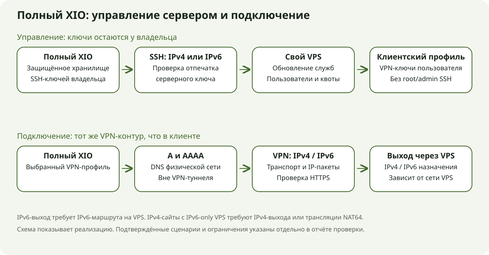
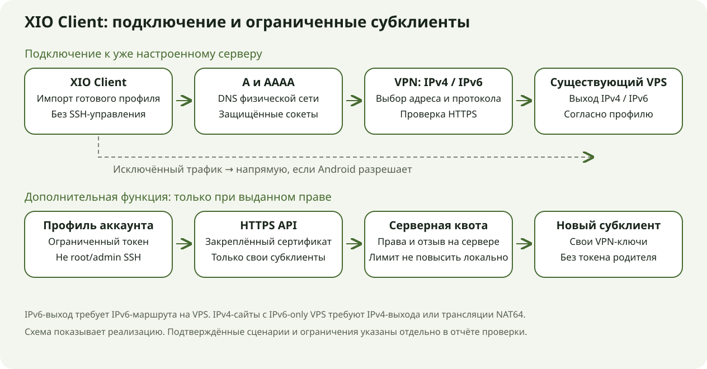
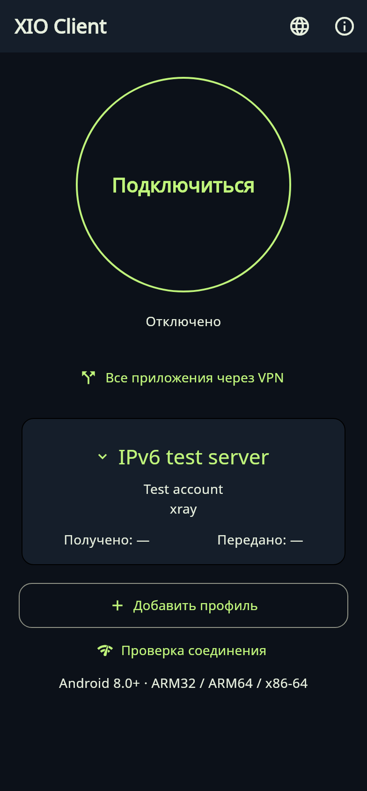

# XIO / XIO Client 0.22.3 — проверка Android и IPv4/IPv6

**0.22.3+5012, серверная ревизия 24. Тестовый релиз.** Физические IPv4-проверки выполнены на POCO X6 5G с Android 16/ARM64 и разрешённом VPS. Публичный IPv6 не проверен: у VPS нет IPv6-маршрута. Это ограничение проверки сохранено в описании и результатах; наличие поддержки в коде не выдаётся за готовый публичный IPv6-канал.

## Два приложения

| Приложение | Назначение |
|---|---|
| Полный XIO | Настройка и обслуживание своего VPS, пользователи и квоты, выдача профилей, подключение к VPN. |
| XIO Client | Подключение к готовым серверам, смена профиля, правила по приложениям или IP. Создание и отзыв своих субклиентов доступны только аккаунту с выданным правом и серверной квотой. |

Клиент устанавливается рядом с полной версией. Его главный экран использует ту же тему: большая кнопка подключения, состояние, сервер, протокол и счётчики. Русский и английский языки доступны в обоих приложениях. Android 8.0/API 26 и новее; ARM32, ARM64 и x86-64. У клиента есть универсальный APK. Физически проверено одно устройство ARM64, остальные архитектуры проверены как сборки. Настольные версии не обновлялись.

## Сеть и правила

Поддерживаются Xray/REALITY, RIVET/H3, RIVET/S1, AmneziaWG и OpenVPN/Cloak. Адрес сервера может быть IPv4, IPv6 или доменом с A/AAAA. Сокеты VPN исключаются из собственного туннеля; имя точки входа разрешается через физическую сеть Android. Xray и Cloak пробуют обе семьи адресов. RIVET перебирает их последовательно, поскольку параллельная авторизация одной личности может заменить её соединение. Проверка TLS/REALITY и идентичности сервера сохраняется.

RIVET/S1 и H3 переносят IPv4 и IPv6. IPv6-адрес выдаётся только сервером с явной поддержкой. Сервер настраивает собственные адреса, forwarding и NAT66 только при реальном маршруте провайдера, с журналом своих изменений и возможностью их точного удаления. IPv6 extension headers, фрагменты и jumbograms пока не поддерживаются; поддерживаются TCP, UDP и ограниченный ICMPv6. IPv6-only серверу для IPv4-only сайтов нужен отдельный IPv4-выход либо NAT64/DNS64.

Правила: все приложения, выбранные через VPN, выбранные в обход, выбранные IP/CIDR через VPN или в обход. IPv4/IPv6 CIDR проверяются локально. DNS берётся из профиля: режим включения отдельных IP должен учитывать нужный DNS-сервер. Исключённый трафик идёт напрямую, если Android lockdown это разрешает. Между сменой соединений возможен промежуток без VPN. Системные Always-on и блокировка без VPN — отдельные настройки Android.

Xray проверяет выбранный HTTPS-сайт через собственный зашифрованный сеанс до активации TUN. Так свежий защищённый обмен подтверждается и при исключении самого приложения или сайта из пользовательских маршрутов. Видимая проверка сайта по правилам маршрутизации остаётся дополнительной диагностикой и не доказывает маршрут всех приложений.

## Субклиенты и ключи

Владелец полной версии подтверждает отдельный HTTPS API на TCP 9444 и выдаёт аккаунту ограниченный токен. Клиент закрепляет сертификат API. Сервер проверяет права, квоту, отзыв и принадлежность дочернего аккаунта. Обычный профиль не даёт таких прав. Дочерний экспорт содержит только VPN-ключи самого субклиента: без токена родителя и без права дальнейшего делегирования.

В клиент не передаются SSH/root/admin-ключи сервера. Это проверено фактическим экспортом из подписанного приложения через Android FileProvider в отдельный тестовый получатель: файл разобран в памяти, сохранены только безопасные результаты проверки. VPN-ключи и ограниченный токен тоже секретны. Keystore/AES-GCM и запрет резервного копирования сохранены. Снимки клиента защищены FLAG_SECURE.

[Как выдать доступ и собрать клиент](../../client/README.ru.md).

## Что исправлено при физических проверках

- AmneziaWG: IPv6 DNS больше не выдаётся VPS, который не объявил поддержку IPv6. На таком VPS используется IPv4 DNS. Повторная проверка DNS прошла.
- API аккаунта: строгий umask больше не лишает непривилегированную HTTPS-службу чтения её публичного кода. Корневое состояние сервера остаётся закрытым.
- Android 16: выдача профилей и обновлений использует разные закрытые компоненты FileProvider. Передача обычного аккаунта и субклиента прошла с временным правом чтения. Такой способ соответствует [схеме Android FileProvider](https://developer.android.com/reference/androidx/core/content/FileProvider).
- Xray: собственная проверка HTTPS-сеанса больше не зависит от выбранных приложений и CIDR. Проверка сертификата, имени и свежего обмена не отключалась.

## Проверки

[Подробный протокол с версиями, датами и границами](../../verification/0.22.3-physical-android.json). Исторические отказы сохранены отдельно от повторных успешных проверок. Проверка на одном телефоне не означает проверку всех версий Android.

| Уровень | Результат |
|---|---|
| Локальные проверки | Flutter: 113 прошли/6 пропущены; отдельно клиентский режим: 13 прошли; сервер: 31 прошёл. Наборы частично пересекаются. Анализ без замечаний. |
| Нативный модуль | Go с `-race` прошёл, включая HTTPS через сеанс, отказ от недоверенного сертификата/HTTP redirect и дедлайн. Точные исходники и SHA связаны с AAR. |
| IPv6 локально | Реальные пакеты S1/H3, адресация, forwarding, NAT66, повторное применение и удаление своих правил прошли в изолированной сети. Это не публичный IPv6. |
| Android/VPS | Пять протоколов в обоих приложениях, DNS/HTTPS, наблюдение адреса выхода; проверки маршрутов, квоты, экспорта и отзыва перечислены по сборкам в протоколе. |
| APK | Подписи, версии, содержимое, ABI и ZIP/ELF 16-КБ выравнивание проверены. Полная версия содержит точный архив ревизии 24. |
| Границы | Один физический Android 16 и один VPS. Два независимых сервера, публичный IPv6, root-раздача, деструктивное удаление сервера, нагрузка и автономность не проверялись. |

## Схемы и экраны

 

Слева — реальный снимок полной версии на POCO с временным QA-профилем. Справа — локальное изображение настоящих виджетов клиента с вымышленным профилем. Это разные виды свидетельств. Защита снимков клиента не отключалась. Светлые и английские варианты доступны рядом в каталоге images.

Матрица пяти протоколов в обоих приложениях (20 HTTPS-проверок) выполнена на сборке 5011. В финальной 5012 нативное ядро/AAR не менялось: добавлены журналы жизненного цикла плитки без секретов. На 5012 отдельно проверены подключение/отключение основной кнопкой плитки, независимый HTTPS через VPN и контроль Xray в клиенте. Это не повтор всей матрицы на 5012.
