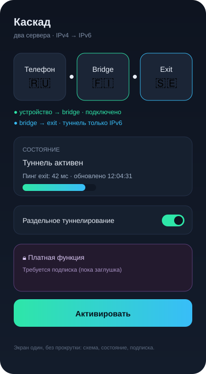

# XIO Cascade — двухсерверная схема (bridge → exit)

> Платная функция. Механизм подписки пока не реализован: в приложении и на сервере
> есть заглушка (`CascadeFeatureGate.enabled == false`), включение — отдельным
> релизом. Всё остальное (протоколы, перебор, раздельное туннелирование,
> проверка соединения) работает как раньше.

## 1. Зачем

Часть провайдеров и стран даёт пользователю только IPv4, а нужный выход — в сети,
где работает исключительно IPv6. XIO Cascade решает это двумя серверами:

```
[устройство]      IPv4        [bridge, IPv4]        IPv6        [exit, только IPv6]
   app  ───────────────▶  приём + мост IPv4→IPv6  ────────────▶  выход в интернет
        защищённый туннель A            защищённый туннель B (только IPv6)
```

* **bridge** — промежуточный сервер с публичным IPv4. Принимает устройство тем же
  транспортом, что и обычная установка (`rivet-s1`/`rivet-h3`/`awg`), и держит
  второй туннель до exit.
* **exit** — сервер **только с IPv6**. Наружу не смотрит по IPv4 вообще, поэтому
  bridge обязан поднимать туннель по IPv6.
* На устройстве в приложении виден маршрут из трёх станций с флагами стран и
  состоянием каждого участка.



## 2. Экраны приложения

Требование: экран подключения и маршрута — **один, без прокрутки**, целиком в
экран телефона.

```
┌──────────────────────────────────────────────┐
│  Каскад                         [замок, если │
│                                 нет подписки]│
│   ┌────────┐      ┌────────┐      ┌────────┐ │
│   │Телефон │──────│ Bridge │──────│  Exit  │ │
│   │  🇷🇺    │      │  🇫🇮    │      │  🇸🇪    │ │
│   └────────┘      └────────┘      └────────┘ │
│      ●──────────────●──────────────●          │
│        подключение      ожидание              │
│                                              │
│  Статус: Bridge → Exit · туннель активен      │
│  Пинг: 42 мс · обновлено 12:04:31             │
│  [ Переподключить ]                           │
├──────────────────────────────────────────────┤
│  Платная функция. Требуется подписка          │
│  [ Активировать ]                             │
└──────────────────────────────────────────────┘
```

* Вёрстка: `Column` + `Expanded`, `FittedBox`/`Flexible`, `maxLines`, поддержка
  крупного системного шрифта; никаких `ListView`/`ScrollView` (это проверяется
  тестом `app/test/cascade_model_test.dart` и ревью).
* Флаги — эмодзи из ISO-кода страны (`RU` → 🇷🇺), без сетевых запросов.
* Цвет линии: серый — idle, жёлтый — установка, зелёный — активен, оранжевый —
  degraded (перебор), красный — failed.
* Заглушка подписки: полупрозрачная плашка с замком, кнопка «Активировать»
  показывает «Подписка ещё не подключена» и не меняет состояние.

## 3. Установка

### 3.1 Из приложения (как раньше)

На экране «VPN на своём сервере» появляется галочка **«Включить каскад»**
(полная версия приложения). Она передаёт в серверный установщик флаг
`--enable-cascade`, и установка идёт по прежней логике: SSH → загрузка
bootstrap и серверного архива → установка.

### 3.2 Из терминала одной командой

```bash
curl -fsSL https://raw.githubusercontent.com/rukazax/xio_vpn/main/deploy/cascade/terminal-install.sh \
  | bash -s -- --role bridge --exit-host 2a0c:b641:1a0:800::2a2 --port 9443
```

`terminal-install.sh` проверяет sha256 скачанного скрипта, пишет лог в
`/var/log/xio-cascade-install.log`, поддерживает `--unattended` и `--dry-run`.

### 3.3 Где живут файлы

Вся логика установки и работы — **в репозитории GitHub**, в приложении только
запуск:

```
deploy/cascade/
├── cascade-install.sh        # общая установка, --role bridge|exit|both
├── cascade-bridge-setup.sh   # IPv4-приём + мост IPv4→IPv6 + туннель до exit
├── cascade-exit-setup.sh     # только IPv6, NAT66, отпечаток
├── cascade-healthcheck.sh    # JSON-проверка туннелей и выхода
├── whitelist-update.sh       # белые списки на bridge, еженедельно
├── terminal-install.sh       # установка из терминала
├── Dockerfile, entrypoint.sh # контейнер
└── README.md
server/webui/
├── xio-webui.py              # TLS + токен + SPA
├── index.html
├── xio-webui.service
└── install-webui.sh
```

## 4. Изоляция: контейнер

Оба сервера держат XIO в **отдельном контейнере**, чтобы не мешать чужому софту:

* `docker`/`podman`, отдельная bridge-сеть, монтирование только `./data`;
* `--cap-add NET_ADMIN`, `--device /dev/net/tun`, публикуется **один** порт
  туннеля (по умолчанию `9443`), наружу ничего больше не выставляется;
* конфиги и ключи — в `./data` (права 700), не в образе;
* удаление = `docker rm -f` + `./data` — хост остаётся чистым.

## 5. Безопасность

| Что | Как |
|---|---|
| Транспорт устройства → bridge | тот же стек XIO: TLS 1.3 / QUIC, pin по ключу сервера |
| Транспорт bridge → exit | отдельный туннель с собственными ключами, только IPv6, MTU 1280 |
| Ключи | генерируются на месте, в логах не печатаются, `umask 077` |
| Одноразовые токены | bridge выдаёт устройству сессионный токен, exit не доверяет устройству напрямую |
| Веб-интерфейс | только TLS (самоподписанный сертификат), Bearer-токен + cookie-сессия, `hmac.compare_digest`, CSRF-заголовок, rate-limit, по умолчанию слушает `127.0.0.1:9443` |
| Белые списки | nft-сет `xio_whitelist4`, атомарная замена, откат при ошибке |

## 6. Раздельное туннелирование (белые списки)

Правила живут **на bridge (IPv4)**: nft-таблица с набором `xio_whitelist4`,
маршрутизация «в туннель только из списка», остальное — напрямую.
Списки скачиваются по URL из `whitelists.conf`, обновление — еженедельно
(`whitelist-update.timer`, `OnCalendar=weekly`), с проверкой синтаксиса и
атомарной подменой набора. В приложении остаётся переключатель
«раздельное туннелирование» — он лишь передаёт список/флаг на сервер.

## 7. Проверка соединения и перебор

* Устройство → bridge: прежняя логика (свежий handshake, счётчики, DNS через
  туннель, watchdog 15 с, 2 промаха → переподключение).
* bridge → exit: `cascade-healthcheck.sh` проверяет IPv6-доступность exit,
  свежесть рукопожатия и реальный выходной IPv6; результат публикуется в
  `/var/lib/xio-cascade/health.json` и виден в приложении.
* Перебор: сначала протоколы (rivet-s1 → rivet-h3 → awg), затем — **заглушка
  перебора серверов** (`CascadeServerPool`, сейчас один bridge/exit; список
  расширяется без изменения UI).

## 8. Веб-интерфейс

После установки в меню «Настройки сервера» появляется строка **«Веб-интерфейс»**
с URL вида `https://<server>:9443/?token=…`. В браузере — одна страница:
сервер, сервисы (start/stop/restart), пользователи (добавить/отозвать),
каскад (включить/выключить), белые списки, здоровье.

## 9. Доменное имя

Решение: **оставляем внутри** — домен нужен для TLS `serverName`/SNI и для
перебора серверов по имени, но поле «адрес сервера» в клиентском UI больше не
просит домен: пользователь вводит IP или импортирует профиль. Если функция не
нужна совсем — удаляется одним коммитом (см. `server_address.dart`).

## 10. Что не реализовано сейчас (заглушки)

* подписка и оплата (`CascadeFeatureGate`, `CascadeSubscription`);
* перебор нескольких bridge/exit (`CascadeServerPool`);
* автоматическое гео-определение флагов (сейчас — из конфигурации сервера);
* полноценный веб-интерфейс за обратным прокси (сейчас TLS + токен напрямую).

## 11. Проверки

```bash
# модель и UI каскада
cd app && flutter analyze && flutter test test/cascade_model_test.dart
# скрипты
bash -n deploy/cascade/*.sh
python3 -m py_compile server/webui/xio-webui.py
```
