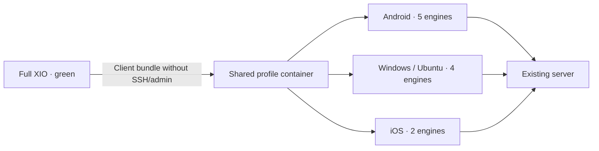

# XIO Client 0.22.4: distinct branding and compatibility

Client prerelease 0.22.4+5013. Full XIO keeps its green identity. The client uses yellow-orange: bright amber on dark surfaces and deep orange on light surfaces. Home-screen and logo geometry are retained. All 16 Android launcher variants, Windows ICO, Ubuntu PNG and source iOS AppIcon assets are recolored. Principal text/background pairs pass a 4.5:1 contrast check; this is a palette check, not a complete accessibility audit.

 

These are real Flutter widget renders with a synthetic profile, not screenshots of the new APK on a phone. Android FLAG_SECURE is retained.

## Protocol compatibility today

The shared profile container is `xio://`, schema 1; schema 3 adds scoped subclient management. An actual AppStore test imports, saves and re-exports all five profiles even when the native engine set is limited. Server/user IDs and configurations survive; administrative access is not added to the client bundle. This verifies format/storage portability, not tunnel operation.

| Platform | Native engines declared in source | Missing | 0.22.4 deliverable |
|---|---|---|---|
| Android 8+ | AWG, RIVET/H3, RIVET/S1, Xray/REALITY, OpenVPN/Cloak | — | Signed ARM32, ARM64, x86-64 and universal APKs |
| Windows x64 | AWG, RIVET/H3, RIVET/S1, Xray/REALITY | OpenVPN/Cloak | Cross-built ZIP; native acceptance not executed |
| Ubuntu x64 | AWG, RIVET/H3, RIVET/S1, Xray/REALITY | OpenVPN/Cloak | Built DEB and tar.gz; live VPN test not executed |
| iOS | RIVET/H3, RIVET/S1 | AWG, Xray/REALITY, OpenVPN/Cloak | Source preparation only; no IPA |

**Full interchangeability across all five protocols is not implemented yet.** Transferring a bundle does not make every contained transport connect on every OS. Android is not reduced to two common engines to manufacture parity. Unsupported engines are not silently replaced. `python3 tools/check-protocol-parity.py --require-complete` exits 2 while this matrix is incomplete. Without that flag it refreshes the [machine-readable report](protocol-status.json) and checks Dart declarations against native source.

IPv6 and split routing are not identical either. Android supports IPv4/IPv6 within the previously documented limits; public IPv6 on the authorized VPS remains unverified. The current desktop backend requires an IPv4 endpoint. iOS forwards IPv4 packets and captures/drops IPv6. Split tunnelling, DNS and kill-switch behavior need separate native acceptance on each OS.

## Product boundaries

The client connects to existing servers; SSH provisioning and server administration belong to full XIO. An ordinary profile cannot create subclients. A restricted account uses a server-enforced quota, scoped HTTPS token and certificate pinning. Server root/admin keys and server archives are unnecessary; administrative-field import rejection remains enforced.

Android retains package `app.x1o.client` and the signing certificate and installs alongside full XIO. Windows/Ubuntu use separate metadata and encrypted-credential directories (`xio-client`/`app.x1o.client`) and application identity; full XIO storage paths are unchanged. Data from experimental desktop builds that used the main store is not migrated automatically: use a client export. Prepared iOS sources use separate `app.xio.light`, app group and extension IDs; Apple signing, provisioning and entitlements require a Mac.

## Verification for this release

- Flutter: final general suite: 119 passed, 7 skipped; final client subset after the last caption change: 20 passed. The later AppStore test update passed four format/storage tests in each of normal and client modes. Analyzer clean. Final commands and scope: [verification/client-0.22.4.json](../../verification/client-0.22.4.json).
- Android: four release APKs, build 5013, existing signature, native payload/16 KB checks. The new build was not installed on a phone in this session. [Physical 0.22.3 evidence](../dualstack/0.22.3.en.md) concerns earlier builds and is not a new 5013 device test.
- Ubuntu: local Flutter release and Go helper build; package not installed, actual VPN connection not tested.
- Windows: amber-icon runner, Flutter AOT and Go helper cross-built from Linux. Wine ran only the trusted gen_snapshot compiler. Native Windows/Wintun and Ethernet traffic remain untested. Separate NAS/gateway work is not included here.
- The owner confirmed no Mac/iPhone is available: Xcode build, signed IPA and device acceptance are NOT_EXECUTED/BLOCKED.

This is a prerelease. The required next implementation is desktop Cloak plus three missing iOS engines, followed by native tests of the same server profile on every OS. Full protocol parity remains an open requirement.
