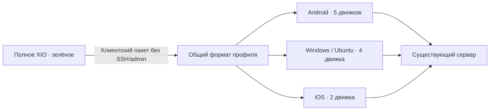

# XIO Client 0.22.4: отдельное оформление и совместимость

Предварительный выпуск клиента, 0.22.4+5013. Главное приложение сохраняет зелёное оформление. Клиент использует жёлто-оранжевую палитру: светлый янтарный акцент на тёмном фоне и тёмный оранжевый на светлом. Геометрия главного экрана и логотипа сохранена. Все 16 Android-вариантов иконки, Windows ICO, Ubuntu PNG и исходные iOS AppIcon перекрашены. Главные пары текста/фона проходят проверку контраста не ниже 4.5:1; это проверка палитры, а не полный аудит доступности.

 

Это рендеры настоящих Flutter-виджетов с вымышленным профилем. Они не являются снимками нового APK на телефоне. Android FLAG_SECURE сохранён.

## Протоколы: что совместимо сейчас

Общий формат профилей — `xio://`, schema 1; schema 3 добавляет ограниченное право управления субклиентами. Тест реального AppStore проверяет импорт, сохранение и повторный экспорт всех пяти профилей даже при ограниченном наборе доступных движков. Сохраняются идентификаторы сервера/пользователя и конфигурации; административные данные в клиентский пакет не добавляются. Это совместимость формата и хранения, а не доказательство работы туннеля.

| Платформа | Нативные движки по исходникам | Отсутствуют | Выпуск 0.22.4 |
|---|---|---|---|
| Android 8+ | AWG, RIVET/H3, RIVET/S1, Xray/REALITY, OpenVPN/Cloak | — | Подписанные ARM32, ARM64, x86-64 и universal APK |
| Windows x64 | AWG, RIVET/H3, RIVET/S1, Xray/REALITY | OpenVPN/Cloak | ZIP, кросс-сборка; нативная приёмка не выполнена |
| Ubuntu x64 | AWG, RIVET/H3, RIVET/S1, Xray/REALITY | OpenVPN/Cloak | DEB и tar.gz; собраны, сетевой тест не выполнен |
| iOS | RIVET/H3, RIVET/S1 | AWG, Xray/REALITY, OpenVPN/Cloak | Только подготовка исходников; IPA отсутствует |

**Полная взаимозаменяемость по пяти протоколам ещё не реализована.** Нельзя считать переносимость пакета поддержкой его подключения на любой ОС. Android не ограничивается двумя общими протоколами ради формального равенства. Неподдерживаемый движок не подменяется другим. Проверка `python3 tools/check-protocol-parity.py --require-complete` возвращает код 2, пока матрица неполная. Обычный запуск обновляет [машиночитаемый отчёт](protocol-status.json) и проверяет соответствие реестра Dart нативным декларациям.

Также не заявляется равенство IPv6 и раздельных маршрутов. Android поддерживает IPv4/IPv6 в описанных ранее границах; публичный IPv6 на разрешённом VPS ещё не проверен. Текущий desktop backend требует IPv4 endpoint. iOS передаёт IPv4-пакеты, IPv6 перехватывает и отбрасывает. Системные ограничения split tunnelling, DNS и kill switch должны проверяться отдельно на каждой ОС.

## Границы продукта

Клиент подключается к существующим серверам; SSH-установка и администрирование сервера остаются в полном XIO. Обычный профиль не даёт права создавать субклиентов. Ограниченный аккаунт использует серверную квоту и отдельный HTTPS-токен с закреплённым сертификатом. Root/admin-ключи и архивы сервера клиенту не нужны; проверка импорта административных полей сохранена.

Android: прежний package `app.xio.client` и сертификат, отдельная установка рядом с XIO. Windows/Ubuntu: отдельные каталоги метаданных и зашифрованных учётных данных (`xio-client`/`app.xio.client`), отдельное имя приложения; прежнее хранилище полного XIO не меняется. Перенос данных из экспериментальной настольной сборки, использовавшей главное хранилище, автоматом не выполняется — используйте клиентский экспорт. iOS-подготовка использует отдельный `app.xio.light`, app group и extension ID; подпись, provisioning и разрешения Apple требуют Mac.

## Проверки этого выпуска

- Flutter: итоговый общий набор — 119 прошли, 7 пропущены; итоговый клиентский набор после последней правки — 20 прошли. После добавления проверки AppStore: по 4 теста формата/хранения прошли в обычном и клиентском режиме. Анализатор без замечаний. Итоговые команды и границы — в [verification/client-0.22.4.json](../../verification/client-0.22.4.json).
- Android: четыре release APK, версия 5013, прежняя подпись, проверки native payload/16 KB. Новая сборка не устанавливалась на телефон в этом сеансе. [Физический протокол 0.22.3](../dualstack/0.22.3.ru.md) относится к предыдущим сборкам; его нельзя выдавать за новую проверку 5013.
- Ubuntu: Flutter release и Go helper собраны локально; пакет не устанавливался, реальное VPN-подключение не проверено.
- Windows: runner с новой иконкой, Flutter AOT и Go helper собраны из Linux; Wine использован только для компилятора gen_snapshot. Windows/Wintun и Ethernet-трафик не проверены. NAS/gateway-код из отдельной работы в этот выпуск не включён.
- Mac/iPhone недоступны по ответу владельца: сборка Xcode, подпись IPA и приёмка на устройстве — NOT_EXECUTED/BLOCKED.

Это предварительный выпуск. Следующий обязательный участок — реальные недостающие desktop Cloak и три iOS-движка с проверкой одного и того же серверного профиля на каждой ОС. До этого требование полной протокольной совместимости остаётся открытым.
