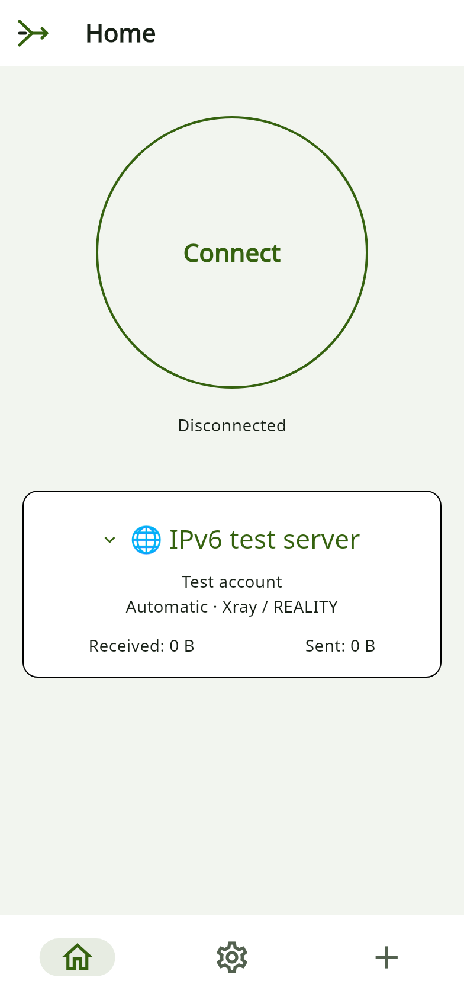
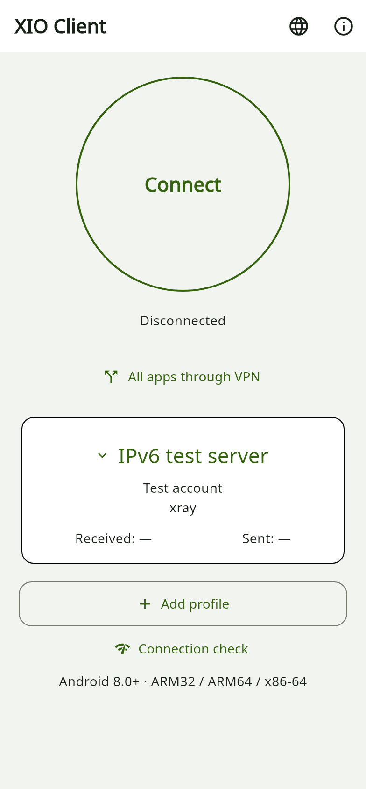
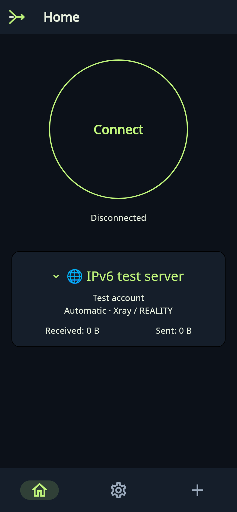

# XIO and XIO Client 0.22.3: IPv4 and IPv6

**Candidate 0.22.3+5007, server recipe 23. Physical Android and public IPv6 testing is still pending.** A stable release waits for those checks. Android 8.0+, ARM32, ARM64 and x86-64; the client also has a universal APK. Desktop releases are unchanged.

## Two apps

| App | Purpose |
|---|---|
| Full XIO | Provision and maintain an owned VPS, manage users, issue profiles and quotas, connect to the VPN. |
| XIO Client | Connect to existing servers, switch profiles and use split tunnelling. An explicitly entitled account may create and revoke its own subclients within the server-enforced quota. |

The client home uses the full app’s theme: large connection button, status, server card, protocol and traffic counters. The client now offers Russian and English. It rejects server root/admin SSH keys. Subclient operations use a separate scoped HTTPS token; child VPN profiles do not inherit their parent’s token. VPN credentials remain sensitive and must be kept private.

## Changes

A server endpoint can be IPv4, IPv6 or a hostname with A/AAAA records. Android resolves through the physical network and protects VPN transport sockets against routing into their own tunnel. Xray and Cloak stagger attempts across address families. RIVET tries addresses sequentially: concurrent authentication by one user can displace its existing peer. TLS/Reality/Cloak retain the original server name and authentication; a family change never disables certificate checks.

RIVET/S1 and RIVET/H3 can carry IPv6 packets as well as IPv4. A slot IPv6 address is issued only when the server advertises IPv6 capability. Packet source, size and destination are checked. Extension-header chains, fragments and jumbograms are currently unsupported; TCP, UDP and limited ICMPv6 are accepted. These compatibility limits do not establish a complete leak audit.

Server recipe 23 adds VPN-interface addresses, IPv6 forwarding, scoped firewall rules and NAT66 when a real provider IPv6 default route exists. Updates retain keys and existing users. Owned changes have a rollback receipt; unrelated firewall rules are not flushed. The app cannot invent or allocate a provider IPv6 address or route.

Split tunnelling retains application modes and IPv4/IPv6 IP/CIDR rules. Excluded traffic goes directly when Android lockdown permits it. Switching servers can create a gap between stopping and reconnecting; system Always-on and block-without-VPN settings are separate. Physical testing of these modes with the new runtime is still pending.

## How it works

## Interfaces

 

 

These are local captures of the actual widgets using synthetic profiles. They are not connected-phone screenshots or proof of an active VPN. Client FLAG_SECURE remains enabled.

## Verification

| Layer | Result |
|---|---|
| Flutter | Clean analysis; 112 general tests passed, 6 skipped. Separately, 7 client-mode tests passed. Suites partly overlap. |
| Local IPv6 | All Go packages passed with `-race`; real S1/H3 sessions carried IPv6 packets in an isolated network. Eleven targeted Dart tests, including IPv4/IPv6 HTTPS pinning, passed there. |
| Server | Thirty Python tests passed. The test VPS was updated to recipe 23; server keys, original users and services were checked. |
| IPv4 through VPS | Xray, RIVET/S1, RIVET/H3 and AmneziaWG passed HTTPS/DNS checks. RIVET/AWG exit addresses matched the VPS. Execution used a Linux userspace stack, not an Android APK. |
| Cloak | Transport authentication passed; a full OpenVPN HTTPS session in the new Android build remains untested. |
| VPS kernel IPv6 | Addressing, forwarding, NAT66 rules, idempotency and exact rule cleanup passed in a separate network namespace. This is not public IPv6 connectivity. |
| APKs | Signatures, versionCode, native payload and 16-KB ZIP/ELF alignment checked. Full-app embedded recipe-23 archive matched source bytes. |
| Physical Android | Pending: the authorized device is absent from ADB. |
| Public IPv6 | Pending: the test VPS has no public IPv6/default route. |

Completion requires the authorized Android device and an approved VPS with working public IPv6. An IPv6-only VPS still needs IPv4 egress or NAT64/DNS64 to reach IPv4-only websites. An IPv6 endpoint does not prove VPN IPv6 egress. The subclient API remains preliminary and needs a separate production review; these network checks do not provide that review. No throughput, battery-life, universal-circumvention or independent-security-audit claims are made.
