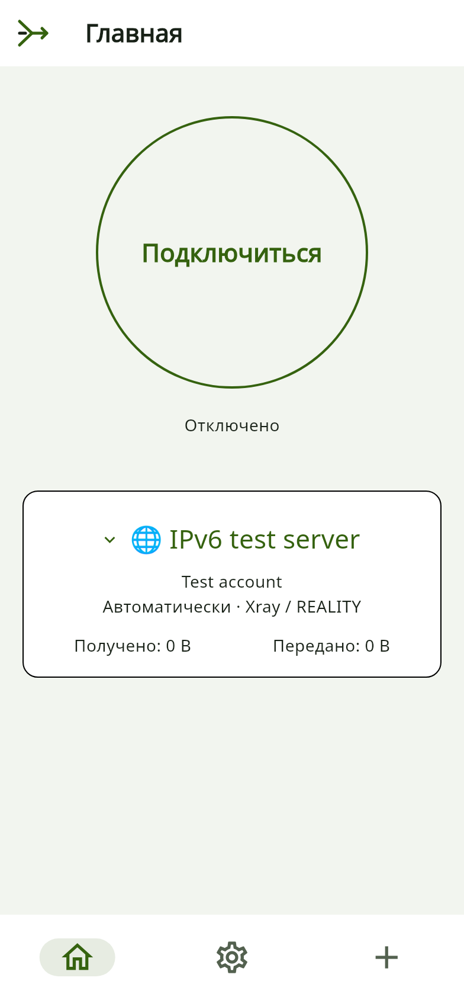
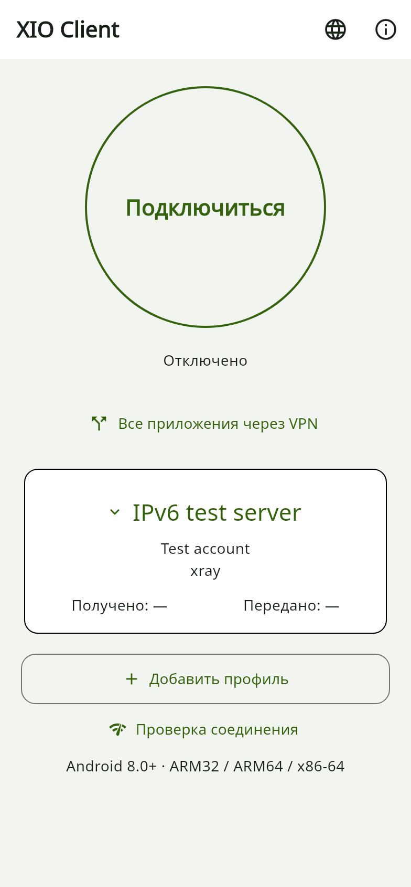
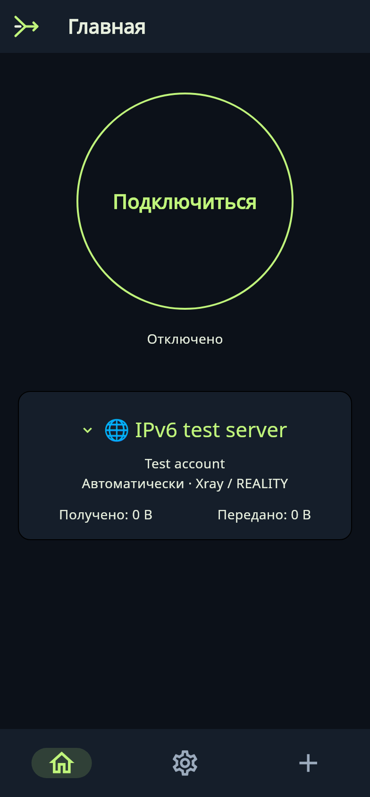

# XIO и XIO Client 0.22.3: IPv4 и IPv6

**Кандидат 0.22.3+5007, серверная ревизия 23. Проверка на физическом Android и публичном IPv6 ещё не выполнена.** Публикация стабильного релиза ожидает этих испытаний. Android 8.0+, ARM32, ARM64 и x86-64; отдельный универсальный APK есть у клиента. Сборки для ПК остаются прежними.

## Два приложения

| Приложение | Назначение |
|---|---|
| Полный XIO | Настройка и обслуживание своего VPS, управление пользователями, выдача VPN-профилей и квот; подключение к VPN. |
| XIO Client | Подключение к существующим серверам, переключение профилей, раздельное туннелирование. Аккаунт с явным правом создаёт и отзывает собственных субклиентов в пределах серверной квоты. |

Главный экран клиента использует тему полной версии: большая кнопка подключения, состояние, карточка сервера, протокол и счётчики. В клиент добавлен выбор русского и английского языка. Серверные root/admin SSH-ключи клиент не принимает. Для субклиентов используется отдельный ограниченный HTTPS-токен; обычный дочерний профиль не получает токен родителя. Это чувствительные VPN-данные, их также нужно хранить в тайне.

## Что изменилось

Адрес сервера может быть IPv4, IPv6 или доменным именем с A/AAAA. Разрешение имени идёт через физическую сеть Android; исходящие сокеты VPN исключаются из собственного туннеля. Xray и Cloak пробуют доступные адреса обеих семейств с задержкой между попытками. RIVET перебирает адреса последовательно: параллельная авторизация одного пользователя может вытеснить его соединение. TLS/Reality/Cloak сохраняют исходное имя и проверку подлинности; смена семейства не отключает проверку сертификата.

RIVET/S1 и RIVET/H3 умеют переносить IPv6-пакеты в дополнение к IPv4. IPv6-адрес слота выдаётся только профилям сервера, объявляющего поддержку IPv6. Проверяются источник, размер и назначение пакета. В текущей реализации нет цепочек IPv6 extension headers, фрагментов и jumbograms; разрешены TCP, UDP и ограниченный ICMPv6. Это ограничение совместимости, а не доказательство полной защиты от утечек.

Ревизия сервера 23 добавляет адреса VPN-интерфейсам, IPv6-forwarding, ограниченные правила firewall и NAT66 при наличии реального IPv6-маршрута провайдера. Обновление сохраняет ключи и существующих пользователей. Собственные изменения записываются в квитанцию для отката; сторонний firewall не очищается. Публичный IPv6 или маршрут провайдера приложение не придумывает и не выделяет.

Раздельное туннелирование сохраняет режимы по приложениям либо IP/CIDR IPv4/IPv6. Исключённый трафик идёт напрямую, если Android lockdown это разрешает. Между остановкой одного сервера и подключением другого возможен промежуток без VPN; системные Always-on и блокировка соединений без VPN настраиваются отдельно. Физическая проверка этих режимов с новым runtime ещё ожидается.

## Схема работы

## Интерфейсы

 

 

Изображения получены локальным тестом настоящих виджетов с вымышленными профилями. Это не снимки подключённого телефона и не доказательство установленного VPN. Защита экрана клиента FLAG_SECURE сохранена.

## Что проверено

| Уровень | Результат |
|---|---|
| Flutter | Анализ без замечаний; 112 общих тестов прошли, 6 пропущены. Отдельно 7 тестов клиентского режима прошли. Наборы частично пересекаются. |
| IPv6 локально | Go `-race` во всех пакетах и реальные S1/H3-сеансы с IPv6-пакетами прошли в изолированной сети. 11 целевых Dart-тестов, включая HTTPS pinning на IPv4/IPv6, прошли там же. |
| Сервер | 30 Python-тестов прошли. На тестовом VPS проверены установка ревизии 23, сохранение серверных ключей/старых пользователей и службы. |
| IPv4 через VPS | Xray, RIVET/S1, RIVET/H3 и AmneziaWG: HTTPS и DNS прошли через сервер. Для RIVET/AWG адрес выхода совпал с VPS. Исполнитель — Linux userspace, не Android APK. |
| Cloak | Аутентификация транспорта прошла; полный OpenVPN HTTPS-сеанс в новой Android-сборке ещё не проверен. |
| IPv6 на ядре VPS | В отдельном network namespace прошли адресация, forwarding, правила NAT66, повторное применение и точное удаление правил. Это не публичная IPv6-связность. |
| APK | Проверены подпись, versionCode, native payload, ZIP/ELF 16-КБ выравнивание. В полной версии встроенный архив ревизии 23 сверён побайтно с исходным. |
| Физический Android | Не выполнено: согласованное устройство отсутствует в ADB. |
| Публичный IPv6 | Не выполнено: тестовый VPS не имеет публичного IPv6/default route. |

Для завершения нужны подключённый согласованный Android и разрешённый VPS с работающим публичным IPv6. IPv6-only серверу для IPv4-only сайтов всё равно нужен IPv4-выход либо NAT64/DNS64. Наличие IPv6 endpoint не доказывает наличие IPv6-выхода из VPN. API субклиентов остаётся предварительным и требует отдельной production-проверки; эти сетевые тесты её не заменяют. Метрики скорости, автономность, обход всех блокировок и независимый аудит безопасности здесь не заявляются.
