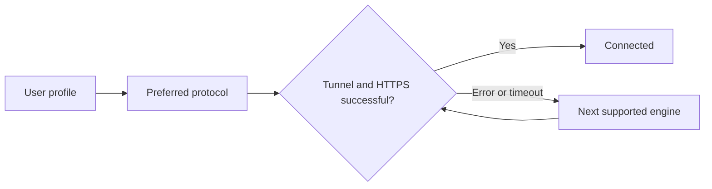
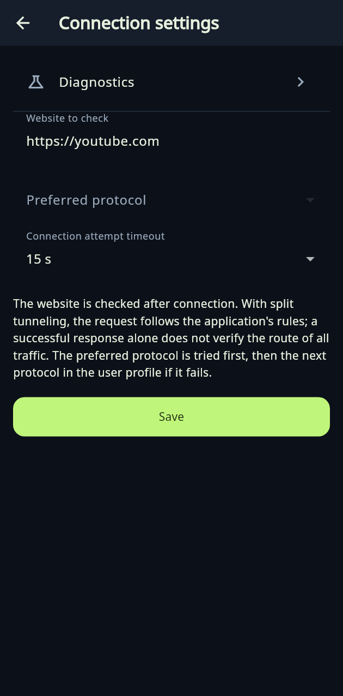
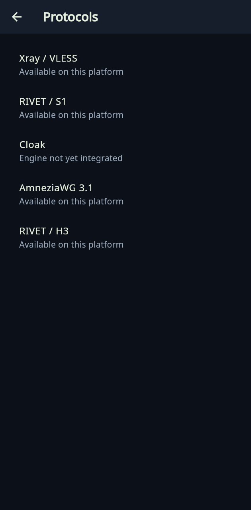

# Using XIO

[Русский](../ru/guide.md) · [Home](../../README.md)

## Install

Choose a build on the [download page](downloads.md). Honor Magic V3 uses Android ARM64. Open the APK and allow installation for your chosen source in Android settings. Keep app data when updating. On Ubuntu, run `sudo apt install ./XIO-0.20.0-ubuntu-amd64.deb`. On Windows, extract the entire ZIP and run XIO.exe. iOS currently provides a project to build on a Mac; a source ZIP cannot be installed on an iPhone.

On first launch, read the licence, responsibility notice and VPN disclosure. Acknowledgements are saved on the device. View the record under Settings → About XIO → Licence and responsibility.

## Set up your VPS

1. Prepare an amd64 VPS with systemd and TUN. The installer detects the OS family and package manager. This does not establish support for every distribution and release.
2. Select + → VPN on your own server. Enter the host, SSH port, user and login method. Enter passwords in the app, never in GitHub.
3. Start installation with administrative permissions. Read the result and log. An engine is available only after its components install successfully.
4. Select the server on Home. Set a preferred protocol, attempt timeout and test site under Connection settings.
5. Connect and approve the system VPN permission or separate network helper prompt.

## Import an existing or third-party profile

Select + → Paste key or configuration, paste the profile and confirm import. XIO detects the engine from supported formats. Arbitrary formats from other apps are not guaranteed. Importing a profile does not add an engine missing from the current platform.

## Automatic selection

XIO first tries the preferred supported protocol in the user profile, then tries the next one after failure or timeout. The default HTTPS test site is youtube.com. If the VPS itself cannot reach it, temporarily use https://example.com for diagnosis. A successful response does not establish the absence of all leaks or correct routing for every application.

## Users

Create a user for a managed server under Settings → Users. Their profile includes configurations for supported protocols. Share grants access: send the profile only to its intended recipient. Revoke removes server access. The admin option delegates user creation within a limit on concurrently active users; revoking one frees a place.

Cards show the admin role where applicable, online/offline status, current-month traffic and actions. Statistics refresh once at launch. They are a snapshot of server data, not a continuous presence indicator. Accounting depends on engine support and server counters.

## Settings

- Servers: selection, renaming, export, local removal and separate cleanup of XIO-owned server components. Read the confirmation: cleanup removes VPN access and server settings. Shared SSH, web and mail services should be preserved.
- Connection: test site, priority and timeout; Diagnostics and session log are inside this section.
- Application: language and system theme; Android also includes icons, split tunneling and system controls.
- About XIO: protocols, help, FAQ, licence and acknowledgement record.

Administrative server exports contain secrets. Share them only with someone authorised to manage the VPS. User profiles and administrative exports grant different permissions.

## Background use and disconnecting

Android uses a VPN service. The Quick Settings tile toggles the connection once system permissions have been granted. Closing the UI is not disconnecting. Force-stop, firmware restrictions and device restart can affect behaviour. Ubuntu and Windows use a separate helper that can continue after the window closes. Disconnect before uninstalling the client.

[FAQ](faq.md) · [Protocols](protocols.md) · [Platform details in Russian](../../CROSS-PLATFORM-0.19.ru.md)

## Updated page structure

Images rendered from the Flutter UI test, without a live VPS connection.

