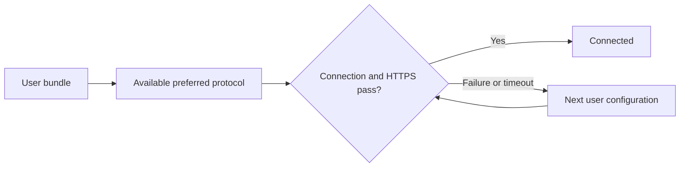

# Using XIO

[Русский](../ru/guide.md) · [Downloads](downloads.md)

## Installation

Choose Android ARM64, ARMv7 or x86_64. ARM64 fits most modern phones. Android 8+ is required; individual firmware compatibility is not guaranteed. Install updates over the existing app to keep data. Ubuntu: `sudo apt install ./XIO-0.22.0-ubuntu-amd64.deb`. Windows: extract the entire ZIP and run XIO.exe. iPhone/iPad currently has an Xcode source project, not an installable IPA.

Read the licence and terms on first launch. The acknowledgement receipt is stored locally under Settings → About XIO → Licence and responsibility.

## Your server or an existing profile

1. Press “+”. Enter a VPS address and SSH credentials for a managed installation, or paste a third-party key/configuration. XIO detects supported formats automatically.
2. Use a dedicated VPS without unrelated VPN services. The installer recognises supported Debian/Ubuntu and RHEL/CentOS families and package managers. Not every release/derivative has been tested; current system-level verification uses an Ubuntu x64 VM.
3. SSH credentials use protected client storage and are reused for administration. A changed SSH host key stops maintenance pending owner verification.
4. Server installation deploys Xray, RIVET/S1, RIVET/H3, AWG and Cloak. Client support depends on the platform. Keep SSH access until installation finishes.
5. Select a server on Home and connect. XIO tries an available preferred protocol and an HTTPS test. The default site is youtube.com; change it and the attempt timeout under Connection.

## Users and servers

Open Settings → Users or “+ → User”. One user bundle includes all supported configurations for that user. Share sends access secrets; send it only to the intended recipient. Revoke disables server access. The admin flag delegates user creation within a limit on simultaneously active users; revocation frees a slot. Cards show admin when applicable, online/offline, monthly traffic and actions. Statistics refresh once at startup and represent a server-counter snapshot.

Server settings offer rename, configuration export, local-only deletion, or removal of XIO-owned server components followed by local deletion. Server cleanup revokes every user on that deployment. Shared packages needed by unrelated applications must stay. Administrative exports contain management secrets and differ from ordinary user bundles.

## Connection settings and tethering

Settings → Connection contains Diagnostics, **Protocols**, test site, priority, timeout and **VPN for tethering**. About XIO contains help, licensing, GitHub and app sharing.

Android tethering **requires root**. On a stock phone the switch displays “Root required” and remains off. On a rooted device, enable the hotspot/tethering, deliberately select its downstream interface, disable split tunnelling, enable this feature and approve root locally. Restart the hotspot after the offload setting changes. Connect the VPN and verify the external IP from a tethered device. IPv6 forwarding is blocked; IPv4 uses the tunnel, with DNS redirected to 9.9.9.9 through it. Without a tunnel, forwarding rules block IPv4. Vendor offload, reboot and system rule resets need separate validation. A switch alone is not proof of protected traffic.

Windows: connect the VPN, enable the mobile hotspot, select its interface and enable sharing with administrator rights. XIO configures ICS for its adapter and refuses to replace unrelated sharing. Native Windows ICS has not yet been validated on a Windows PC; this feature is experimental. Check the tethered device’s external IP and behaviour on VPN disconnect. This control is unavailable on Ubuntu and iOS.

## Background and updates

Android uses a separate VPN service; the quick-settings tile toggles it after system VPN permission is granted. Force-stop, reboot and firmware restrictions can interrupt it. Ubuntu/Windows use a separate privileged helper.

Check updates under Settings → Application. Automatic checks run weekly with a random offset; a release can be skipped. Android installation requires system confirmation, and iOS does not install unsigned updates. Metadata signatures and package hashes are checked first. Managed-server maintenance runs at startup/administration when the VPN is disconnected, saved owner SSH credentials work and the host key matches. Users and keys are preserved; service failure triggers rollback. Recipe 19 disables retired connections. OS package upgrades are not performed.

  

Screenshots come from Flutter UI tests. [FAQ](faq.md) · [Protocols](protocols.md) · [Updates](updates.md)
