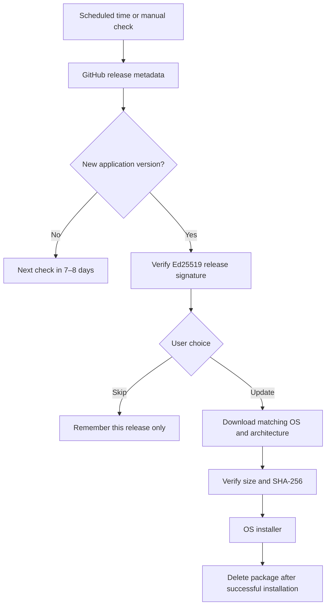

# XIO updates

[Русский](../ru/updates.md) · [Settings](guide.md) · [Download](downloads.md)

Settings → About XIO contains the repository link and Share app. Android and iOS use the system share sheet. Ubuntu and Windows copy the current GitHub release link to the clipboard and show a confirmation.

Open Settings → Application → Check for updates. A newer signed application release offers Update, Skip release and Later. Skipping is saved locally and applies only to that release; a manual check can show it again. Documentation and press-kit releases are excluded.

## Schedule and traffic

The first automatic check is scheduled seven days ahead plus a random offset of up to 24 hours. Each check assigns a new independently randomized due time. It survives restarts. Concurrent checks share one request. Manual checks have a five-minute minimum cooldown; GitHub Retry-After is respected. Conditional ETag requests reduce metadata transfers.

Android also uses JobScheduler while the UI is closed. This job checks metadata and posts a notification; it does not download or install a package. Opening the app verifies the release signature before offering installation. A notification alone does not establish package authenticity. Android may delay work because of battery restrictions, connectivity, disabled notifications or a force-stopped app.

Ubuntu and Windows check while the app is running and handle an overdue check after launch. iOS checks on launch/resume. No persistent desktop updater daemon is installed. Package downloads always require user approval and start after a random delay of up to three seconds. Update checks send no VPN profiles or installation analytics. GitHub receives ordinary HTTPS request metadata, including the source IP address.

## Platform installation

| Platform | Behaviour |
|---|---|
| GitHub Android APK | Allow installs from XIO if Android asks, then retry. Android requires system installation confirmation. Package name, a higher versionCode and the same signing certificate are required. MY_PACKAGE_REPLACED deletes the downloaded package after successful replacement; the next app launch also cleans it up. |
| Google Play build | External installation is disabled; the button opens the store page. A published Google Play listing is not yet confirmed. |
| Ubuntu/Debian x64 | Download a DEB, request OS authorization with pkexec, install using dpkg. After success, delete the package and restart `/opt/xio/XIO`. Cancellation or installation failure is not reported as success. |
| Windows x64 | Extract a ZIP into staging after rejecting unsafe paths, links, duplicate names and excessive sizes. A detached PowerShell process waits for XIO to exit, backs up its directory, copies the new files and starts XIO. Delete ZIP and backup only after the new version acknowledges startup. Copy failure restores the old directory. Missing startup acknowledgement keeps the backup for manual recovery. Protected installation directories may require manual installation. |
| iPhone/iPad | Open the release page. Arbitrary GitHub archives are not installed. The current distribution is source-only: an installable version requires a Mac build, signing and an Apple-authorized distribution channel. |

Finish your VPN session before updating. Profiles and credentials remain in the separate application data directory. Cancelling a download or failing its checksum deletes partial files. Cancelling the OS installer may retain a verified package for retry; successful installation removes it.

## Authenticity and publishing

The pinned Ed25519 public key is `app/assets/security/update-ed25519.pub`. Its signature covers the exact bytes of the version, build, package URLs, sizes and SHA-256 values. Only HTTPS is accepted. Initial package URLs must belong to this repository's release assets; redirects are restricted to GitHub asset hosts. Equal or older versions are rejected. The separate signing key reduces the impact of a GitHub account/file compromise, but cannot protect a compromised signing key or endpoint.

The private key is excluded from source and releases. Forks must use their own key and pin it before building. After building final packages, run `tools/sign-update.py --key PATH --notes TEXT` and attach `releases/XIO-update.json` to the matching `vMAJOR.MINOR.PATCH` release. Any package modification after signing invalidates its hash. Publish matching complete sources and SHA256SUMS alongside the packages.

0.21 is the first release with this updater. Install it normally over 0.20; subsequent signed releases can be discovered by the app.

Platform references: [Android JobScheduler](https://developer.android.com/reference/android/app/job/JobScheduler), [Android PackageInstaller](https://developer.android.com/reference/android/content/pm/PackageInstaller), [Apple distribution](https://developer.apple.com/distribute/), [GitHub Releases API](https://docs.github.com/en/rest/releases/releases).
