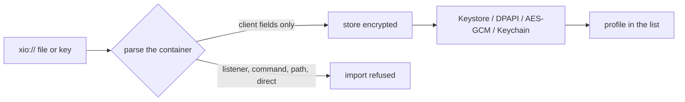
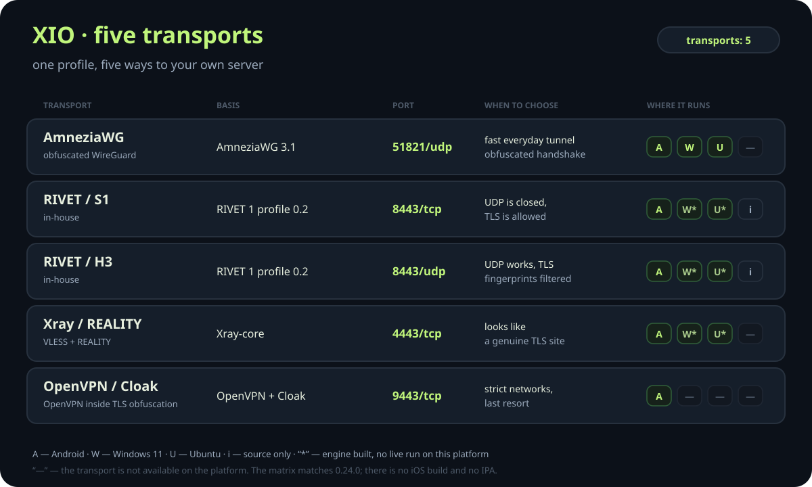
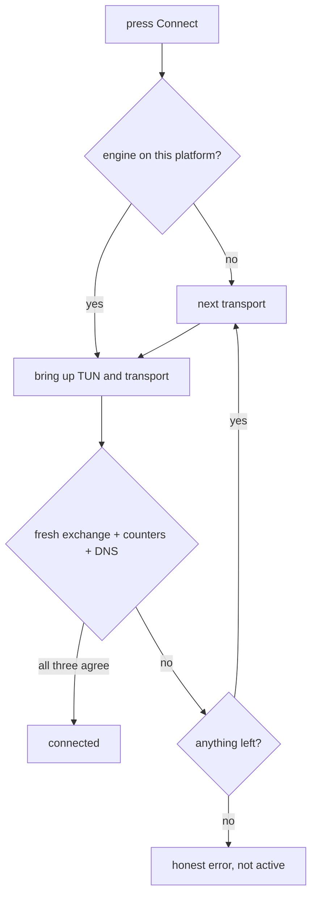
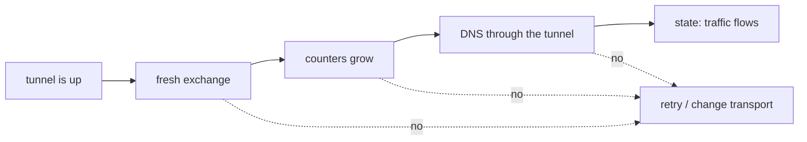
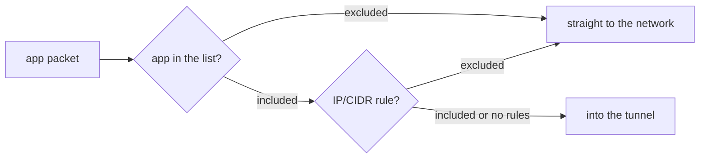
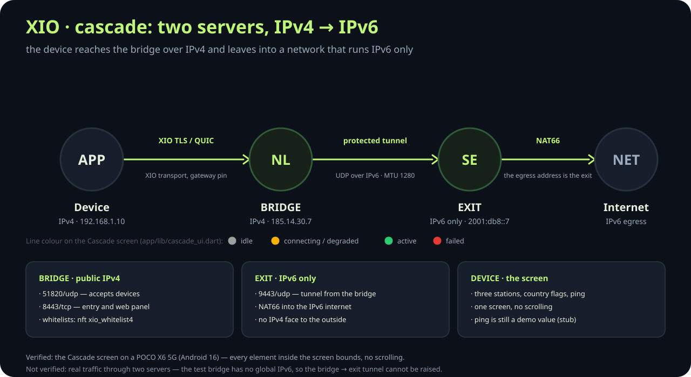
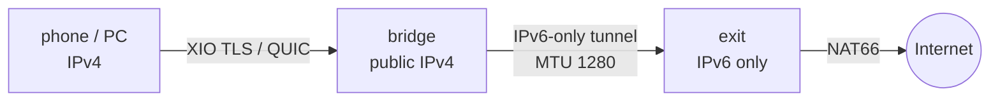

# XIO features — in detail, with examples

[Русский](features.ru.md) · [Home](../README.md) · [Diagrams](landing/architecture.mmd) · [Screenshots](screenshots/README.md)

This page is the long version of the README's Features section. It answers the questions that
usually come after the first launch: what is inside a profile, how a transport is picked, why
"tunnel active" is not the same as "traffic flows", and where the promises end.

Every section below says what the feature does, how it looks in practice, and what it
deliberately does **not** do.

---

## 🧩 The `xio://` profile

A profile is one portable file for every transport of one server. Inside is a base64 container:
the user, the server and a separate configuration per transport.

| What is inside | Why |
|---|---|
| user and server identifiers | the server knows whose access it is and which server it is |
| a configuration per transport | the client neither builds it nor guesses it |
| DNS and addresses inside the tunnel | the server hands out the address, not the app |
| `pin` and `gatewayId` for RIVET | a substituted gateway does not pass silently |

Import accepts **client material only**. A profile cannot add a listener, an API server, an
executable command, a filesystem path or a `direct`/`freedom` outbound. If the file contains one,
the import is refused instead of being "fixed in place".



At rest: Android Keystore with backups disabled, Windows DPAPI, Ubuntu AES-GCM with a local key
and file permissions, iOS Keychain. The "Share" action hands over the access secret — a file
that grants entry. Send it only to the recipient.

---

## 🚀 Five transports and the order they are tried

All five do the same job — carry traffic to the server — but solve different problems: speed,
camouflage and networks where UDP is closed.

| Transport | What it looks like on the wire | Port | Choose it when |
|---|---|---|---|
| **AmneziaWG** | UDP with an obfuscated handshake | `51821/udp` | an ordinary fast tunnel |
| **RIVET / S1** | TCP + TLS 1.3 | `8443/tcp` | UDP is cut, TLS is allowed |
| **RIVET / H3** | QUIC / HTTP/3 + TLS 1.3 | `8443/udp` | UDP works, TLS fingerprints are filtered |
| **Xray / REALITY** | an ordinary HTTPS site | `4443/tcp` | you need to look like a real site |
| **OpenVPN / Cloak** | TCP + TLS obfuscation | `9443/tcp` | a strict network, last resort |



The order is arranged so that the **protocol** changes before the entry point does:

1. the selected profile;
2. variants of the same endpoint with another transport;
3. other profiles.

A blocked protocol is replaced before the VPS address, so the address is not lost. The default
first choice is Xray/REALITY, on iOS RIVET/S1. The order is configurable and unavailable
engines are skipped rather than silently substituted.



### What five transports do not do

- They give no full platform parity: Android 5, Windows and Ubuntu 4, iOS 2 and source only.
- They do not magically replace each other: if the provider blocks the server IP itself,
  changing the protocol will not help.
- They are not an independent audit: RIVET is our own work and has no public audit.

---

## ⚡ Honest verification and the live link watchdog

"Interface active" is not success. Success is traffic actually crossing the tunnel.
The client checks three independent signals:

| Signal | What it proves |
|---|---|
| a fresh exchange with the server | the tunnel just came up, it is not a leftover |
| growing traffic counters | packets really pass |
| a DNS lookup through the tunnel | the route and resolver are configured, not just an interface |

An external HTTPS site probe is **optional** and off by default since 0.24.0. If you enable it,
the probe site must be reachable through the tunnel; otherwise you get a false alarm.



**Live watchdog.** While you want the tunnel, the link is checked every 15 seconds. After two
consecutive misses the client reconnects: the first three attempts after 5 seconds, then every
15 until the server returns. Verified on a POCO X6: stopping the entry gives
"Reconnecting…", starting it restores the link in about 15 seconds.

---

## 🌍 IPv4 and IPv6

The outer transport and the inner address are independent:

- the entry point may be IPv4, IPv6, or a domain with A and/or AAAA records;
- Xray and Cloak try both families; RIVET goes sequentially, because concurrent authorisation of
  one identity can replace a peer;
- RIVET/S1, RIVET/H3, AmneziaWG and OpenVPN carry IPv4 and IPv6 inside the tunnel;
- an IPv6 address is issued only by a server that explicitly advertises support.

| Transport | IPv4 subnet | IPv6 subnet |
|---|---|---|
| WireGuard (non-restricted) | `10.77.0.0/24` | `fd77:1::/64` |
| AmneziaWG | `10.78.0.0/24` | `fd78:1::/64` |
| RIVET | `10.79.0.0/24` | `fd79:1::/64` |
| OpenVPN UDP | `10.80.0.0/24` | `fd80:0::/64` |
| OpenVPN TCP | `10.81.0.0/24` | `fd80:1::/64` |
| IKEv2 / IPsec | `10.82.0.0/24` | — |

**`restrictedNetwork` mode** — for a VPS without an IPv4 default route:

- no kernel WireGuard and no `xio0`; AmneziaWG runs in userspace;
- only transports that can work are installed: AWG, RIVET, Xray, Cloak, OpenVPN TCP;
- the firewall opens `4443/tcp`, `9443/tcp`, `8443`, `51821/udp`;
- the preflight records `outboundByFamily: {ipv6: eth0}` and `ipv4DefaultRoute: false` instead
  of pretending the host is dual-stack.

Verified on a VPS with global IPv6 `2a0c:b641:1a0:800::2a2`: the client receives
`fd79:1::fe/128`, `ping6` and `wget -6` pass through the tunnel and the answer comes from the
VPS global address. The outer entry `[2a0c:b641:1a0:800::2a2]:18443` came up in 129–159 ms.

> Not verified: XIO provides **no** DNS64, NAT64 or CLAT. IPv4 literals inside an IPv6-only
> network are not translated — you need an IPv4 egress or provider-side NAT64. IPv6 extension
> headers, fragments and jumbograms are not supported.

---

## 🧩 Split tunnelling

Rules work in both directions:

- **per application** — include or exclude selected apps;
- **per address** — IP/CIDR rules either way.

There are no domain rules: routing by name needs its own resolver, and XIO does not have one yet.
Excluded traffic goes directly — unless Android lockdown forbids it (in lockdown the system
block wins over the setting).



In a cascade the rules live **on the bridge**: the `xio_whitelist4` nft set, routing "into the
tunnel only what is listed", everything else directly. The set is refreshed weekly and replaced
atomically.

---

## 🧑‍🤝‍🧑 Subclients and quotas

A subclient is a separate access created by a parent. The server issues a **scoped account
token**, and with it you can only:

- check your own quota;
- create your own subclient;
- revoke your own subclient.

No SSH, no root, no administrative actions. A child export contains that child's VPN keys and
never the parent token or server keys.

The quota counts simultaneously active records: revocation frees a slot. The limit is enforced
by the server, not by the app, so a patched client cannot bypass it.

---

## 📱 VPN sharing (Android, Windows)

| Platform | Requirement | What happens |
|---|---|---|
| Android | **root** | IPv4 goes into the tunnel, DNS is redirected to `9.9.9.9` through it, IPv6 sharing is blocked |
| Windows | administrator, hotspot on | ICS for its own adapter; unrelated sharing is not replaced |
| Ubuntu, iOS | — | not available |

Without root the switch shows "Root required" and stays off. Restart the hotspot after changing
the offload setting. Firmware with offload bypass needs separate validation: the position of a
switch is not proof of protection.

> Windows ICS is experimental. ICS has not been validated on a live Windows PC; only the build
> and the helper launch were checked.

---

## 🔗 Cascade: two servers, IPv4 → IPv6

The situation: the provider gives you IPv4 only, but the exit you need is in a network that runs
IPv6 only. The cascade solves this with two servers.





**The app screen.** "Cascade" is one screen without scrolling, entirely inside the phone screen
(`app/lib/cascade_ui.dart`):

- three stations: device → bridge → exit, with country flags from the ISO code;
- state lines: grey — idle, yellow — connecting or degraded, green — active, red — failed;
- ping, update time, a "Reconnect" button;
- a "Paid feature. Subscription required" plate and an "Activate" button.

The layout is deliberately `Column` + `Expanded`, with no `ListView`/`ScrollView`: a large system
font must not push elements off screen. This was checked on a POCO X6 5G (Android 16): all
elements inside 134…2676 on a 1220×2712 screen, `logcat` free of `RenderFlex overflowed`.

**Install with one command on the server:**

```bash
curl -fsSL https://raw.githubusercontent.com/rukazax/xio_vpn/main/deploy/cascade/terminal-install.sh \
  | sudo bash -s -- --role bridge --exit-host 2a0c:b641:1a0:800::2a2
```

The script downloads the installer over HTTPS, verifies sha256 **before** running it, requires
root and logs to `/var/log/xio-cascade-install.log` (mode 600). Roles: `bridge`, `exit`, `both`.
From the app the cascade is enabled by the "Enable cascade" checkbox in the server setup form;
it passes `--enable-cascade` and the usual SSH flow takes over.

| What | Where |
|---|---|
| Install and roles | `deploy/cascade/cascade-install.sh` |
| Tunnel checks | `deploy/cascade/cascade-healthcheck.sh` → `/var/lib/xio-cascade/health.json` |
| Whitelists | `deploy/cascade/whitelist-update.sh`, `OnCalendar=weekly` timer |
| Web panel | `server/webui/`, TLS + Bearer token, port 10443 |

> Not verified: real traffic through two servers. The test bridge (81.177.142.37) has no global
> IPv6, so the bridge → exit tunnel (2a0c:b641:1a0:800::2a2) cannot physically be raised. The
> scripts were checked for bash syntax and branching logic, but never ran on a live server pair.

---

## 🛠️ Server payload

Installation is one archive: the app uploads it over SSH, or you place it yourself.

```bash
# on the server, as root
curl -fsSLo xio-server.tar.gz \
  https://github.com/rukazax/xio_vpn/releases/download/v0.24.0/xio-server-0.24.0.tar.gz
curl -fsSLo xio-bootstrap.sh \
  https://raw.githubusercontent.com/rukazax/xio_vpn/main/server/managed/bootstrap.sh
sudo XIO_EXPECTED_ARCHIVE_SHA256="<sha256 from SHA256SUMS-0.24.0.txt>" \
  bash xio-bootstrap.sh < xio-server.tar.gz
```

The bootstrap verifies SHA-256 **before** unpacking: a truncated or substituted stream is
refused instead of being unpacked as root. It then installs the services and `xio-ready.service`
— a responder on the tunnel gateways, so the client can tell "the tunnel carries packets" from
"a website happened to open".

| Path | Contents |
|---|---|
| `/usr/local/lib/xio-managed` | `admin.py`, `stack.py`, `network_stack.py`, `dualstack.py`, binaries |
| `/etc/xio-managed/deployment.json` | state: host, users, keys, counters, receipts |
| `/etc/xio-rivet` | RIVET public state and install receipt |
| `/var/lib/xio-stack` | counters and stack state |

The administration interface is JSON on stdin:

```sh
printf '%s\n' '{"action":"status","serverId":"<id>"}' \
  | python3 /usr/local/lib/xio-managed/admin.py
```

| Action | What it does |
|---|---|
| `init` | first installation; `host` and `restrictedNetwork` are required |
| `inspect` | public server description and phase |
| `status` | services, counters, users, monthly traffic |
| `add` | create a user and return per-transport configurations |
| `revoke` | revoke a user and its subclients |
| `remove` | remove only XIO-owned units, rules, keys and packages |
| `client-grant` | issue a scoped token for subclients |

All actions except `init` require `serverId`; a mismatch returns
`Server identity changed; reopen setup`. That is the guard against "applied one server's state
to another".

Units: `xio-managed-awg`, `xio-managed-stats.timer`, `xio-rivet-entry`, `xio-rivet-gateway`,
`xio-stack`, `xio-cloak`, `xio-openvpn-udp`, `xio-openvpn-tcp`, `xio-ikev2`, `xio-client-api`,
`xio-ready`.

---

## 🖥️ The server web panel

One Python file, standard library only, no build step and no CDN. One page, dark theme, a `fetch`
refresh every 5 seconds.

```bash
sudo ./install-webui.sh                 # https://127.0.0.1:10443
sudo ./install-webui.sh 0.0.0.0:10443   # listen on all interfaces
```

What it does: service state, add and revoke users, enable and disable the cascade, view health.
What it does not: change whitelists (read-only) or bypass `admin.py`.

Security: TLS only (minimum 1.2), a 32-byte random token in a 600 file, `HttpOnly` / `Secure` /
`SameSite=Strict` cookie valid for 12 hours, an `X-XIO-CSRF` header for POST, a rate limit of
5 failures per 15 minutes, external commands through `subprocess.run([...], shell=False)` with a
unit allowlist. Expose it only behind a reverse proxy with a real certificate.

---

## 🔄 Updates and rollback

| What | How |
|---|---|
| Client | one check per week with a random offset; a release can be skipped |
| Signature | metadata signature and package hash are verified **before** installation |
| Android | installs through the system installer, updates in place and keeps profiles |
| Server | updated only while the VPN is off, with saved SSH credentials and a matching host key |
| Rollback | a failed server update rolls back; users and keys survive |

The server is not updated "whenever": it is updated when the VPN is off — otherwise the update
would tear down the very tunnel you are using.

---

## 🔐 Security and privacy

- **Profile secrets are encrypted at rest** — the key is not sitting in plain text next to the file.
- **The client never receives server keys.** SSH, root and admin stay in the full application.
- **SSH host keys are pinned**: a changed key stops maintenance until the owner confirms it.
- **Per-client configs are not written into `deployment.json`.** A replay returns
  `configsUnavailable` instead of handing out secrets twice.
- **Secrets are compared in constant time** in `rivet user add` and token checks.
- **Units use a credentials directory**, not `%d`: secrets do not appear on the command line.
- **Sandbox is explicit**: `ProtectSystem=strict` where a read-only bind mount works; otherwise
  `sandboxMode: compat` drops only that directive while keeping `PrivateTmp`, `NoNewPrivileges`
  and capability bounding.
- **No telemetry**: no advertising or analytics SDK, no automatic crash reporting, no built-in
  server catalogue. Android screens are protected with `FLAG_SECURE`.

---

## 🧪 What is not verified (the honest list)

This is not fine print, it is an explicit list of boundaries. If a point is here, the evidence
does not exist, and "should work" does not count.

- **Xray/REALITY does not connect** on "client 0.23.x + Xray 26.7.28 gateway": the REALITY
  implementation in the client core is incompatible. AWG and RIVET do work.
- **AWG on Android in `main`:** `tun.CreateUnmonitoredTUNFromFD` can hand the descriptor to a Go
  finalizer that later closes a number already owned by something else — hence rare drops
  (`i/o timeout`, `accept4: bad file descriptor`). The fix (duplicate the descriptor first) is in
  the `release-0.24.0` branch (`c2b3338`), `main` does not have it yet.
- **There is no full protocol parity**: Android 5, Windows/Ubuntu 4, iOS 2 from source.
- **Windows 0.24.0**: the helper is rebuilt with the WFP firewall fix (rules by user SID and App
  ID instead of `netsh`), analyze, tests and packaging pass. A live GUI connection on 0.24.0 was
  not re-run.
- **Ubuntu GUI**: 0.23.0 did not create a window; 0.24.0 packages are built but the GUI was not
  re-verified live. The tunnel works through `libexec/xio-tunnel` and needs `systemd-resolved`.
- **Cascade**: no real traffic through two servers; the subscription is a stub
  (`CascadeFeatureGate.enabled == false`) and server pooling is a stub (`CascadeServerPool`).
- **The web panel and the terminal bootstrap** never ran on a live server with systemd and
  `admin.py` — only `py_compile`, certificate generation and response codes were checked locally.
- **Windows ICS sharing** was not validated on a live host.
- **iOS** is not built: no Mac/Xcode/iPhone and no IPA.
- **Next to another VPN** XIO does not work: the `/1` routes conflict.
- **Blocking circumvention is not guaranteed**: there are no field measurements with Russian
  carriers and no independent audit of RIVET.

---

## Where to go next

- [Home page](../README.md) — everything, briefly.
- [How to use](en/guide.md) · [FAQ](en/faq.md) · [Downloads](en/downloads.md)
- [Protocols](en/protocols.md) · [RIVET library](protocols/README.md)
- [Cascade: full description](cascade/README.md) · [Cascade scripts](../deploy/cascade/README.md)
- [Web panel](../server/webui/README.md) · [Client and subclients](../client/README.en.md)
- [Compatibility 0.24.0](compatibility/0.24.0.en.md) · [0.24.1 notes](release-notes-0.24.1-mobile.md)
