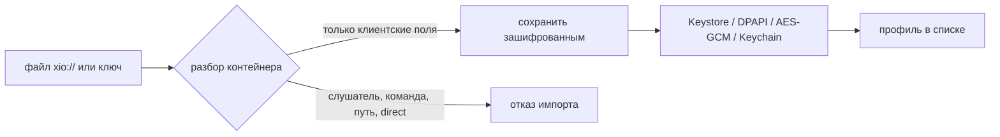
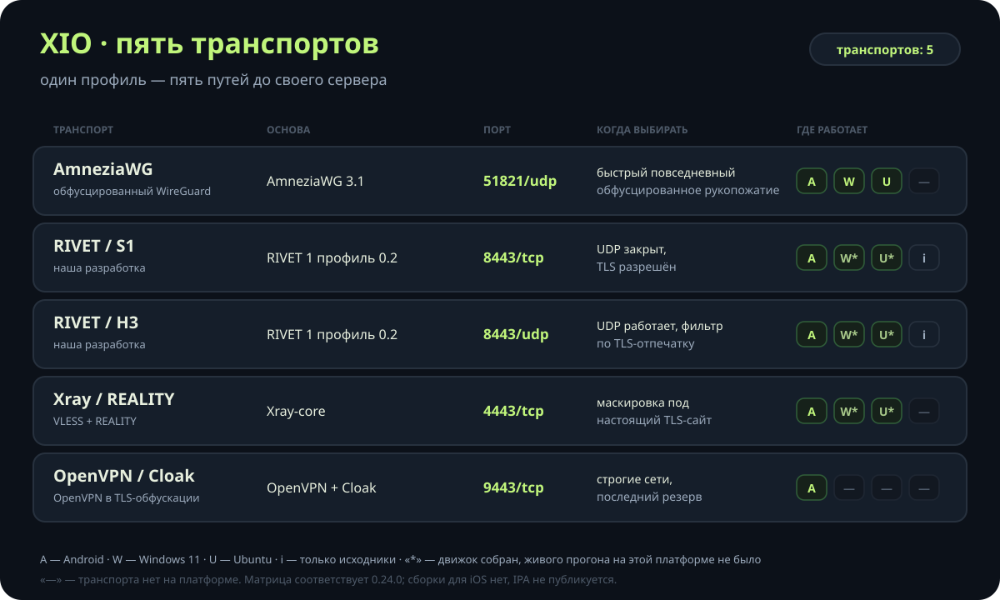
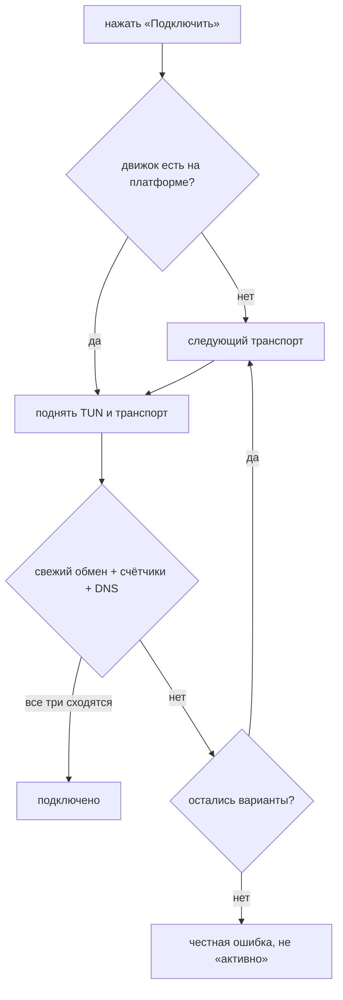
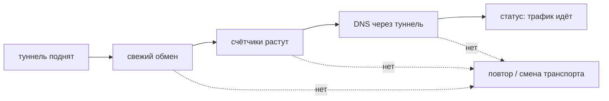
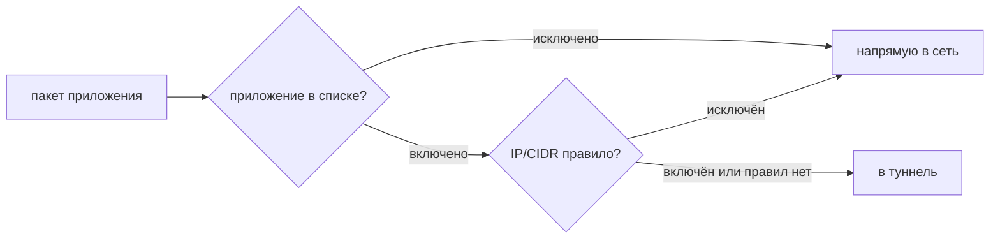
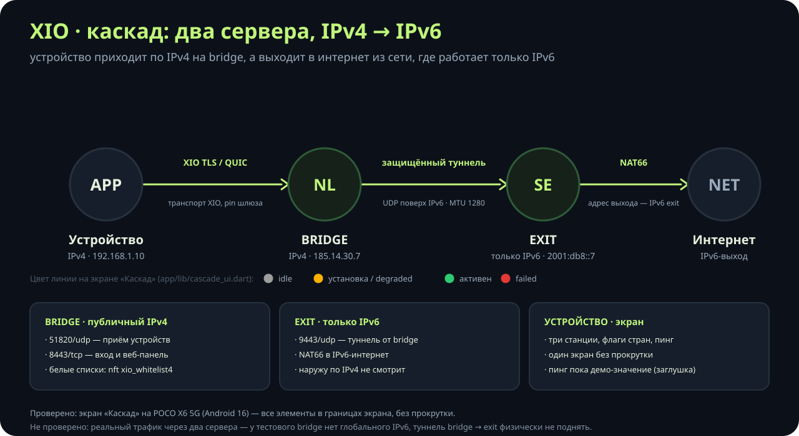
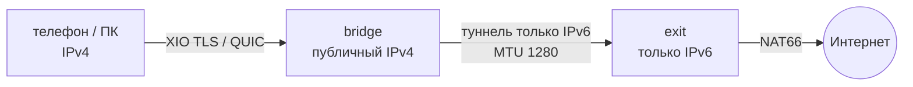

# Возможности XIO — подробно, с примерами

[English](features.md) · [Главная](../README.ru.md) · [Схемы](landing/architecture.mmd) · [Скриншоты](screenshots/README.md)

Эта страница — расширенная версия раздела «Возможности» из README. Здесь то, что обычно
спрашивают после первого запуска: что лежит внутри профиля, как выбирается транспорт, чем
«туннель активен» отличается от «трафик идёт», и где заканчиваются обещания.

Дальше в каждом разделе: что делает функция, как выглядит на практике, чего она **не** делает.

---

## 🧩 Профиль `xio://`

Профиль — это один переносимый файл на все транспорты одного сервера. Внутри base64-контейнер:
пользователь, сервер и отдельная конфигурация под каждый транспорт.

| Что внутри | Зачем |
|---|---|
| идентификатор пользователя и сервера | сервер узнаёт, чей это доступ, и чей это сервер |
| конфигурация на каждый транспорт | клиент не собирает её сам и не угадывает |
| DNS и адреса внутри туннеля | адрес выдаёт сервер, а не приложение |
| `pin` и `gatewayId` для RIVET | подмена шлюза не проходит молча |

Импорт принимает **только клиентский материал**. Профиль не может добавить слушателя, API-сервер,
исполняемую команду, путь файловой системы или outbound `direct`/`freedom`. Если в файле это
есть — импорт отклоняется, а не «починится на месте».



Хранение на диске: Android Keystore с отключёнными резервными копиями, Windows DPAPI,
Ubuntu AES-GCM с локальным ключом и правами файла, iOS Keychain. Экспорт «Поделиться» отдаёт
секрет доступа — то есть файл, который даёт вход. Отправляйте его только получателю.

---

## 🚀 Пять транспортов и порядок выбора

Все пять делают одно и то же — несут трафик до сервера, — но решают разные задачи: скорость,
маскировка и сети, где UDP закрыт.

| Транспорт | Внешний вид в сети | Порт | Когда выбирать |
|---|---|---|---|
| **AmneziaWG** | UDP с обфусцированным рукопожатием | `51821/udp` | обычный быстрый туннель |
| **RIVET / S1** | TCP + TLS 1.3 | `8443/tcp` | UDP режут, TLS пропускают |
| **RIVET / H3** | QUIC / HTTP/3 + TLS 1.3 | `8443/udp` | UDP работает, фильтруют TLS-отпечаток |
| **Xray / REALITY** | обычный HTTPS-сайт | `4443/tcp` | нужна маскировка под настоящий сайт |
| **OpenVPN / Cloak** | TCP + TLS-обфускация | `9443/tcp` | строгая сеть, последний резерв |



Порядок выбора устроен так, чтобы сначала менялся **протокол**, а не точка входа:

1. выбранный профиль;
2. варианты того же endpoint с другим транспортом;
3. остальные профили.

Заблокированный протокол меняется раньше, чем адрес VPS, поэтому адрес не теряется.
По умолчанию первым идёт Xray/REALITY, на iOS — RIVET/S1. Порядок настраивается,
недоступные движки пропускаются, а не подменяются молча.



### Чего пять транспортов не делают

- Не дают полного паритета платформ: Android — 5, Windows и Ubuntu — 4, iOS — 2 и только из
  исходников.
- Не заменяют друг друга волшебно: если провайдер блокирует сам IP сервера, смена протокола
  не поможет.
- Не являются независимым аудитом: RIVET — наша разработка, публичного аудита у неё нет.

---

## ⚡ Честная проверка и живой контроль связи

«Интерфейс активен» — не успех. Успех — когда через туннель реально идут данные.
Клиент проверяет три независимых сигнала:

| Сигнал | Что доказывает |
|---|---|
| свежий обмен с сервером | туннель только что поднялся, а не «висит с прошлого раза» |
| растущие счётчики трафика | пакеты действительно проходят |
| DNS-запрос через туннель | маршрут и резолвер настроены, а не просто интерфейс создан |

Опрос внешнего HTTPS-сайта — **необязательная** опция и с 0.24.0 по умолчанию выключен.
Если включить, сайт-пробник должен быть доступен именно через туннель, иначе вы получите
ложную тревогу.



**Живой контроль.** Пока туннель нужен, линия проверяется каждые 15 секунд. После двух
промахов подряд клиент переподключается: первые три попытки через 5 секунд, дальше через 15,
пока сервер не вернётся. Проверено на POCO X6: остановка входа даёт «Повторное подключение…»,
подъём входа — восстановление примерно за 15 секунд.

---

## 🌍 IPv4 и IPv6

Внешний транспорт и внутренний адрес независимы:

- точка входа — IPv4, IPv6 или домен с A и/или AAAA;
- Xray и Cloak пробуют оба семейства; RIVET идёт последовательно, потому что одновременная
  авторизация одной идентичности может заменить peer;
- RIVET/S1, RIVET/H3, AmneziaWG и OpenVPN несут IPv4 и IPv6 внутри туннеля;
- IPv6-адрес выдаётся только сервером, который явно объявляет поддержку.

| Транспорт | Подсеть IPv4 | Подсеть IPv6 |
|---|---|---|
| WireGuard (не restricted) | `10.77.0.0/24` | `fd77:1::/64` |
| AmneziaWG | `10.78.0.0/24` | `fd78:1::/64` |
| RIVET | `10.79.0.0/24` | `fd79:1::/64` |
| OpenVPN UDP | `10.80.0.0/24` | `fd80:0::/64` |
| OpenVPN TCP | `10.81.0.0/24` | `fd80:1::/64` |
| IKEv2 / IPsec | `10.82.0.0/24` | — |

**Режим `restrictedNetwork`** — для VPS без IPv4 default route:

- нет kernel WireGuard и интерфейса `xio0`, AmneziaWG работает в userspace;
- ставятся только транспорты, которые могут работать: AWG, RIVET, Xray, Cloak, OpenVPN TCP;
- firewall открывает `4443/tcp`, `9443/tcp`, `8443`, `51821/udp`;
- предпроверка пишет `outboundByFamily: {ipv6: eth0}` и `ipv4DefaultRoute: false` вместо
  того, чтобы делать вид, что хост dual-stack.

Проверено на VPS с глобальным IPv6 `2a0c:b641:1a0:800::2a2`: клиент получает
`fd79:1::fe/128`, `ping6` и `wget -6` проходят через туннель, ответ приходит с глобального
адреса VPS. Внешний вход `[2a0c:b641:1a0:800::2a2]:18443` поднимался за 129–159 мс.

> Что не проверено: DNS64, NAT64 и CLAT XIO **не предоставляет**. IPv4-литералы внутри
> IPv6-only сети не переводятся — нужен IPv4-выход или NAT64 на стороне провайдера.
> IPv6 extension headers, фрагменты и jumbograms не поддерживаются.

---

## 🧩 Раздельное туннелирование

Правила работают в две стороны:

- **по приложениям** — включить или исключить выбранные приложения;
- **по адресам** — правила IP/CIDR в любую сторону.

Доменных правил нет: маршрутизация по именам требует своего резолвера, его в XIO пока нет.
Исключённый трафик идёт напрямую — если системная блокировка Android его не запрещает
(в режиме lockdown запрет сильнее настройки).



В каскаде правила живут **на bridge**: nft-набор `xio_whitelist4`, маршрут «в туннель только
из списка», остальное — напрямую. Обновление еженедельно, замена набора атомарная.

---

## 🧑‍🤝‍🧑 Субклиенты и квоты

Субклиент — это отдельный доступ, созданный родителем. Сервер выдаёт **ограниченный токен
аккаунта**, и по нему можно только:

- проверить свою квоту;
- создать своего субклиента;
- отозвать своего субклиента.

Ни SSH, ни root, ни административных действий. Экспорт субклиента содержит только его
VPN-ключи, но никогда — родительский токен и серверные ключи.

Квота считается по количеству одновременно действующих записей: отзыв освобождает место.
Сервер отвечает за лимит, а не приложение, — поэтому обойти его подменой клиента нельзя.

---

## 📱 Раздача VPN (Android, Windows)

| Платформа | Условие | Что происходит |
|---|---|---|
| Android | **root** | IPv4 уходит в туннель, DNS перенаправляется на `9.9.9.9` через туннель, раздача IPv6 блокируется |
| Windows | администратор, включённый хот-спот | ICS для своего адаптера, чужой общий доступ не заменяется |
| Ubuntu, iOS | — | функции нет |

Без root переключатель показывает «Необходим root» и не включается. После смены настройки
аппаратного ускорения точку доступа нужно перезапустить. Прошивки с нестандартным offload
требуют отдельной проверки: положение переключателя — не доказательство защиты.

> Windows ICS — экспериментальная функция. На живом Windows-компьютере работа ICS не
> проверялась, проверялись только сборка и запуск помощника.

---

## 🔗 Каскад: два сервера, IPv4 → IPv6

Ситуация: провайдер даёт только IPv4, а нужный выход — в сети, где работает один IPv6.
Каскад решает это двумя серверами.





**Экран в приложении.** «Каскад» — один экран без прокрутки, целиком в экран телефона
(`app/lib/cascade_ui.dart`):

- три станции: устройство → bridge → exit, с флагами стран из ISO-кода;
- линии состояния: серый — ожидание, жёлтый — установка или degraded, зелёный — активен,
  красный — failed;
- пинг, время обновления, кнопка «Переподключить»;
- плашка «Платная функция. Требуется подписка» и кнопка «Активировать».

Вёрстка намеренно на `Column` + `Expanded`, без `ListView`/`ScrollView`: крупный системный
шрифт не должен выталкивать элементы за экран. Это проверено на POCO X6 5G (Android 16):
все элементы в границах 134…2676 при экране 1220×2712, `logcat` без `RenderFlex overflowed`.

**Установка — одна команда на сервере:**

```bash
curl -fsSL https://raw.githubusercontent.com/rukazax/xio_vpn/main/deploy/cascade/terminal-install.sh \
  | sudo bash -s -- --role bridge --exit-host 2a0c:b641:1a0:800::2a2
```

Скрипт скачивает установщик по HTTPS, проверяет sha256 **до** запуска, требует root и пишет
лог в `/var/log/xio-cascade-install.log` (права 600). Роли: `bridge`, `exit`, `both`.
Из приложения каскад ставится галочкой «Включить каскад» в форме установки сервера — она
передаёт `--enable-cascade`, дальше идёт обычная схема SSH.

| Что | Где |
|---|---|
| Установка и роли | `deploy/cascade/cascade-install.sh` |
| Проверка туннелей | `deploy/cascade/cascade-healthcheck.sh` → `/var/lib/xio-cascade/health.json` |
| Белые списки | `deploy/cascade/whitelist-update.sh`, таймер `OnCalendar=weekly` |
| Веб-панель | `server/webui/`, TLS + Bearer-токен, порт 10443 |

> Что не проверено: реальный трафик через два сервера. У тестового bridge
> (81.177.142.37) нет глобального IPv6, поэтому туннель bridge → exit
> (2a0c:b641:1a0:800::2a2) физически не поднять. Скрипты проверены на синтаксис bash и
> логику ветвлений, но не запускались на живой паре серверов.

---

## 🛠️ Серверный пакет

Установка — один архив, который приложение загружает по SSH само, либо вы кладёте руками.

```bash
# на сервере, от root
curl -fsSLo xio-server.tar.gz \
  https://github.com/rukazax/xio_vpn/releases/download/v0.24.0/xio-server-0.24.0.tar.gz
curl -fsSLo xio-bootstrap.sh \
  https://raw.githubusercontent.com/rukazax/xio_vpn/main/server/managed/bootstrap.sh
sudo XIO_EXPECTED_ARCHIVE_SHA256="<sha256 из SHA256SUMS-0.24.0.txt>" \
  bash xio-bootstrap.sh < xio-server.tar.gz
```

Bootstrap проверяет SHA-256 **до** распаковки: обрезанный или подменённый поток отклоняется,
а не распаковывается от root. Дальше он ставит службы и `xio-ready.service` — ответчик на
шлюзах туннеля, чтобы клиент отличал «туннель везёт пакеты» от «сайт случайно открылся».

| Путь | Что там лежит |
|---|---|
| `/usr/local/lib/xio-managed` | `admin.py`, `stack.py`, `network_stack.py`, `dualstack.py`, бинарники |
| `/etc/xio-managed/deployment.json` | состояние: хост, пользователи, ключи, счётчики, квитанции |
| `/etc/xio-rivet` | публичное состояние RIVET и квитанция установки |
| `/var/lib/xio-stack` | счётчики и состояние стека |

Административный интерфейс — JSON на stdin:

```sh
printf '%s\n' '{"action":"status","serverId":"<id>"}' \
  | python3 /usr/local/lib/xio-managed/admin.py
```

| Действие | Что делает |
|---|---|
| `init` | первая установка; нужны `host` и `restrictedNetwork` |
| `inspect` | публичное описание сервера и фаза |
| `status` | службы, счётчики, пользователи, трафик за месяц |
| `add` | создать пользователя и отдать конфигурации по транспортам |
| `revoke` | отозвать пользователя и его субклиентов |
| `remove` | снять только свои юниты, правила, ключи и пакеты |
| `client-grant` | выдать ограниченный токен для субклиентов |

Всем действиям, кроме `init`, нужен `serverId`; при несовпадении возвращается
`Server identity changed; reopen setup`. Это защита от «применили состояние одного сервера
к другому».

Юниты: `xio-managed-awg`, `xio-managed-stats.timer`, `xio-rivet-entry`, `xio-rivet-gateway`,
`xio-stack`, `xio-cloak`, `xio-openvpn-udp`, `xio-openvpn-tcp`, `xio-ikev2`, `xio-client-api`,
`xio-ready`.

---

## 🖥️ Веб-панель сервера

Один Python-файл, только стандартная библиотека, без сборки и без CDN. Одна страница,
тёмная тема, обновление `fetch` раз в 5 секунд.

```bash
sudo ./install-webui.sh                 # https://127.0.0.1:10443
sudo ./install-webui.sh 0.0.0.0:10443   # слушать все интерфейсы
```

Что умеет: состояние служб, добавление и отзыв пользователей, включение и выключение каскада,
просмотр здоровья. Чего не умеет: менять белые списки (только чтение) и подменять `admin.py`.

Безопасность: только TLS (минимум 1.2), токен 32 случайных байта в файле 600, cookie
`HttpOnly`/`Secure`/`SameSite=Strict` на 12 часов, CSRF-заголовок `X-XIO-CSRF` для POST,
rate-limit 5 неудач за 15 минут, внешние команды через `subprocess.run([...], shell=False)`
с белым списком юнитов. Наружу — только через обратный прокси с настоящим сертификатом.

---

## 🔄 Обновления и откат

| Что | Как |
|---|---|
| Клиент | одна проверка в неделю со случайным сдвигом; релиз можно пропустить |
| Подпись | подпись метаданных и хеш пакета проверяются **до** установки |
| Android | установка через системный установщик, обновление поверх с сохранением профилей |
| Сервер | обновление только при выключенном VPN, с сохранёнными SSH-данными и совпавшим ключом хоста |
| Откат | неудачное обновление сервера откатывается; пользователи и ключи сохраняются |

Сервер обновляется не «когда захочется», а когда VPN выключен — иначе обновление порвёт
туннель, которым вы же и пользуетесь.

---

## 🔐 Безопасность и приватность

- **Секреты профиля шифруются на диске** — и ключ не лежит рядом с файлом в открытом виде.
- **Клиент не получает серверные ключи.** SSH, root и admin остаются в полном приложении.
- **SSH-ключи хоста закреплены**: изменившийся ключ останавливает обслуживание до
  подтверждения владельцем.
- **Клиентские конфигурации не пишутся в `deployment.json`.** Повторный запрос возвращает
  `configsUnavailable`, а не выдаёт секреты второй раз.
- **Секреты сравниваются за постоянное время** в `rivet user add` и проверках токенов.
- **Юниты используют каталог credentials**, а не `%d`: секреты не попадают в командную строку.
- **Песочница явная**: `ProtectSystem=strict` там, где работает read-only bind mount; иначе
  `sandboxMode: compat` и снимается только эта директива, а `PrivateTmp`, `NoNewPrivileges`
  и ограничение capabilities остаются.
- **Телеметрии нет**: ни рекламного, ни аналитического SDK, ни автоматических отчётов о
  падениях, ни встроенного каталога серверов. Экраны Android закрыты `FLAG_SECURE`.

---

## 🧪 Что не проверено (честный список)

Это не мелкий шрифт, а прямое перечисление границ. Если пункт здесь — значит, доказательства
нет, и «должно работать» не считается.

- **Xray/REALITY не подключается** на паре «клиент 0.23.x + шлюз Xray 26.7.28»: реализация
  REALITY в ядре клиента несовместима. AWG и RIVET при этом работают.
- **AWG на Android в ветке `main`:** `tun.CreateUnmonitoredTUNFromFD` может отдать дескриптор
  финализатору Go, и тот позже закрывает уже чужой номер — отсюда редкие обрывы
  (`i/o timeout`, `accept4: bad file descriptor`). Исправление (дублирование дескриптора) есть в
  ветке `release-0.24.0` (`c2b3338`), в `main` его нет.
- **Полного паритета протоколов нет**: Android 5, Windows/Ubuntu 4, iOS 2 из исходников.
- **Windows 0.24.0**: помощник пересобран с исправлением firewall через WFP (правила по SID
  пользователя и App ID вместо `netsh`), analyze, тесты и упаковка проходят. Живое
  подключение через GUI на 0.24.0 не перепроверялось.
- **Ubuntu GUI**: в 0.23.0 окно не создавалось; пакеты 0.24.0 собраны, но GUI живьём не
  перепроверялся. Туннель работает через `libexec/xio-tunnel` и требует `systemd-resolved`.
- **Каскад**: реального трафика через два сервера не было; подписка — заглушка
  (`CascadeFeatureGate.enabled == false`), перебор серверов — заглушка (`CascadeServerPool`).
- **Веб-панель и терминальный bootstrap** не запускались на живом сервере с systemd
  и `admin.py` — проверены `py_compile`, генерация сертификата и коды ответов локально.
- **Раздача на Windows (ICS)** не проверялась на живом хосте.
- **iOS** не собран: нет Mac/Xcode/iPhone и IPA.
- **Рядом с другим VPN** XIO не работает: конфликтуют маршруты `/1`.
- **Обход блокировок не гарантирован**: полевых измерений у операторов РФ и независимого
  аудита RIVET нет.

---

## Куда дальше

- [Главная страница](../README.ru.md) — коротко о всём.
- [Как пользоваться](ru/guide.md) · [FAQ](ru/faq.md) · [Загрузки](ru/downloads.md)
- [Протоколы](ru/protocols.md) · [Библиотека RIVET](protocols/README.md)
- [Каскад: полное описание](cascade/README.md) · [Скрипты каскада](../deploy/cascade/README.md)
- [Веб-панель](../server/webui/README.md) · [Клиент и субклиенты](../client/README.ru.md)
- [Совместимость 0.24.0](compatibility/0.24.0.ru.md) · [Заметки 0.24.1](release-notes-0.24.1-mobile.md)
