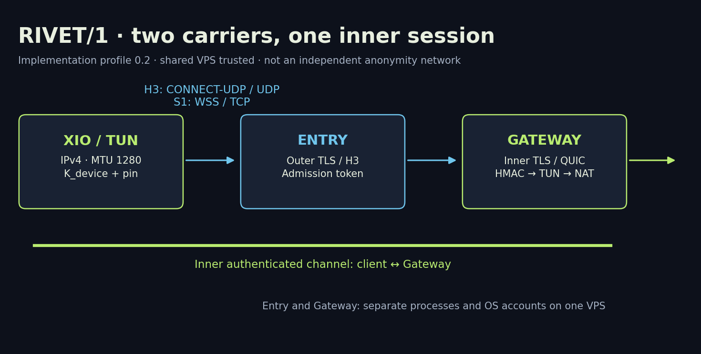

# RIVET/1 — техническая библиотека / technical library

**Русский:** [Как устроены H3 и S1](ru/01-architecture.md) · [Формат и безопасность](ru/02-wire-security.md) · [Испытания и эксплуатация](ru/03-testing-operations.md).

**English:** [H3 and S1 architecture](en/01-architecture.md) · [Wire format and security](en/02-wire-security.md) · [Testing and operations](en/03-testing-operations.md).

Документация 1.0, 18 октября 2026. Описывает экспериментальный профиль RIVET/1 0.2 в XIO 0.20.0. Собственные разработки — композиция транспорта, аутентификации и управления сеансом; TLS, QUIC, WebSocket и криптографические примитивы разработаны их авторами. Другие движки XIO не объявляются нашей разработкой.

Documentation 1.0, 18 October 2026. Covers experimental RIVET/1 implementation profile 0.2 in XIO 0.20.0. Our contribution is the composition of transports, authentication and session management; TLS, QUIC, WebSocket and cryptographic primitives belong to their respective authors. Other integrated XIO engines are not our protocol inventions.

[Журнал публикации / publication blog](../blog/2026-10-18-rivet.md) · [Данные графиков / chart inputs](data/) · [Генератор / generator](../../tools/render-protocol-figures.py).

Исходная архитектура 0.1 сохранена в research. При расхождении приоритет имеют код и явно описанные отличия профиля 0.2. Статьи не заменяют независимый аудит. Исторические сетевые измерения не выполнялись заново при подготовке публикации.

Architecture 0.1 remains in research. Implementation code and explicit profile 0.2 changes take precedence. These articles do not replace an independent audit. Historical network measurements were not rerun for this publication.
