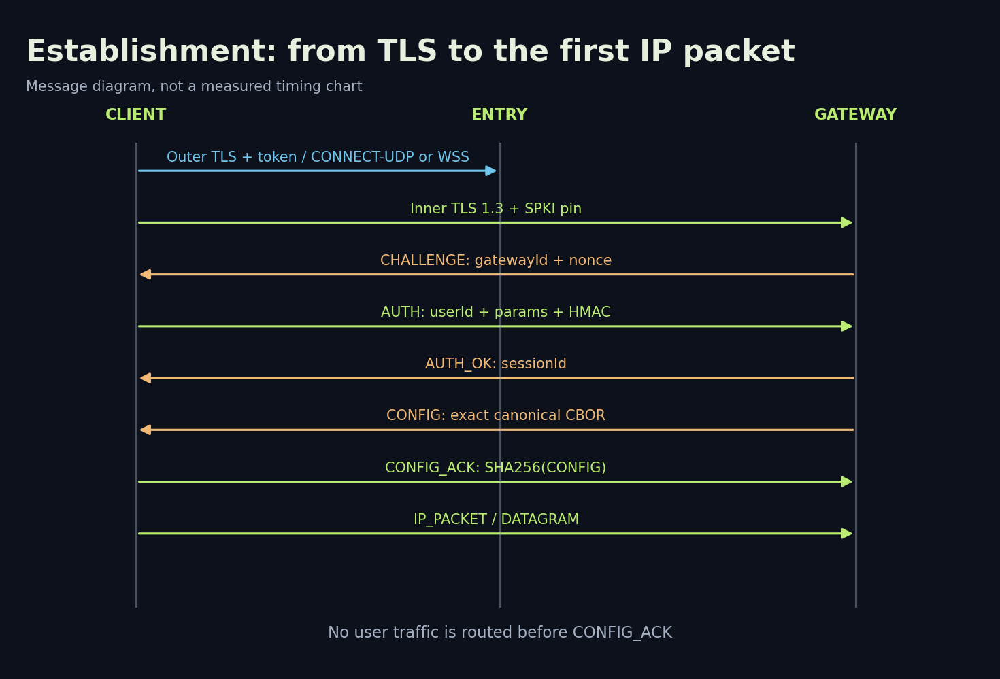

# RIVET/H3 and RIVET/S1: how our VPN transports work

[Library](../README.md) · [Русский](../ru/01-architecture.md) · [Next: wire format and security](02-wire-security.md)

**Snapshot:** XIO 0.20.0, experimental RIVET/1 implementation profile 0.2. Date: 18 October 2026.

## The problem

We want to connect to our own VPS across networks with different restrictions. A single transport is not suitable everywhere: UDP works in some networks, while others leave TCP and HTTPS available. RIVET therefore combines two outer carriers with one inner authenticated session. The application can change delivery methods without relaxing its gateway and device checks.

We did not invent a cipher. Our contribution is the composition of entry and gateway, session-bound device authentication, framing, bounded packet reassembly and integration with the VPN client. Maintained libraries provide cryptography. RIVET/H3 and RIVET/S1 are two transports in one family, not independent cryptosystems.

## Participants and trust boundaries


| Participant | Function | Information available |
|---|---|---|
| Application and TUN | Captures IP packets, selects carrier, verifies gateway | Device profile and original traffic |
| Entry | Terminates outer HTTPS/H3, checks admission token | Client IP, presented token, sizes/timing, inner ciphertext |
| Gateway | Terminates inner TLS/QUIC, checks device HMAC, routes IPv4 | Device secret, inner packets and destinations |
| Destination website | Receives traffic exiting the VPS | VPS IP and its application connection |
| Network observer | Observes client-to-entry connection | IP/port, volume, timing and exposed TLS/QUIC metadata |

A website's HTTPS connection remains end-to-end from browser to website above the VPN. A VPN does not turn HTTP into HTTPS. The gateway is trusted and can inspect decrypted IP packets and destinations. Entry and gateway run as separate processes and OS accounts; on one VPS, root and the hypervisor control both. This is not an independently operated two-hop anonymity network.

## H3: transport over HTTP/3

```text
IPv4 → RIVET fragment → inner QUIC DATAGRAM / TLS 1.3
     → UDP via CONNECT-UDP → HTTP/3 / outer QUIC / UDP → Entry
     → inner QUIC → Gateway → TUN → routing/NAT → internet
```

The outer layer uses HTTP/3 CONNECT-UDP, a standard mechanism for proxying UDP over HTTP ([RFC 9298](https://www.rfc-editor.org/rfc/rfc9298.html)). Implementation libraries are masque-go and quic-go. The permitted internal gateway destination is fixed; the current client requests `127.0.0.1:7444`. Entry checks equality before opening a socket. This is not an unrestricted public UDP proxy.

Inner QUIC uses TLS 1.3 and ALPN `rivet/1`. The client opens a control stream and writes the `00` preface; the gateway then sends CHALLENGE. User packets travel in unreliable QUIC DATAGRAM frames ([RFC 9221](https://www.rfc-editor.org/rfc/rfc9221.html)). Application TCP provides its own ordering and retransmission above those datagrams.

A lost user datagram does not force delivery of all following data through a reliable outer TCP stream. The costs are nested QUIC connections, cryptographic overhead, size constraints and dependence on UDP. Outer QUIC Initial size is configured to 1450 bytes, inner to 1200; path MTU discovery is disabled for inner QUIC. This does not guarantee operation at every path MTU. An unsuitable path should lead to carrier fallback.

## S1: fallback over WebSocket and HTTPS

```text
IPv4 → RIVET frame → inner TLS 1.3 → binary WebSocket
     → outer TLS / TCP → Entry → inner TLS byte stream → Gateway
```

S1 connects to `wss://<serverName>:<port>/api/stream`. Outer ALPN honestly advertises `http/1.1`; HTTP/2 is disabled for this path. WebSocket compression is disabled and incoming WebSocket messages are limited to 65536 bytes. This carrier limit is not the RIVET IP-packet limit. HTTP redirects are forbidden. Outer TLS permits TLS 1.2+, whereas inner TLS requires exactly TLS 1.3.

Entry removes outer TLS/WebSocket but cannot terminate the independently authenticated inner encryption. S1 can operate when UDP is blocked. With loss, outer TCP stalls later bytes until a missing segment is recovered. Carrying application TCP inside TCP can cause interacting retransmissions and higher latency. The published dataset does not quantify that effect.

## Carrier comparison

| Property | H3 | S1 |
|---|---|---|
| Outer channel | HTTP/3, QUIC, UDP | WebSocket, TLS, TCP |
| Outer ALPN | h3 | http/1.1 |
| Inner channel | QUIC/TLS 1.3 | TLS 1.3 byte stream |
| User packets | DATAGRAM with RIVET fragmentation | IP_PACKET stream frames |
| UDP unavailable | Cannot connect | May connect over TCP |
| Browser indistinguishability | Not established | Not established |
| IPv6 user traffic | Unsupported | Unsupported |

## Session establishment and fallback



The sequence is profile validation → outer certificate and token → inner TLS and pin → CHALLENGE/AUTH → AUTH_OK → CONFIG → CONFIG_ACK → packets. User IP traffic is not routed before configuration completes. Failed verification terminates the attempt.

Without a chosen preference, the base RIVET-profile order is H3 → S1 → AmneziaWG → WireGuard. The XIO manager handles other imported engines and available profiles; every import is not assumed to contain all four options. Moving H3 to S1 does not permit classical-only inner key agreement. Moving to WireGuard/AWG selects a different protocol with its own properties, rather than preserving the complete RIVET cryptographic profile.

An initial RIVET attempt uses the remaining connection budget, capped at 10 seconds. OS permission and service startup can add time. Existing mobile sessions recover separately with delays of 1/2/4/8 seconds. Maintenance checks run every 10 seconds with a 25-second no-read threshold, so a silently lost channel can take approximately 30 seconds to detect. These are three different mechanisms, not one timeout.

## What the design does not solve

IP/ASN blocking, allowlist-only networks, endpoint/VPS compromise, global correlation and every possible DPI remain outside guarantees. HTTPS/H3 composition reduces some simple distinctions, but does not guarantee censorship resistance. SNI, the tested port 8443, Go TLS/QUIC fingerprints, duration and volume remain observable. Absence of plaintext `rivet/1` in one capture is not evidence that traffic cannot be classified.

## Source map

[client.go](../../../protocol/rivet/internal/rivet/client.go), [entry.go](../../../protocol/rivet/internal/rivet/entry.go), [gateway.go](../../../protocol/rivet/internal/rivet/gateway.go), [session.go](../../../protocol/rivet/internal/rivet/session.go), [profile 0.2, Russian](../../../RIVET-IMPLEMENTATION-0.2.ru.md), [historical architecture 0.1, Russian](../../../research/RIVET-1-ARCHITECTURE.ru.md). The shipped Android runtime has separate source provenance from current desktop code: [build/source mapping](../../native-source-provenance.md).
