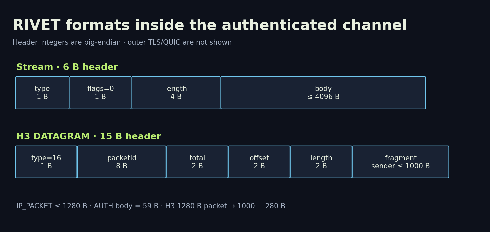

# RIVET/1: wire format, authentication and security boundaries

[Library](../README.md) · [Русский](../ru/02-wire-security.md) · [Architecture](01-architecture.md) · [Testing](03-testing-operations.md)

Implementation profile 0.2, XIO 0.20.0. This documents existing code and engineering decisions, not an independent cryptographic audit. Independent implementations also require published test vectors and interoperability tests; this series is not a completed standard.

## Two layers of verification

Outer TLS validates the entry certificate chain and name. The installer uses a local copy of a suitable public certificate, or generates a private CA scoped to the connection profile rather than installing it system-wide. A private CA provides anchored trust but differs visibly from a normal public website certificate.

Inner TLS requires TLS 1.3, ALPN `rivet/1`, X25519MLKEM768 and no resumption. `InnerTLS` replaces ordinary PKI with `VerifyConnection`, checking exactly one certificate, its lifetime and its SHA-256 SPKI pin in constant time. Its `InsecureSkipVerify` setting must never be copied without this verifier. Outer TLS does not bypass normal verification.

X25519MLKEM768 is hybrid key agreement supplied by the Go TLS implementation. Server authentication remains classical ECDSA P-256. TLS 1.3 AEAD selection belongs to the standard library and includes AES-128-GCM; calling the entire tunnel “256-bit encryption” or universally quantum-resistant is incorrect. Inner 0-RTT and session resumption are disabled. See [TLS 1.3](https://www.rfc-editor.org/rfc/rfc8446.html) and [Go TLS configuration](https://pkg.go.dev/crypto/tls#Config).

## Keys and identifiers

| Field | Size | Purpose |
|---|---|---|
| `secret` / K_device | 32 random bytes | Device HMAC |
| `entryToken` | 32 independently random bytes | Admission at Entry |
| `gatewayId` | 16 bytes | Gateway binding |
| `id` | 16 bytes, hexadecimal in JSON | User identity |
| `pin` | 32-byte SHA-256 | Gateway SPKI fingerprint |
| CHALLENGE nonce | 32 random bytes | Fresh session proof |
| AUTH_OK sid | 16 random bytes | CONFIG binding |

Binary profile fields use standard Base64 except hexadecimal `id`. The profile also contains `protocol`, `endpoint`, `serverName`, `ip` and optional `outerCA`. Protocol is `rivet-h3` or `rivet-s1`, endpoint is host:port and device address is 10.79.0.2–10.79.0.254. Profiles are access credentials and must not appear in public logs.

Entry stores SHA-256 token hashes; the presented token is visible to Entry inside outer TLS. It is persistent until revocation, without automatic rotation or short-lived tickets. A stolen token enables attempts at the inner gateway but does not replace K_device. Gateway secrets are AES-GCM sealed using a separate master key and user `id` as associated data. A stolen database alone differs from root compromise. Gateway can decrypt the secrets; this is not a zero-knowledge server design.

## Exact AUTH proof

```text
params = canonical-CBOR({0:1, 1:carrier, 2:1, 3:1280})
carrier = 0 for H3, 1 for S1
exporter = TLS-Exporter("EXPORTER-RIVET-1-auth", nil, 32)
proof = HMAC-SHA256(K_device,
    "RIVET-1-client-auth" || gatewayId[16] || nonce[32] ||
    exporter[32] || SHA256(params)[32])
AUTH.body = userId[16] || params || proof[32]
CHALLENGE.body = gatewayId[16] || nonce[32]
```

Listed concatenated fields have fixed lengths. AUTH determines params length and exact canonical bytes are checked. Current H3 params hex is `a400010100020103190500`, S1 is `a400010101020103190500`; AUTH body is 59 bytes. Changing carrier, gateway, nonce, exporter or parameters changes the proof. Binding to the TLS exporter prevents simply replaying a captured proof in a new TLS session. Whole-system timing, error handling and side channels still require analysis.

## Control stream frames



Multibyte header integers below are big-endian. The six-byte stream header is `type:u8 | flags:u8=0 | length:u32 | body[length]`; length is checked before allocating the body.

| Type | Name | Body / behaviour |
|---|---|---|
| 1 | CHALLENGE | 48 bytes |
| 2 | AUTH | id + canonical params + proof |
| 3 | AUTH_OK | 16-byte sid |
| 4 | CONFIG | Fixed-profile canonical CBOR |
| 5 | CONFIG_ACK | SHA-256 of exact CONFIG bytes, 32 bytes |
| 6 | CLOSE | Recognised by framer; unexpected in active readers and terminates session; no agreed reason-code registry |
| 16 | IP_PACKET | Up to 1280 bytes; stream carriage in S1 |
| 32 | PADDING | 1–4096 bytes; maintenance sends 16 random bytes |

General stream body limit is 4096 bytes, IP_PACKET 1280. Unknown types, nonzero flags and messages unexpected in a state are rejected. PADDING currently provides bounded keepalive; it does not implement browser-like timing or size distributions.

## CONFIG without arbitrary routes

The client compares CONFIG with exact `EncodeConfig(ip,sid)` bytes. Keys are 0: version 1; 1: sid; 2: address `[[4,ip,32]]`; 3: route `[[4,0.0.0.0,0]]`; 4: DNS `[[4,1.1.1.1]]`; 5 and 6: 1280; 7: 3600; 8: 64; 9: 262144; 10: 1000. These are frozen compatibility values, not independent runtime knobs; field 9 is not a measured total process-memory limit.

Extra keys, noncanonical encoding and altered address/DNS/routes fail comparison. CONFIG_ACK contains its SHA-256. Android applies local DNS policy 9.9.9.9 instead of the wire DNS value. This documents resolver policy, not a complete leak test across every transition.

## H3 DATAGRAM and reassembly

RIVET payload inside the inner QUIC DATAGRAM:

```text
type:u8=16 | packetId:u64 | totalLength:u16 |
offset:u16 | fragmentLength:u16 | fragment[fragmentLength]
```

The header is 15 bytes. The sender splits packets into fragments up to 1000 bytes. A 1280-byte packet produces 1000 and 280-byte fragments, totalling 1310 RIVET bytes with headers: 30/1280 ≈ 2.34% overhead at this layer only. QUIC/TLS, MASQUE, UDP/IP and retransmissions are excluded. The receiver checks bounds, total length 20–1280, nonzero ID and exact datagram length. The sender's 1000-byte chunk size is not an independent maximum fragmentLength check in the parser.

There are at most 64 incomplete packets, a one-second expiry and a 4096-ID replay window. Identical duplicates are ignored; partial overlaps, different bytes and total-length changes fail. Expiry is processed on the next `Feed`, not by a separate timer. Data and seen byte arrays can reach 163840 bytes at 64×1280; maps, objects and allocator overhead add memory. This is not a total RAM budget. Full reassembly tables drop new incomplete packets. The sender refuses packet-counter overflow.

## Permitted IP packets

TUN MTU is 1280. Packets must be IPv4 without options (first byte 0x45), correct length and header checksum, no IP fragmentation, and protocol ICMP, TCP or UDP. Source must match the assigned address. Explicit forbidden destination prefixes are 0/8, 10/8, 100.64/10, 127/8, 169.254/16, 172.16/12, 192.168/16, 224/4, 240/4 and 198.18/15, plus gateway interface addresses discovered at startup. This is an explicit list, not an exhaustive dynamic IANA special-purpose database. Newly added local addresses need policy review. Invalid incoming user packets terminate the session.

## Resource bounds and remaining risks

Entry permits 64 active proxy requests; TCP listener is limited to 128 connections and QUIC rejects connections beyond 128. Per-IP token buckets have burst 20, refill 2/second and up to 4096 entries; clients behind one NAT share a limit. Gateway's 32 slots remain occupied for the entire session, so this is also a concurrent-session cap rather than only a handshake cap. Each user queue holds 64 packets; overflow drops packets. These are code limits, not measured capacity or universal DDoS protection.

Maintenance checks are 10/25 seconds and sessions expire after one hour. Revocation checks run every five seconds subject to normal scheduling. A new authenticated session replaces an old session using the same IP. One shared address is not a multi-device profile. Statistics count inner IP-packet bytes in both directions and reset by UTC month; they are not provider billing, encrypted wire bytes or application goodput.

Open work includes independent review of the cryptographic composition, full dual-stack, automatic certificate renewal and token rotation, independent implementation vectors, sustained/adversarial resource tests, system isolation across engines and real networks in different countries.

## Threat model: mechanism and boundary

| Scenario | Mechanism | Remaining boundary |
|---|---|---|
| Passive capture | Two protected layers and independent inner pin | Metadata and correlation remain |
| Entry impersonation | Outer certificate validation | Trust chain/CA must be delivered securely |
| Malicious Entry | Independent gateway pin and HMAC | Entry sees token and can block, delay or correlate |
| Admission token theft only | Separate K_device still required | Inner gateway attack surface becomes reachable |
| Complete profile theft | User revocation | Device impersonation is possible until revoked |
| AUTH replay on a different TLS session | nonce, exporter and carrier in HMAC | Does not replace side-channel analysis |
| Inner key-agreement downgrade | X25519MLKEM768 only, no resumption | Switching to another engine changes guarantees |
| Forged source / private-network access | Source checks and explicit destination prefixes | Special-address list is not exhaustive |
| Arbitrary CONNECT-UDP target | Exact comparison to a fixed target | Allowed-target overload remains possible |
| Overlap/replay fragments | Bounds checks, 4096-ID window, 64 assemblies | Bounded-load and DDoS resilience still need measurement |
| Root/VPS compromise | OS-account separation has limited scope | Root and hypervisor remain trusted |
| Address blocking or allowlist-only network | Carrier fallback may help in some conditions | No bypass guarantee |

## Code map

[wire.go](../../../protocol/rivet/internal/rivet/wire.go): frames, HMAC, CBOR and fragments; [config.go](../../../protocol/rivet/internal/rivet/config.go): pin, certificates and keys; [session.go](../../../protocol/rivet/internal/rivet/session.go): state and maintenance; [packet.go](../../../protocol/rivet/internal/rivet/packet.go): IPv4; [entry.go](../../../protocol/rivet/internal/rivet/entry.go) and [gateway.go](../../../protocol/rivet/internal/rivet/gateway.go): admission and resources.
