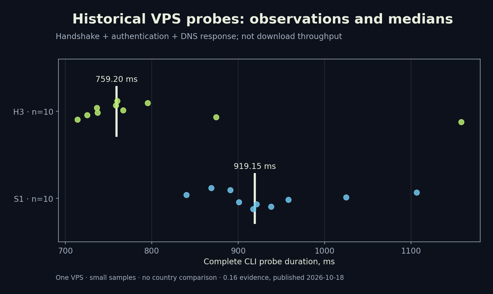
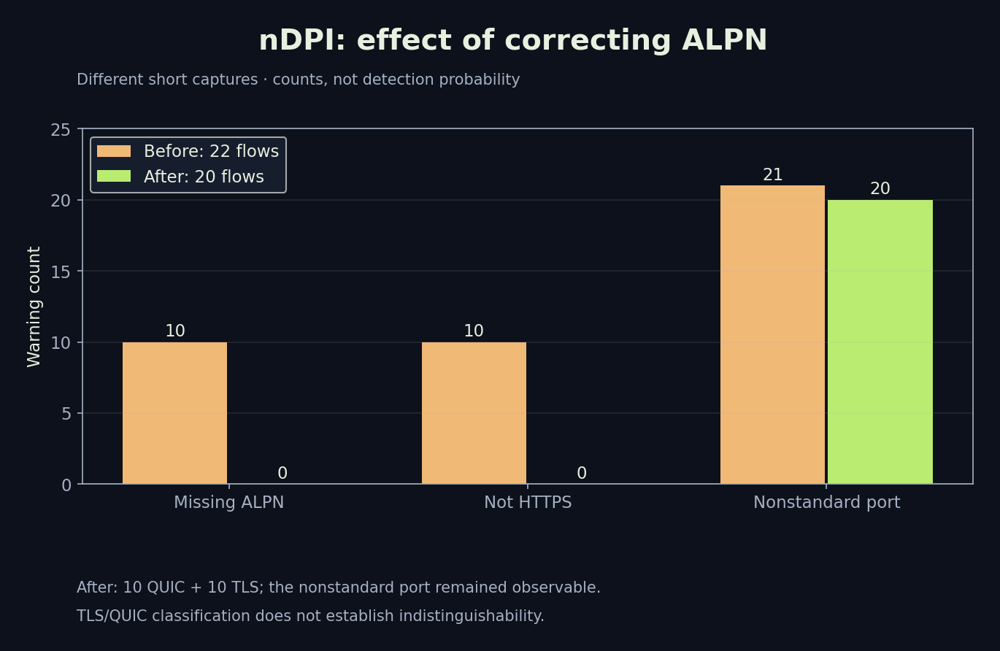

# RIVET: test results, deployment and reproducibility

[Library](../README.md) · [Русский](../ru/03-testing-operations.md) · [Architecture](01-architecture.md) · [Security](02-wire-security.md)

## Published evidence

Charts use saved project JSON, not invented results. Historical network experiments were not rerun for this publication. Results belong to their recorded binary and environment; a fresh local core test has a separate report. This documentation release does not change application protocols.

| Check | Source | Supports | Does not support |
|---|---|---|---|
| 10 S1 and 10 H3 probes | rivet-vps-probe-0.16.json | Handshake, pin and tunneled DNS response in that experiment | Download speed, SLA, countries |
| 416610-byte capture | rivet-detection-0.16.json | SNI/ALPN observations and absence of listed plaintext markers | Traffic indistinguishability |
| nDPI 6.0.0-1-1a52933 | rivet-ndpi-0.16.json | One classifier's output on short captures | Every DPI product |
| Android x86_64 emulator | android-rivet-outage-0.16.json | TUN retained, request blocked during outage, then recovered | Physical Honor or all leak scenarios |
| Ubuntu 24.04 VM | ubuntu-vm-protocols-019.json | HTTPS through seven integrated engines in that test | Native Windows/iOS networking |

## Probe duration: all 20 observations



Units are milliseconds. The CLI probe covers connection establishment, authentication and a DNS response; it is neither pure RTT nor VPN throughput. S1 median is 919.15 ms, H3 759.2 ms. H3's median is about 17.4% lower in this sample. Ten observations per carrier do not establish statistical significance or superiority across networks. Every point and the median are shown, without an invented confidence interval.

Both records report TLS version 772 = 0x0304 (TLS 1.3), curve 4588 = 0x11ec (X25519MLKEM768), cipherSuite 4865 = 0x1301 (TLS_AES_128_GCM_SHA256), resumption=false. This is further evidence against calling the entire implementation “AES-256”. The temporary user was revoked afterwards. The original report retains the server binary SHA-256 for build attribution.

## Classifier output and the ALPN fix



Before the outer ALPN fix, nDPI reported ten missing-ALPN and ten not-HTTPS warnings. Honest `http/1.1` advertisement reduced both counts to zero in the subsequent capture. The earlier set contained 22 flows including an old Unknown flow; the later set contained 20, ten QUIC and ten TLS. These are different short datasets, so warning counts cannot be converted into a percentage improvement in detectability. Nonstandard-port warnings remained on all 20 later flows. A WireGuard positive control was recognised, but that does not validate a RIVET detector.

Conversion from SLL2 to a synthetic Ethernet envelope left IP packets unchanged. The capture exposed SNI and ALPN and two JA3 values with ten observations each. Plaintext `rivet/1`, `XIO` and device credentials were not found. We publish cleaned aggregates rather than raw pcap or access profiles. Exact SNI and VPS IP are unnecessary for chart reproduction.

## Outage and recovery

In the saved Android emulator test, a pre-outage request returned HTTP 200 through the VPS. During outage it failed with SocketTimeoutException after approximately six seconds, with TUN still active. Requests succeeded after recovery; observed recovery took 45.57 seconds. This is one observation, not an average or guaranteed timer. Engine changes, force stop, boot, Wi-Fi/cellular transitions and Doze need separate tests.

Android Always-on VPN plus “Block connections without VPN” provide system-level blocking across engine changes and process termination. An unprivileged application cannot silently enable them. Desktop runtime does not yet have a complete system kill switch between attempts. A successful tunneled HTTPS request does not test every leak path.

## Installation through XIO and server lifecycle

1. Add your VPS in the connection section, enter SSH details locally and start installation. Do not publish credentials with this article.
2. The installer identifies the platform and checks dependencies and conflicts. Current RIVET server artifacts target Linux x86_64; universal OS/architecture support is not established.
3. Installation creates `xio-entry` and `xio-rivet`, TUN `xiorivet`, systemd services `xio-rivet-entry`/`xio-rivet-gateway`, `/etc/xio-rivet`, `/var/lib/xio-rivet` and an ownership receipt. Default ingress is TCP/UDP 8443 and subnet 10.79.0.0/24. Ports, subnet overlaps and unowned paths are checked before taking ownership.
4. Forwarding/NAT and XIO-owned rules are configured, accounting for iptables, UFW or firewalld. Conflicting foreign configuration can fail installation rather than being silently overwritten.
5. Create a user and import the profile containing separate admission/device secrets, pin and gateway settings. Transfer it securely. A full XIO user profile can include other engines; administrative exports carry more sensitive information.
6. Revocation removes admission and periodic checks close an active session. Cleanup uses the installation receipt. Removing XIO is not secure media erasure and does not erase system logs, backups or provider records.

Services use separate users, NoNewPrivileges, ProtectSystem=strict, ProtectHome, PrivateTmp, MemoryMax=256M and TasksMax=128. These are service limits, not measured RAM consumption. Monitor memory, certificate expiry, disk availability and persistence failures.

## Certificates and maintenance

Generated private outer certificates last 90 days, inner certificates 180 days. Public-certificate copies must be updated before expiry; automatic renewal is not implemented. Replacing the outer certificate must not disable the inner pin. Replacing gateway keys requires authenticated client trust updates; delivering a new pin over an untrusted channel defeats pinning. Revoke compromised profiles and issue fresh independent secrets.

XIO's test website is configurable and defaults to youtube.com. During the saved 0.19 test, direct VPS access also failed due to DNS. Check VPS baseline, resolution, TLS and HTTP status before blaming every transport. Do not disable certificate verification to obtain a green status.

## Reproduce local checks

```sh
cd protocol/rivet
/path/to/go test -race -count=1 -v ./internal/rivet
/path/to/go test -run '^$' -fuzz '^FuzzFrame$' -fuzztime=30s ./internal/rivet
/path/to/go test -run '^$' -fuzz '^FuzzFragments$' -fuzztime=30s ./internal/rivet
```

Use the Go version in go.mod and dependencies from the complete source archive. Fuzz commands are reproduction instructions, not claims that these 30-second campaigns were run for this publication. Ordinary go test executes the seed corpus rather than an extended campaign. `rivet probe --config /private/client.json` checks handshake and one DNS packet without changing routes; it does not replace an application end-to-end test.

Run `python3 tools/render-protocol-figures.py` with matplotlib to regenerate charts. Clean JSON and CSV live in [data](../data/), and evidence-manifest.json records source report hashes. Compare local reports with those hashes; changing input data requires republishing figures.

## Fresh local publication check

On 18 October 2026, `go test -race -count=1 -json ./internal/rivet` passed 15 top-level Test functions and seed cases for two fuzz functions; package duration was 19.367 seconds. Subtests are not counted as independent experiments. No new extended fuzz campaign, VPS cycle or blocking measurement ran here. Checked 95 local links, hashes of five evidence reports, recomputed medians and AUTH size. [Machine-readable validation](../data/publication-validation.json).

## Remaining measurements

Future work, not completed results: upload/download goodput and p50/p95/p99; CPU/RAM and battery; 1/3/5% loss at different RTTs; low PMTU and blackholed ICMP; 24–72-hour sessions; load and revocation; DNS/IPv6 leak matrices; network transitions and sleep/wake; native Windows and iOS; physical Android; comparison against real browsers on an independent dataset; authorised testing across countries and operators. Independent code and threat-model review remain necessary.

## Primary project evidence

[VPS probe](../../../verification/rivet-vps-probe-0.16.json) · [nDPI](../../../verification/rivet-ndpi-0.16.json) · [Capture metadata](../../../verification/rivet-detection-0.16.json) · [Android outage](../../../verification/android-rivet-outage-0.16.json) · [0.19 report, Russian](../../../verification/VERIFICATION-0.19.0.ru.md) · [Installer](../../../server/managed/rivet-setup.py) · [Runtime provenance](../../native-source-provenance.md).
