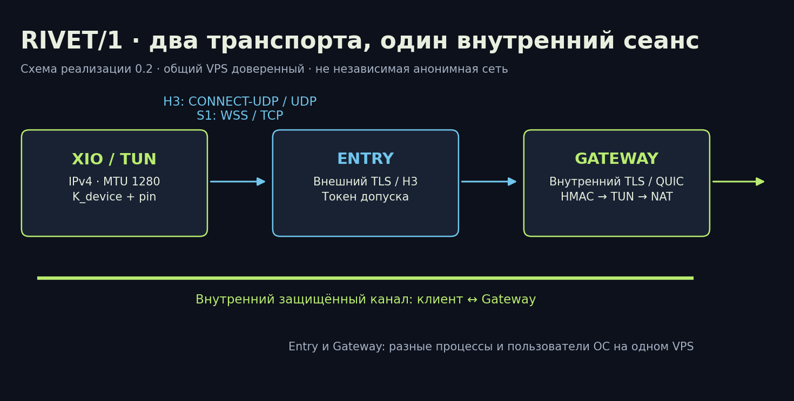
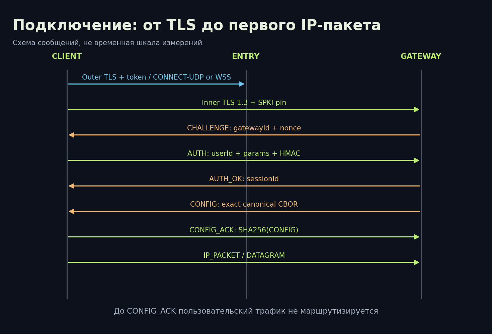

# RIVET/H3 и RIVET/S1: как устроены наши транспорты VPN

[Библиотека](../README.md) · [English](../en/01-architecture.md) · [Далее: формат и безопасность](02-wire-security.md)

**Срез:** XIO 0.20.0, экспериментальный профиль RIVET/1 0.2. Дата: 18 октября 2026.

## Задача

Мы хотим подключаться к своему VPS из сетей с разными ограничениями. Один транспорт не подходит для всех условий: где-то работает UDP, где-то остаются только TCP и HTTPS. Поэтому RIVET имеет два внешних транспорта и общий внутренний защищённый сеанс. Приложение может сменить способ доставки, сохранив требования к проверке шлюза и устройства.

Мы не изобретали шифр. Собственная часть — правила соединения входного узла и шлюза, привязка аутентификации к сеансу, форматы кадров, ограниченная сборка пакетов и интеграция с VPN-клиентом. Шифрование выполняют сопровождаемые библиотеки. RIVET/H3 и RIVET/S1 — два транспорта одного семейства, а не две независимые криптосистемы.

## Участники и границы доверия



| Участник | Что делает | Что ему доступно |
|---|---|---|
| Приложение и TUN | Получает IP-пакеты, выбирает транспорт, проверяет шлюз | Профиль и исходный трафик устройства |
| Entry, входной узел | Завершает внешний HTTPS/H3, проверяет входной токен | IP клиента, токен при запросе, размеры и время, внутренний шифротекст |
| Gateway, шлюз | Завершает внутренний TLS/QUIC, проверяет HMAC, передаёт IPv4 в интернет | Секрет устройства, внутренние IP-пакеты, назначения |
| Сайт назначения | Получает исходящий трафик VPS | IP VPS и данные своего прикладного соединения |
| Наблюдатель сети | Видит соединение клиента с Entry | IP/порт, объёмы, тайминги, доступные метаданные TLS/QUIC |

Сайт с HTTPS сохраняет собственное сквозное TLS-соединение от браузера до сайта поверх VPN. Сам VPN не превращает HTTP в HTTPS. Gateway доверенный: он видит расшифрованные IP-пакеты и может анализировать назначения. Entry и Gateway работают отдельными процессами и пользователями ОС, но на одном VPS root и гипервизор контролируют оба. Это не независимая двухоператорная сеть и не гарантия анонимности.

## H3: доставка через HTTP/3

Путь пользовательского пакета:

```text
IPv4 → фрагмент RIVET → QUIC DATAGRAM внутреннего QUIC/TLS 1.3
     → UDP через CONNECT-UDP → HTTP/3 / внешний QUIC / UDP → Entry
     → внутренний QUIC → Gateway → TUN → маршрутизация/NAT → интернет
```

Внешний слой использует HTTP/3 и CONNECT-UDP: стандартный способ проксирования UDP через HTTP ([RFC 9298](https://www.rfc-editor.org/rfc/rfc9298.html)). Реализация использует masque-go и quic-go. Адрес разрешённого внутреннего шлюза фиксирован; текущий клиент запрашивает `127.0.0.1:7444`. Entry сравнивает цель до открытия сокета. Это не публичный произвольный UDP-прокси.

Внутренний QUIC использует TLS 1.3 с ALPN `rivet/1`. Управляющий stream начинается с байта `00`, после чего шлюз посылает CHALLENGE. Пользовательские пакеты идут в QUIC DATAGRAM, не имеющих гарантии доставки ([RFC 9221](https://www.rfc-editor.org/rfc/rfc9221.html)). Порядок и повторную доставку TCP-трафика приложений обеспечивает его собственный TCP, а не RIVET DATAGRAM.

Преимущество — потеря пользовательской датаграммы не требует повторной доставки всех данных через надёжный внешний TCP-поток. Цена — вложенные QUIC-соединения, криптографические накладные расходы, ограничения размера и зависимость от UDP. Внешний QUIC Initial настроен на 1450 байт, внутренний — на 1200; discovery PMTU отключён для внутреннего QUIC. Это не означает работоспособность на любом MTU. При непригодном пути выбирается другой транспорт.

## S1: резерв через WebSocket и HTTPS

```text
IPv4 → кадр RIVET → внутренний TLS 1.3 → двоичный WebSocket
     → внешний TLS / TCP → Entry → поток внутреннего TLS → Gateway
```

S1 подключается к `wss://<serverName>:<port>/api/stream`. Внешний ALPN честно объявляет `http/1.1`, HTTP/2 для этого пути отключён. WebSocket использует двоичные сообщения, сжатие отключено, лимит входного сообщения — 65536 байт. Это транспортный предел WebSocket, а не разрешённый размер IP-пакета RIVET. Перенаправления HTTP запрещены. Внешний TLS допускает TLS 1.2+, внутренний требует строго TLS 1.3.

Вход снимает внешний TLS/WebSocket, но не внутреннее шифрование. Внутренний канал аутентифицирует Gateway отдельно. S1 полезен при блокировании UDP. При потерях внешний TCP задерживает последующие данные до восстановления пропущенного сегмента. Если внутри передаётся TCP, взаимодействие двух уровней повторной доставки может ухудшить задержки и пропускную способность. Количественного теста этого эффекта в опубликованном наборе нет.

## Сравнение транспорта

| Свойство | H3 | S1 |
|---|---|---|
| Внешний канал | HTTP/3, QUIC, UDP | WebSocket, TLS, TCP |
| Внешний ALPN | h3 | http/1.1 |
| Внутренний канал | QUIC/TLS 1.3 | TLS 1.3 поверх потока |
| Пользовательские пакеты | DATAGRAM с фрагментацией RIVET | Кадры IP_PACKET в потоке |
| Если UDP недоступен | Не подключится | Может подключиться по TCP |
| Неотличимость от браузера | Не доказана | Не доказана |
| IPv6 пользовательского трафика | Не поддерживается | Не поддерживается |

## Подключение и переключение



Последовательность: проверка профиля → внешний сертификат и токен → внутренний TLS и pin → CHALLENGE/AUTH → AUTH_OK → CONFIG → CONFIG_ACK → пакеты. До окончания настройки пользовательские IP-пакеты не маршрутизируются. Ошибка проверки закрывает попытку.

Без пользовательского приоритета базовый порядок RIVET-профиля: H3 → S1 → AmneziaWG → WireGuard; остальные импортированные движки и доступность профилей определяет менеджер XIO. Это не обещание, что для любого импорта существуют все четыре варианта. Смена H3 на S1 не разрешает понижение внутреннего TLS до классической-only группы. Переход на WireGuard/AWG означает другой протокол с собственными свойствами, а не сохранение всего криптопрофиля RIVET.

Первичная попытка RIVET ограничена оставшимся бюджетом подключения и собственным потолком 10 с. Разрешение ОС на VPN и задержки службы могут добавить время. Восстановление уже существующего мобильного сеанса отдельно использует паузы 1/2/4/8 с. Проверка живости запускается каждые 10 с, порог отсутствия чтения — 25 с; молча пропавший канал может быть обнаружен примерно за 30 с. Эти три механизма нельзя считать одним тайм-аутом.

## Что новый транспорт не решает

Блокировку IP/ASN, сети только с разрешённым списком сайтов, компрометацию устройства/VPS, глобальную корреляцию и все возможные DPI RIVET не исключает. Внешнее сходство с HTTPS/H3 уменьшает некоторые простые отличия, но не гарантирует прохождение блокировки. SNI, порт 8443 в испытании, отпечаток Go TLS/QUIC, длительность и объём остаются наблюдаемыми. Отсутствие строки `rivet/1` в захвате означает отсутствие этого открытого маркера в конкретном захвате, а не невозможность классификации.

## Где проверять описание

[client.go](../../../protocol/rivet/internal/rivet/client.go), [entry.go](../../../protocol/rivet/internal/rivet/entry.go), [gateway.go](../../../protocol/rivet/internal/rivet/gateway.go), [session.go](../../../protocol/rivet/internal/rivet/session.go), [профиль 0.2](../../../RIVET-IMPLEMENTATION-0.2.ru.md), [историческая архитектура 0.1](../../../research/RIVET-1-ARCHITECTURE.ru.md). Точный Android runtime и текущие настольные исходники различаются по происхождению: [привязка исходников к сборкам](../../native-source-provenance.md).
