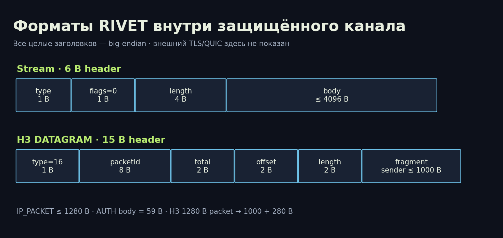

# RIVET/1: формат, аутентификация и ограничения безопасности

[Библиотека](../README.md) · [English](../en/02-wire-security.md) · [Архитектура](01-architecture.md) · [Испытания](03-testing-operations.md)

Профиль реализации 0.2, XIO 0.20.0. Это описание существующего кода и инженерный разбор; независимый криптографический аудит отсутствует. Для новой совместимой реализации нужны также тестовые векторы и межреализационные испытания; эти статьи не объявляются завершённым стандартом.

## Два уровня проверки

Внешний TLS проверяет цепочку и имя Entry. При наличии публичного сертификата установщик использует его локальную копию. Иначе создаётся отдельный CA, ограниченный конкретным профилем; он не устанавливается глобально в систему. Приватный CA обеспечивает закреплённое доверие, но заметно отличается от сертификата обычного публичного сайта.

Внутренний канал требует TLS 1.3, ALPN `rivet/1`, группу X25519MLKEM768 и отсутствие возобновления. В `InnerTLS` стандартная PKI-проверка заменена явной `VerifyConnection`: проверяется ровно один сертификат, срок и SHA-256 SPKI pin в постоянное время. Поэтому `InsecureSkipVerify` внутри функции не означает отсутствие проверки и не должен копироваться отдельно от callback. Внешний TLS такую подмену проверки не использует.

X25519MLKEM768 — гибрид согласования ключей в используемой Go crypto/tls. Это не постквантовая аутентификация: сертификат шлюза использует ECDSA P-256. TLS 1.3 AEAD выбирает стандартная библиотека; профиль допускает AES-128-GCM. Нельзя описывать весь туннель как «256-битное шифрование» или обещать защиту от любого квантового противника. 0-RTT и session resumption внутреннего канала выключены. Свойства TLS описаны в [RFC 8446](https://www.rfc-editor.org/rfc/rfc8446.html); выбор TLS 1.3 cipher suites библиотекой — в [Go Config](https://pkg.go.dev/crypto/tls#Config).

## Ключи и идентификаторы

| Поле | Размер | Назначение |
|---|---|---|
| `secret` / K_device | 32 случайных байта | HMAC устройства |
| `entryToken` | 32 случайных байта, отдельно от secret | Допуск на Entry |
| `gatewayId` | 16 байт | Идентичность шлюза в доказательстве |
| `id` | 16 байт, hex в JSON | Идентификатор пользователя |
| `pin` | SHA-256, 32 байта | Отпечаток SPKI шлюза |
| nonce CHALLENGE | 32 случайных байта | Новое доказательство на сеанс |
| sid AUTH_OK | 16 случайных байт | Привязка CONFIG |

Бинарные значения конфигурации кодируются стандартным Base64, кроме hex `id`. Полный профиль содержит также `protocol`, `endpoint`, `serverName`, `ip` и необязательный `outerCA`. `protocol` равен `rivet-h3` или `rivet-s1`, `endpoint` — host:port, адрес устройства — 10.79.0.2–10.79.0.254. Конфигурация секретная: это средство входа, а не безобидный текст настроек.

Entry хранит SHA-256 токена. Токен передаётся Entry внутри внешнего TLS и остаётся постоянным до отзыва; автоматической ротации и короткоживущих tickets пока нет. Его кража открывает доступ к попытке внутреннего соединения, но не заменяет K_device. Gateway хранит секреты под AES-GCM с отдельным master key и `id` как associated data. Компрометация БД без ключа и компрометация root — разные сценарии. Gateway способен расшифровать секреты, это не схема без знания сервером.

## Точное доказательство AUTH

```text
params = canonical-CBOR({0:1, 1:carrier, 2:1, 3:1280})
carrier = 0 для H3, 1 для S1
exporter = TLS-Exporter("EXPORTER-RIVET-1-auth", nil, 32)
proof = HMAC-SHA256(K_device,
    "RIVET-1-client-auth" || gatewayId[16] || nonce[32] ||
    exporter[32] || SHA256(params)[32])
AUTH.body = userId[16] || params || proof[32]
CHALLENGE.body = gatewayId[16] || nonce[32]
```

Разделители не нужны для фиксированных длин указанных полей; длина params известна из AUTH и проверяется точным сравнением. Для текущих параметров H3 canonical hex — `a400010100020103190500`, S1 — `a400010101020103190500`. AUTH имеет 59 байт тела. Изменение carrier, gateway, nonce, exporter или параметров меняет HMAC. Это связывает доказательство с конкретным защищённым сеансом; перехваченное доказательство нельзя просто перенести в новый TLS-сеанс. Последовательность обработки ошибок, тайминги и устойчивость всей системы требуют отдельного анализа.

## Управляющий поток: заголовок и типы



Все многобайтные целые заголовков ниже — big-endian. Заголовок stream занимает 6 байт: `type:u8 | flags:u8=0 | length:u32 | body[length]`. Предел проверяется до выделения тела.

| Type | Имя | Тело / поведение |
|---|---|---|
| 1 | CHALLENGE | 48 байт |
| 2 | AUTH | id + канонические params + proof |
| 3 | AUTH_OK | sid, 16 байт |
| 4 | CONFIG | Канонический CBOR фиксированного профиля |
| 5 | CONFIG_ACK | SHA-256 точных байтов CONFIG, 32 байта |
| 6 | CLOSE | Распознаётся фреймером; активные readers завершают сеанс при неожиданном типе; согласованного кодового словаря причин нет |
| 16 | IP_PACKET | До 1280 байт; в S1 через stream |
| 32 | PADDING | Допустимое тело 1–4096; maintenance передаёт 16 случайных байт |

Общий предел stream-тела — 4096 байт, для IP_PACKET — 1280. Неизвестные типы, ненулевые flags и неожиданные сообщения состояния приводят к отказу. Тип PADDING не означает реализованную имитацию распределения размеров/таймингов браузера. Сейчас это ограниченный keepalive, а не система traffic shaping.

## CONFIG без произвольных маршрутов

Код сравнивает полученный CONFIG с точным `EncodeConfig(ip,sid)`. Ключи: 0 — версия 1; 1 — sid; 2 — адрес `[[4,ip,32]]`; 3 — маршрут `[[4,0.0.0.0,0]]`; 4 — DNS `[[4,1.1.1.1]]`; 5 и 6 — 1280; 7 — 3600; 8 — 64; 9 — 262144; 10 — 1000. Это замороженные значения совместимости; не каждое поле является независимо настраиваемым параметром runtime. Нельзя делать вывод, что поле 9 — фактический общий лимит памяти процесса.

Не принимаются дополнительные ключи, неканоническое кодирование и подменённые адреса/DNS/маршруты. ACK подтверждает SHA-256 этого CONFIG. На Android локальная политика DNS использует 9.9.9.9 вместо wire-значения 1.1.1.1; произвольный resolver от входного узла не принимается. Это описание политики, а не доказательство отсутствия DNS-утечек при всех переходах.

## H3 DATAGRAM и сборка

Формат RIVET внутри внутреннего QUIC DATAGRAM:

```text
type:u8=16 | packetId:u64 | totalLength:u16 |
offset:u16 | fragmentLength:u16 | fragment[fragmentLength]
```

Заголовок 15 байт. Отправитель делит пакет на части до 1000 байт. Пакет 1280 байт даёт части 1000 и 280, то есть 1310 байт полезной нагрузки RIVET вместе с двумя заголовками: 30/1280 ≈ 2,34% накладных расходов только этого уровня. TLS/QUIC, MASQUE, UDP/IP и повторные передачи сюда не включены. Получатель проверяет границы, общий размер 20–1280, ненулевой id и точную длину датаграммы; генераторный размер 1000 не является самостоятельной проверкой верхней границы fragmentLength у parser.

Не более 64 незавершённых пакетов, срок 1 с, окно повторов 4096 номеров. Совпадающий дубликат игнорируется; частичное перекрытие, отличающиеся байты и изменение totalLength отвергаются. Удаление просроченных сборок происходит при следующем `Feed`, а не отдельным таймером. Два byte-массива data/seen дают до 163840 байт при 64×1280, но map, объекты и Go allocator добавляют память; это не полный RAM-бюджет. При заполнении таблицы новые незавершённые пакеты отбрасываются. Переполнение счётчика отправителя закрывает дальнейшую передачу.

## Разрешённые IP-пакеты

MTU TUN — 1280. Требуются IPv4 без options (первый байт 0x45), корректные длина и checksum, отсутствие IP-фрагментации; разрешены ICMP, TCP и UDP. Источник должен совпадать с выданным адресом. Запрещённые префиксы в текущем коде: 0/8, 10/8, 100.64/10, 127/8, 169.254/16, 172.16/12, 192.168/16, 224/4, 240/4, 198.18/15; дополнительно запрещаются адреса интерфейсов самого шлюза, найденные при старте. Это явный список, а не исчерпывающая динамическая база всех специальных адресов IANA. Динамическое появление нового локального адреса требует отдельной проверки политики. Ошибка проверки входящего пользовательского пакета завершает сеанс.

## Ресурсные ограничения и остаточные риски

Entry: до 64 активных запросов прокси; TCP listener ограничен 128 соединениями, QUIC отклоняет подключения сверх 128. Token bucket — burst 20, пополнение 2/с на IP, до 4096 записей; общий NAT может делить лимит между клиентами. Gateway: канал slots на 32 удерживается всю сессию, то есть это также предел параллельных обслуживаемых сеансов, а не только handshake. Очередь к пользователю — 64 пакета, при заполнении пакет отбрасывается. Это не измеренная ёмкость сервера и не защита от любого DDoS.

Проверка живости — 10/25 с, предельная жизнь сеанса — 1 ч. Периодическая проверка отзыва — каждые 5 с при нормальной работе планировщика. Новое аутентифицированное подключение к тому же IP заменяет старое; общего multi-device-профиля на один адрес нет. Статистика хранит байты внутренних IP-пакетов в обоих направлениях, месяц по UTC; это не биллинг провайдера, не объём TLS на проводе и не обязательно объём полезных данных приложения.

Главные незакрытые вопросы: независимый аудит криптокомпозиции, полноценный dual-stack, автоматическое продление сертификатов/ротация входных токенов, тестовые векторы для независимой реализации, длительные ресурсные и adversarial-тесты, системная изоляция между разными движками и реальные сети разных стран.

## Модель угроз: защита и её граница

| Сценарий | Механизм | Оставшаяся граница |
|---|---|---|
| Пассивный перехват | Два защищённых слоя, внутренний pin | Метаданные и корреляция видимы |
| Подмена Entry | Проверка внешнего сертификата | Доверенная цепочка/CA должны доставляться безопасно |
| Злоумышленник на Entry | Независимый pin и HMAC Gateway | Entry видит токен, может блокировать, задерживать и коррелировать |
| Кража только entryToken | Нужен отдельный K_device | Допуск к атакуемой поверхности Gateway получен |
| Кража полного профиля | Отзыв пользователя | До отзыва возможно выдать себя за устройство |
| Повтор AUTH на другом TLS | nonce + exporter + carrier в HMAC | Не заменяет анализ всех побочных каналов |
| Понижение внутренней группы | Только X25519MLKEM768, без resumption | Переход к другому движку меняет профиль защиты |
| Подделка IP источника / доступ в LAN | Проверка адреса и явных запрещённых префиксов | Список специальных адресов не исчерпывающий |
| Произвольный CONNECT-UDP target | Точное сравнение фиксированной цели | Перегрузка допустимой цели остаётся возможной |
| Фрагменты с перекрытиями/повторами | Проверки границ, окно 4096, лимит 64 | Нагрузка в пределах лимита и DDoS требуют измерений |
| Компрометация root/VPS | Процессная изоляция лишь ограничивает отдельные аккаунты | Root/гипервизор доверенные, защиты от них нет |
| Блокировка адреса или allowlist-only | Резервный транспорт может помочь только частично | Гарантии обхода нет |

## Карта кода

[wire.go](../../../protocol/rivet/internal/rivet/wire.go) — кадры, HMAC, CBOR, фрагменты; [config.go](../../../protocol/rivet/internal/rivet/config.go) — pin, сертификаты, ключи; [session.go](../../../protocol/rivet/internal/rivet/session.go) — состояния и keepalive; [packet.go](../../../protocol/rivet/internal/rivet/packet.go) — IPv4; [entry.go](../../../protocol/rivet/internal/rivet/entry.go) и [gateway.go](../../../protocol/rivet/internal/rivet/gateway.go) — допуск и ресурсы.
