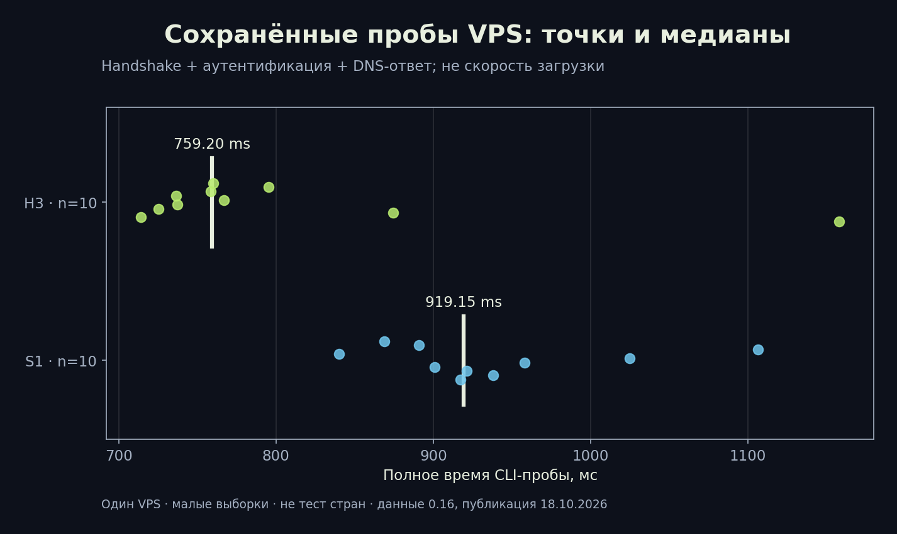
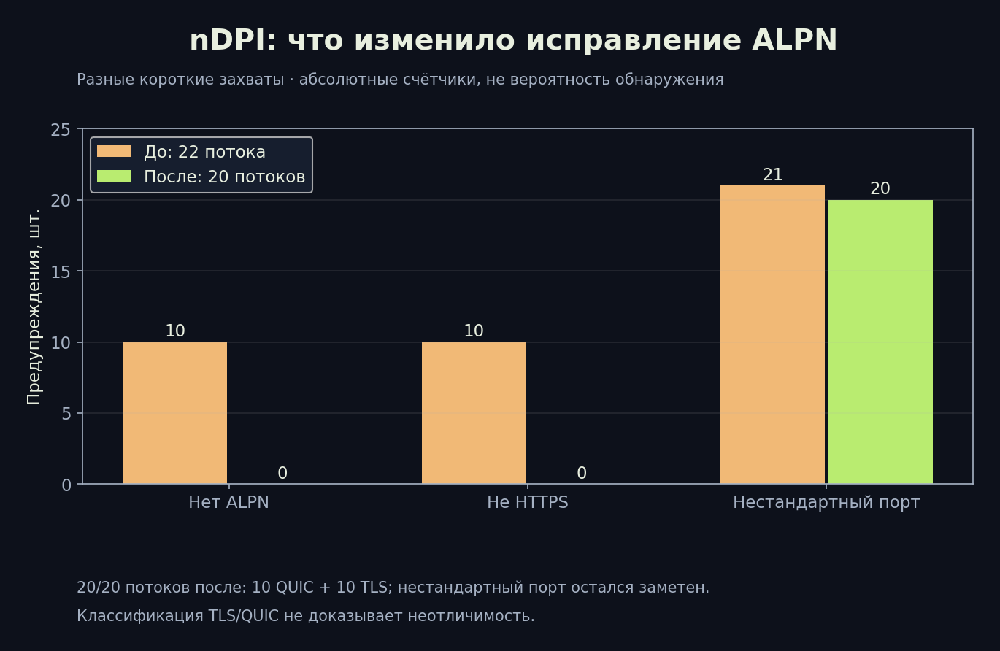

# RIVET: результаты испытаний, установка и воспроизводимость

[Библиотека](../README.md) · [English](../en/03-testing-operations.md) · [Архитектура](01-architecture.md) · [Безопасность](02-wire-security.md)

## Какие данные опубликованы

Графики построены из сохранённых JSON проекта, не из предположений. При подготовке статей сетевой эксперимент не повторялся. Данные относятся к указанным сборкам и среде; свежая локальная проверка ядра вынесена в отдельный отчёт. Протоколы приложения не менялись в этом выпуске документации.

| Проверка | Источник | Что подтверждает | Что не подтверждает |
|---|---|---|---|
| 10 проб S1 + 10 H3 | rivet-vps-probe-0.16.json | В том эксперименте завершились handshake, pin и DNS-ответ через шлюз | Скорость загрузки, SLA, страны |
| Захват 416610 байт | rivet-detection-0.16.json | Внешние SNI/ALPN; отсутствие указанных открытых маркеров | Неотличимость трафика |
| nDPI 6.0.0-1-1a52933 | rivet-ndpi-0.16.json | Результат одного классификатора на коротком захвате | Поведение всех DPI |
| Android x86_64 emulator | android-rivet-outage-0.16.json | TUN сохранялся, запрос блокировался при обрыве, затем восстановился | Физический Honor и все сценарии утечек |
| Ubuntu 24.04 VM | ubuntu-vm-protocols-019.json | HTTPS прошёл через 7 интегрированных движков в том тесте | Нативная сеть Windows/iOS |

## Время пробы: все 20 измерений



Единица — миллисекунды. Проба CLI включает создание соединения, аутентификацию и получение DNS-ответа; это не чистый RTT и не скорость VPN. Для S1 медиана 919,15 мс, для H3 — 759,2 мс. В этой выборке H3 имеет меньшую медиану примерно на 17,4%. Всего 10 наблюдений на транспорт: вывод о преимуществе во всех сетях или статистической значимости не делается. График показывает отдельные точки и медиану, без придуманного доверительного интервала.

В обоих результатах: TLS version 772 = 0x0304 (TLS 1.3), curve 4588 = 0x11ec (X25519MLKEM768), cipherSuite 4865 = 0x1301 (TLS_AES_128_GCM_SHA256), resumption=false. Это дополнительно показывает, почему нельзя называть всю реализацию «AES-256». После эксперимента временный пользователь был отозван. SHA-256 серверного binary в исходном отчёте сохранён для привязки результата к сборке.

## Классификатор и исправление ALPN



До исправления внешнего ALPN nDPI выдал 10 предупреждений missing ALPN и 10 not HTTPS. После честного объявления `http/1.1` оба счётчика стали 0. До исправления было 22 потока, включая один старый Unknown; после — 20 потоков, 10 QUIC и 10 TLS. Это разные короткие наборы, поэтому число предупреждений нельзя напрямую превращать в процент улучшения детектируемости. Предупреждение нестандартного порта осталось для всех 20 потоков. Положительный контроль WireGuard распознан как WireGuard, но этого недостаточно для валидации RIVET-детектора.

При конвертации SLL2 в синтетический Ethernet IP-пакеты не менялись. В захвате видны SNI и ALPN, два JA3 по 10 наблюдений; открытые `rivet/1`, `XIO` и учётные данные не найдены. Публикуем очищенные агрегаты, а не сырой pcap или профили. Точная строка SNI и адрес VPS не нужны для воспроизведения графиков.

## Обрыв и восстановление

В сохранённом испытании Android-эмулятора запрос до обрыва получил HTTP 200 через VPS; во время обрыва — SocketTimeoutException примерно через 6 с; TUN оставался активным. После восстановления запрос снова прошёл, наблюдаемое время восстановления — 45,57 с. Это одна наблюдаемая величина, не гарантированный таймер и не среднее. Смена движка, force stop, запуск ОС, Wi-Fi/cellular и Doze требуют отдельных испытаний.

Android Always-on VPN и «Блокировать соединения без VPN» нужны для системной блокировки обходного трафика между движками и при остановке процесса. Приложение без привилегий не включает их молча. В настольном runtime полного системного kill switch между попытками пока нет. Успешный запрос через VPN не является проверкой всех возможных утечек.

## Установка через XIO и жизненный цикл сервера

1. В разделе добавления соединения выберите свой VPS, укажите SSH-доступ и разрешите установку. Секреты вводятся локально и не публикуются вместе со статьёй.
2. Установщик определяет платформу и проверяет зависимости и конфликты. Для RIVET серверная сборка сейчас Linux x86_64; «любой VPS и любая архитектура» не подтверждены.
3. Создаются `xio-entry` и `xio-rivet`, TUN `xiorivet`, службы `xio-rivet-entry`/`xio-rivet-gateway`, конфигурации `/etc/xio-rivet`, состояние `/var/lib/xio-rivet` и receipt установки. По умолчанию вход — TCP/UDP 8443, внутренняя подсеть — 10.79.0.0/24. Порт, подсеть и чужие файлы проверяются до присвоения владения.
4. Настраиваются forwarding/NAT и принадлежащие XIO правила iptables, либо учитывается UFW/firewalld. Чужая изменённая конфигурация может привести к отказу установки, а не к молчаливой перезаписи.
5. Создайте пользователя и импортируйте его профиль. Профиль содержит оба независимых секрета, pin и параметры шлюза. Передавайте его по защищённому каналу; общий профиль XIO может содержать и другие движки, а административный экспорт — более чувствительные данные.
6. При отзыве удаляется допуск, действующая сессия закрывается периодической проверкой. При очистке используется receipt собственного владения. Удаление XIO не является безопасным стиранием носителя и не удаляет общие системные журналы, резервные копии и записи провайдера.

Службы запускаются под отдельными пользователями с NoNewPrivileges, ProtectSystem=strict, ProtectHome, PrivateTmp, MemoryMax=256M и TasksMax=128. Это ограничения службы, а не результаты измерения RAM. Нужны контроль свободной памяти, срока сертификатов, доступности диска и ошибок persistence.

## Сертификаты и обслуживание

Приватный внешний сертификат генерируется на 90 дней, внутренний — на 180. Копия публичного сертификата должна обновляться до истечения срока; автоматического renewal в RIVET пока нет. Смена внешнего сертификата не должна отключать внутренний pin. Смена ключа Gateway требует безопасного обновления доверия клиентов; пересылка нового pin через недоверенный канал уничтожает смысл закрепления. При компрометации профиля отзовите пользователя и выдайте новые секреты; токен и secret не переиспользуйте.

Проверочный сайт XIO настраивается; по умолчанию youtube.com. В сохранённом испытании 0.19 он не работал даже напрямую с VPS из-за DNS. Перед обвинением транспорта выполните baseline на VPS и независимую проверку разрешения имени, TLS и HTTP-ответа. Не отключайте проверку сертификата ради зелёного статуса.

## Как воспроизвести локальную проверку

```sh
cd protocol/rivet
/path/to/go test -race -count=1 -v ./internal/rivet
/path/to/go test -run '^$' -fuzz '^FuzzFrame$' -fuzztime=30s ./internal/rivet
/path/to/go test -run '^$' -fuzz '^FuzzFragments$' -fuzztime=30s ./internal/rivet
```

Нужен Go из go.mod и зависимости полного source-архива. Команды фаззинга — инструкция для отдельного запуска; они не означают, что именно такие 30-секундные запуски проведены для этой публикации. Обычный go test исполняет seed corpus, а не полноценный fuzz campaign. Сетевой CLI `rivet probe --config /private/client.json` проверяет handshake и DNS-пакет, не меняет маршруты и не заменяет тест приложения.

Графики воспроизводятся командой `python3 tools/render-protocol-figures.py`; нужен matplotlib. В [data](../data/) лежат очищенный JSON и CSV, источник и SHA-256 исходных отчётов — в evidence-manifest.json. Сравните hash локальных исходных отчётов с манифестом; изменённый отчёт требует новой публикации графиков.

## Свежая локальная проверка публикации

18 октября 2026 заново выполнен `go test -race -count=1 -json ./internal/rivet`: успешно прошли 15 верхнеуровневых Test-функций и seed-кейсы двух fuzz-функций; пакет завершился за 19,367 с. Подтесты не посчитаны как отдельные независимые испытания. Нового длительного фаззинга, VPS-цикла и измерения блокировок в этом запуске не было. Проверены 95 локальных ссылок, хэши пяти исходных отчётов, пересчёт медиан и размер AUTH. [Машиночитаемый отчёт](../data/publication-validation.json).

## Что ещё нужно измерить

План будущих испытаний, а не выполненные результаты: upload/download goodput и p50/p95/p99; CPU/RAM и расход батареи; 1/3/5% потерь с разными RTT; низкий PMTU и blackhole ICMP; 24–72 ч работы; перегрузка и отзыв; DNS/IPv6 leak matrix; смена сетей и sleep/wake; нативные Windows и iOS; физические Android; сравнение с настоящими браузерами на независимой выборке; реальные сети и операторы разных стран с разрешением владельцев. Отдельно нужен независимый аудит кода и модели угроз.

## Первичные материалы

[Проба VPS](../../../verification/rivet-vps-probe-0.16.json) · [nDPI](../../../verification/rivet-ndpi-0.16.json) · [Метаданные захвата](../../../verification/rivet-detection-0.16.json) · [Обрыв Android](../../../verification/android-rivet-outage-0.16.json) · [Отчёт 0.19](../../../verification/VERIFICATION-0.19.0.ru.md) · [Установщик](../../../server/managed/rivet-setup.py) · [Происхождение runtime](../../native-source-provenance.md).
