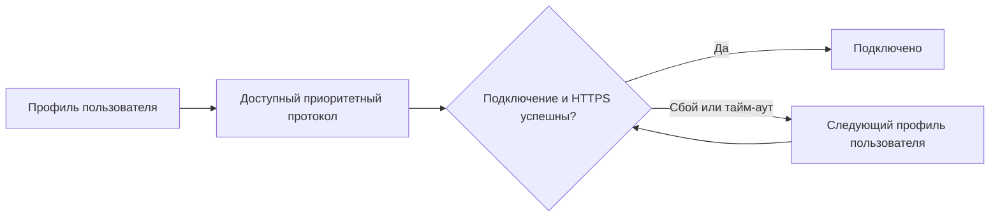
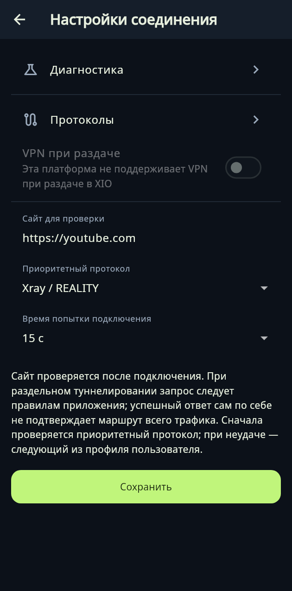

# Как пользоваться XIO

[English](../en/guide.md) · [Скачать](downloads.md)

## Установка

Выберите APK по архитектуре: Android ARM64, ARMv7 или x86_64. Для большинства современных телефонов подходит ARM64. Android 8 и новее; поддержка каждой конкретной прошивки не гарантирована. Обновляйте поверх установленного приложения, сохраняя данные. В Ubuntu установите DEB: `sudo apt install ./XIO-0.22.0-ubuntu-amd64.deb`. В Windows полностью распакуйте ZIP и запустите XIO.exe. Для iPhone/iPad доступен исходный проект Xcode; ZIP исходников не устанавливается как приложение.

При первом запуске прочитайте лицензию и условия. Запись подтверждения хранится локально в «Настройки → О XIO → Лицензия и ответственность».

## Свой сервер или готовый профиль

1. Нажмите «+». Для своего VPS выберите настройку сервера, введите адрес и SSH-реквизиты. Для стороннего сервиса вставьте ключ или конфигурацию: движок определяется автоматически.
2. Используйте отдельный VPS без посторонних VPN. Установщик определяет поддерживаемую ОС семейства Debian/Ubuntu или RHEL/CentOS и её пакетный менеджер. Не каждая версия и производная ОС проверена; актуальная проверка — Ubuntu VM x64.
3. SSH-пароль сохраняется защищённым хранилищем клиента и подставляется при административных операциях. Изменившийся SSH-ключ блокирует обслуживание до проверки владельцем.
4. Установка разворачивает доступный серверный набор: Xray, RIVET/S1, RIVET/H3, AWG и Cloak. На клиенте набор зависит от платформы. Не закрывайте SSH до завершения настройки.
5. На главной выберите сервер и нажмите подключение. XIO использует предпочтительный доступный протокол и проверяет HTTPS-сайт. По умолчанию это youtube.com; адрес и тайм-аут меняются в настройках соединения.

## Пользователи и серверы

«Настройки → Пользователи» или «+ → Пользователь» открывают создание доступа. В одном пользовательском профиле находятся все его поддерживаемые протоколы. «Поделиться» передаёт секрет доступа, поэтому отправляйте его только получателю. «Отозвать» отключает доступ на сервере. Флаг admin разрешает создавать пользователей в пределах лимита одновременно действующих записей; отзыв освобождает место. Карточка показывает admin при наличии прав, online/offline, трафик за месяц и действия. Статистика запрашивается один раз при запуске; это снимок серверных счётчиков.

В настройках сервера можно изменить название, сохранить конфигурацию, удалить только запись клиента или очистить принадлежащие XIO компоненты на VPS и удалить запись. Очистка отзывает доступ всех пользователей этого сервера. Общие системные пакеты, нужные другим программам, удалять нельзя. Административный экспорт содержит секреты управления и отличается от пользовательского профиля.

## Настройки соединения и раздача

«Настройки → Соединение» содержит «Диагностика», **«Протоколы»**, сайт проверки, приоритет, тайм-аут и **«VPN при раздаче»**. В «О XIO» остаются справка, лицензия, GitHub и кнопка поделиться приложением.

На Android для раздачи через VPN **необходим root**. На обычном телефоне переключатель выводит «Необходим root» и не включает функцию. При наличии root включите модем/точку доступа, выберите именно интерфейс раздачи, отключите раздельное туннелирование, включите функцию и подтвердите root локально. После изменения аппаратного ускорения перезапустите точку доступа. Затем подключите VPN и проверьте внешний IP на подключённом устройстве. IPv6 раздачи блокируется; IPv4 направляется в туннель, DNS перенаправляется на 9.9.9.9 через него. При отсутствии туннеля правила блокируют IPv4-пересылку. Прошивки с нестандартным offload, перезагрузка и сброс правил системой требуют отдельной проверки. Не считайте телефон защищённым только по положению переключателя.

Windows: подключите VPN, включите мобильный хот-спот, выберите его интерфейс и включите функцию с правами администратора. XIO настраивает ICS для своего адаптера и отказывается заменять чужой общий доступ. Реальная работа Windows ICS пока не проверена на Windows-компьютере; функция экспериментальная. Всегда проверяйте внешний IP устройства и поведение при отключении VPN. Для Ubuntu и iOS этот переключатель недоступен.

## Фон и обновления

Android VPN-служба работает отдельно от окна; плитка быстрых настроек переключает соединение после выдачи системного разрешения VPN. Принудительная остановка, перезагрузка и ограничения прошивки могут прервать его. В Ubuntu/Windows туннель обслуживает отдельный помощник.

Проверка обновлений: «Настройки → Приложение». Автоматическая проверка раз в неделю со случайным сдвигом; релиз можно пропустить. Android подтверждает установку системным установщиком, iOS не получает неподписанную автоустановку. Подпись метаданных и хеш пакета проверяются до установки. Обновление управляемого сервера выполняется при запуске/управлении, когда VPN отключён, доступны сохранённые SSH-реквизиты и совпадает ключ сервера. Пользователи и ключи сохраняются; при сбое службы выполняется откат. Старые неподдерживаемые подключения отключаются миграцией рецепта 19. Обновление ОС не выполняется.

  

Изображения получены при проверке Flutter-интерфейса. [FAQ](faq.md) · [Протоколы](protocols.md) · [Обновления](updates.md)
