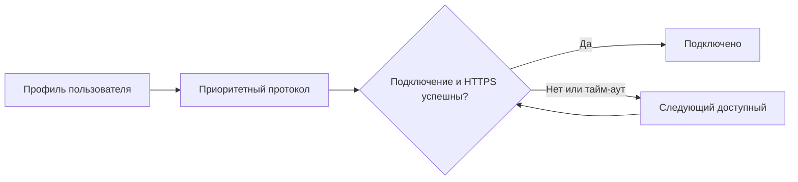
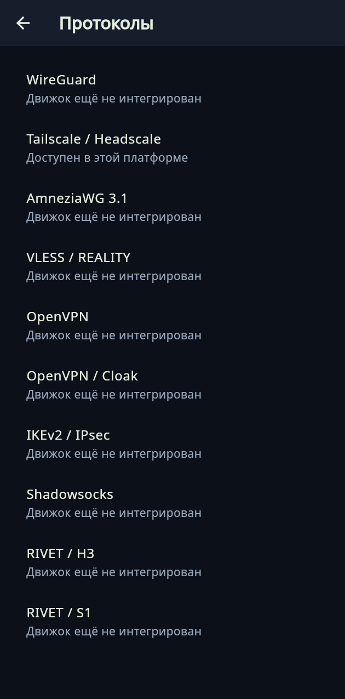

# Как пользоваться XIO

[English](../en/guide.md) · [Главная](../../README.ru.md)

## Установка

Скачайте сборку на [странице загрузок](downloads.md). Для Honor Magic V3 нужен Android ARM64. Откройте APK и разрешите установку выбранному источнику в системных настройках. Сохраняйте существующие данные приложения при обновлении. Для Ubuntu установите DEB командой `sudo apt install ./XIO-0.20.0-ubuntu-amd64.deb`. Windows: распакуйте ZIP полностью и запустите XIO.exe. iOS: пока доступен проект для сборки на Mac; ZIP исходников не устанавливается на телефон.

При первом запуске прочитайте лицензию, уведомление об ответственности и описание работы VPN. Отметки сохраняются на устройстве. Проверить запись можно в «Настройки → О XIO → Лицензия и ответственность».

## Подключение своего VPS

1. Подготовьте сервер с systemd, TUN и поддерживаемой архитектурой amd64. Система установки определяет семейство ОС и пакетный менеджер. Это не означает проверку всех дистрибутивов и их версий.
2. Нажмите «+ → VPN на своём сервере». Укажите адрес, порт SSH, пользователя и способ входа. Пароль вводите в приложении, не в GitHub.
3. Запустите установку. Для установки требуются административные права. Проверьте результат в журнале: протокол считается доступным после успешной установки его компонентов.
4. Выберите сервер на главной странице. Откройте настройки соединения, задайте приоритет, время попытки и сайт проверки.
5. Нажмите подключение и подтвердите системное разрешение VPN или запуск сетевого помощника.

## Готовый профиль или сторонний VPN

Нажмите «+ → Вставить ключ или конфигурацию», вставьте содержимое профиля и подтвердите импорт. Движок определяется по формату. Поддерживается только конфигурация, которую умеет разбирать текущий клиент; произвольный формат другого приложения не гарантируется. Отсутствующий на платформе движок не появится от импорта.

## Автоматический выбор

Сначала проверяется приоритетный поддерживаемый протокол из профиля пользователя. При ошибке или истечении времени приложение пробует следующий. Проверочный сайт по умолчанию — youtube.com. Если он недоступен с самого сервера, временно укажите https://example.com для диагностики. HTTPS-ответ не доказывает отсутствие всех утечек или правильность маршрута каждого приложения.

## Пользователи

В «Настройки → Пользователи» создайте пользователя на выбранном управляемом сервере. Профиль содержит его конфигурации поддерживаемых протоколов. Кнопка «Поделиться» передаёт доступ, поэтому отправляйте профиль только получателю. «Отозвать» закрывает доступ на сервере. Флаг admin разрешает создание других пользователей в пределах заданного лимита одновременно действующих пользователей. После отзыва место освобождается.

В карточке отображаются роль администратора при её наличии, online/offline, трафик за текущий месяц и действия. Статистика обновляется один раз при запуске. Это снимок серверных данных, а не непрерывный индикатор присутствия. Возможность точного учёта зависит от движка и серверных счётчиков.

## Настройки

- «Серверы»: выбор, переименование, экспорт, удаление записи из приложения и отдельная очистка сервера от принадлежащих XIO компонентов. Прочитайте подтверждение: очистка удаляет доступ пользователей и настройки на VPS. Общие SSH, сайт и почта не должны удаляться.
- «Соединение»: сайт проверки, приоритет и тайм-аут; внутри — «Диагностика» и журнал сеанса.
- «Приложение»: язык и системная тема; Android — иконка, раздельное туннелирование и системные параметры.
- «О XIO»: протоколы, справка, FAQ, лицензия и запись ознакомления.

Административная конфигурация сервера включает секреты. Передавайте её только тому, кому разрешено управлять VPS. Обычный пользовательский профиль и административный экспорт имеют разные права.

## Фон и отключение

Android использует VPN-службу; плитка быстрых настроек переключает подключение после выдачи нужных системных разрешений. Закрытие интерфейса не равно отключению. Принудительная остановка приложения, ограничения прошивки и перезапуск устройства могут менять поведение. На Ubuntu/Windows отдельный помощник продолжает работу после закрытия окна. Перед удалением клиента отключите туннель.

[FAQ](faq.md) · [Протоколы](protocols.md) · [Ограничения платформ](../../CROSS-PLATFORM-0.19.ru.md)

## Новый порядок страниц

Изображения получены при проверке Flutter-интерфейса, без подключения к реальному VPS.

