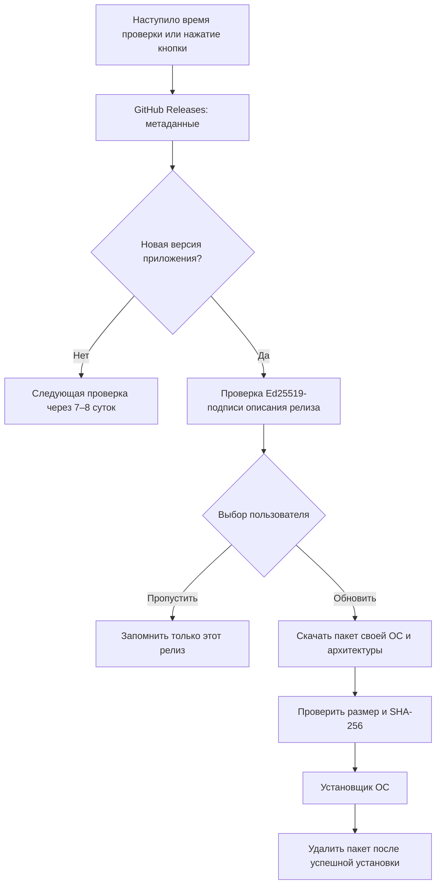

# Обновления XIO

[English](../en/updates.md) · [Настройки](guide.md) · [Скачать](downloads.md)

В «Настройки → О XIO» находятся ссылка на репозиторий и кнопка «Поделиться приложением». Android и iOS открывают системное меню общего доступа. Ubuntu и Windows копируют ссылку на релиз в буфер обмена и сообщают об этом.

В «Настройки → Приложение» нажмите «Проверить обновления». Если найден новый подписанный релиз приложения, выберите «Обновить», «Пропустить релиз» или «Позже». Пропуск сохраняется на устройстве; он относится только к этому релизу. Ручная проверка снова показывает пропущенный релиз. Релизы документации и материалов проекта не предлагаются как обновление приложения.

## Расписание и нагрузка

Первая автоматическая проверка назначается через семь суток плюс случайный интервал до 24 часов. После каждой проверки вычисляется новое время по тому же правилу. Срок хранится локально: перезапуск приложения не сбрасывает его. Несколько одновременных нажатий используют один запрос. Между ручными запросами действует пауза не менее пяти минут; ответ GitHub Retry-After учитывается. ETag сокращает повторную передачу метаданных.

Android дополнительно использует системный JobScheduler при закрытом интерфейсе. Он проверяет только метаданные и показывает уведомление. Для предложения установки приложение заново проверяет подпись. Уведомление не является доказательством подлинности пакета. Отключённые уведомления, принудительная остановка приложения, отсутствие сети и ограничения батареи могут задержать фоновую проверку. Точное время выбирает Android.

В Ubuntu и Windows проверка выполняется во время работы приложения; пропущенный срок обрабатывается после запуска. В iOS — при запуске или возврате в приложение. Отдельный постоянно работающий процесс проверки не устанавливается. Везде пакеты скачиваются только после согласия пользователя, со случайной начальной задержкой до трёх секунд. Приложение не собирает статистику установок и не передаёт профили VPN при проверке обновлений. GitHub при HTTPS-запросе видит обычные сетевые метаданные, включая IP-адрес.

## Установка

| Платформа | Поведение |
|---|---|
| Android APK с GitHub | При необходимости разрешите установку из XIO в настройках Android и повторите действие. Системный установщик запросит подтверждение. Проверяются имя пакета, более высокий versionCode и тот же сертификат подписи. После успешной замены приложения получатель MY_PACKAGE_REPLACED удаляет пакет; повторный запуск также выполняет очистку. |
| Google Play | Внешняя установка отключена; кнопка открывает страницу приложения в магазине. Публикация приложения в Google Play ещё не подтверждена. |
| Ubuntu/Debian x64 | Скачивается DEB. `pkexec` запрашивает разрешение ОС, `apt-get` устанавливает обновление и необходимые зависимости, не удаляя другие пакеты. После успешного завершения пакет удаляется, приложение запускается из `/opt/xio`. При отмене или ошибке новая версия не объявляется установленной. |
| Windows x64 | ZIP распаковывается в отдельной рабочей папке. Пути, ссылки, повторяющиеся имена и размеры проверяются. Отдельный PowerShell-процесс ждёт завершения XIO, сохраняет прежнюю папку, переносит новую и запускает её. После подтверждения запуска новой версии удаляются ZIP и резервная копия. При ошибке копирования восстанавливается прежняя папка; если новый процесс не подтвердил запуск, резервная копия сохраняется для ручного восстановления. Для защищённых системных каталогов может потребоваться ручная установка. |
| iPhone/iPad | Открывается страница релиза. Произвольный архив GitHub не устанавливается. Сейчас распространяются исходники: для устанавливаемой версии необходимы сборка на Mac, подпись и разрешённый Apple канал распространения. |

Перед обновлением завершите текущую VPN-сессию. Профили и учётные данные остаются в отдельном каталоге данных приложения. Отмена загрузки и неверная контрольная сумма удаляют частичный файл. Отменённая системная установка может оставить проверенный пакет для повторной попытки; успешная установка удаляет его.

## Проверка подлинности и выпуск следующей версии

Приложение доверяет конкретному открытому ключу Ed25519 из `app/assets/security/update-ed25519.pub`. Подпись покрывает точные байты описания версии, номера сборки, адресов, размеров и SHA-256 пакетов. Передача — только HTTPS, исходные адреса — только assets этого репозитория, перенаправления ограничены CDN GitHub. Более старые и равные версии не устанавливаются автоматически. Независимая подпись снижает риск подмены файлов аккаунта GitHub, но не защищает при компрометации ключа выпуска или самого устройства.

Закрытый ключ не публикуется. Для своего форка создайте собственный ключ и замените открытый до сборки. `tools/sign-update.py --key ПУТЬ --notes ТЕКСТ` создаёт `releases/XIO-update.json` после сборки пакетов. Этот файл необходимо прикрепить к тому же релизу `vMAJOR.MINOR.PATCH`. Подписывать следует только окончательные пакеты: любое изменение байтов после подписи приведёт к отказу установки. Архив исходников и SHA256SUMS публикуются рядом. Архивы не содержат ключей подписи.

Версия 0.21 — первая с этим механизмом. Переход с 0.20 выполняется обычной установкой пакета; последующие подписанные релизы сможет обнаруживать само приложение.

Документация платформ: [Android JobScheduler](https://developer.android.com/reference/android/app/job/JobScheduler), [установщик Android](https://developer.android.com/reference/android/content/pm/PackageInstaller), [распространение приложений Apple](https://developer.apple.com/distribute/), [GitHub Releases API](https://docs.github.com/en/rest/releases/releases).
