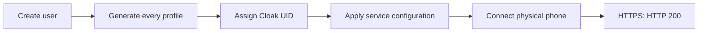

# XIO 0.22: physical Android verification

Test device: POCO X6 5G, Android 16 / API 36, system font scale 145%. These results cover one device and one network. They do not establish compatibility with every Android device or resistance to every ISP/DPI deployment.

| Scenario | Observed result |
|---|---|
| Release APK installation and launcher | Installed and opened successfully |
| First launch | The owner personally accepted the license and VPN disclosure |
| UI with 145% font scale | Inspected screens were readable and navigation remained visible |
| Add the test VPS through XIO | Passed |
| Create a user using stored SSH credentials | Passed without another password prompt |
| Xray / REALITY | HTTPS control site returned HTTP 200; bidirectional counters increased |
| RIVET / S1 | HTTPS control site returned HTTP 200; bidirectional counters increased |
| RIVET / H3 | HTTPS control site returned HTTP 200; bidirectional counters increased |
| AmneziaWG 3.1 | HTTPS control site returned HTTP 200; bidirectional counters increased |
| OpenVPN / Cloak | Passed with HTTP 200 after correcting server user activation |
| Automatic fallback | An unsuccessful Cloak attempt fell back to Xray successfully |
| Background operation | VPN foreground service remained active after leaving the app |
| Quick Settings tile | Disconnected and reconnected without opening XIO; reconnection transferred traffic |
| VPN tethering without root | Displayed the root requirement; tethered routing itself was not tested |

## Separating a site failure from a tunnel failure

The default connectivity site is YouTube. A direct request from this test VPS failed to receive an HTTP response from YouTube. The control site example.com returned HTTP 200. The original check therefore rejected routes even when their counters showed traffic. After temporarily selecting example.com, the five protocols passed their separate HTTPS checks. This does not prove a protocol-specific block or YouTube availability from this VPS.

## Cloak fix in 0.22.1

User creation activated the service before generating the new Cloak UID. The profile existed, but the service did not authorize that user. Configuration is now applied after all user profiles have been generated. The embedded server package advances to revision 20 so the existing updater can distinguish and migrate the package safely.

A regression test requires the new UID to be present at the first gateway activation. All 19 server tests passed. A separate temporary user was also automatically authorized on the real VPS; its access was revoked after the check.

## Limits

A fresh connection, a successful in-app HTTPS check and bidirectional counters verify the observed flow. They do not prove the absence of all DNS/IPv6 leaks or replace an independent packet capture and audit. Battery usage, throughput, long-duration recovery, other devices and native Windows/iOS behavior were not measured in this session. Other app features were not comprehensively retested.

The phone was used under an explicit exclusive Kot reservation. Personal information, access profiles and raw device logs are not published. Version 0.22.1 changes the embedded server installer; cryptographic algorithms and native tunnel engines remain the same.

## In-place application update

The final 0.22.1 / build 5005 APK was installed over the previous version, preserving profiles and first-launch acknowledgments. The app automatically migrated the server from revision 19 to 20; its installed package SHA-256 matched the embedded APK package. ARMv7 and x86_64 APKs were built and passed signature, launcher and native-library consistency checks; only ARM64 was physically tested. All 14 selected Flutter tests for profiles, server actions and update security passed.
