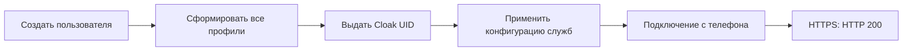

# XIO 0.22: проверка на физическом Android

Проверяется опубликованный ARM64 APK XIO 0.22.0. Телефон: POCO X6 5G, Android 16 / API 36; системный масштаб шрифта — 145%. Это проверка одного устройства и одной сети. Она не подтверждает работу на всех Android, операторах или в условиях DPI.

| Сценарий | Результат |
|---|---|
| Установка APK, значок запуска | Успешно, приложение открылось через launcher alias |
| Первый запуск | Владелец лично подтвердил лицензию и уведомление VPN |
| Интерфейс при шрифте 145% | Проверенные экраны читаемы; навигация отображается |
| Добавление тестового VPS через приложение | Успешно |
| Создание пользователя с сохранённым SSH-доступом | Успешно, повторного ввода пароля не потребовалось |
| Xray / REALITY | HTTP 200 от контрольного HTTPS-сайта; счётчики трафика растут |
| RIVET / S1 | HTTP 200 от контрольного HTTPS-сайта; счётчики трафика растут |
| RIVET / H3 | HTTP 200 от контрольного HTTPS-сайта; счётчики трафика растут |
| AmneziaWG 3.1 | HTTP 200 от контрольного HTTPS-сайта; счётчики трафика растут |
| Сворачивание приложения | VPN-служба осталась foreground service |
| Плитка быстрых настроек | Отключение и подключение без открытия окна XIO; повторное подключение передало трафик |
| Раздача VPN без root | Отображается сообщение «Необходим root»; сама маршрутизация раздачи не проверялась |
| OpenVPN / Cloak | После исправления серверного порядка активации: HTTP 200, двусторонний трафик |
| Автоматический резерв | После неудачного Cloak приложение подключилось через Xray |

## Почему первая попытка была неуспешной

Проверка сайта по умолчанию использует YouTube. На тестовом VPS прямой запрос к YouTube не получил HTTP-ответ; доступный контрольный сайт example.com ответил HTTP 200. С исходным сайтом приложение перебирало протоколы и отклоняло маршруты, не прошедшие проверку. После временного выбора example.com Xray и RIVET/S1 прошли сквозную проверку. Это не доказательство блокировки конкретного протокола и не основание обещать доступность YouTube с данного сервера.

## Границы проверки

Проверка HTTP внутри приложения вместе со свежим подключением и двусторонними счётчиками подтверждает проверенный поток. Она не доказывает отсутствие всех утечек DNS/IPv6 и не заменяет отдельный захват пакетов и независимый аудит. Энергопотребление, пропускная способность, длительное восстановление после смены сети и другие модели телефонов в этой сессии не измерялись.

Физический телефон используется исключительно по явной брони Kot. Личные данные, конфигурации доступа и необработанные журналы не публикуются.

## Исправление Cloak в 0.22.1

При создании пользователя служба перезапускалась до выдачи его Cloak UID. Профиль сохранялся, но новый пользователь отсутствовал в списке разрешённых. Применение конфигурации перенесено после формирования всех профилей. Встроенный серверный пакет получил ревизию 20 для безопасного обновления существующего сервера.

Регрессионный тест проверяет, что при первой активации служба уже получает UID созданного пользователя. Все 19 серверных тестов прошли. На реальном VPS дополнительный временный пользователь автоматически попал в список разрешённых; после проверки его доступ отозван.

В этой сессии не проверялись остальные функции приложения, длительная автономная работа и производительность. Новый Android-патч меняет встроенный серверный установщик; криптографические алгоритмы и нативные движки не менялись.

## Обновление установленного приложения

Итоговый APK 0.22.1 / build 5005 установлен поверх предыдущей версии с сохранением профилей и подтверждений первого запуска. Приложение автоматически обновило сервер с ревизии 19 до 20; SHA-256 установленного пакета совпал со встроенным в APK. Сборки ARMv7 и x86_64 собраны и прошли проверки подписи, значка запуска и соответствия нативных библиотек; физически проверена только ARM64. Выборочные 14 тестов Flutter по профилям, управлению сервером и безопасности обновлений прошли.
