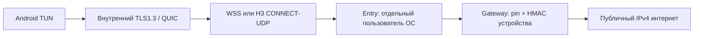

# RIVET: реализация профиля0.2

Рабочая экспериментальная композиция TLS1.3, WebSocket, QUIC и CONNECT-UDP. Примитивы не заменяются самодельными шифрами. См. [точные границы профиля](../../RIVET-IMPLEMENTATION-0.2.ru.md) и [отчёт](../../verification/VERIFICATION-0.16.ru.md).

Entry снимает только внешний транспорт. Внутренняя криптография заканчивается на gateway. Разные аккаунты ОС ограничивают доступ к файлам, но root единственного VPS доверенный.

## Сборка

Go1.27.2, Linux x86_64. `go test -race ./...`, `go vet ./...`; зависимости закреплены в go.mod/go.sum. Для Android требуются совместимые NDK и gomobile/gobind из версии tool в go.mod, переменные ANDROID_HOME/ANDROID_NDK_HOME и Go в PATH.

Из корня XIO: `python3 tools/build-rivet.py --go /path/to/go --gomobile /path/to/gomobile`, затем `python3 tools/package-server.py`. Скрипт записывает контрольные суммы исходников/артефактов в vendor-metadata/rivet-build.json. Серверная цель x86_64; Android AAR содержит arm64, armv7 и x86_64. AWG/WireGuard и RIVET входят в один Go runtime. Отдельная историческая JNI-библиотека исключена из APK. Для мобильного runtime сборщик создаёт приватную копию Go с прежней CLOCK_BOOTTIME-правкой Android-таймеров; криптографические исходники не меняются. Ключи подписи APK этим скриптом не используются.

Сервер устанавливается из приложения через SSH с учётом реестра собственной установки. Сам CLI `rivet init` только создаёт ключевой материал; он не заменяет полный установщик. Приватные файлы /etc/xio-rivet не нужно переносить в клиент. Профиль клиента содержит protocol, endpoint, serverName, pin, gatewayId, id, secret, entryToken, ip и необязательный outerCA. Это секретный профиль устройства: его нельзя помещать в публичные логи или исходники.

`rivet probe --config /private/client.json` выполняет TLS/HMAC, отправляет DNS-пакет через шлюз и проверяет ответ. Он не меняет маршруты компьютера и не является полноценным desktop VPN-клиентом. Не публикуйте сам client.json.

Android применяет локальный DNS9.9.9.9; поле DNS замороженного wire CONFIG остаётся1.1.1.1 для совместимости. Это локальное переопределение клиента, а не доверие произвольному DNS, предложенному шлюзом.

## Проверки

- Фреймы и канонический CBOR, связывание доказательства с exporter/носителем, независимые pin/PKI/секреты.
- Запрет TLS1.2 и классического-only X25519 во внутреннем канале; отсутствие снижения защиты при fallback.
- Оба транспорта на loopback с настоящими TLS/QUIC и пакетами1280байт; отзыв действующего сеанса.
- Ограниченные фрагментация/сборка, повторы, перекрытия, истечение времени и предельные номера.
- Отказ в неавторизованном WebSocket и произвольном CONNECT-UDP proxy-target.
- Go race detector, фаззинг FuzzFrame/FuzzFragments и govulncheck. Это не независимый криптографический аудит и не доказательство необнаруживаемости.
