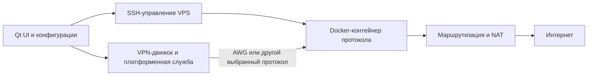

# Amnezia VPN: техническое исследование проекта

Дата проверки: 16 октября 2026 года.

**Результат:** изучены устройство проекта, выбранные критические пути исходного кода, серверные сценарии, обфускация AWG 3.1, управление ключами, API, обновления и опубликованные аудиты. Это подробное статическое исследование, а не полный независимый аудит и не проверка работоспособности в сетях разных стран.

## 1. Основной вывод

Amnezia — практически полезная основа для исследования устойчивого VPN: у проекта есть готовые клиенты, автоматизация собственного сервера и несколько протокольных семейств. AmneziaWG изменяет внешние признаки WireGuard, сохраняя основную криптографическую конструкцию. Xray — отдельная ветвь транспорта, а не новый режим шифрования AWG.

Проект не даёт технического основания обещать неотличимость от любого обычного трафика, неуязвимость для всех DPI или работу через полный запрет UDP/IP. В рассмотренных материалах нет независимой метрики обнаруживаемости актуального AWG 3.1 на репрезентативных сетях разных стран.

Для RIVET важны четыре урока: опираться на проверенную криптографию; разделять управление и пользовательский трафик; рассматривать скрытность как измеряемое свойство всей сессии; фиксировать точные версии и настройки вместо общего названия протокола.

## 2. Что именно изучено

Локально сохранены шесть официальных репозиториев, отдельный снимок выпуска клиента, метаданные GitHub и два аудита. Полный индекс 31 опорного места кода с закреплёнными ссылками: [EVIDENCE.md](amnezia-research/EVIDENCE.md). Машиночитаемые записи: [source-manifest.json](amnezia-research/source-manifest.json), [verification.json](amnezia-research/verification.json).

| Компонент | Снимок | Роль |
|---|---|---|
| amnezia-client, стабильный выпуск | 5.0.3.0, `de93650a90739b87bb47a632872ea9d0adc9412f` | Основной объект рассмотрения клиента |
| amnezia-client, dev | `30ff3451c7a0db60f6306582c700ef9fc916a49e` | Сравнение текущей разработки |
| amneziawg-go, master | `b5928efb6ca19f0153958460c3d141f04abc5c2e` | Userspace AWG 3.x |
| amneziawg-go, зависимость рецепта клиента | v3.1.20260814, `1b86b2ae0e493e7ea93f8c1a0f0cb6735b1551f1` | Проверка отличий от master |
| amneziawg-linux-kernel-module | `4569c4c67f3a57414969260cafbbd04694fbaae0` | Выбранные пути kernel backend |
| amneziawg-tools | `ee0f0a9aa34ff0a0da4b3433b9512781cfe02843` | Конфигурация и управление интерфейсом |
| amneziawg-android | `ff15093bf3856fea0947923474870b86efb682f0` | Android backend и системная интеграция |
| libagw | `46b7704b1d080e060c45fb803186ebb953cdb968` | Новый SDK API-шлюза |

GitHub API `/releases/latest` при проверке вернул 5.0.3.0 с датой публикации 18 сентября 2026 года. Это не устанавливает версии в каждом магазине приложений. Рецепт AWG-Go в этом выпуске закрепляет v3.1.20260814 и SHA-256 архива [E02]. Загруженные пользователями бинарные файлы и Docker-образы не разбирались; их точное соответствие исходникам не доказано.

Выполнено чтение исходников и проверка источников. Go отсутствует в текущем окружении, поэтому upstream unit tests не запускались. Клиент не установлен, kernel-модуль не загружен, сервер не развёрнут, настройки сети рабочего компьютера не менялись. Исходники не изменялись.

## 3. Продукт состоит из нескольких разных систем

### Многопротокольный клиент

Qt/C++ и QML, платформенные компоненты для ОС, привилегированная служба и IPC. Сборка использует CMake и Conan. Часть сетевых движков и SDK написана на Go. Мобильные платформы добавляют собственные VPN API и обвязку.

Клиент решает значительно больше задач, чем шифрование: установка сервера, маршруты, DNS, импорт/экспорт, доступы пользователей, API подписок, обновления, split tunneling и kill switch.

### Self-hosted

Клиент подключается к собственному VPS по SSH, выполняет сценарии установки и настраивает Docker-контейнеры. После установки пользовательский VPN-трафик идёт к VPS через выбранный протокол; SSH нужен для управления, а не для каждого передаваемого пакета.

Преимущество — отсутствие обязательного центрального API на каждом соединении с уже настроенным сервером. Это не означает отсутствия внешних зависимостей при установке, обновлении, загрузке образов и разрешении имён.

### Amnezia Free / Premium

Управляемая инфраструктура добавляет API выдачи конфигураций, подписки и служебные обходные пути. Здесь доступность control plane становится самостоятельным фактором. Нельзя автоматически переносить вывод о приватности собственного VPS на управляемый сервис или наоборот.

Различие режимов прямо отражено типами конфигураций и ветвями ConnectionController [E30].

### Отдельные приложения и библиотеки

AmneziaWG Android/Windows/Apple и основной AmneziaVPN — разные программные продукты. Одинаковое имя протокола не гарантирует одинаковую версию движка, поддерживаемые поля, пользовательские функции и семантику kill switch.

## 4. Архитектура self-hosted

В стандартном self-hosted AWG сервер является одновременно точкой входа и выхода. Это не двухузловая схема анонимизации. VPS видит IP клиента и назначения; HTTPS приложений продолжает защищать своё содержимое от выхода.

Изолирующий эффект Docker зависит от прав. В рассмотренном сценарии AWG есть `--privileged`, NET_ADMIN, SYS_MODULE и подключение `/lib/modules`. Значит, контейнер нельзя считать сильной границей защиты хоста [E14].

Сценарий запуска добавляет правила forwarding и MASQUERADE [server_scripts/awg/start.sh]. Из наличия правил нельзя заключить, что итоговый firewall правильно сочетается с политикой конкретного VPS: это требует проверки после установки.

## 5. Карта протоколов

| Семейство | Функция в проекте | Что важно различать |
|---|---|---|
| WireGuard | Базовый быстрый VPN | Узнаваемость стандартного wire format |
| AmneziaWG | WireGuard с изменением внешних признаков | UDP, параметры обфускации, совместимость версий |
| Xray/VLESS/REALITY | Отдельный прокси-стек и способ построения соединений | Собственная модель транспорта и ключей |
| OpenVPN | Поддержка классических конфигураций | TCP/UDP и конкретные TLS-настройки |
| OpenVPN + Cloak / Shadowsocks | Дополнительное маскирование | Отдельные компоненты и зависимости |
| IKEv2 | Системная/платформенная совместимость | Узнаваемая IPsec-инфраструктура |
| SOCKS, MTProxy, Telemt, TProxy и прочие сервисы | Дополнительные функции | Не равнозначны полному IP-VPN |

Часть этой карты отражает поддерживаемые и исторические компоненты. Доступность конкретной установки через интерфейс зависит от платформы, выпуска, режима сервиса и конфигурации. В исследование не входит заявление, что все варианты одновременно доступны пользователю в актуальном UI.

У Xray-шаблона выпуска 5.0.3.0 видны VLESS, TCP, REALITY и `xtls-rprx-vision` [E24]. Конфигуратор также содержит обработку разных транспортов и XHTTP-настроек [E25]. Строка `encryption=none` относится к полю VLESS и не означает отсутствие защиты внешнего REALITY/TLS-слоя. Наличие `fingerprint=chrome` не доказывает полное совпадение поведения с браузером.

## 6. Эволюция AmneziaWG

На уровне механики поколения можно описать так:

| Поколение | Основная идея |
|---|---|
| Ранний AWG | Иные типы сообщений, префиксы, junk-пакеты |
| 1.5 | CPS-пакеты и дополнительные средства маскировки начала обмена |
| 2.0 | Диапазоны H1–H4 и дополнительные параметры S3/S4 |
| 3.0 | Header Protection, content padding и вариативные интервалы |
| 3.1 | Дополнительно RandomTrailers и DisableCookies |

Это обзор эволюции, не таблица wire-совместимости всех исторических сборок. Текущие официальные материалы описывают 3.1; клиентские константы явно выделяют версии 1.5, 2 и 3.1 [E01].

Миграция может требовать изменения серверного контейнера и перевыдачи пользовательских конфигураций. Обновление одного приложения не гарантирует обновления сервера. Проверять нужно вместе: клиент, движок, сервер, tools и фактические поля конфигурации.

## 7. Криптография: что изменилось, а что осталось

В рассмотренном AWG-Go основа — Noise-конструкция WireGuard, X25519/Curve25519 и ChaCha20-Poly1305. Пользовательские IP-пакеты проходят AEAD, проверку допустимых источников и replay protection [E03, E05; receive.go].

Дополнительный HeaderProtectionKey относится к маскировке служебных частей. Он не заменяет приватный ключ устройства, сеансовые ключи, PSK и AEAD полезной нагрузки [E07].

Не обнаружен встроенный гибридный X25519+ML-KEM обмен AWG. Наличие PSK нельзя назвать тем же механизмом: заранее безопасно распределённый высокоэнтропийный секрет может усиливать модель против части будущих угроз, но не является автоматическим постквантовым обновлением всей системы.

Наследование криптографического ядра уменьшает объём нового криптографического проектирования. Оно не переносит доказательства безопасности автоматически на новые парсеры, управление временем, отключение механизмов DoS, UI и обновления.

## 8. Как устроена обфускация AWG 3.1

### H1–H4: идентификаторы типов

Вместо постоянных идентификаторов используются значения из настроенных диапазонов. Диапазоны не должны пересекаться; проверка есть в UAPI [E08]. Это усложняет простое сопоставление с четырьмя фиксированными типами WireGuard, но не устраняет все остальные признаки.

### S1–S4: случайные префиксы

S1 относится к initiation, S2 — response, S3 — cookie, S4 — transport. Важная тонкость: случайными являются **байты**; при обычной фиксированной настройке Sx длина префикса фиксирована. Нельзя приписывать этому одному механизму случайную длину каждого пакета [E04, E05].

### I1–I5: CPS-пакеты

Это генерируемая цепочка служебных UDP-пакетов перед началом handshake. Описания могут включать статические байты, случайные части и время. Их отправка видна в SendHandshakeInitiation перед junk и настоящим handshake [E04].

Имитация отдельных байтов QUIC/DNS не реализует полноценный автомат этих протоколов. Наблюдатель может учитывать ответы, порядок, повторения и то, как продолжает жить поток. Одинаковый массовый CPS-шаблон также потенциально становится признаком семейства клиентов. Последнее — гипотеза для проверки, не доказанная атака на текущие сети.

### Jc/Jmin/Jmax: junk train

Дополнительные псевдослучайные пакеты меняют начало потока. Слишком большой размер может привести к IP-фрагментации; избыток пакетов увеличивает расход и создаёт повторяемое поведение. Польза зависит от реального классификатора.

### Header Protection

Дополнительный ChaCha20 скрывает служебные части; nonce берётся из первых 12 байт случайного префикса. При включении проверяется достаточная длина S1–S4. У transport защищается заголовок, у handshake — соответствующее сообщение. Есть Go- и kernel-реализации [E07, E08, E10].

Это обфускация поверх основной защиты, а не отдельное доказательство аутентификации произвольных пакетов. Компрометация общего header key способна ослабить скрытность группы, не обязательно раскрывая пользовательское содержимое.

### ContentPaddingAddition и RandomTrailers

Content padding меняет длину зашифрованного содержимого. В рассмотренном master сначала пробуется content padding, затем RandomTrailers, затем обычное дополнение WireGuard — они не всегда просто складываются. Для handshake trailer создаётся отдельно [E04, E05].

Ограничения размеров и их расчёт изменялись между августовским тегом и master. Проверка PMTU, потерь, маленьких пакетов и UDP-фрагментации нужна на конкретной версии.

### Настраиваемые интервалы

Клиент задаёт диапазоны rekey, retry, keepalive и числа попыток; движок выбирает значения в соответствующих местах [E01, E09]. Это не произвольный планировщик времени каждого пользовательского пакета. Интервалы, отвечающие за жизненный цикл ключей, надо менять с учётом безопасности и производительности.

### DisableCookies: особенно важное различие версий

В **теге v3.1.20260814**, закреплённом рецептом клиента 5.0.3.0, проверка нагрузки/MAC2 остаётся в receive.go, а запрет отправки находится в SendHandshakeCookie. При нагрузке это может означать отказ в новых handshake, когда cookie требуется, но не отправляется; поведение нужно измерить.

В **master b5928ef…** проверка `!disableCookies` перенесена на всю ветку обработки нагрузки. При true обходятся также проверка MAC2 и расположенный в этой ветке limiter [E06]. В выбранном kernel-снимке флаг влияет на under_load [E11], но полную эквивалентность backend по этому одному фрагменту утверждать нельзя.

Поэтому фраза «отключает только cookie-ответ» недостаточна для описания всех текущих реализаций. Компромисс между зондированием и DoS надо оценивать по commit SHA. Существующие MAC, очереди и другие ограничения при этом не исчезают; «полностью отключена защита» было бы неверным утверждением.

## 9. Пример начальных параметров основного клиента

В константах выпуска 5.0.3.0: MTU 1280 для мобильных/NE-профиля и 1376 для других указанных ветвей; Jc=3; Sx default padding=12; H1–H4=1,2,3,4; content padding 10–100; rekey 100–120 секунд; retry 3–7; RejectAfterTime 150–180; keepalive 5–15; PersistentKeepalive 25–35; RandomTrailers и DisableCookies включены [E01].

Это значения констант, **не готовый рекомендуемый конфиг** и не доказательство, что любой импорт или сервер использует именно их. Header key, применённый профиль и генератор конфигураций надо проверять отдельно. Стандартные H1–H4 при включённой защите заголовков не означают, что открытый пакет содержит стандартный WireGuard type.

## 10. Создание ключей и доверие

Рассмотренный конфигуратор создаёт клиентский X25519-ключ через криптографический генератор OpenSSL [E12]. Серверный сценарий создаёт собственную пару и PSK [E13]. Конфигуратор добавляет серверу peer с публичным ключом клиента и получает серверный публичный ключ по SSH.

В этом self-hosted пути PSK читается из одного серверного файла и затем добавляется пользователям; нельзя предполагать отдельный PSK на каждое устройство. Независимые приватные ключи клиентов при этом сохраняются. Общий HeaderProtectionKey тоже не следует трактовать как индивидуальный пользовательский секрет.

Критическая точка доверия — первый административный SSH-сеанс: подмена полученного ключа шлюза на этапе настройки нарушает последующее доверие к VPN, даже если сам Noise работает правильно.

## 11. Экспорт доступа: vpn:// не означает шифрование

В self-hosted экспорте профиль сериализуется в JSON, сжимается qCompress и кодируется Base64URL. Это переносимый контейнер данных, не парольная защита содержимого [E18, E19].

Есть важное разделение: пользовательский экспорт очищает SSH-поля, а full-access экспорт сохраняет административную модель сервера. QR-код также является способом передачи данных, не дополнительной защитой.

Практическое следствие: полный профиль следует считать административным секретом, пользовательский — секретом доступа конкретного устройства. Утечку ссылки нельзя исправить сменой её видимого названия. Форматы управляемых подписок могут иметь другую упаковку; вывод о self-hosted нельзя переносить на все `vpn://` без разбора.

## 12. Kill switch, DNS и split tunneling

В desktop-службе есть платформенные firewall-ветви и strict kill switch [E23]. В Linux-коде явно фигурируют отдельные IPv4/IPv6 anchors. Сам факт наличия IPv6-правил не подтверждает работоспособность полноценного IPv6-туннеля: серверный сценарий в исследованном пути преимущественно IPv4/NAT.

Нужно различать отключение вручную, неожиданное падение, strict mode, разрешения LAN, API-исключения и ОС lockdown. Официальная документация обычного kill switch описывает блокировку при аварии и разрешение обычного доступа после ручного отключения. Это не то же обещание, что «прямой интернет запрещён всегда».

DNS зависит от режима, наличия AmneziaDNS, клиентских маршрутов и исключений. App split tunneling по определению разрешает некоторым приложениям прямой путь. Это не следует называть утечкой, если такова выбранная политика, но результаты теста надо интерпретировать с её учётом.

На Android отдельный AWG backend использует VpnService и userspace-движок [E26]. Проверять надо реальное устройство: смену Wi-Fi/LTE, перезапуск, энергосбережение, kill процесса, DNS и always-on/lockdown. APK не собирался и телефон не проверялся.

## 13. Управляемые сервисы: отдельный control plane

В выпуске клиента 5.0.3.0 GatewayController формирует прикладной конверт: случайный AES-ключ, AES-CBC для данных и RSA PKCS#1 v1.5 для упаковки ключевого материала [E20]. Это не криптография AWG data plane.

Начальный gateway endpoint в SecureAppSettingsRepository — HTTP [E21]. Следовательно, формулировка «все API-соединения всегда защищены HTTPS» не подтверждается этим исходником. Одновременно неверно утверждать, что прикладное тело обязательно передаётся открыто: конверт существует. Его целостность, ответы, downgrade, replay и oracle-поведение требуют отдельного end-to-end рассмотрения.

После ошибок предусмотрены запасные API-пути, получение списка proxy endpoints из storage и кэш. Это повышает доступность управления, но переносит доверие на несколько дополнительных механизмов. Шифрование списка, основанное на общедоступном материале приложения, нельзя считать самостоятельным доказательством его происхождения.

В dev GatewayController уже вызывает C ABI библиотеки libagw. Её Go-код сохраняет совместимый конверт и поведение failover [E29, E31]. Это изменение реализации управления, а не новый VPN-протокол или доказанное улучшение всех криптографических свойств API. Разрабатываемая версия не приравнивается к выпущенному бинарному продукту.

## 14. Supply chain и обновления

Положительное наблюдение: рецепт AWG-Go закрепляет версию и SHA-256 исходного архива [E02]. Есть разделение зависимостей и платформенных сборок.

Другая сторона: серверный Dockerfile AWG использует `amneziavpn/amneziawg-go:latest` [E15]. Повторная установка в разные даты может получить иное содержимое. Закреплённый commit основного клиента не определяет однозначно серверный бинарный движок.

Рассмотренный desktop updater сохраняет загруженный ответ в файл, переводит его в ReadyToInstall и затем запускает установщик [E22]. В этом пути не обнаружена отдельная проверка подписанного манифеста/хеша перед установкой. Это наблюдение по клиентскому пути; системная подпись Windows/macOS и защита магазина — отдельные уровни, которые здесь не проверялись.

Для архитектуры нового сервиса стоит требовать подписанные метаданные обновления, anti-rollback, фиксированные образы и проверяемую связь версии исходников с поставляемыми артефактами.

## 15. Опубликованные аудиты: что они подтверждают

Изучены оригинальные отчёты 7ASecurity AVP-02 и AVP-03. AVP-02 относится к июлю 2024 года, AVP-03 — к декабрю 2024 / январю 2025. Это предшествует AWG 3.x 2026 года.

AVP-03 содержит три уязвимости и три рекомендации усиления. Все шесть отмечены как исправленные с подтверждением повторной проверки:

| ID | Тема | Уровень в отчёте |
|---|---|---|
| AVP-03-004 | Нарушение доступности через небезопасную коммуникацию | High |
| AVP-03-005 | Изменение VPN-конфигурации через административный API | Critical |
| AVP-03-006 | Выполнение кода при импорте OpenVPN-конфигурации | Critical |
| AVP-03-001 | Настройки PFS в IKEv2/IPsec-пути | Medium |
| AVP-03-002 | Устаревшие версии Go | Low |
| AVP-03-003 | PRNG и маскировка | Low |

Находка о PFS не означает, что WireGuard/AWG целиком не имел forward secrecy. Не следует выдавать исторические исправленные находки за действующие уязвимости текущего клиента. Аудит также не равен проверке глобальной скрытности от DPI; в отчёте явно ограничена область рассмотрения облачной инфраструктуры.

AVP-02 полезен как свидетельство прежних проблем хранения конфигураций, logcat, памяти и маршрутов. Их актуальность определяется последующими исправлениями и конкретной платформой, а не одним старым заголовком.

## 16. Собственные статические наблюдения, требующие проверки

Это не новые CVE и не доказанные эксплуатацией уязвимости. Условия и версии указаны, чтобы их можно было проверить на отдельном стенде. Сообщения разработчикам не отправлялись.

### O1. Проверка SSH host key не обнаружена в рассмотренном пути

В connectToHost после ssh_connect выполняется пользовательская аутентификация. Явных вызовов проверки known-host/fingerprint в этом файле и поиске рассмотренных C/C++-деревьев не найдено [E17]. Документация libssh требует от приложения проверки подлинности серверного ключа.

Риск: активная подмена на административном SSH-пути. Особенно важна парольная аутентификация; при публичном ключе модель последствий отличается. Окончательная оценка требует проверки бинарного клиента, libssh-конфигурации и всех подключаемых обработчиков. В dev просмотренный путь остаётся аналогичным.

### O2. Шифрование настроек отключено для desktop Linux

SecureQSettings::encryptionRequired возвращает false для Linux без Android [E16]. Это сохраняется в просмотренном dev. Поэтому перенос утверждения о системном keychain на Linux неправилен.

Риск требует доступа к соответствующим файлам/пользовательской учётной записи. Это не означает удалённое чтение конфигурации любым участником сети. Шифрование диска, права файлов и изоляция процессов — отдельные защиты.

### O3. Широкие права контейнера и mutable image

Наблюдения E14/E15 подтверждены сценариями. Они увеличивают доверие к контейнеру и источнику образа. Это эксплуатационный компромисс автоматической установки, не самостоятельное доказательство удалённого взлома.

### O4. Контроль целостности обновления нуждается в отдельной проверке

В пути download/install не найден независимый verification step [E22]. Нужны тесты политики URL, подписи и отзыва, tampered artifact и downgrade, отдельно по ОС. Нельзя считать наличие HTTPS достаточным доказательством всей цепочки поставки.

### O5. DisableCookies имеет различную семантику

Разница между закреплённым тегом и master подтверждена git diff. Нужно измерить нагрузочный отказ в августовском варианте и стоимость неподтверждённых handshake в более новом. Без нагрузочного эксперимента нельзя присваивать severity.

## 17. Какие блокировки проект адресует

| Механизм фильтра | AWG 3.1 | Ограничение |
|---|---|---|
| Простая сигнатура стандартного WireGuard | Есть целевые изменения | Зависит от включённых параметров |
| Постоянные длины handshake | Префиксы и trailers меняют признаки | Версии/настройки важны |
| Явные служебные заголовки | Header Protection | Общий секрет и другие метаданные остаются |
| Повторяющиеся service timings | Настраиваемые диапазоны | Не скрывают все тайминги приложения |
| Статистическая классификация | Несколько механизмов усложнения | Эффективность не измерена здесь |
| Активное зондирование | Несколько барьеров и изменение cookies | Требует отдельного тестирования |
| Запрет всего UDP | AWG сам по себе не решает | Нужен другой транспорт/протокол |
| IP/подсеть/ASN сервера | Сам протокол не решает | Сервер может стать недоступен |
| Запрет API/сайта | Есть служебные резервные пути | Не бесконечный запас доступности |
| Заражённый клиент или выход | Не решает | Криптография не заменяет безопасность хоста |
| Строгий список разрешённых сервисов | Гарантии отсутствуют | Совпадение первых байтов недостаточно |

Наличие quic-go, websocket или Outline в зависимостях AWG-Go не доказывает, что обычный AWG-туннель автоматически идёт через TCP/HTTPS. Найденный Outline StreamDialer создаёт netstack поверх AWG с обычным bind и предоставляет приложениям TCP streams **внутри** AWG [E27]. Это противоположное направление вложения по сравнению с «AWG поверх TCP».

## 18. Сопоставление с RIVET/1

| Вопрос | Amnezia/AWG | Наш RIVET/1 |
|---|---|---|
| Практическая зрелость | Есть код, клиенты и выпуски | Пока проект |
| Базовая криптография | WireGuard/Noise | Предложен TLS/QUIC hybrid |
| Обфускация | Изменение wire-признаков UDP | Реальный внешний веб-транспорт |
| Разделение входа/выхода | В стандартном self-hosted не обязательно | Предложено явно |
| UDP заблокирован | Нужен другой протокольный путь | Предложен TCP carrier |
| Стоимость слоёв | AWG сравнительно прямой путь | Вложение TLS/QUIC и сложнее PMTU |
| Импорт и административный доступ | Готовые модели, но широкий риск-периметр | Надо минимизировать с начала |
| Доказанная неотличимость | Не установлена этим исследованием | Не установлена, реализации нет |

RIVET нельзя считать безопаснее или скрытнее Amnezia на основании одной архитектуры. У предлагаемого двойного QUIC есть собственные проблемы Initial/PMTU, congestion control и ресурсов, которые не исчезают из-за модного стандарта.

Наиболее рациональный следующий шаг — измеримый сравнительный стенд: стандартный WireGuard; AWG на закреплённых версиях с несколькими профилями; один воспроизводимый Xray-профиль; затем минимальный RIVET. Сначала установить реальную разницу в обнаруживаемости, расходе и надёжности, затем выбирать собственную архитектуру.

## 19. Какие решения стоит перенять

1. Независимый протокольный backend и платформенная обвязка.
2. Разделение административного и пользовательского экспорта.
3. Проверенная криптография вместо собственного шифра.
4. Несколько реальных протокольных семейств для разных ограничений сети.
5. Механизмы работы control plane при недоступном основном API.
6. Внешние аудиты с повторной проверкой исправлений.

Что требует более строгого проектирования для нового продукта: обязательная аутентификация административного сервера, минимальные привилегии, защита локальных секретов на всех платформах, подписанные обновления и конфигурации, закреплённые контейнеры, отдельный DoS-анализ и тестирование совместимости параметров.

## 20. Что требуется для проверки на стенде

### Функциональность

IPv4/IPv6 и DNS, маршруты, NAT, отзыв одного peer, восстановление после сбоя, ручное отключение и strict kill switch, смена сети, split-tunnel exceptions. Проверять реальный трафик и внешний IP, а не только handshake.

### Производительность

Те же CPU/VM, MTU и нагрузки для всех протоколов. RTT 20/100/300/500 ms; потери 0/1/3/5%; upload/download, маленькие UDP-пакеты, короткие и длительные TCP-сеансы. Отдельно CPU, RAM, батарея и дополнительный объём CPS/junk/padding.

### Обнаруживаемость

Оценивать first packets и весь поток; отдельно IP-репутацию и payload/metadata-признаки. Тестировать новые устройства, дни и сети вне обучающей выборки. Публиковать TPR при низком FPR, доверительные интервалы и долю VPN. AUC одного лабораторного классификатора не заменяет реальную проверку блокировки.

### Безопасность

Отдельные локальные тесты подмены SSH host key; повреждённого профиля и недопустимых OpenVPN-параметров; скачанного обновления; PSK/header-key отзыва; malformed CPS/UAPI; подделки source address; cookie/handshake нагрузки. Не направлять такие проверки на чужие публичные серверы.

### Совместимость

Таблица client version × backend/tag × server image digest × tools version × параметры. Особо проверить RandomTrailers, минимальные Sx и межпоколенные импорты. Поля в конфигурации и фактическая поддержка движком — разные вещи.

## 21. Источники и воспроизводимость

Основные первичные источники:

- [Официальная организация GitHub](https://github.com/amnezia-vpn).
- [Выпуск клиента 5.0.3.0](https://github.com/amnezia-vpn/amnezia-client/releases/tag/5.0.3.0).
- [Официальная документация AWG](https://docs.amnezia.org/documentation/amnezia-wg/).
- [Миграция self-hosted на AWG 3.1](https://docs.amnezia.org/documentation/instructions/new-amneziawg-selfhosted/).
- [Описание kill switch](https://docs.amnezia.org/documentation/instructions/killswitch/).
- [Аудит AVP-02, оригинал](https://7asecurity.com/reports/pentest-report-amneziavpn2.pdf).
- [Аудит AVP-03, оригинал](https://7asecurity.com/reports/pentest-report-amneziavpn3-RC1.1.pdf).
- [Сводка заказчика аудита OTF](https://www.opentech.fund/security-safety-audits/amneziavpn-security-audit-summary/).
- [Требования libssh к проверке сервера](https://api.libssh.org/stable/libssh_tutor_guided_tour.html).

Точные ссылки на код находятся в EVIDENCE.md. Чтобы повторно построить локальный индекс: `python3 amnezia-research/verify_sources.py`. Скрипт проверяет наличие опорных мест и вычисляет хеши; он не тестирует безопасность, производительность или скрытность.

Сводки СМИ и сторонние установщики не использованы как доказательство свойств протокола. Материалы Free/Premium не дают доступа к полной внутренней production-инфраструктуре. Отсутствие находки в выбранных файлах не является доказательством отсутствия свойства во всём проекте.

**Итоговая оценка:** Amnezia заслуживает использования как практический эталон для сравнительного исследования и источник инженерных решений. Её сильная сторона — сочетание готового продукта, нескольких протоколов и адаптивной обфускации. Её нельзя описывать как невзламываемый или гарантированно нераспознаваемый канал. Для нашего проекта сначала нужны измерения относительно Amnezia, а не заявление о превосходстве нового протокола.
