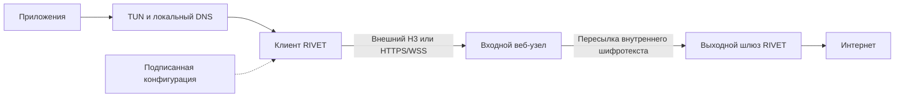

# RIVET/1 — архитектура VPN и проект протокола

> **Исторический документ (архитектура 0.1, 16.10.2026).** Это проект профиля **RIVET/1 0.1**; он сохранён
> как история решений и **не описывает текущее состояние**. Актуальные документы —
> [docs/protocols](../docs/protocols/README.md) (профиль **0.2**, статьи 01–03) и
> [RIVET-IMPLEMENTATION-0.2.ru.md](../RIVET-IMPLEMENTATION-0.2.ru.md), реализация —
> `protocol/rivet/internal/rivet`.
>
> Что изменилось с 0.1 и о чём ниже уже неверно: допускаемый AEAD (0.1 требовал AES-256-GCM/ChaCha20,
> 0.2 допускает AES-128-GCM, в испытании фактически `TLS_AES_128_GCM_SHA256`); адресация (0.1 — полный
> туннель IPv4/IPv6, 0.2 — IPv4-only, IPv6 блокируется); доверие к шлюзу (0.1 — набор закреплённых SPKI,
> 0.2 — ровно один сертификат и один SHA-256 SPKI pin); бюджет подключения (0.1 — 5 с на канал плюс 10 с,
> 0.2 — единый потолок 10 с); буфер сборки (0.1 — 256 KiB, 0.2 — до 163 840 Б); коды закрытия (0.1 — словарь
> 0–5, 0.2 — согласованного словаря причин нет); подписанная конфигурация с монотонным номером (0.1) в 0.2
> не реализована; H3-управление получило байт-preface `00`.
>
> Статус в 0.1 («реализации и тестов пока нет») тоже устарел: клиент и шлюз реализованы, пакет
> `internal/rivet` проходит `go test -race`, независимого криптоаудита по-прежнему нет.

Дата: 16 октября 2026 года. Версия: 0.1, проект для технического рассмотрения.

**Статус:** архитектура и предварительная спецификация. Реализации, криптоаудита, тестов обнаруживаемости и испытаний в сетях разных стран пока нет. Рабочее название и проектные решения не означают доказанной научной новизны.

## 1. Цель и границы обещаний

Создать VPN для Linux и Android, который защищает содержимое между клиентом и выходным шлюзом, работает через несколько стандартных веб-транспортов и допускает независимое обновление транспорта без замены криптографии.

«Устойчивый к взлому» означает проверяемые свойства против определённого противника, а не абсолютную безопасность. «Органический трафик» не имеет единого распределения: браузер, видеозвонок, синхронизация и резервное копирование выглядят по-разному. Цель — снизить обнаруживаемость относительно сопоставимого легитимного класса приложений. Нельзя обещать неотличимость от любого интернет-трафика.

Гарантии не распространяются на заражённый телефон/компьютер, глобальную корреляцию всех участков, сговор входа и выхода, компрометацию выхода во время сеанса и полный запрет внешних соединений. Строгий список разрешённых сервисов может сделать транспорт недоступным без взлома криптографии.

## 2. Модель угроз

| Противник | Возможности | Цель защиты | Остаточное ограничение |
|---|---|---|---|
| Пассивный оператор | Видит IP, длины, время, доступные поля TLS/QUIC | Конфиденциальность, снижение простых сигнатур | Метаданные и адрес входа остаются |
| Активный фильтр | Блокирует UDP/IP/DNS, сбрасывает соединения, зондирует | Переключение транспорта, аутентификация до VPN-доступа | Может блокировать весь адрес или класс трафика |
| Злоумышленник в сети | Подмена DNS, MITM, replay, перестановка пакетов | Аутентификация шлюза, целостность, защита от повторов | Доступность не гарантируется |
| Захваченный вход | Завершает внешний HTTPS, меняет/читает переносимые байты | Внутренняя конфиденциальность и целостность | Видит клиента, выбранный шлюз, время и объём |
| Захваченный выход | Видит внутренние IP-пакеты | Ограничить последствия изоляцией и ротацией | Выход видит назначения и незашифрованные приложения |
| Архиватор трафика | Записывает сейчас, анализирует позже | Гибридное установление ключей, forward secrecy | PQ-стойкость зависит от алгоритмов и реализации |
| Компрометация управления | Подменяет маршруты, обновления, конфигурации | Подписанные конфигурации, отдельные корни доверия | Кража всех доверенных ключей нарушает модель |

## 3. Компоненты и доверие



Внутренний криптографический канал соединяет C и E. Внешний канал соединяет C и D. Разделение относится к ключам и процессам, а для усиленного профиля — к машинам и операторам.

### Клиент

- Небольшой привилегированный помощник создаёт TUN, маршруты и kill switch. Парсеры сетевого протокола работают без root.
- Транспортный движок, внутренняя криптография, диспетчер каналов и DNS — отдельные модули.
- Полный туннель IPv4/IPv6 по умолчанию; split tunneling только как явно выбранная политика.
- Linux: TUN и nftables; Android: VpnService и исключение транспортных сокетов из собственного туннеля. Реальная проверка на телефоне обязательна.

### Вход

Полноценный веб-сервер с действительными HTTPS-функциями и сертификатом собственного домена. Он принимает разрешённый транспорт, проверяет краткоживущий входной допуск и пересылает шифротекст к одному из разрешённых шлюзов.

Входу запрещено быть открытым CONNECT-прокси. Произвольные адреса назначения для CONNECT-UDP не разрешаются. Граничные лимиты применяются до выделения дорогих ресурсов.

Обычный веб-сайт снижает некоторые различия при зондировании, но его наличие не скрывает VPN автоматически. Различия ошибок, таймингов, HTTP-настроек и нагрузки нужно измерять. Украденный действующий допуск позволяет пробующему увидеть транспортный сервис.

### Выход

Завершает внутренний TLS/QUIC, аутентифицирует клиента, назначает адреса, проверяет пакеты, выполняет маршрутизацию/NAT и DNS. Не хранит входные веб-токены. Внутренние адреса и tenant-контексты разделены; клиент не может подменять назначенный source IP.

### Управление

Реестр входов, шлюзов и доверенных ключей отделён от пути данных. Работающий клиент не требует связи с центральным API на каждом запуске: локально есть подписанный набор запасных маршрутов с ограниченным сроком действия.

Два узла в одной учётной записи одного VPS-хостинга не дают сильного организационного разделения. Одноузловой стенд допустим только как функциональный прототип.

## 4. Криптографический профиль

Новых шифров, собственного KEM и самодельного объединения секретов нет. Новая часть RIVET — управление сеансом, перенос IP-пакетов и выбор транспорта.

### Внутренний канал: обязательно

1. TLS 1.3 внутри QUIC либо TLS 1.3 поверх надёжного потока.
2. Гибридная группа X25519MLKEM768 согласно RFC 10024. Если выбранная библиотека не поддерживает нужную группу в данном режиме, такой стек не принимается для основного профиля.
3. AEAD: TLS_AES_256_GCM_SHA384 или TLS_CHACHA20_POLY1305_SHA256. Конкретные лимиты использования ключей берутся из выбранного стандарта и библиотеки.
4. Проверка сертификата/ключа шлюза по независимому набору закреплённых SPKI; отключение проверки запрещено. Публичная PKI внешнего сайта не заменяет эту проверку.
5. 0-RTT, прикладной resumption и TLS resumption в первой версии отключены. Каждый новый внутренний сеанс выполняет полный гибридный обмен.
6. Эфемерные секреты удаляются после использования. Ключи внутреннего канала не выдаются входу и не пишутся в журналы.
7. В QUIC обновление ключей выполняет QUIC-реализация; сообщения TLS KeyUpdate внутри QUIC не применяются. В потоковом TLS используется штатный механизм TLS. Обновление traffic keys не эквивалентно новому KEM-обмену и не лечит компрометацию процесса.

В качестве первоначальной политики полный новый сеанс создаётся не позднее 60 минут; это проектный параметр, который нужно согласовать с потерями, батареей и прикладной нагрузкой. Более ранние лимиты библиотеки имеют приоритет.

RFC 10024 задаёт гибридное согласование ключей, NIST FIPS 203 — ML-KEM. Самостоятельно реализовывать эти алгоритмы нельзя; необходима сопровождаемая библиотека с проверенными тест-векторами. [S1, S2]

### Внешний канал

Обычный TLS веб-стека, действительная проверка доменного имени и сертификата. Гибридный обмен предпочтителен при поддержке стека. Параметры внешнего канала могут отличаться от внутреннего: снижение внешней криптографической возможности не должно снижать требования к внутреннему каналу.

ECH используется только при реальной поддержке клиента, DNS-конфигурации и сервера. Он не является условием работы и не скрывает IP входа. Нельзя утверждать, что произвольная библиотека с ECH неотличима от браузера. [S3]

### Постквантовая граница

Гибридный KEM предназначен в том числе для защиты записанного сегодня содержимого от будущего квантового анализа. Классическая подпись сертификата шлюза не обеспечивает самостоятельную защиту аутентификации от активного квантового противника.

Версия 0.1 использует классическую серверную аутентификацию и не называется полностью постквантовой. Для такого заявления потребуется отдельный совместимый профиль аутентификации, независимый аудит и соответствующая цепочка доверия. Кража клиентского секрета и компрометация устройства не устраняются KEM.

## 5. Транспортные профили

| Профиль | Внешний канал | Внутренний канал | Назначение и ограничения |
|---|---|---|---|
| H3 | HTTP/3 CONNECT-UDP до входа; датаграммы к фиксированному шлюзу | QUIC/TLS 1.3 с RIVET в ALPN | Основной профиль; требует UDP и достаточного PMTU |
| S1 | HTTPS WebSocket по HTTP/1.1 | TLS 1.3 над двунаправленным потоком WebSocket | Совместимость с TCP-сетями; head-of-line blocking |

CONNECT-UDP берётся из RFC 9298. Для H3 DATAGRAM внутреннего QUIC используется RFC 9221. WebSocket использует RFC 6455. Это стандартные несущие каналы, а не доказательство их нераспознаваемости. [S4–S6]

ALPN `rivet/1` относится только к внутреннему соединению; не публикуется во внешнем ClientHello. Внешний ALPN и HTTP-поведение формирует реальный веб-стек. Внешние пути принадлежат собственному сервису; чужие домены и гарантированная поддержка domain fronting не предполагаются.

### H3: вложенный QUIC и MTU

Внешняя UDP-датаграмма несёт внешний QUIC, HTTP Datagram/CONNECT-UDP и внутреннюю QUIC-датаграмму. Внутренний QUIC обязан уметь отправить Initial размером минимум 1200 байт; внешнему пути нужна дополнительная ёмкость на все заголовки и теги.

Перед подключением вычисляется максимальная полезная нагрузка CONNECT-UDP по согласованным лимитам и измеренному PMTU. Если она меньше 1200 байт, H3-профиль непригоден; клиент переходит к S1. Нельзя подставлять фиксированное «MTU 1280» и считать вложение решённым. Для IP-пакетов внутри уже установленного внутреннего QUIC предусмотрена ограниченная фрагментация RIVET.

Оба QUIC-слоя оставляют штатный congestion control включённым. Это консервативный выбор с вероятной потерей эффективности; nested congestion control нужно измерять. Своё отключение контроля перегрузки в версии 1 запрещено. Отдельный необоснованный FEC также не вводится.

### S1: надёжный поток

WebSocket передаёт байты внутреннего TLS в бинарных сообщениях. Границы WebSocket не равны границам TLS и RIVET; адаптер обязан поддерживать разбиение и объединение. WebSocket compression выключена. Максимальное сообщение адаптера — 64 KiB, максимальная очередь — 256 KiB на направление.

Все IP-пакеты здесь передаются над надёжным потоком. Потери внешнего TCP задерживают остальные данные; интерактивный UDP внутри такого VPN может заметно ухудшиться. Профиль не объявляется эквивалентным H3 по скорости.

### Что отложено

HTTP/2 extended CONNECT, WebTransport, нативные браузерные клиенты и перенос одного IP-сеанса через несколько параллельных соединений не входят в версию 1. Каждый требует отдельного согласования семантики и проверки обнаруживаемости.

## 6. RIVET/1: предварительная спецификация

Термины MUST/SHOULD ниже задают требования к будущей реализации. Спецификация ещё не является завершённым стандартом: до интероперабельной реализации нужны точные схемы сообщений и тест-векторы.

### 6.1. Состояния

`DISCONNECTED → CARRIER_READY → INNER_SECURE → AUTHENTICATED → CONFIGURED → RUNNING → CLOSED`.

До AUTHENTICATED сервер MUST NOT маршрутизировать пользовательские пакеты. До CONFIGURED клиент MUST NOT передавать пользовательский трафик. Ошибка проверки шлюза или гибридного обмена завершает попытку; переход на более слабую внутреннюю криптографию запрещён.

### 6.2. Аутентификация клиента

Для каждого устройства выпускается случайный 256-битный секрет K_device и 128-битный непрозрачный идентификатор credential_id. Это не пароль пользователя. Секрет хранится в системном хранилище клиента и шифруется при хранении на шлюзе. Компрометация серверного хранилища позволяет имитировать клиента, поэтому секреты отделяются от обычной БД и от резервных копий конфигурации.

После внутреннего TLS сервер отправляет CHALLENGE: случайный nonce 32 байта и идентификатор шлюза 16 байт. Клиент отправляет AUTH: credential_id, выбранные параметры и proof.

Предлагаемая привязка, требующая криптографического рассмотрения:

```
E = TLS-Exporter("EXPORTER-RIVET-1-auth", empty_context, 32)
P = SHA-256(exact_encoded_client_parameters)
M = "RIVET-1-client-auth" || gateway_id[16] || nonce[32] || E[32] || P[32]
proof = HMAC-SHA-256(K_device, M)
```

Все поля фиксированной длины; параметры кодируются единственным допустимым образом. Проверка MAC выполняется за постоянное время. CHALLENGE действует только в данном соединении, одноразовый, не более 30 секунд. Максимум одна попытка AUTH на внутреннее соединение. AUTH_OK выдаёт случайный session_id 16 байт. Сессионные идентификаторы не передаются в открытых внешних заголовках.

Привязка к exporter исключает перенос готового proof в другое TLS-соединение при выполнении предположений TLS и HMAC. Replay внутри того же соединения запрещает автомат состояний. Самодельной аутентификации до криптоанализа не приписывается доказанная безопасность. Экспорт ключевого материала и ограничения ранних данных определены TLS 1.3. [S7]

Отзыв credential_id применяется при новом входе и завершает активные сеансы в пределах заданного эксплуатационного интервала. Отдельный короткоживущий допуск входа не заменяет AUTH и не содержит K_device.

### 6.3. Надёжный канал управления

В H3-профиле первая клиентская двунаправленная QUIC-stream — управление. В S1 управление и данные разделяются типами сообщений в одном внутреннем TLS-потоке.

Заголовок каждого потокового сообщения:

```
type: u8 | flags: u8 | payload_length: u32 big-endian | payload
```

Максимальный payload — 65535 байт; управляющий payload — 4096 байт. Неизвестные flags и типы в версии 1 закрывают сеанс. Предел длины проверяется до выделения памяти. Все сообщения находятся внутри внутреннего защищённого канала.

| Код | Сообщение | Полезная нагрузка / правило |
|---|---|---|
| 0x01 | CHALLENGE | gateway_id 16 байт + nonce 32 байта |
| 0x02 | AUTH | credential_id 16 байт + параметры + proof 32 байта |
| 0x03 | AUTH_OK | session_id 16 байт |
| 0x04 | CONFIG | адреса, маршруты, DNS, MTU, лимиты |
| 0x05 | CONFIG_ACK | SHA-256 точного CONFIG payload |
| 0x06 | CLOSE | ограниченный код причины, без секретов |
| 0x10 | IP_PACKET | один IP-пакет; только S1 и только RUNNING |
| 0x20 | PADDING | случайные байты; только после AUTH |

Параметры AUTH и CONFIG: deterministic CBOR по RFC 8949 §4.2.1 с целочисленными ключами, без неопределённых длин, повторов ключей, tags и floating point. Числа и длины используют кратчайшее представление, ключи отсортированы по их детерминированному кодированию; неизвестные ключи в версии 1 запрещены. Максимальная вложенность — 4. [S11]

AUTH payload = credential_id[16] || parameters_cbor || proof[32]. Длина parameters_cbor выводится из длины payload минус 48. parameters_cbor — обязательная map ровно из четырёх полей: 0: version=1; 1: carrier (0=H3, 1=S1); 2: ip_families (1=IPv4, 2=IPv6, 3=оба); 3: max_ip_length (1280…65535). Сервер сверяет carrier с фактическим внутренним транспортом; произвольное изменение параметров после AUTH запрещено.

CONFIG payload — map с обязательными ключами:

| Ключ | Тип и смысл |
|---|---|
| 0 | uint, version=1 |
| 1 | bstr[16], session_id из AUTH_OK |
| 2 | array адресов: каждый элемент [family:uint, address:bstr, prefix_length:uint] |
| 3 | array маршрутов: [family:uint, network_address:bstr, prefix_length:uint] |
| 4 | array DNS-адресов: [family:uint, address:bstr] |
| 5 | uint, TUN MTU; для dual stack по умолчанию 1280 |
| 6 | uint, максимальная общая длина внутреннего IP-пакета, не более max_ip_length клиента |
| 7 | uint, срок сеанса в секундах, 60…3600 |
| 8 | uint, максимальное число незавершённых пакетов, 1…64 |
| 9 | uint, максимальный буфер сборки, 65535…262144 байт |
| 10 | uint, deadline сборки, 100…1000 ms |

family=4 требует address длиной 4 байта и prefix_length 0…32; family=6 — 16 байт и 0…128. У сети host bits нулевые. В CONFIG не более двух назначенных адресов, 32 маршрутов и четырёх DNS-адресов. Семейства должны соответствовать AUTH. MTU — не более максимального IP-пакета и не менее 1280 при включённом IPv6; для IPv4-only минимум 576. Маршруты source address следуют назначенным адресам; отдельное право отправлять произвольные source prefixes в версии 1 не выдаётся.

CLOSE payload — u16 BE: 0=normal, 1=protocol, 2=authentication, 3=resource, 4=policy, 5=expired. Текстовых расширений нет. PADDING payload имеет длину 1…4096; получатель игнорирует его только после успешной аутентификации. flags всегда 0. CHALLENGE/AUTH/AUTH_OK/CONFIG/CONFIG_ACK допустимы ровно один раз в соответствующем состоянии. Противоречие CONFIG локальной политике закрывает сеанс до установки маршрутов.

CONFIG устанавливает назначенные адреса, разрешённые source prefixes, DNS шлюза, лимит IP-пакета, поддержку IPv4/IPv6 и лимиты сеанса. Клиент сверяет маршруты с локальной политикой; сервер не получает право менять произвольные настройки ОС. CONFIG_ACK завершает переход в RUNNING.

### 6.4. IP-датаграммы H3-профиля

Защита датаграмм обеспечивается внутренним QUIC. Дополнительного собственного AEAD и собственных nonce нет. Формат содержимого QUIC DATAGRAM:

```
type: u8 | packet_id: u64 BE | total_length: u16 BE |
offset: u16 BE | fragment_length: u16 BE | fragment
```

type=0x10. packet_id монотонно увеличивается отдельно по направлениям; при исчерпании сеанс закрывается. total_length — 1…65535; fragment_length — 1…65535; фактическая длина должна совпадать с fragment_length; offset+fragment_length не превышает total_length. Нефрагментированный пакет имеет offset=0 и fragment_length=total_length. После сборки IP-пакет дополнительно проходит проверки версии, заголовков и согласованной максимальной длины; IPv6 jumbograms не поддерживаются.

Область уникальности — конкретный внутренний сеанс и направление. Получатель принимает перестановки в ограниченном окне. Изменение total_length для одного packet_id и частичные перекрытия фрагментов приводят к отбрасыванию пакета; точный повтор идентичного фрагмента игнорируется. Завершённый packet_id учитывается в окне 4096 идентификаторов для исключения повторной доставки. Слишком старые ID отбрасываются.

Не более 64 незавершённых пакетов и 256 KiB буферов на сеанс. Deadline сборки — 1 секунда по монотонным часам с первого фрагмента. При исчерпании лимитов новые неполные пакеты отбрасываются; лимиты нельзя расширять по запросу клиента. Злоупотребление ведёт к закрытию сеанса. До AUTH буферы сборки запрещены.

Фрагментация здесь прикладная, а не IPv6 Fragment Header. TUN MTU по умолчанию 1280 для dual stack; при необходимости пакет делится на RIVET-фрагменты. Большие пакеты могут работать хуже из-за вероятности потери части фрагментов. ICMP Packet Too Big и PMTU обрабатываются явно; MSS clamping не подменяет исправную IPv6-семантику.

### 6.5. Проверка пакетов и ресурсы

Проверять длину и версию IP, соответствие заголовков длине, назначенный source address и отсутствие доступа к инфраструктуре сервиса. Блокировать link-local, loopback, metadata endpoints хостинга, multicast/broadcast и приватные подсети выхода, кроме явно разрешённых маршрутов конкретного tenant.

Клиент не может указывать произвольный входной интерфейс выхода или чужой tenant. IPv4/IPv6-фрагменты и extension headers имеют отдельную ограниченную политику обработки. Выход не возвращает ICMP-ошибки, раскрывающие пакет другого клиента. Защита от spoofing и SSRF обязательна до включения доступа в интернет.

## 7. Снижение обнаруживаемости

### Основа

Использовать настоящие HTTP/TLS/QUIC-реализации, совместимые сертификаты, реальную обработку HTTP-ошибок и корректную семантику транспорта. Выбрать один легитимный класс сравнения: например, длительная зашифрованная синхронизация собственного приложения. Не утверждать, что такой клиент является Chrome.

Одинаковые заголовки или JA4 не гарантируют одинаковое поведение. Уникальными могут оказаться версии стека, HTTP/2 settings, QUIC transport parameters, закрытие потоков и характер нагрузки. Подделка одного ClientHello не решает эту задачу.

### Экспериментальный планировщик

После отдельного включения разрешается дополнение и сглаживание прикладных сообщений до внутреннего шифрования. Начальные исследовательские пределы: дополнительный объём до 20% в пятиминутном окне и добавленная задержка до 15 ms для интерактивной нагрузки. Это бюджет эксперимента, не оценка достаточности.

Реализация должна определить учёт коротких сеансов, максимальный burst padding и поведение при пустой очереди. Без этого нельзя утверждать соблюдение бюджета. Простое приложение PADDING не гарантирует изменение внешних пакетов: сегментация TLS и пакетизация QUIC могут устранить задуманный эффект. Проверять надо внешнюю трассу.

Постоянный поток фиктивных данных, периодический метроном и произвольная рандомизация по умолчанию выключены: они могут увеличить расход и создать собственный отпечаток. Внутреннее TLS/QUIC-рукопожатие также может проявиться статистически во внешнем соединении. Такие атаки показаны в исследованиях; данная архитектура не считается автоматически защищённой от них. [S8]

### Что не обещается

- Невидимость адреса и принадлежности хостингу.
- Работа через любой CDN, корпоративный TLS-перехват или список разрешённых сайтов.
- Скрытие факта долгого двунаправленного обмена.
- Анонимность против корреляции входа и выхода.
- Эффективность экспериментального padding до измерений.

## 8. Выбор транспорта и работа в разных сетях

Политика выбирается по измеряемым возможностям текущей сети, а не по названию страны. В одной стране операторы, мобильные сети и регионы могут фильтровать по-разному.

| Наблюдаемая проблема | Действие клиента | Граница |
|---|---|---|
| UDP недоступен | Перейти H3 → S1 | Потеря качества под потерями TCP |
| Не хватает PMTU для вложенного Initial | Перейти к S1 | Нельзя уменьшить Initial ниже требований QUIC |
| Конкретный вход недоступен | Следующий разрешённый вход из подписанного набора | Блокировка всех адресов остаётся возможной |
| Сбой центрального API | Использовать действующий локальный набор | После истечения доверия — отказ |
| Ошибка ключа шлюза / downgrade | Закрыть попытку, показать причину | Не игнорировать проверку ради соединения |
| DNS входа повреждён | Действующий адрес из подписанной конфигурации с проверкой TLS-имени | Адрес также может блокироваться |
| Строгий allowlist | Показать отсутствие доступного маршрута | Универсального решения нет |

Первоначальные параметры: 5 секунд на установление несущего канала; затем отдельный тайм-аут внутреннего обмена до 10 секунд. Значения подлежат испытаниям на высоких RTT. Нужны ограниченное число попыток, exponential backoff с jitter и пауза после устойчивого отказа. Нельзя создавать шквал подключений или перебирать произвольные чужие узлы.

Факт блокировки не устанавливается одним тайм-аутом: причина может быть в сервере, маршруте, батарее или MTU. Диагностика помечает «недоступен / вероятная фильтрация / подтверждено экспериментом» раздельно.

Переход H3↔S1 создаёт новый внутренний сеанс. Сохранение существующих пользовательских TCP-соединений в версии 1 не обещается. Штатная QUIC migration допускается только при сохранении валидного внешнего пути и прохождении его проверок; она не заменяет механизм смены входа. При смене сети все данные остаются под kill switch до восстановления маршрута.

## 9. Bootstrap, конфигурации и ключи управления

Первичное подключение начинается с доверенного установочного пакета или локально импортированного профиля. TOFU через непроверенный сайт не используется.

Конфигурация содержит версию схемы, монотонный номер, срок действия, входы, gateway_id, набор SPKI, разрешённые профили и минимальные требования безопасности. Подпись — отдельным ключом управления; ключ подписи не хранится на входе или выходе. Публичные bootstrap-адреса считаются известными противнику.

Ротация: подпись перехода действующим ключом, перекрытие старых/новых ключей, защита от отката по сохранённому номеру. Нельзя бесконечно продлевать доверие к просроченной конфигурации. Переустановка и потеря локального состояния требуют отдельной процедуры восстановления, иначе монотонный счётчик не защищает от старого подписанного профиля.

Для зрелой версии — готовая система подписанных обновлений с разделением offline-root и online-ролей, пороговым подписанием корня и проверкой rollback/freeze attacks. Использование собственной JSON-подписи не считается эквивалентом такой системы.

## 10. Защита устройства и эксплуатация

- Kill switch включается до изменения маршрутов; при падении движка интернет не переключается незаметно на прямой путь.
- В обход туннеля допускаются только необходимые сокеты к выбранным входам и явно определённый bootstrap. Исключения обновляются атомарно.
- IPv6 не остаётся прямым «запасным выходом». Нельзя ломать необходимый link-local/control traffic ОС общим запретом без проверки.
- DNS пользовательских приложений направляется к резолверу внутри канала. При недоступности не используется публичный DNS напрямую.
- Android: проверить always-on/lockdown, DNS, смену Wi-Fi/LTE и ограничения производителя. VpnService сам по себе не доказывает отсутствие утечек.
- Шлюз и вход — непривилегированные процессы; маршрутизация вынесена в минимальный помощник. AppArmor/seccomp и системная защита сохраняются.
- Отключены дампы памяти с секретами и TLS key logging. Секреты отсутствуют в URL, диагностических отчётах, репозитории и примерах конфигураций.
- Ограничены дескрипторы, очереди, число сеансов, handshake rate и CPU. Проверка входного допуска предшествует дорогому внутреннему обмену.
- Журналы по умолчанию содержат агрегированные ошибки и счётчики. Отсутствие журналов сервиса не означает отсутствие журналов хостинга или сетевого оператора.
- Безопасное обновление и отзыв ключей — часть продукта, не необязательное дополнение.

Входной bearer-допуск должен быть краткоживущим, отдельным для устройства и входа; его кража допускает повторное использование до истечения/отзыва. Он ограничивает злоупотребления, но не считается криптографически связанным с внутренним клиентом. Лимит допуска ограничивает также число параллельных потоков и разрешённых шлюзов.

## 11. План реализации

### Этап A — заморозить спецификацию

Проверить предложенные CBOR-схемы, лимиты полей, коды ошибок и автомат. Уточнить policy для IP-фрагментов и extension headers. Выпустить положительные и отрицательные wire-векторы. Провести отдельное рассмотрение exporter-auth и bootstrap. Без этого не начинать две независимые реализации.

### Этап B — функциональный Linux-стенд

Клиент, вход и выход; сначала S1 без padding, затем H3. Язык сетевого ядра — Rust или Go после проверки библиотек. Выбор конкретного TLS/QUIC-стека зависит от подтверждённой поддержки гибридной группы, exporter и datagrams; в этом проекте готовность библиотек не проверялась.

Приёмка: реальный двунаправленный IPv4/IPv6, DNS, отсутствие открытого прокси, kill switch, воспроизводимые трассы, обработка повреждённых сообщений и ограниченная память.

### Этап C — сетевые отказы

Изолированный стенд с задержками 20–500 ms, потерями 0–5%, перестановками, UDP blackhole, ограничениями PMTU, разрывами DNS и сменой входа. Сравнить S1/H3 с прямым каналом и стандартным VPN на тех же ресурсах. Показать overhead, p50/p95 latency, throughput, CPU и память, не только факт соединения.

### Этап D — обнаруживаемость

С согласия владельцев собрать трассы собственного легитимного приложения сравнения и RIVET. Сохранять минимум данных; не собирать содержимое чужих соединений. Фиксировать версии, ОС, сеть, RTT, потери, тип нагрузки и транспорт.

Разделять train/test по дням, устройствам, серверам и сетям. Отдельно оценивать классификатор по содержимому потока без IP/домена и практический классификатор с адресной репутацией. Нельзя выдать низкую обнаруживаемость после удаления адресов за защиту от IP-блокировки.

Исследовать TLS/QUIC-параметры, последовательности размеров и времени, вложенные рукопожатия, длительность и реакцию на активное зондирование. Проверять также начало и конец сеанса, короткие подключения, ошибки и невалидную аутентификацию.

Начальные исследовательские цели: ROC-AUC не выше 0.60; TPR не выше 10% при FPR 0.1% на отложенных сетях; доверительные интервалы и baseline обязательны. Это произвольно выбранные пороги пересмотра дизайна, не результаты и не универсальный сертификат скрытности. Для оценки FPR 0.1% требуется достаточно большая независимая отрицательная выборка; несколько сотен сеансов недостаточны.

Необходима оценка precision при реальной доле VPN. Пример: при распространённости 0.1%, TPR 10% и FPR 0.1% precision составляет около 9.1%. Это показывает значение базовой частоты, но не мешает фильтру принять большой побочный ущерб.

### Этап E — безопасность и устройства

Fuzzing всех парсеров и автоматов; тесты replay, malformed lengths, reassembly exhaustion, credential revocation, подмены конфигурации, downgrade, MTU, DNS/IPv6-утечек. Внешний криптоаудит до пользовательских заявлений о безопасности.

Реальное Android-устройство: блокировка экрана, перезагрузка, энергосбережение, Wi-Fi↔LTE, always-on и аварийное завершение. Эмулятор не заменяет этот этап.

### Этап F — страны и операторы

Только после стенда: добровольные тесты по операторам и типам доступа с датами, версией клиента и наблюдаемыми ограничениями. Публиковать матрицу проверенных сетей; не писать «работает во всех странах». Проверять внешние подключения с обеих сторон, различая сбой инфраструктуры и фильтрацию.

## 12. Почему это направление выбрано

| Вариант | Причина не делать его единственной основой |
|---|---|
| Новый UDP-протокол с узнаваемым заголовком | Простая протокольная сигнатура и зависимость от UDP |
| WireGuard со сменой порта | Порт не скрывает структуру протокола |
| Самодельное шифрование поверх TCP | Увеличивает риск без доказанного выигрыша |
| Только TLS-маскировка без внутреннего канала | Вход получает доступ к переносимым IP-данным |
| Только HTTP/3 | Отказ при блокировке UDP и проблемах вложенного PMTU |
| Только WebSocket/TCP | Потери и head-of-line blocking ухудшают универсальный VPN |
| Только случайный padding | Может создать собственный статистический отпечаток |
| Множество автоматических профилей без контроля | Сложность, downgrade и больше различимых ошибок |

RIVET/1 выбирает минимальное число профилей, отдельный внутренний канал и измерение наблюдаемой трассы. Это инженерная гипотеза с известной ценой: два криптографических слоя, сложный PMTU, возможное двойное congestion control и незавершённая формальная спецификация.

## 13. Что готово и что остаётся

Готовы: модель угроз, границы доверия, выбор стандартов, схема узлов, два транспортных профиля, автомат сеанса, предварительное framing, проект аутентификации, политика фрагментации, эксплуатационные ограничения и программа испытаний.

Не готовы: независимая проверка wire-format, реализация, тест-векторы, доказательство аутентификации, измерения производительности/скрытности, независимый аудит, тесты по странам и на телефоне. Ни криптографическая стойкость всего продукта, ни неотличимость трафика не подтверждены.

## 14. Первичные источники

Источники проверены 16 октября 2026 года. Стандарты описывают механизмы; проектные параметры RIVET и прогнозы эффективности являются предложениями автора документа.

- **S1.** [RFC 10024 — PQ/T Hybrid Key Agreement Mechanisms for TLS 1.3](https://www.rfc-editor.org/rfc/rfc10024.html), август 2026. Основание выбора X25519MLKEM768.
- **S2.** [NIST FIPS 203 — ML-KEM](https://csrc.nist.gov/pubs/fips/203/final), 2024; на странице есть уведомление о планируемых исправлениях. При реализации сверять актуальные errata.
- **S3.** [RFC 9849 — TLS Encrypted Client Hello](https://www.rfc-editor.org/rfc/rfc9849.html), март 2026. Свойства и границы ECH.
- **S4.** [RFC 9298 — Proxying UDP in HTTP](https://www.rfc-editor.org/rfc/rfc9298.html), 2022. Стандартный внешний datagram-транспорт.
- **S5.** [RFC 9221 — An Unreliable Datagram Extension to QUIC](https://www.rfc-editor.org/rfc/rfc9221.html), 2022. Внутренние ненадёжные датаграммы.
- **S6.** [RFC 6455 — The WebSocket Protocol](https://www.rfc-editor.org/rfc/rfc6455.html), 2011. Потоковый carrier.
- **S7.** [RFC 8446 — TLS 1.3](https://www.rfc-editor.org/rfc/rfc8446.html), 2018. Базовые свойства; для реализации учитывать обновления и errata.
- **S8.** [USENIX Security 2024 — Fingerprinting Obfuscated Proxy Traffic with Encapsulated TLS Handshakes](https://www.usenix.org/conference/usenixsecurity24/presentation/xue-fingerprinting). Ограничения маскировки вложенных протоколов.
- **S9.** [RFC 9000 — QUIC](https://www.rfc-editor.org/rfc/rfc9000.html), 2021. Ограничения Initial и PMTU.
- **S10.** [RFC 9001 — Using TLS to Secure QUIC](https://www.rfc-editor.org/rfc/rfc9001.html), 2021. Интеграция TLS, защита пакетов и обновление ключей QUIC.
- **S11.** [RFC 8949 — CBOR](https://www.rfc-editor.org/rfc/rfc8949.html), 2020. Детерминированное представление управляющих сообщений.

Документ не устанавливает зависимость от конкретного коммерческого VPN, CDN или VPS-провайдера и не подтверждает их доступность.
