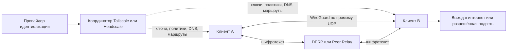

# Tailscale: технический разбор документации для xio

Дата исследования: **16 октября 2026 года**. Это исследование документации и проектные выводы, а не аудит исходного кода и не результат сетевых испытаний.

## 1. Что изучено и как проверялась полнота

Составлен объединённый каталог из официального [индекса документации](https://tailscale.com/docs/llms.txt) и [карты сайта](https://tailscale.com/sitemap.xml): **696 уникальных адресов документации**, из них 306 присутствуют в тематическом индексе. Все 696 страниц сохранены в Markdown с адресом, временем загрузки и SHA-256. Получилось 598 303 слова по простому подсчёту пробельных разделителей; это оценка объёма, а не лингвистический подсчёт.

У 143 страниц экспорт содержал `Missing snippet`: соответствующие HTML-страницы дополнительно сохранены и извлечён текст основного содержимого. Это устраняет обнаруженный класс пропусков, но не доказывает полноту интерактивных примеров, изображений, видео и внешних ссылок. Даты `Last validated` отдельных статей старше даты исследования: свежая загрузка не превращает старое описание реализации в проверку нового бинарного выпуска.

**54 страницы разобраны тематически**, ещё четыре — обзорно. Для остальных 638 создан поиск и каталог; индивидуальное подробное прочтение не заявляется. Дополнительно разобраны выбранные темы восьми официальных страниц Headscale. Следовательно, работа охватывает весь обнаруженный корпус организационно и подробно разбирает сетевое ядро, безопасность и интеграцию; утверждать, что все 696 страниц построчно проверены, было бы неверно.

Границы корпуса: публичный раздел `/docs` на дату снимка. Не включены все исторические версии, все статьи блога, issues, весь Go API и вся интерактивная спецификация REST API вне этого раздела. Публичные security bulletins нужно дополнительно сверять при закреплении конкретного выпуска.

Артефакты:

- [Карта всех страниц и статусов разбора](tailscale-research/COVERAGE.ru.md).
- [Машиночитаемый реестр](tailscale-research/manifest.json), [охват разбора](tailscale-research/review-coverage.json), [пропуски Markdown](tailscale-research/markdown-export-gaps.json).
- [Описание корпуса и локального поиска](tailscale-research/README.ru.md).
- Исходные страницы: `tailscale-research/pages/`; дополнения HTML: `rendered-supplements/`; материалы Headscale: `headscale/`.

## 2. Карта системы

Tailscale — набор механизмов защищённой сети устройств, а не один новый транспортный протокол. В нём соединены WireGuard, координация идентичностей и ключей, обнаружение путей, relay, DNS и локальное применение политик. Поддержка обычного WireGuard-конфига не обеспечивает совместимость с Tailscale. [Control/data planes](https://tailscale.com/docs/concepts/control-data-planes).

Схема объединяет роли: на практике exit node или subnet router — отдельный узел tailnet. DERP и Peer Relay показаны вместе только как альтернативные ретрансляторы, технически это разные механизмы.

**Control plane** распределяет сведения об устройствах, публичных ключах, разрешённых связях, адресах, DNS и маршрутах. **Data plane** передаёт зашифрованные пакеты между узлами; координатор не обязан находиться на пути каждого пользовательского пакета. Relay не становится точкой расшифрования WireGuard. Однако выходной узел расшифровывает туннель перед отправкой в интернет; дальнейшая конфиденциальность зависит от HTTPS и других протоколов приложения.

При недоступности координатора разрешённое общение по ранее полученному состоянию может продолжаться. Нельзя обещать автономную регистрацию, обновление политик, распространение новых ключей и обнаружение новых участников. Доступность зависит от сохранённого состояния и срока действия ключей. Для xio нужны отдельные индикаторы «координатор доступен» и «передача данных работает». [Отказ координатора](https://tailscale.com/docs/reference/coordination-server-down).

## 3. Криптография и доверие

Документация разделяет несколько криптографических контекстов: WireGuard для данных, Noise для связи с координатором, механизмы подтверждения владения ключом при соединении с DERP, DISCO для обнаружения пути и подписи Tailnet Lock. Описание криптографических деталей прямо привязано к реализации декабря 2024 года; его нельзя автоматически считать спецификацией каждого компонента выпуска октября 2026 года. [Шифрование Tailscale](https://tailscale.com/docs/concepts/tailscale-encryption).

Практические границы доверия:

- Администратор координатора управляет составом сети и политиками. Защита пользовательских данных не устраняет доверие к правильному распространению публичных ключей.
- Relay видит сетевые метаданные и объёмы, хотя не получает открытый текст внутреннего WireGuard-трафика.
- Exit node видит исходящий трафик после снятия туннельного шифрования; subnet router — трафик к своей локальной сети.
- Компрометация конечного устройства даёт доступ к его данным и секретам независимо от защищённости транспорта.

По текущей доступной статье Tailscale **не предоставляет постквантовую защиту data plane** и не использует настраиваемый пользователем WireGuard PSK. Наличие optional PSK в обычном WireGuard не означает наличие такой функции в Tailscale. Это утверждение документации, а не проверка криптографии конкретного собранного клиента. Гибридные механизмы предварительного RIVET не наследуются Tailscale-backend. [Постквантовая криптография](https://tailscale.com/docs/concepts/post-quantum-cryptography).

Для xio следует отображать свойства конкретного backend: какой протокол используется, где заканчивается шифрование и какой сервер выполняет выход. Общая надпись «всё защищено от любых современных атак» технически необоснованна.

## 4. Идентичности, регистрация и ключи

Нужно различать пользователя IdP, устройство, machine key, node key, ключ регистрации, административный API token и ключи Tailnet Lock. У них разные назначения и жизненные циклы. Node keys генерируются на устройстве; публичные части распространяются среди разрешённых участников. Теги позволяют назначать сервисную идентичность устройству вместо пользовательского владельца. [Ключи узла](https://tailscale.com/docs/concepts/node-keys), [модель идентичности](https://tailscale.com/docs/concepts/tailscale-identity).

Auth key применяется для присоединения устройства. Он бывает одноразовым или повторно используемым, может содержать теги и параметры регистрации. **Отзыв auth key не удаляет уже зарегистрированные устройства**. Аналогично, срок действия auth key не равен сроку действия node key. В интерфейсе xio необходимы отдельные действия «отозвать ключ регистрации», «отключить/удалить устройство» и «потребовать повторную аутентификацию». [Auth keys](https://tailscale.com/docs/features/access-control/auth-keys).

У tagged-устройств истечение ключей по умолчанию отключено; изменение настройки не следует считать ретроактивным для всех старых узлов. Принудительная повторная аутентификация удалённого exit node может лишить администратора единственного канала доступа. Перед обслуживанием VPS нужен проверенный независимый SSH-канал. [Key expiry](https://tailscale.com/docs/features/access-control/key-expiry).

### Защита состояния на диске

В состоянии клиента находятся секреты. На Android описано использование EncryptedSharedPreferences. Для Linux и Windows поддержка TPM 2.0 появилась с 1.86. Особенность документации: в 1.90.2–1.92.4 шифрование состояния было включено по умолчанию, а начиная с 1.92.5 на Linux/Windows оно требует явного включения. Нельзя делать универсальный вывод «все ключи Tailscale всегда аппаратно зашифрованы». Сброс TPM может потребовать повторной регистрации. [Secure node state storage](https://tailscale.com/docs/features/secure-node-state-storage).

**Вывод для xio:** отдельно хранить клиентское состояние, SSH-доступ установщика и административные credentials координатора. Секреты не должны попадать в общий экспорт профиля, диагностические журналы или QR-код с настройками, которым пользователь делится с другим человеком.

### Tailnet Lock

Tailnet Lock добавляет проверку подписей node keys доверенными подписывающими устройствами и уменьшает риск подстановки участников через координатор. Это не защита от отказа сервиса, компрометации конечных устройств и всех видов раскрытия метаданных. Нужны безопасная первоначальная инициализация и сохранение recovery/disablement secrets.

Значимые ограничения текущего описания: максимум 20 signing nodes, Android не может выполнять роль signing node, Tailnet Lock и Device Approval взаимно исключаются. Без сохранённых disablement secrets и предусмотренного восстановления можно потерять возможность восстановления сети. Постоянное состояние уменьшает зависимость от координатора при запуске. [Tailnet Lock](https://tailscale.com/docs/features/tailnet-lock).

Для xio это отдельная расширенная функция с проверкой поддержки платформы и координатора. Совместимость Tailnet Lock с выбранным выпуском Headscale в этом исследовании не подтверждена.

## 5. Установление соединений и ретрансляция

Документация описывает начальный обмен через DERP с попыткой улучшить путь до прямого UDP. Когда прямой путь невозможен, возможен Peer Relay, а затем DERP как доступный запасной путь. Выбор и повторные попытки происходят динамически: успешное соединение сегодня не означает постоянный direct. [Типы соединений](https://tailscale.com/docs/reference/connection-types), [диагностика связности](https://tailscale.com/docs/reference/device-connectivity).

| Путь | Сетевое требование | Назначение | Что проверить в xio |
|---|---|---|---|
| Direct | Доступный UDP-путь между узлами | Минимум посредников, обычно лучший throughput | NAT, IPv4/IPv6, смена сети, MTU |
| Peer Relay | Доступный UDP-порт relay-узла | Более производительный промежуточный путь | Права relay, версия, доступность UDP |
| DERP | Доступность relay по TCP/TLS | Связность при сложных ограничениях | Задержка, TCP head-of-line, пропускная способность |

Peer Relay требует клиента не ниже указанной документацией версии 1.86, доступного UDP-порта и разрешения `tailscale.com/cap/relay`. Android/iOS/TV могут пользоваться relay, но не выступают его хостом. **При полном запрете UDP Peer Relay не заменяет DERP.** [Peer Relays](https://tailscale.com/docs/features/peer-relay).

Собственный DERP не равен собственному exit node: первый передаёт шифротекст между узлами, второй выпускает расшифрованный трафик в интернет. Собственный DERP требует сертификата, доступности, контроля клиентов и обслуживания карты relay. В Tailscale у пользовательского DERP есть ограничения, включая сценарии sharing между tailnet. [DERP servers](https://tailscale.com/docs/reference/derp-servers).

Для штатной работы описаны исходящий TCP/443 для координации и relay, UDP для прямой передачи и UDP/3478 для STUN. TCP/80 используется в отдельных служебных сценариях, включая captive portal и эффективное установление защищённого control-соединения. Поэтому ни «Tailscale использует только 443», ни «порт 80 означает открытый пользовательский трафик» не являются корректным общим описанием. [Firewall ports](https://tailscale.com/docs/reference/faq/firewall-ports).

**Устойчивость к блокировкам:** переход на DERP помогает при недоступном прямом UDP, но не гарантирует обход DPI, блокировки адресов, доменов, сертификатов или разрешительных списков. TLS-соединение с известным DERP не доказывает неотличимость от обычного веб-сёрфинга. Для xio Tailscale остаётся отдельным mesh-backend; RIVET требует самостоятельного исследования транспорта и измерений.

## 6. Интернет, подсети и выбор маршрутов

### Exit node

Обычная mesh-сеть не направляет весь интернет через VPS автоматически. Нужны объявление exit node, одобрение, права использования и выбор на клиенте. Отдельно управляются доступ к локальной LAN и DNS; LAN-доступ при использовании выхода по умолчанию ограничен. Для серверного Linux нужны forwarding и корректный firewall. [Exit nodes](https://tailscale.com/docs/features/exit-nodes).

Для xio состояние «VPS зарегистрирован» следует отличать от «VPS одобрен как выход», «клиент выбрал выход» и «фактически проверены IPv4, IPv6 и DNS». При падении узла необходимы явно заданное поведение и тест отсутствия нежелательного прямого выхода. Само наличие кнопки exit node не подтверждает kill switch.

### Subnet router

Роутер объявляет конкретные CIDR, координатор разрешает их использование, политика определяет доступ, а клиент принимает маршруты. На Linux принятие subnet routes по умолчанию отличается от мобильных клиентов и Windows. SNAT обычно включён; его отключение требует обратных маршрутов в обслуживаемой сети. Шифрование Tailscale заканчивается на роутере, если целевое LAN-устройство само не участник tailnet. [Subnet routers](https://tailscale.com/docs/features/subnet-routers).

Kernel routing и userspace routing отличаются семантикой: userspace-роутер восстанавливает TCP/UDP-соединения, а поддержка ICMP ограничена; произвольные протоколы нельзя считать одинаково поддержанными. «Kernel routing» здесь не означает автоматическое использование WireGuard-модуля ядра. [Режимы маршрутизации](https://tailscale.com/docs/reference/kernel-vs-userspace-routers).

### Отказоустойчивость и доменные назначения

Выбор маршрута учитывает наиболее специфичный префикс. Отказ всех роутеров более специфичного маршрута не следует автоматически трактовать как безопасный переход на менее специфичный маршрут. Есть различные механизмы выбора избыточных роутеров; MagicRoute описан как beta. Их доступность зависит от режима и сервиса, а не только от установки двух VPS. [Route selection](https://tailscale.com/docs/features/route-selection), [MagicRoute](https://tailscale.com/docs/features/magicroute).

`via` в grants ограничивает допустимые tagged-роутеры для разрешённого доступа. Это не произвольный механизм построения криптографической цепочки переходов. App Connectors разрешают доступ по доменам, используя DNS и объявления полученных IP-маршрутов; это не просто настройка HTTP-прокси браузера. Состав дополнительных доменов SaaS и общие IP требуют проверки. [Grants via](https://tailscale.com/docs/features/access-control/grants/grants-via), [App connectors](https://tailscale.com/docs/features/app-connectors).

## 7. DNS и адресация

MagicDNS даёт имена устройствам tailnet и search domains. В официальном Tailscale это не универсальный редактор произвольной DNS-зоны. `100.100.100.100` — локальная служебная точка клиента, её не следует конфигурировать как обычный публичный рекурсивный DNS на VPS. [MagicDNS](https://tailscale.com/docs/features/magicdns).

Общий DNS, split DNS и override local DNS имеют разное поведение. Использование частного DNS требует доступного маршрута и разрешений. Порядок серверов не всегда является строгим порядком запросов: влияют клиент и ОС. Exit node меняет контекст DNS. Windows использует собственные механизмы разрешения, включая NRPT; `nslookup` не всегда отражает путь системного resolver. На Linux следует учитывать systemd-resolved и менеджер сети. [DNS in Tailscale](https://tailscale.com/docs/reference/dns-in-tailscale), [Linux DNS](https://tailscale.com/docs/reference/linux-dns).

Адреса CGNAT `100.64.0.0/10` могут конфликтовать с другой VPN или инфраструктурой провайдера. xio должен проверять конфликты, сохранять прежние параметры DNS и восстанавливать их при остановке/сбое backend. Проверка должна включать A/AAAA, split-зоны, IPv6 и запросы исключённых Android-приложений.

## 8. Grants, ACL и административные роли

Для новых конфигураций документация рекомендует grants. Они включают сетевые разрешения и application capabilities. Legacy ACL продолжают работать. Разрешения складываются: добавление узкого grant не отменяет существующее широкое разрешение ACL. Application capability передаёт приложению смысл разрешения, но само приложение должно его применять. [Grants](https://tailscale.com/docs/features/access-control/grants), [Grants vs ACLs](https://tailscale.com/docs/reference/grants-vs-acls).

Важно различать модель «разрешается только явно разрешённое» и фактическую стартовую политику с широким доступом. Нельзя обещать изоляцию только потому, что используется WireGuard. Для xio генератор политики должен явно задавать минимальные права и проверять их тестами. Ошибка редактирования не должна заменяться пустой конфигурацией с другими семантическими последствиями.

Политика включает владельцев тегов, группы, hosts, autoApprovers, network grants/ACL, SSH и тесты. `tests` и `sshTests` позволяют проверять ожидания при изменении политики; это проверки модели доступа, а не доказательство реальной сетевой доступности. Нужны и позитивные, и негативные сценарии. [Policy syntax](https://tailscale.com/docs/reference/syntax/policy-file).

Device posture позволяет учитывать свойства устройств и внешние проверки, но набор атрибутов, интеграций и тарифных возможностей различается. Политики с `srcPosture` нельзя переносить в Headscale без проверки. [Device posture](https://tailscale.com/docs/features/device-posture).

Для xio следует отдельно моделировать права администратора приложения, управления VPS, регистрации устройств, изменения маршрутов и доступа к сетевым ресурсам. Владелец тега и пользователь, которому разрешён TCP/443, выполняют разные роли.

## 9. Android, Ubuntu и Windows

| Платформа | Особенность интеграции | Следствие для xio |
|---|---|---|
| Android | Системная VPN-конфигурация; upstream требует Android 8+; полноценного CLI нет | Нативная интеграция и один согласованный владелец VpnService |
| Ubuntu/Linux | Демон, TUN, системные маршруты/DNS/firewall, повышенные привилегии | UI отделить от привилегированной службы и защищённого IPC |
| Windows | Системная служба и интерфейс управления; upstream Windows 10+/Server 2016+ | Проверить службу, права, DNS, сон/пробуждение и обновление |

Это требования описанных upstream-клиентов, а не уже утверждённые минимальные требования xio. [Android](https://tailscale.com/docs/install/android), [Linux](https://tailscale.com/docs/install/linux), [Windows](https://tailscale.com/docs/install/windows).

На Android одновременно действует одна системная VPN. Запустить самостоятельные приложения Amnezia/Tailscale/xio и рассчитывать на их автоматическое сложение нельзя. Возможны переключение backend и специально спроектированная внутренняя цепочка, но второе ещё требует реализации. На desktop остаются конфликты адресов, маршрутов, DNS и firewall. [Другие VPN](https://tailscale.com/docs/reference/faq/other-vpns).

Android split tunneling исключает выбранные приложения из VPN, включая их DNS. Это влияет на приватность и тестирование утечек. Возможности upstream-интерфейса и managed-конфигурации различаются. xio должен явно показывать исключения, а не называть их защищёнными VPN. [Android app split tunneling](https://tailscale.com/docs/features/client/android-app-split-tunneling).

На Linux отдельно проверяются iptables/nftables и совместимость с правилами хоста. Изменять firewall на VPS нужно по плану с сохранением административного доступа. [Firewall mode](https://tailscale.com/docs/features/firewall-mode).

## 10. Встраивание: tsnet, daemon и API

**tsnet** создаёт сетевой узел внутри Go-программы и предоставляет приложению Dial/Listen. Он удобен для сервисов, но не является готовой заменой системного VPN-клиента Android/Windows/Ubuntu. Userspace networking может предоставлять SOCKS/HTTP-прокси; приложения, не настроенные использовать его, не получают туннелирование автоматически. [tsnet](https://tailscale.com/docs/features/tsnet), [userspace networking](https://tailscale.com/docs/concepts/userspace-networking).

В API tsnet есть отдельные параметры состояния, имени, авторизации, эфемерности и ControlURL, методы сетевого доступа и LocalClient. Совместимость этих API должна закрепляться по версии; интерфейс библиотеки не заменяет контракт приложения с ОС. [tsnet server API](https://tailscale.com/docs/reference/tsnet-server-api).

**Предварительное решение для xio:** на desktop исследовать адаптер к отдельной службе через типизированный IPC/LocalAPI; на Android — нативный backend под единым VpnService. tsnet рассматривать для отдельных сервисов и тестовых агентов. Это проектный вывод, а не уже реализованная интеграция.

REST API управляет ресурсами tailnet и не заменяет локальное управление передачей пакетов. Auth key, API access token и OAuth client secret не взаимозаменяемы. OAuth clients служат сервисным сценариям; trust credentials поддерживают scopes и федерацию workload identity, позволяющую избежать постоянного секрета там, где есть подходящий OIDC-источник. [API](https://tailscale.com/docs/reference/tailscale-api), [OAuth clients](https://tailscale.com/docs/features/oauth-clients), [trust credentials](https://tailscale.com/docs/reference/trust-credentials).

OAuth apps и пользовательское device provisioning описаны как **alpha** и ограничены одной tailnet: app и авторизующий пользователь должны принадлежать ей. Это не готовый универсальный вход для любых клиентов публичного xio. Показанный поток использует client secret, который нельзя просто вшить в распространяемый APK/EXE. [OAuth apps](https://tailscale.com/docs/features/oauth-apps), [device provisioning](https://tailscale.com/docs/features/oauth-apps/device-provisioning).

## 11. Дополнительные функции и границы продукта

| Функция | Что даёт | Ограничение для планирования xio |
|---|---|---|
| Tailscale SSH | SSH с идентичностью tailnet и отдельными SSH-правилами | Серверная роль Linux/поддерживаемый macOS CLI, порт 22; не универсальный SSH-сервер Windows |
| Serve | Публикация сервиса внутри tailnet | Не считать автоматически общедоступной публикацией |
| Funnel | Публикация сервиса в публичный интернет | Отдельная публичная экспозиция, beta, ограничения портов и имени |
| Taildrop | Передача файлов между собственными устройствами | Alpha; tagged-узлы и произвольные другие пользователи не равны этому сценарию |
| Taildrive | Сетевой доступ к файлам через WebDAV | Alpha; роли клиента/сервера зависят от ОС и прав |

Tailscale SSH не меняет автоматически обычный внешний sshd и его `authorized_keys`, однако его собственная модель полномочий отличается от SSH-ключей локальных OS-пользователей. На многопользовательском клиенте это требует отдельной оценки. [SSH](https://tailscale.com/docs/features/tailscale-ssh).

Serve передаёт identity headers: backend должен быть защищён от обхода прокси и подделки таких заголовков. Serve и Funnel на одном порту могут менять режим публикации последней командой; интерфейс должен явно показывать переход к публичному доступу. [Serve](https://tailscale.com/docs/features/tailscale-serve), [Funnel](https://tailscale.com/docs/features/tailscale-funnel).

Передача файлов и сетевые диски — самостоятельные потоки разрешений и данных, не свойства шифра WireGuard. Их стоит включать в xio отдельными модулями после базовой сети. [Taildrop](https://tailscale.com/docs/features/taildrop), [Taildrive](https://tailscale.com/docs/features/taildrive).

Весь корпус шире VPN: 47 страниц Kubernetes Operator, 44 — Privileged Access Management, 84 — Aperture, 69 — интеграции. Kubernetes Operator управляет ingress/egress, коннекторами и доступом к Kubernetes API. PAM — отдельный продукт привилегированного доступа. Aperture — AI gateway с идентификацией, маршрутизацией запросов и телеметрией; его обработка содержимого запросов имеет собственные границы приватности. Эти направления изучены обзорно и не становятся автоматически требованиями xio. [Operator](https://tailscale.com/docs/kubernetes-operator), [PAM](https://tailscale.com/docs/privileged-access-management), [Aperture architecture](https://tailscale.com/docs/aperture/how-aperture-works).

## 12. Логи, наблюдаемость и обновления

Нельзя маркировать интеграцию «без логов» на основании одного только WireGuard. Документация описывает отправку клиентских диагностических логов, отдельные audit logs, network flow logs и session recordings. У них разные данные, настройки, доступность и сроки хранения. Opt-out клиентских логов существует, но требует платформенной проверки. [Logging](https://tailscale.com/docs/features/logging).

Для диагностики полезны `status --json`, `netcheck`, `ping`, метрики и bugreport. Android нельзя считать средой с полным upstream CLI. Отчёт об ошибке потенциально содержит чувствительные идентификаторы и сетевые сведения: xio должен показывать состав экспорта и не отправлять его автоматически третьим лицам. [CLI](https://tailscale.com/docs/reference/tailscale-cli), [client metrics](https://tailscale.com/docs/reference/tailscale-client-metrics).

Локальный API и сокет демона являются границей привилегий. Метрики и административный интерфейс нельзя публиковать в интернет по умолчанию. Обновление демона может прервать встроенные SSH-сессии. Путь обновления зависит от ОС и механизма установки; канал и версия должны фиксироваться вместе. [tailscaled](https://tailscale.com/docs/reference/tailscaled), [updates](https://tailscale.com/docs/features/client/update), [client versions](https://tailscale.com/docs/reference/tailscale-client-versions).

Открыты ядро клиента/CLI и DERP, Linux/Android-клиенты; официальный Windows GUI не следует считать готовым открытым интерфейсом для копирования. Облачный coordination server закрыт. Перед включением компонентов в дистрибутив xio нужен разбор лицензий конкретных репозиториев и зависимостей. [Open source at Tailscale](https://tailscale.com/opensource). Перед выпуском также проверять [security bulletins](https://tailscale.com/security-bulletins) и advisories выбранных версий; эта работа не заменяет такую проверку.

## 13. Headscale: самостоятельный координатор

Headscale — независимая реализация control plane. Он не превращает один VPS в полную копию всех облачных продуктов Tailscale. Актуальная feature matrix уже включает **Grants и Peer Relays**: считать его системой только со старыми ACL было бы устаревшим предположением. [Headscale features](https://headscale.net/stable/about/features/).

| Возможность | Что подтверждает текущая документация Headscale | Как трактовать в xio |
|---|---|---|
| Регистрация, preauth, теги, базовый OIDC | Заявлены | Проверить выбранную комбинацию версий |
| Subnet/exit routes, autoApprovers, dual stack | Заявлены | Отдельно проверять forwarding, approval и клиент |
| MagicDNS, global/restricted DNS, extra records | Заявлены | Собственная конфигурация DNS Headscale |
| Embedded DERP, Peer Relays | Заявлены | Это разные сервисы и сетевые требования |
| ACL, Grants, via, tests, sshTests | Заявлены с ограничениями | Проверять политику валидатором Headscale |
| Device posture/srcPosture, ipsets | Указаны как неподдерживаемые | Не переносить такие политики без изменения |
| Serve, Funnel, Network flow logs | Не отмечены как поддерживаемые в matrix | Не обещать паритет; локальная команда клиента сама по себе его не доказывает |
| Tailnet Lock, OAuth apps, прочие cloud-функции | Здесь совместимость не установлена | Отдельное исследование и стенд |

Критичная семантика Headscale: без загруженной политики и с `{}` описан разрешающий доступ; явная политика `{"grants":[]}` задаёт запрет сетевого доступа. Это не production-конфигурация: до применения требуются разрешения администрирования и тесты. Отдельные autogroups и атрибуты поддерживаются частично. [Policy](https://headscale.net/stable/ref/policy/).

Для VPS рекомендованы публичный адрес, HTTPS/443, отдельный системный пользователь и современная Linux/BSD. Для embedded DERP нужен также STUN/UDP3478. Metrics/debug9090 не следует открывать публично; gRPC50443 нужен только при выбранном способе remote control. [Requirements](https://headscale.net/stable/setup/requirements/).

Embedded DERP по умолчанию выключен. При включении он добавляется к карте доступных DERP; это **не означает автоматическое исключение публичных relay Tailscale**. Для полностью собственного набора нужно явно изменить DERP map. Один собственный DERP — единая точка отказа. Документация также предусматривает проверку клиентов relay; внешний `derper` требует отдельной настройки интеграции. [DERP](https://headscale.net/stable/ref/derp/).

Headscale поддерживает маршруты с объявлением и одобрением, дополнительные DNS A/AAAA и собственный административный REST/gRPC API. Это не API облачного Tailscale: xio нужны два адаптера управления. REST-схему следует получать с `/swagger` установленного экземпляра и сверять с его версией. [Routes](https://headscale.net/stable/ref/routes/), [DNS](https://headscale.net/stable/ref/dns/), [API](https://headscale.net/stable/ref/api/).

## 14. Предлагаемые изменения архитектуры xio

Это проектные выводы из документации; код не реализован.

1. **Разделить сетевой backend и coordinator adapter.** Backend Tailscale обслуживает устройство и соединения; адаптеры Tailscale Cloud/Headscale управляют разными серверными API. RIVET и семейства Amnezia остаются самостоятельными backend.
2. **Ввести проверяемые capabilities.** Например: `mesh`, `exitNode`, `subnetRoutes`, `peerRelayClient`, `peerRelayHost`, `tailnetLockSigning`, `grants`, `devicePosture`, `publicPublishing`. Значение определяется ОС, клиентом, координатором и конфигурацией, а не одной галочкой «Tailscale».
3. **Развести роли VPS.** Координатор, DERP, exit node и subnet router имеют отдельные состояния, ключи, порты, health checks и процедуры обновления. На лабораторном VPS их можно совместить, но отказ будет общим.
4. **Сделать сетевые переходы транзакционными.** До смены backend сохранять маршруты/DNS, останавливать старого владельца VPN, применять новый набор и проверять интернет/имена. Отдельно задать fail-closed/fail-open режим, не делать незаметного прямого выхода.
5. **Не распространять административные секреты с профилем.** Клиентское приглашение не должно давать доступ к установщику VPS и всей tailnet.
6. **Показать реальные состояния.** «Авторизован», «координатор недоступен», «соединение DERP», «выход выбран», «проверка IPv6 не пройдена» полезнее одного зелёного значка VPN.
7. **Закреплять версии и происхождение.** Тег, SHA, хеш артефакта, лицензия, конфигурация, канал обновления, версия Headscale и проверенная матрица возможностей.

## 15. План проверок до заявления о готовности

| Сценарий | Наблюдаемый результат |
|---|---|
| Новая регистрация и отзыв auth key | Новая регистрация запрещена; прежние узлы проверены отдельно |
| Удаление узла и ротация node key | Проверено прекращение/обновление доступа по реальной сети |
| Direct → relay → direct | Видны фактический путь, время переключения и потери |
| Полный запрет UDP | Peer Relay не заявлен как рабочий; проверен DERP/TCP |
| Свой DERP без публичной карты | Нет непредусмотренных relay-подключений; известен сценарий его отказа |
| Падение координатора | Различены работа существующих связей, перезапуск и новая регистрация |
| Exit node IPv4/IPv6 | Проверены внешний IP, DNS и поведение при падении выхода |
| Subnet routes | Проверены одобрение, права, обратный маршрут и конфликт CIDR |
| Смена Wi-Fi/мобильной сети и сна | Проверены восстановление туннеля и DNS на каждой ОС |
| Android app exclusions | Исключённые приложения и их DNS ведут себя согласно интерфейсу |
| Политика доступа | Положительные/отрицательные тесты модели и реальные запрещённые соединения |
| Неудачная установка/обновление VPS | Сохранён SSH, доступны журнал шагов и восстановление |
| Headscale/cloud | Одинаковые тесты выполнены отдельно; расхождения зафиксированы |

В этом исследовании **не запускались** Tailscale/Headscale-клиенты, не создавалась tailnet, не менялись маршруты/firewall и не выполнялась установка на VPS. Ни производительность, ни обход блокировок в конкретных странах, ни работа на физическом Android этим отчётом не подтверждены.

## 16. Что осталось изучить отдельно

- Исходники закреплённых версий Tailscale, Android embedding и безопасный контракт IPC для desktop.
- Конкретные API endpoints/scopes и OpenAPI обоих координаторов под сценарии установщика xio.
- Реальная совместимость Tailnet Lock и дополнительных функций с выбранным Headscale.
- Детальные конфигурации всех IdP/MDM, Kubernetes, PAM, Aperture и провайдерских интеграций, если они войдут в продукт. Сейчас соответствующие страницы доступны в индексе, но полный аудит каждого сценария не заявляется.
- Проверка security advisories, лицензий и сборочной цепочки непосредственно перед фиксацией зависимостей.
- Лабораторные, VPS и физические Android/Windows/Ubuntu испытания по матрице выше.

Связанные материалы: [требования xio](xio/PRODUCT-BRIEF.ru.md), [исследование Amnezia](AMNEZIA-TECHNICAL-REVIEW.ru.md), [предварительная архитектура RIVET](RIVET-1-ARCHITECTURE.ru.md).
